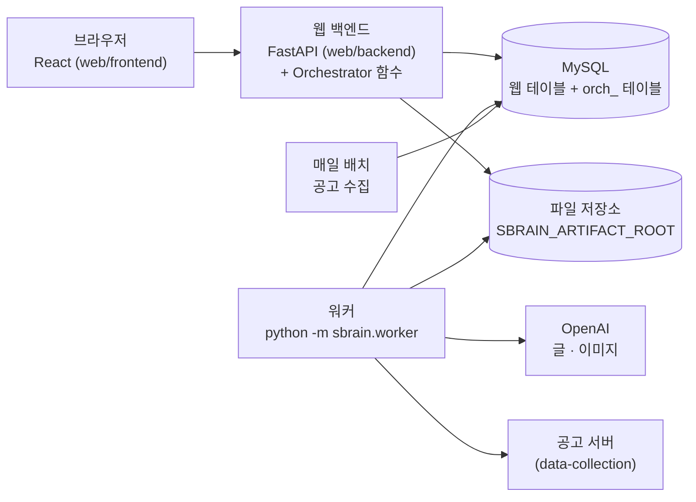

# S-Brain

정부지원사업 사업계획서 · 프로토타입 동시 생성 AI 서비스

> SK 네트웍스 Family AI 32기 1팀 · [SKNETWORKS-FAMILY-AICAMP/SKN32-FINAL-1TEAM](https://github.com/SKNETWORKS-FAMILY-AICAMP/SKN32-FINAL-1TEAM)
> 중간발표 2026-09-15 · 최종발표 2026-10-26

## 한 줄 정의

창업 아이템을 입력하면 지금 열려 있는 정부지원사업 공고 중 맞는 것을 찾아, 그 공고 기준으로 사업계획서를 쓰고, 심사에서 가장 약한 칸인 "준비 정도"를 실제 프로토타입으로 채워준다.

사용자가 상대하는 것은 조율 Agent 하나뿐이지만, 뒤에서는 역할이 나뉜 실행 Agent 5개가 순서대로 협업한다(조율 포함 총 6개). 파이프라인은 끝까지 자동으로 돌지 않는다 — 계획서를 만든 뒤와 프로토타입을 만든 뒤, 종합 평가 뒤에 멈추고 사용자의 판단을 받는다. 최종 산출물은 문서 한 부가 아니라 **사업계획서 + 프로토타입 + 두 산출물을 대조한 검증 결과**, 세 겹의 묶음이다.

## 왜 만드는가

창업지원사업 · R&D 신청 과정에서 신청자가 반복적으로 막히는 지점에서 출발했다.

| 문제 | 현재 상황 | S-Brain의 대응 |
|---|---|---|
| 공고 탐색 비용 | 수만 건 중 유효 공고 선별에 장시간 소요 | 정형 필터 + 하이브리드 검색(임베딩 · BM25)으로 후보 공고를 순위대로 제시 |
| 자격 판정 부재 | 작성 후에야 신청 불가를 인지 | 작성 전 자격요건 게이트로 통과 · 불통과 판정 |
| 준비 정도 공란 | "개발 예정" 서술로 실현가능성 점수 손실 | 동작하는 프로토타입을 증빙으로 생성 |
| 자기 검증 불가 | 작성자가 자기 문서의 약점을 못 봄 | 계획서와 프로토타입을 각각 채점하고 대조해 미달 지적 |

가장 유사한 경쟁 서비스는 [플랜스코어](https://www.planscore.kr/)다. 공고 매칭과 계획서 평가는 이미 상품화되어 있으므로 그 두 가지로는 경쟁하지 않는다. S-Brain만 제공하는 것은 세 가지다.

- 계획서의 "준비 정도"를 실제 동작하는 프로토타입으로 채운다 — 다른 서비스는 "프로토타입을 개발할 계획"이라는 문장까지만 만든다.
- 계획서에 쓴 기능이 프로토타입에 실제로 있는지 대조해 지적한다 (`계획서의 '결제' 기능이 프로토타입에 없습니다` 같은 지적은 계획서 한 부만으로는 나올 수 없는 판정이다).
- 작성에 들어가기 전에 자격요건을 게이트로 걸러, 계획서를 다 쓴 뒤 신청 불가를 확인하는 낭비를 막는다.

## 산출물

| 구분 | 내용 |
|---|---|
| 사업계획서 | 신청자 유형(예비창업 · 초기창업)별 표준 양식 항목 본문 + 표와 그래프. 워드(.docx) · 한글(.hwp)로 내려받기 |
| 프로토타입 | 웹개발 · AI API: HTML 실행 파일 + 인포그래픽 / 원페이지: SVG 원페이지. 실행 안내 문서가 함께 붙는다 |
| 검증 결과 | 2층(문서층 · 산출물층) 항목별 점검 결과와 점수, 미달 항목 목록 |

공고 매칭은 산출물이 아니라 이 과정에서 함께 제공되는 결과다. 세 산출물 모두 AI 생성 고지가 붙는다 — 검증 점수도 서비스 내부 기준값일 뿐 실제 심사 점수가 아님을 명시한다.

## 서비스 흐름

```
로그인 → 사전 정보 입력 → 공고 후보 중 선택(추가 조회 1회) → 자격요건 게이트
   → 사업계획서 작성 → 문서 평가(100점 환산) ── 미달 시 재작성
   → 프로토타입 제작 → 산출물 확인 ──────────── 미달 시 재작성
   → 종합 평가(문서층 + 산출물층, 100점) ─ 미달 시 계획서 / 프로토타입 중 다시 만들 항목 선택
   → 결과물 내려받기
```

설계 원칙은 진입 순서다: **아이템을 말한다 → 맞는 공고를 찾아준다 → 그 공고 기준으로 만든다.** 반대 순서(공고를 먼저 고르고 아이템을 맞추는 것)는 금지한다. 입력은 대화형이 아니라 폼으로 한 번에 받아, 실행 중 되묻기가 없도록 한다. 동시 실행은 계정당 1건으로 제한하며, 진행 중인 작업은 중단 지점부터 이어할 수 있다. 종합 평가에서 '진행'을 누르면 되돌릴 수 없다.

## 시스템 구성

### Agent 6개

| Agent | 담당 업무 | Task |
|---|---|---|
| 조율 | 요구사항 해석, 공고 매칭, 작업 분해, 결과 통합 (+ 자격요건 게이트 · 판정 · 합치기 규칙 단계) | T-C1 · T-C2 · T-C3 · T-C4 |
| 전략 | 요구사항 분석, 목표 시장 분석 | T-S1 · T-S2 |
| 작성 | 사업계획서 본문 · 그래프 · 표 작성 | T-W1 · T-W2 · T-W3 |
| 구현 | 프로토타입 제작 — HTML 실행 파일, 인포그래픽 | T-B1 · T-B2 |
| 검증-1 (문서) | 문서층 검증 — 평가항목 기준 LLM 판정 | T-V1 |
| 검증-2 (산출물) | 산출물층 검증 — 규칙 기반 코드 점검 + 계획서 대조 | T-V2 |

실행 순서는 `조율(해석 · 공고 매칭) → 자격요건 게이트 → 조율(작업 분해) → 전략 → 작성 → 검증-1 → (사용자 판단) → 구현 → 실행 안내 문서 → 검증-2 → (사용자 판단) → 조율(결과 통합)`으로 고정된다. 검증을 두 Agent로 나눈 이유는 판정 방식이 다르기 때문이다 — 검증-1은 LLM 판단, 검증-2는 규칙 기반 계산과 대조. 원페이지 카테고리는 HTML 실행 파일(T-B1)을 만들지 않는다.

아이템 카테고리(원페이지 / 웹개발 / AI API)는 조율이 판정하는 내부 값이며, 사용자에게 선택 UI로 노출하지 않는다. 단계별 입력 · 출력과 전체 흐름도는 [`agent-orchestration/README.md`](agent-orchestration/README.md) 5절에 있다.

### 2층 검증 구조

| 층 | 검증 대상 | 방식 | 배점 |
|---|---|---|---|
| 문서층 | 사업계획서가 평가항목을 충족하는가 | LLM 판정 (검증-1) | 70 |
| 산출물층 | 프로토타입이 기준을 지키고, 계획서에 쓴 기능이 실제로 있는가 | 코드 점검 15 + 계획서 대조 15 (검증-2) | 30 |

문서 평가 시점(산출물층이 아직 없을 때)은 70점을 100점으로 환산해 표시하고, 종합 평가 시점은 100점 그대로 표시한다. 두 시점 모두 Threshold는 80점(관리자 설정값)이다.

- **코드 점검 15점**은 LLM 없이 규칙만으로 매긴다. 카테고리별 8항목 체크리스트가 다르다(HTML 실행 파일은 KWCAG 2.2 접근성 근거, SVG 원페이지는 지면 정보 파싱 근거).
- **계획서 대조 15점**은 계획서의 기능을 요소로 나눠, LLM은 요소마다 "화면에 있는가"만 판정하고(세 번 물어 다수결) 점수는 코드가 계산한다. 구현 쪽이 "만들었다"고 신고한 값은 근거로 쓰지 않는다.
- 판정(합격선을 넘었는가)과 점검(무엇이 부족한가)은 화면에서 분리해서 보여준다.

Task 결과가 자체 검사에 걸리면 문제 내용을 실어 최대 2회 자동 재수행하고, 검증-1이 fail로 판정한 항목은 한 번 자동으로 다시 쓴다. 그 밖의 재작성은 사용자가 화면에서 묶음을 골라 요청할 때만 실행하며, 고른 항목만 다시 만든다(전체 파이프라인을 다시 돌리지 않는다). 이전 결과는 버전으로 보존해 점수 변화 이력을 남긴다.

### LLM 호출 vs 직접 구현

배점의 70%가 LLM 판정이므로, "무엇을 직접 만들었는가"는 배점이 아니라 파이프라인에서 답한다. 다음은 LLM 호출이 아니라 직접 구현한 로직이다.

- 공고 데이터 일일 수집 배치와 지원대상 정형화 파싱
- 자격요건 게이트 — 구조화 필드 비교로 통과 · 불통과 판정
- 정형 필터 우선 적용 후 하이브리드 검색으로 순위를 매기는 매칭
- 산출물층 코드 점검 8항목과 계획서 대조 점수 계산
- 인포그래픽 지면 조립 — 글자는 모두 코드가 쓰고, 이미지 모델에는 아이콘 그림만 맡긴다
- 실행 순서 · 대기 지점 · 재시도 · 재수행 · 재개를 제어하는 Orchestrator, 고정 작업 목록과 실행 시점 지시문 생성

### 사용 모델

모두 조율의 호출 통로(OpenAI)를 거친다. Task별 설정은 `agent-orchestration/sbrain/orchestrator/settings.py`에 있다.

| 쓰는 곳 | 모델 |
|---|---|
| 조율 · 구현(HTML · 인포그래픽 글) · 검증-2 | `gpt-6-luna` |
| 전략 · 작성 · 검증-1 | 함수별로 `gpt-5.6-terra` · `gpt-5.6-sol` · `gpt-6.1-sol` · `gpt-6-luna` |
| 인포그래픽 아이콘 그림 | `gpt-image-2.5-flare` |
| 공고 요약 임베딩 | BGE-M3 |

### 실행 구성



- 웹 백엔드는 Orchestrator(`agent-orchestration`의 `sbrain` 패키지)를 같은 프로세스에서 불러, 시작 요청 · 사용자 명령을 DB에 넣고 진행 상태 · 결과를 읽는다.
- Agent를 실제로 실행하는 것은 별도 프로세스인 **워커**다. 워커가 DB에서 일을 가져가 단계를 진행하고, 웹과 같은 DB · 같은 파일 저장소를 본다. 웹만 띄우면 시작 요청이 쌓이기만 한다.
- 공고 매칭 · 자격 판정은 워커가 공고 서버(HTTP)를 부른다. 공고 서버 주소(`SBRAIN_NOTICE_API_URL`)가 없으면 스텁 공고로 돈다.

## 저장소 구조

| 폴더 | 내용 | 안내 |
|---|---|---|
| `agent-orchestration/` | Orchestrator(실행 뼈대) · 조율 Agent · 담당자 Agent 코드를 옮겨 붙인 실행본 · 워커 | [README](agent-orchestration/README.md) |
| `web/backend/` | FastAPI 백엔드 — 인증 · 프로젝트 · 화면 API · 계획서 파일 생성 · 관리자 | [README](web/backend/README.md) |
| `web/frontend/` | React 화면 — 랜딩 · 워크스페이스 · 단계별 화면 · 마이페이지 · 관리자 | [README](web/frontend/README.md) |
| `data-collection/` | 공고 수집 배치 · 공고 서버(매칭 · 자격 판정) · 평가 | [README](data-collection/README.md) |
| `agent-orchestration/sbrain/agents/partner_bv/engineering_agent/` | 구현 Agent(T-B1 HTML 실행 파일 · T-B2 인포그래픽) | [README](agent-orchestration/sbrain/agents/partner_bv/engineering_agent/README.md) |
| `agent-orchestration/sbrain/agents/partner_bv/verification_agent/` | 검증-2(T-V2 산출물층 30점 채점) | [README](agent-orchestration/sbrain/agents/partner_bv/verification_agent/README.md) |
| `docs/` | 팀 공용 문서 | [브랜치 · PR 규칙](docs/git-strategy.md) |

비밀값은 각 폴더의 `.env`에 두고 저장소에 올리지 않는다(`.env.example` 참고). PR을 올리면 CI가 PR 제목의 이슈 키(`[SB-번호]`)와 웹 백엔드 · 프론트를 확인한다.

## 로컬에서 전체 띄우기

순서만 적는다. 명령과 환경 변수는 링크한 README에 있다.

1. **MySQL 준비** — 같은 DB에 웹 스키마(`web/backend/app_schema.sql` + `migrations/`)와 Orchestrator 스키마(`agent-orchestration/sql/orchestrator_schema.sql`)를 넣는다. → [web/backend README](web/backend/README.md) 1-1
2. **웹 백엔드** — 가상환경에 `web/backend/requirements.txt`와 `pip install -e agent-orchestration`(sbrain)을 설치하고, `.env`(MySQL · 구글 로그인 · `SBRAIN_ARTIFACT_ROOT` 등)를 채운 뒤 `uvicorn app.main:app --port 8000`. → [web/backend README](web/backend/README.md)
3. **워커** — 같은 가상환경 · 같은 DB · 같은 `SBRAIN_ARTIFACT_ROOT`에 `OPENAI_API_KEY`를 더해 `python -m sbrain.worker`. → [agent-orchestration README](agent-orchestration/README.md) 3절
4. **프론트** — `web/frontend`에서 `npm ci` → `npm run dev`, 브라우저는 `http://localhost:5174`(`127.0.0.1`이면 구글 로그인이 막힌다). → [web/frontend README](web/frontend/README.md)
5. **공고 서버(선택)** — 실제 공고로 매칭하려면 워커에 `SBRAIN_NOTICE_API_URL`을 넣는다. 없으면 스텁 공고(`공고 A01` 같은 제목)로 돈다. → [data-collection README](data-collection/README.md)

Agent를 실제로 부르지 않고 화면 흐름만 보려면 2번 뒤에 워커 대신 `web/backend/scripts/stub_worker.py`를 띄운다(`web/backend/testing_guide.md`). MySQL 없이 화면만 확인할 때는 백엔드를 `DB_BACKEND=sqlite`로 띄운다(더미 데이터).

## 데이터 수집

| 구분 | K-Startup | 기업마당 |
|---|---|---|
| 제공기관 | 창업진흥원 | 중소벤처기업부 |
| 범위 | 창업지원사업 전용 | 중소기업 지원 전반 (8개 분야) |
| 활용 범위 | 전량 | 기술 분야(코드 02), 창업 분야(코드 06) |

하루 한 번 배치로 수집하며 사용자 요청 시점에 API를 직접 호출하지 않는다(API 장애 시에도 전일 데이터로 정상 동작). 모집 진행 중인 공고만 남기고, 내용이 바뀐 공고만 요약 임베딩을 새로 만들어 저장한다. 대형 국가 R&D(IRIS · NTIS 소관)는 공개 API로 접수기간 · 지원대상 · 지원규모를 확보할 수 없어 수집 범위에서 제외한다.

## 데이터 · 산출물 정책

- 실행 로그는 12개월 보관 후 계정 식별자를 분리해 통계로만 남긴다(품질 기준 조정 근거 확보 목적).
- 산출물 파일(HTML · SVG · 그림 · 계획서 파일)은 DB가 아니라 파일 저장소에 두고, DB에는 파일 참조만 남긴다. 완전 삭제 · 탈퇴 · 12개월 정리 때 파일도 함께 지운다.
- 가입 시 필수 동의(이용약관 · 개인정보 수집 · 이용, 만 16세 이상)를 받고, 알림 수신은 선택 동의로 언제든 끌 수 있다.
- 산출물마다 AI 초안 생성 사실과 검토 필요를 표기하고, 검증 점수가 서비스 내부 기준값이며 실제 심사 결과가 아님을 명시한다.

## 기술 스택

| 구분 | 스택 |
|---|---|
| 백엔드 | FastAPI, Pydantic, SQLAlchemy 2.x, PyMySQL, python-docx(계획서 워드 파일) |
| Orchestrator | Python, Pydantic, SQLAlchemy · PyMySQL(공유 MySQL), OpenAI SDK |
| 프론트엔드 | Vite, React 18, Zustand, Tailwind CSS |
| 인증 | Google Identity Services(프론트 토큰 발급) + google-auth(백엔드 토큰 검증) |
| 데이터베이스 | MySQL (팀 공용) |
| 배포 | AWS |

DB 스키마는 `SK 네트웍스 Family AI 32기 1팀 데이터베이스_저장소 설계 문서`를 기준으로 하고, 웹 스키마는 `web/backend/app_schema.sql`, Orchestrator 테이블은 `agent-orchestration/sql/orchestrator_schema.sql`에 있다.

## 팀 구성

| 이름 | 역할 | GitHub |
| --- | --- | --- |
| 신누리 | Team Lead · Agent Orchestration | [@4nchez](https://github.com/4nchez) |
| 박상희 | Business Plan Generation | [@StandOut-0](https://github.com/StandOut-0) |
| 이근준 | Data & Matching | [@geunlee00](https://github.com/geunlee00) |
| 정재희 | Prototype & Web | [@jjh430](https://github.com/jjh430) |
| 하정원 | Agent Orchestration · Web | [@Hajungwon01](https://github.com/Hajungwon01) |

### 역할 및 책임 (R&R)

| 파트 | 담당자 | 담당 업무 |
|---|---|---|
| 공고 데이터 | 이근준 | API 연동, 일 1회 배치 수집, 지원대상 정형화 파싱, 공고 요약 임베딩 생성, 수집 상태 모니터링 |
| 매칭 · 자격 판정 | 이근준 | 정형 필터 로직, 하이브리드 검색 순위 산정, 자격요건 게이트 규칙 구현, 공고 서버 |
| Agent 오케스트레이션 | 신누리, 하정원 | 조율 Agent 설계, 작업 분해 로직, Task 정의, 실행 순서 · 의존성 제어, 재수행 · 재시도 흐름 |
| 계획서 생성 | 박상희 | 전략 · 작성 Agent 프롬프트 설계, 표준 양식 항목 매핑, 표 · 그래프 생성 |
| 프로토타입 생성 | 정재희 | 구현 Agent 프롬프트 설계, 산출 형태 고정, HTML / 인포그래픽 산출 체인 구성 |
| 검증 로직 | 박상희, 정재희 | 검증-1 rubric 설계와 재현성 장치, 검증-2 코드 점검 8항목 · 계획서 대조 구현, 점수 산정과 재수행 판정 |
| 프론트엔드 | 정재희, 하정원 | 전체 화면 흐름, 진행률 표시, 결과물 화면, 관리자 화면 |
| 인프라 · 배포 | 신누리, 이근준 | 개발 / 운영 환경 구성, DB 구축, 배포 |

## 일정

| 시점 | 목표 | 주요 산출물 |
|---|---|---|
| ~ 9/15 | 중간발표 | 정적 HTML 목업 전체 흐름, 작업 분해 · Agent 협업 시연, 기본 흐름 데모 |
| 중간발표 이후 | 실 구현 | 실제 API 연동, Agent 파이프라인 구현, 2층 검증 로직 구현, 웹 연동 |
| 최종발표(10/26) 전날 | 배포 완료 | 정상 구동 확인, 문서 제출 완료 |

## 이번 범위에서 제외

- 결제 · 유료 구독, 메일 / 알림톡 발송 (일정 초과 — 알림톡은 사업자등록 요건도 있음)
- 고객사 관리자와 조직 분리 (데이터 모델 전면 수정 필요)
- 대형 국가 R&D(IRIS · NTIS) 연동 (데이터 확보 불가)
- 첨부 문서에서 정보 추출, 멀티모달, 채팅 기반 정보 입력 / 실행 중 되묻기 (입력 폼 방식으로 대체)
- 한 계정의 여러 공고 동시 실행 (이어하기 대상이 모호해짐)

## 참고 출처

- 중소벤처기업부, 2026년 중앙부처 및 지자체 창업지원사업 통합공고
- [2026년 창업지원사업 통합공고 분야별 예산 (벤처스퀘어)](https://www.venturesquare.net/1020914/)
- [K-Startup 지원사업 공고정보 오픈API](https://www.data.go.kr/data/15125364/openapi.do)
- [기업마당 지원사업정보 API](https://www.bizinfo.go.kr/apiDetail.do?id=bizinfoApi)
- [과학기술정보통신부 사업공고 API](https://www.data.go.kr/data/15074634/openapi.do)
- [NTIS Open API](https://www.ntis.go.kr/rndopen/api/mng/apiMain.do)
- [범부처통합연구지원시스템(IRIS)](https://iris.go.kr/)
- [플랜스코어](https://www.planscore.kr/)
- [예비창업패키지 사업계획서 작성 가이드](https://blog.wishket.com/reserve-startups-package-business-plan-list-guide/)
- [한국형 웹 콘텐츠 접근성 지침(KWCAG) 2.2](https://a11ykr.github.io/kwcag22/)

---