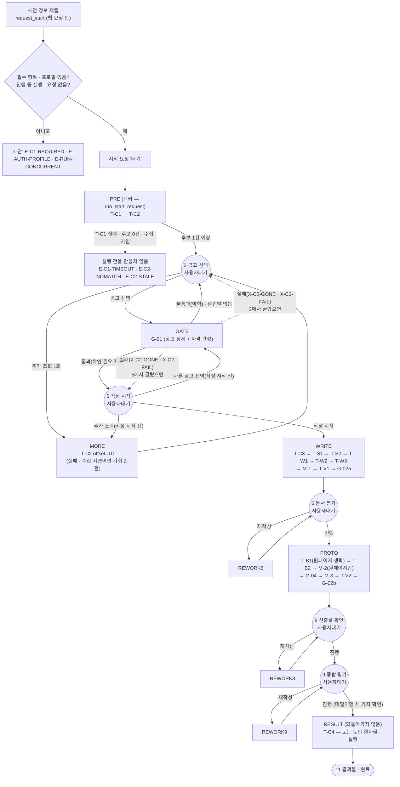
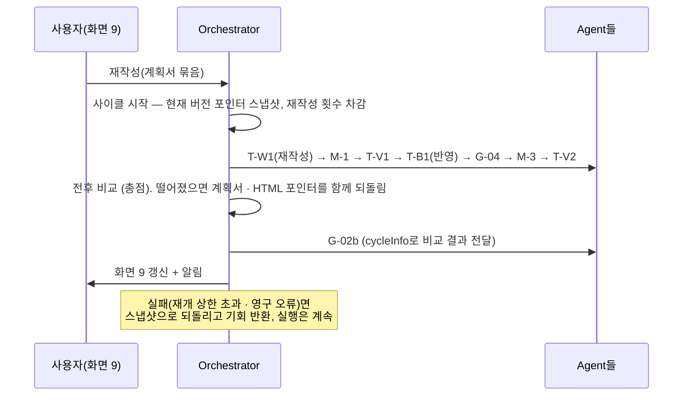

# Orchestrator 구조와 흐름

| 항목 | 내용 |
|---|---|
| 작성일 | 2026-09-26 (2026-10-01 갱신: MySQL 저장소 · 워커 · 웹 연동 함수 · 토큰 기록. 2026-10-02 갱신: 웹 `projects` 쓰기 제거 · 재작성 묶음 요청과 모으기 · T-P2 시도 기록과 `proofread_logs` · 웹 조회 함수 — 바뀐 곳은 4 · 8.1 · 10 · 11 · 12절. 2026-10-03 갱신: 공고 서버 연결(T-C2 · G-01) — 바뀐 곳은 2 · 3 · 5 · 11 · 12절. 2026-10-04 갱신: 조율 T-C3 작업 분해 · 지시문 다시 쓰기 — 바뀐 곳은 2 · 11절. 2026-10-05 갱신: 시각 UTC · 실행 로그 12개월 처리 · 탈퇴 함수 · 시작 요청 입력 사본 비우기 — 바뀐 곳은 2 · 8 · 10 · 11 · 12절. **2026-10-06 갱신: Task별 호출 설정 · 이미지 호출 · 산출물층 검증 반영(원페이지 계획서 반영 · G-04 자체 검사 · 대조 보류 · 부분 인정) · 워커 운영 로그 파일 — 바뀐 곳은 2 · 4 · 5 · 8.2 · 9 · 11절**. 2026-10-08 갱신: 기준 문서 v1.10 반영(표시 정리 · 새 판에서 빠졌지만 남긴 필드) · 웹 함수 `missing_projects` — 바뀐 곳은 10 · 11 · 12절. 2026-10-08 갱신(2): 산출물 파일 참조형(파일 창구 · 파일 저장소 · 출력 참조 확인 · 파일 삭제 대기열 · 파일 읽기 · 관리자 함수 · `SBRAIN_ARTIFACT_ROOT`) — 바뀐 곳은 2 · 7 · 8 · 9 · 10 · 11절(11.10 새로). 2026-10-10 갱신: 전략 · 작성 · 검증-1 실구현(담당자 코드 · 함수별 모델 · 계획서 항목 구조 · 검증-1 fail 재수행 · 태그 묶음 재작성 · 사업비 · 일정 입력)의 잠정 · 확장 — 바뀐 곳은 11절(11.11 새로, 11.1 · 11.4 · 11.9의 바뀐 줄 표시). 2026-10-11 갱신: 구현 · 검증-2 실구현(담당자 코드 `partner_bv`) · `CodeCheck.earned` · `applicable` · 조율 규칙 단계(G-02a · G-02b · G-04 · M-1 ~ M-4) 실구현 · 산출물층 환산 — 바뀐 곳은 2 · 6 · 11(11.12 새로, 11.1 · 11.3 · 11.7 · 11.10 · 11.11의 바뀐 줄 표시) · 12절. 2026-10-13 갱신: 실행별 KIET 검색 스위치 · `tools.search` 호출별 재시도 · 새 재작성 묶음 스위치(지금 꺼짐) · 입력 오류 안내 끝 문장 · 표 대체 안내를 만드는 자리 — 바뀐 곳은 11절(11.13 새로, 11.4 · 11.11의 바뀐 줄 표시). 2026-10-13 갱신(2): 결과 통합 T-C4 실구현(LLM 없음 · 미달 항목 `shortfallItems` · 계획서 파일 칸 비움 · 누락이면 `E-C4-MISSING` 실행 실패) — 바뀐 곳은 11절(11.14 새로, 11.1 · 11.3 · 11.10의 바뀐 줄 표시). 2026-10-13 갱신(3): 담당자 입력 바로잡기(사전 정보 새 칸 목표 고객 · 창업아이템명 · 팀원 표 행, 사용자 목표 고객 덮기, 일반현황 근거, 흐름도 제목) — 바뀐 곳은 11절(11.15 새로). 2026-10-13 갱신(4): 호출 실패 처리(결제 · 한도 코드는 재시도 없이 재개 대기 · 입력 · 운영 재시도 없음 · 늘리는 간격 · 무작위 지연 · Retry-After · 대기 합 상한 · 공고 서버 2초 고정 · T-V2 · T-B2 한도 대체 없음 · T-P2 운영 오류 실패 · 운영 로그 `errorCode`) — 바뀐 곳은 6 · 11(11.16 새로, 11.1의 바뀐 줄 표시) · 12절. 2026-10-15 갱신: 검수 Agent · 첨부 추출 R-8을 흐름에서 뺌(흐름 밖 단계 `OUT_OF_FLOW_STEPS`, 결과물 구간 `RESULT` · 알림 '결과물', 화면 10 · 단계 '표현검수' 없앰, 웹 INSERT 둘, 지시문 두 부분, 잠정 `tc4.runState`) — 바뀐 곳은 2 · 3 · 5 · 6 · 8.1 · 9 · 11(11.1 · 11.3 · 11.4 · 11.6 · 11.7 · 11.14의 바뀐 줄 표시) · 12절.) |
| 기준 문서 | S-Brain Agent 기능정의서 v1.10 (참고: 프로젝트 기획서 v1.11) |
| 코드 | `sbrain/` |
| 테스트 | `tests/` — 2410건 (2026-10-15 검수 · R-8 흐름에서 뺀 뒤 로컬 MySQL 테스트 DB를 켜고 2410 통과 · 건너뜀 0). 그 전: 2187건 (MySQL 8.0 테스트 DB를 켜면 모두 통과 — 2026-10-13 담당자 입력 바로잡기 뒤, 그 전 결과 통합 T-C4 뒤 2136건). 그 전 기록: 1970건 (MySQL 8.0 테스트 DB를 켜면 모두 통과, 없이 1910건 통과 · 60건 건너뜀(MySQL 전용) — 2026-10-11 구현 · 검증-2 연동 뒤. 2026-10-10에는 1759건, MySQL 8.0 테스트 DB를 켜면 모두 통과). 흐름 테스트는 메모리 · SQLite 두 저장소로, 저장소 계약 · 통합은 MySQL 8.0으로도. 조율 T-C1 · T-C3(작업 분해)와 재작성 · 재수행 지시문 다시 쓰기, 조율 규칙 단계(G-02a · G-02b · G-04 · M-1 ~ M-4, 2026-10-11), 공고 서버 연결 T-C2 · G-01, 전략 · 작성 · 검증-1 여섯 Task(T-S1 · T-S2 · T-W1 · T-W2 · T-W3 · T-V1 — 담당자 코드), 구현 · 검증-2 세 Task(T-B1 · T-B2 · T-V2 — 담당자 코드, 2026-10-11), 결과 통합 T-C4(LLM 없음, 2026-10-13)가 실제 구현, 나머지 Agent(검수)는 스텁이고 2026-10-15부터 흐름 밖. 담당자 코드는 가짜 LLM으로, 공고 서버는 가짜 전송 · 127.0.0.1 임시 서버로만, 이미지 호출은 가짜 이미지 호출처로만 시험) |
| 독자 | Orchestrator · 조율 Agent 구현 담당, 웹팀(명령 창구 연동) |

이 문서는 코드에서 도출했다. Task 표는 코드의 Task 등록부에서 뽑았다. Agent 연동 규격은 [Agent_연동_규격_초안.md](Agent_연동_규격_초안.md)에 따로 있다.

---

## 1. 범위

Orchestrator는 조율을 포함한 7개 Agent를 같은 방식으로 등록하고 호출하는 뼈대다. **조율은 Agent이며 Orchestrator가 아니다.**

| Orchestrator가 하는 일 | 하지 않는 일 (Agent 몫) |
|---|---|
| Agent · Task 등록부, Task 설정을 입힌 호출 도구(tools) 제공 | 각 Task의 내용 생성 · 검사 · 확정 동작 |
| 워크플로 구동 (순서 · 카테고리 분기 · 조건 분기 · 사용자 대기) | 재작성 판정(점수 환산 · 다음 동작 · 재작성 목록) — G-02a · G-02b |
| Context: 산출물 버전 보관 · 입력 조립 · 되돌리기 | 합치기 4종의 내용(계획서 조립 등) — 조율 Agent |
| 실행 상태(R-9), 호출 실패 처리(R-11 중 재개), 재수행 루프 | 재시도 — tools가 호출 단위로 처리 |
| 저장(메모리 · 공유 MySQL), 워커 프로세스, 웹 연동 함수(시작 요청 · 명령 · 조회 · 중단 · 완전 삭제 · 탈퇴), 실행 로그 12개월 처리(통계 줄로 옮기기) | |
| 재작성 사이클 구동 (다시 돌릴 단계 실행 · 전후 비교 · 되돌리기 · 기회 반환) | |
| 설정값 스냅샷, 알림 발행, 저장, 추적 기록 | |

## 2. 모듈 구성

| 경로 | 내용 |
|---|---|
| `sbrain/models/` | 시트 4 공통 타입. 확장 필드는 `ext()`로 표시. 시각 필드는 모두 시간대 있는 UTC로 맞춘다(2026-10-05) |
| `sbrain/models/clock.py` | 시각 — 프로세스 안의 "지금"은 `utc_now()` 하나(시간대 있는 UTC). 시간대 없는 값은 UTC로 봄(`as_utc`), DB 칸 값(`naive_utc`), 한국 날짜(`kst_today` · `kst_month`, UTC+9 고정) (2026-10-05) |
| `sbrain/contracts/tasks.py` | 시트 3 Task 입출력 규격 (합치기 · R-8 포함 — 흐름 밖 단계의 타입도 남김, 2026-10-15) |
| `sbrain/orchestrator/registry.py` | Agent 등록부 · Task 등록부 (`TaskSpec`: 담당 Agent, 입출력, 실행 함수, 온도 덮어쓰기, 실패 정책, 재수행 · 확정 동작 예외, LLM 사용 여부, 입력 연결) |
| `sbrain/orchestrator/tools.py` | 호출 도구 (잠정 규격): 호출 단위 재시도 · 제한 시간 · 오류 분류 · 스키마 검사 · 호출 로그. 글(`llm`) · 검색(`search`) · 이미지(`image`, 2026-10-06 확장) 호출, 파일 창구(`files` — `FileTool`의 넣기 · 읽기, 2026-10-08 확장) |
| `sbrain/models/files.py` | 파일 참조 `FileRef`(확장 타입), 허용 형식 8종 · 파일 하나 30MB, 이름 · 키 규칙 (2026-10-08) |
| `sbrain/orchestrator/files.py` | 파일 저장소 창구(`FileStore` — 쓰기 · 읽기 · 메타데이터 · 접두어째 지우기)와 구현 둘: 메모리(`MemoryFileStore`, 테스트 · 시연) · 로컬 폴더(`LocalFolderFileStore`, 워커 · 웹 읽기 전용) (2026-10-08) |
| `sbrain/orchestrator/file_deletion.py` | 파일 삭제 대기열 처리 — 워커가 작업 확인 주기마다 부른다(`process_file_deletions`) (2026-10-08) |
| `sbrain/orchestrator/settings.py` | 시트 1 설정값 · 층별 배점 · Threshold · Task별 호출 설정(`Settings.tasks` — 키는 Task ID와 `지시문 다시 쓰기`, 2026-10-06 Agent별에서 바꿈). 잠정 항목 목록(`PROVISIONAL`) |
| `sbrain/orchestrator/context.py` | 산출물 버전 · 현재 버전 포인터 · 한 번에 저장할 기록 모음 |
| `sbrain/orchestrator/engine.py` | 대기열 실행, 재수행 루프, 재개 · 실패, 재작성 사이클 장치 |
| `sbrain/orchestrator/store.py` · `memory_store.py` | 저장 인터페이스(실행 건 · 점유 · 한 번에 저장 · 시작 요청 · 워커 가져가기 · 관리자 조회)와 메모리 구현 |
| `sbrain/orchestrator/trace.py` | 추적 기록 타입 |
| `sbrain/orchestrator/errors.py` | 시트 6 오류 코드, 예외 |
| `sbrain/flow/catalog.py` | S-Brain Task 등록부 (시트 2 · 3). 흐름 밖 단계 `OUT_OF_FLOW_STEPS`(R-8 · G-03 · T-P1 · T-P2 · M-4 — 줄은 남기고 대기열에 넣지 않음, 2026-10-15) |
| `sbrain/flow/sbrain_flow.py` | 구간 · 대기 지점 · 재작성 경로 · 알림, 전후 비교 단계. T-P2 병렬 실행기는 2026-10-15에 지웠다(검수가 흐름 밖) |
| `sbrain/flow/rework_map.py` | 시트 7 재작성 매핑 (데이터) |
| `sbrain/flow/service.py` | 명령 창구 `SBrainOrchestrator` — 시작 요청 · 명령 · 중단 · 완전 삭제 · 탈퇴 (웹 서버가 부름, 10절) |
| `sbrain/flow/reads.py` | 화면 조회(모양 초안) · 관리자 실행 기록 조회(실행 건 목록 · 운영 요약은 최근 12개월) |
| `sbrain/flow/retention.py` | 실행 로그 12개월 처리 — 기준 시각(`retention_cutoff`), 작업 점유 시작(`start_retention`), 처리(`run_retention`). 워커만 돈다 (2026-10-05) |
| `sbrain/flow/log_stats.py` | 식별자 없는 통계 줄 만들기 — 실행 줄(`run_stats_row`) · 시작요청 줄(`start_request_rows`), 현재 점수(`current_scores`, 관리자 조회와 같은 계산) (2026-10-05) |
| `sbrain/intake/` | 사전 정보 입력 연동: 웹 DB 행 → PreInput, 필수 항목 재확인(E-C1-REQUIRED), SQL 공급처 |
| `sbrain/orchestrator/openai_provider.py` | OpenAI 호출처 어댑터 (LLMProvider 구현) |
| `sbrain/orchestrator/openai_image.py` | OpenAI 이미지 호출처 어댑터 (ImageProvider 구현 — 입력 그림이 있으면 `images.edit`, 없으면 `images.generate`, 2026-10-06) |
| `sbrain/orchestrator/runlog.py` · `sbrain/worker_log.py` | 워커 운영 로그 — 엔진이 이름 붙은 로거 `sbrain.run`에 단계 시작 · 끝, 대기, 실행 끝, 재개 예약 줄을 남기고, 워커만 처리기를 달아 화면과 날짜 · 순번 파일에 쓴다 (2026-10-06) |
| `sbrain/agents/supervisor/` | 조율 Agent 구현 — T-C1(`tc1`), T-C3 작업 분해(`tc3`, 2026-10-04), 작업 계획 부품(`plan` — 확인 · Task 목록 · 틀 · 맥락, 스텁 T-C3와 함께 씀. 참조 조각 배정은 2026-10-15에 없앰), 재작성 · 재수행 안내 다시 쓰기(`rewrite` — 워커 조립이 흐름에 끼운다), 규칙 단계(2026-10-11 — 판정 G-02a · G-02b `judge`, 안내 문서 G-04 `readme`, 합치기 M-1 ~ M-4 `merge`. 워커 · 스텁 조립이 같은 실구현을 쓴다) |
| `sbrain/agents/partner_bv/` | 구현 · 검증-2 담당자 코드(2026-10-11) — `engineering_agent/`(T-B1 · T-B2와 글꼴 · 그림 · 템플릿 자료) · `verification_agent/`(T-V2)를 원본 구조 그대로 두고 연결부만 바꿈(`[S-Brain]` 주석), 자료 상수(`resources`), 등록(`tasks` — `bind_partner_bv`), 바꾼 곳 목록 `VENDORED.md`. 워커 조립만 끼운다 |
| `sbrain/flow/score_scale.py` | 산출물층 환산 규칙(2026-10-11) — 검증-2 원점수를 그 실행 건 배점(D · C · P)으로 환산, 코드 점검 항목 줄 다시 계산, 점수 보고서 환산 칸. 전후 비교 · G-02b · 관리자 조회 · 통계 줄이 함께 쓴다(공식은 이 한 곳) |
| `sbrain/flow/instruction.py` | 지시문 공용 부품 — 틀 · 안내 두 부분 잇기 · 나누기(2026-10-15 참조 자료 부분 없앰), 안내 부분만 바꾸기, 문제 내용 덧붙임 형식 (2026-10-04) |
| `sbrain/agents/notice/` | 공고 서버 연결 — HTTP 클라이언트(`client`), 실제 T-C2(`tc2`) · G-01(`g01`), 응답 검사(`convert`). 워커 조립이 `SBRAIN_NOTICE_API_URL`이 있을 때 스텁 대신 끼운다 (2026-10-03) |
| `sbrain/agents/form_defaults.py` | 신청자 유형별 양식 · 평가 항목 · 채점 기준표 표(`FORM_TABLE`, 잠정)와 고르기 · 불변식 확인 — 작업 분해(T-C3)가 쓴다(2026-10-04). 선택 공고의 기본 양식(자리 표시 값) — 스텁 공고와 공고 서버 연결이 함께 쓴다 |
| `sbrain/agents/stubs.py` | 스텁 Agent · 가짜 LLM 호출처 · 가짜 이미지 호출처(`FakeImage`). 2026-10-11부터 규칙 단계 스텁은 없고, 스텁 조립이 실구현 규칙 단계에 시험용 실패 흉내(`raise_in` · G-04 `check_fail_times`)만 감싼다 |
| `sbrain/bootstrap.py` | 구성 조립 — `build_stub_app`(테스트 · 시연) · `build_app`(워커) · `build_web`(웹 서버) |
| `sbrain/store_sql/` | SQL 저장소: `schema.py`(테이블 정의 — DDL의 단일 원본) · `ddl.py`(MySQL DDL 파일 생성) · `db.py`(접속) · `store.py`(`SqlStore`) · `web_tables.py`(Orchestrator가 쓰는 웹 테이블) · `settings_source.py`(`DbSettingsProvider`) |
| `sbrain/worker.py` | 워커 프로세스 (`python -m sbrain.worker`) |
| `sbrain/env.py` | 환경 변수 읽기 (환경 변수 → `.env`) |
| `sql/orchestrator_schema.sql` | Orchestrator 테이블 DDL (생성 파일, 공유 DB 적용은 사용자) |
| `docker/mysql-test.yml` | MySQL 8 통합 테스트용 로컬 DB — 이미지 `mysql:8.0`(공유 DB와 같은 계열, 2026-10-05 `8.4`에서 바꿈) |

범용 장치(`orchestrator/`)와 S-Brain 고유 규칙(`flow/`)을 나눴다. 복귀 화면 번호 · 알림 대상 · 재작성 경로 같은 서비스 고유 규칙은 `flow/`에만 있다.

## 3. 실행 흐름

- **흐름 밖 (2026-10-15):** 첨부 추출 R-8과 검수(G-03 · T-P1 · T-P2 · M-4)는 어느 구간에도 들지 않는다(`flow/catalog.py` `OUT_OF_FLOW_STEPS`). 등록부 줄 · 스텁 · 입출력 타입 · 설정은 남는다. 그 전에는 사전 단계가 R-8(첨부 있을 때) → T-C1 → T-C2, 화면 9 '진행' 뒤가 REVIEW(G-03 → T-P1 → T-P2 → M-4 → T-C4)였다.

- **사전 단계(PRE)는 실행 건이 없다.** T-C1 · T-C2는 재개하지 않으며, 후보가 1건 이상 나와야 실행 건(Run)을 만든다. 이때 사전 단계의 산출물 · 추적 기록을 동시 실행 제한 확인 · 시작 요청 '완료'와 함께 한 번에 저장한다.
- **사전 단계 시작은 두 조각이다.** 웹 요청 안에서 `request_start`가 확인만 하고 '대기' 요청을 넣는다. 워커가 요청을 가져가 사전 단계를 돈다(`run_start_request`). 실패하면 요청에 코드(E-C1-TIMEOUT · X-C2-FAIL · E-C2-STALE · E-C2-NOMATCH · E-RUN-CONCURRENT)를 남긴다.
- **G-02b는 T-V2 직후 계산한다**(시트 2 "T-V2 종료 직후"). 화면 8은 T-V2 점검 결과를 보여주고, 사용자가 진행하면 이미 계산된 G-02b 결과로 화면 9에 들어간다.
- 각 구간이 끝나면 알림을 만든다: WRITE → '문서평가'(6), PROTO → '산출물확인'(8), RESULT → '결과물'(11, 확장 — 2026-10-15. 그 전에는 REVIEW → '표현검수'(10)). 웹 `notifications.kind` ENUM에 '결과물'이 있어야 운영 DB에 저장된다.
- 결과물 구간(RESULT)이 도는 동안 단계 · 상태는 (결과물, 실행)이고, T-C4가 실패하면 (결과물, 실패)(웹 실패 알림 `stage`도 '결과물'), 끝나면 (결과물, 완료)다(잠정 `tc4.runState`).

## 4. 재작성 경로

사용자가 묶음을 고르면 다시 돌릴 단계를 실행 순서대로 대기열에 넣는다. **합치기는 모든 경로에 들어간다** (테스트로 확인).

**요청 방식 (2026-10-02):** 웹은 묶음마다 `request_rework_for_project(project_id, 묶음 이름)`를 부른다. 묶음 이름은 문서층 `문제인식` · `실현가능성` · `성장전략` · `팀 구성`(임시 구성, 잠정), 산출물층 `실행 파일` · `인포그래픽`이다. 같은 화면에서 첫 요청부터 2초(잠정) 안의 요청은 재작성 한 번으로 합치고(합집합, 기준 문서 순서), 그동안 워커는 그 실행 건을 가져가지 않는다. 미달이 아닌 묶음도 받는다(확장). 문서층은 묶음 구성이 정해질 때까지 어느 이름이든 계획서 전체(T-W1 → T-W2 → T-W3)를 다시 만든다(잠정). 아래 표의 '고른 T-W*'는 지금 이 임시 처리에서 세 Task 모두다.

| 화면 | 고른 묶음 | 다시 도는 단계 | 비교 기준 |
|---|---|---|---|
| 6 문서 평가 | 계획서 항목 | 고른 T-W1 · T-W2 · T-W3 → M-1 → T-V1 → 전후 비교 → G-02a | 문서층 |
| 8 산출물 확인 | 실행 파일 | T-B1 → G-04 → M-3 → T-V2 → 전후 비교 → G-02b | 산출물층 |
| 8 산출물 확인 | 인포그래픽 | T-B2 → (원페이지면 M-2) → G-04 → M-3 → T-V2 → 전후 비교 → G-02b | 산출물층 |
| 9 종합 평가 | 계획서 항목 포함 | 고른 T-W* → M-1 → T-V1 → T-B1(HTML 반영, 원페이지 제외) → (고른 T-B2 → M-2) → G-04 → M-3 → T-V2 → 전후 비교 → G-02b. **원페이지면 T-B2 → M-2가 반영으로 다시 돈다**(재작성 입력 없이 새 `planDoc`으로, 2026-09-29 결정 · 2026-10-06 구현) | 총점 |
| 9 종합 평가 | 프로토타입만 | 화면 8과 같음. 문서층 승계(carriedOverLayer='document') | 산출물층 |

- 재작성 횟수는 고른 묶음만 센다. 화면 9에서 계획서 재작성을 HTML에 반영하는 T-B1과 원페이지 인포그래픽에 반영하는 T-B2는 횟수를 쓰지 않는다.
- 원페이지 반영 T-B2에는 재작성 입력을 붙이지 않는다(실행 기록 `reworkRole`은 반영). 인포그래픽 묶음을 함께 고르면 T-B2는 한 번만 돌고 대상으로 재작성 입력이 붙는다. 점수가 떨어져 되돌리면 계획서 · 인포그래픽 · 프로토타입 포인터를 함께 되돌린다.
- 산출물층 미달의 재작성 대상은 검증-2 결과의 칸(`gateFailures` · `defectSources` · `missingFeatures` · `partialFeatures` · `withheld`)으로만 정한다(`flow/rework_map.py` `artifact_rework_reasons`, 2026-10-06). 안내 문서(G-04)는 재작성 목록에 올리지 않는다 — G-04 자체 검사가 맡는다(7절).
- 같은 Task에 묶음 여러 개가 걸리면 한 번의 호출로 합친다.
- 다른 화면에서 이미 쓴 묶음은 고를 수 없다(E-G2-LIMIT). 원페이지에서 T-B1을 고르면 거절한다.

## 5. 실행 상태

| 항목 | 구현 |
|---|---|
| 두 축 | `step`(공고선택 … 결과물) × `progress`(실행 · 재개대기 · 사용자대기 · 실패 · 완료 · 중단) |
| 화면 상태 | `progress`에서 계산: 실행 · 재개대기 → 진행 중, 사용자대기 → 확인 필요, 실패 → 문제 발생, 완료 → 완료, 중단 → 중단됨 |
| 복귀 화면 | 단계별 번호(3 · 5 · 6 · 7 · 8 · 9 · 11 — 2026-10-15 단계 '표현검수' · 화면 10 없앰). 재작성 중이면 요청한 화면 |
| 동시 실행 | 계정당 1건. 실행 · 재개대기 · 사용자대기 실행 건과 대기 · 처리중 시작 요청을 센다. 계정 잠금(MySQL `GET_LOCK`) 안에서 확인한다 |
| 프로젝트와 실행 건 | 프로젝트 1건에 실행 건은 최대 1건(`orch_runs.project_id` UNIQUE). 새로 시작은 새 프로젝트로 |
| 설정값 | 실행 시작 때 전체를 `settingsSnapshot`에 고정. Task별 호출 설정(모델 · 호출처 · 온도 · 추론 강도 · 이미지 설정, 잠정)도 포함 — 2026-10-06 Agent별에서 Task별로 바꿨다. 그 전에 시작한 실행 건(사본에 `agents`만 있음)은 사본의 Agent 값 그대로 끝까지 돈다 |
| 중단 | 사용자 '중단'은 확인을 받은 뒤 반영. 진행 중이면 Task 사이에서 반영 |
| 알림 | 문서평가(6) · 산출물확인(8) · 결과물(11, 확장 — 2026-10-15) · 실패(실행: 대상 없음 / 재작성: 요청 화면). 표현검수(10)는 새로 만들지 않는다(옛 알림은 읽는다) |
| 공고 마감 | 진행 상태 보기 때 선택 공고의 마감일이 지났거나(비어 있으면 보지 않음) G-01이 받은 모집 상태가 '마감'이면 E-RUN-CLOSED 안내만 붙인다(2026-10-03) |
| 막힌 공고 | 자격 불통과 공고는 실행 건의 막힌 공고 목록(`blockedAnnouncementIds`)에 넣어 다시 고를 수 없게 하고(`ANNOUNCEMENT_BLOCKED`), 추가 조회에서 내용이 바뀌면 푼다(2026-10-03) |

## 6. 호출 실패 처리

| 단계 | 누가 | 동작 |
|---|---|---|
| 재시도 | tools | 호출 한 건마다 **일시 오류만** 최대 5회 다시 보낸다(2026-10-13 — 입력 · 운영 응답 코드 오류와 결제 · 한도 코드는 한 번만). 간격은 늘리는 간격 · 무작위 지연 · Retry-After · 대기 합 상한(11.16). 기록은 호출 로그에만 남고 새 버전을 만들지 않는다 |
| 재개 | Orchestrator | 재시도를 다 쓴 일시 오류면 `재개대기`로 두고 실패한 Task(currentTask)부터 다시 한다. 간격 15 → 30 → 60 → 120 → 240분, 최대 5번, 총 12시간. 재개할 때마다 재시도 횟수를 다시 채운다 |
| 실패 | Orchestrator | 재개 상한 초과 · 영구 오류(입력 · 운영)면 실행 실패(E-RUN-FAIL). 영구 오류는 관리자 알림 대상(`adminAlert`). 재작성 중이면 재작성 실패(E-RUN-ROLLBACK) |

- 재개하면 같은 실행 기록을 이어 쓴다(`resumeCount` 증가). 재시도는 시도를 새로 만들지 않는다는 기준 문서 원칙과 같은 방향이다.
- 재개 시각이 되면 워커가 그 실행 건을 하나씩 가져가 `resume(run_id)`로 깨운다. `tick(now)`은 재개 대상을 모두 도는 테스트 · 시연용이다.
- 실행이 실패하면 실패 사유(`failureReason`, 확장)를 `"<Task>: <사유> — <오류 요약>"`으로 남긴다(500자까지, 잠정).
- **T-B2 이미지 예외 (2026-10-06):** T-B2는 이미지 호출(`tools.image`)의 재시도 소진만 받아 기본 아이콘으로 계속할 수 있다. 재개하지 않고 사용자 화면에도 알리지 않는다. 성공으로 저장되는 T-B2 실행 기록에 최종 실패인 이미지 호출이 있으면 그 실행 기록과 같은 저장에서 추적 사건 `이미지대체`(잠정)를 남긴다(재수행으로 다시 돈 앞선 실행도 실행 기록마다). 2026-10-11부터 실구현 T-B2는 그림 칸 수 불일치 · 그림 해석 오류도 기본 아이콘으로 계속하며 출력 `iconFallback`을 참으로 내고, 이 경우도 같은 사건을 실행 기록마다 하나 남긴다(설명은 둘째 문구, 11.12). T-B2의 글 호출 실패는 위 규칙 그대로다. 이미지 설정이 없는 Task가 이미지 호출을 부르면 호출처를 부르지 않고 바로 실패(호출실패 · 운영)한다.
- **결제 · 한도 코드 (2026-10-13):** 응답 본문의 오류 코드가 결제 · 한도 6종(`errors.BILLING_LIMIT_CODES`)이면 tools가 다시 보내지 않고 '일시'로 끝낸다 — 위 재개 일정으로 기다리고, 그 안에 충전하면 하던 단계부터 이어 간다. 받아서 대체 경로로 가는 곳(T-V2 대조 LLM · T-B2 아이콘판)도 한도면 다시 올리고, 재개 상한을 넘으면 다른 단계처럼 실패한다(대체 없음). 재개하지 않는 단계(T-C1 · T-C2 · G-01)는 그 단계 규칙대로 끝난다.
- **T-P2 (2026-10-13):** '호출실패' 비율이 기준을 넘었을 때 실패한 문장 중 오류 종류 '운영'이 있으면 재개하지 않고 실행 실패(재작성 중이면 재작성 실패). 재개 상한 확인보다 먼저 본다. — **2026-10-15 해당 없음:** T-P2가 흐름 밖이라 이 규칙을 쓰던 문장별 실행기를 지웠다.

## 7. 재수행 루프

1. Task가 `check.passed=false`를 돌려주면, `ReworkInput(mode='재수행', issues=check.failures, previousResultRef, isFinalAttempt)`을 산출물로 저장하고 같은 Task를 다시 부른다.
2. 재수행 횟수(2회)까지 한다. 마지막 시도에는 `isFinalAttempt=true`를 싣는다.
3. 예외 여섯 곳에서 마지막 시도가 불통과인데 `finalAction`이 비어 있으면 규격 위반을 기록한다.
4. 재수행 하나하나는 새 실행 기록 · 새 산출물 버전이다. 피드백 전달(check@n → 다음 실행)로 연결한다.
5. 매 시도가 끝날 때마다 저장하므로, 중간에 멈춰도 몇 번째 재수행이었는지를 잃지 않는다.
6. **T-B1 재수행이면 재작성 입력에 방금 만든 진입 파일의 참조(`previousSourceFile`, 확장)를 싣는다**(2026-10-06 — 2026-10-08부터 원문 글자 칸 `previousSourceText`를 지우고 참조로 바꿈). 엔진은 Task 이름을 모르므로 재작성 입력을 만든 직후 흐름의 선택 확장 지점 `Flow.redo_rework_input`이 채운다(기본은 그대로 돌려줌). 사용자 재작성 대상 T-B1은 `initial_redo_state`가 재작성 직전 `prototype.entryFile`을 채운다. 반영 실행 · 첫 실행 · 다른 Task는 비우고, 진입 파일이 비어 있어도 비운다. 이 참조는 재작성 입력 산출물에만 있고 지시문 다시 쓰기 LLM에는 보내지 않는다. 파일 내용은 기록 · 관리자 조회에 싣지 않는다.
7. **G-04 자체 검사 (2026-10-06):** G-04는 규칙 단계지만 재수행 대상이다. 출력 `check`가 불통과면 같은 루프로 재수행 횟수까지 다시 만들고, 끝내 불통과면 추적 사건 `안내문서자체검사실패`(잠정)를 남기고 계속한다(점수 밖, T-C4 전달을 막지 않음).

## 8. 저장

| 원칙 | 구현 |
|---|---|
| 한 번에 저장 | 단계(또는 재수행 시도) 하나가 끝나면 산출물 버전 · 현재 버전 포인터 · 실행 상태 · 추적 기록을 `CommitBatch` 하나로 저장한다 |
| 실행 점유 | 같은 실행을 두 곳에서 동시에 진행하지 않도록 점유한다(점유자 · 만료 시각). 저장은 점유한 쪽만 할 수 있다(`StoreConflict`) |
| 제한 시간 | tools가 호출처의 HTTP timeout으로 건다 |
| 사용자 중단 | 점유 중이면 중단 요청만 남기고, 엔진이 Task 사이에서 확인한다 |
| 구현 | `MemoryStore`(테스트 · 시연)와 `SqlStore`(공유 MySQL 8 · SQLite). 같은 동작이며, 흐름 테스트 전체를 두 저장소로 돌려 확인한다 |
| 산출물 파일 (2026-10-08) | 파일은 DB가 아니라 파일 저장소에 두고, 산출물 값에는 파일 참조(`FileRef`)만 싣는다. Task는 `tools.files`로만 넣고 읽는다. 저장 전에 엔진이 출력 안의 모든 `FileRef`를 저장소와 대조한다(이 실행 건 · 있음 · 이름 · 형식 · 크기 · `sha256`) — 어기면 출력 규격 위반(`ContractError`). 파일 저장소는 조립이 엔진에 넘긴다: 스텁 앱 메모리, 워커 로컬 폴더(`SBRAIN_ARTIFACT_ROOT`, 필수), 웹은 엔진에 넘기지 않고 파일 읽기에만 읽기 전용으로 쓴다. 지금은 웹 · 워커가 함께 보는 폴더, 운영은 S3 예정 |
| 파일 삭제 (2026-10-08) | DB를 먼저 지우고(산출물을 지우는 같은 트랜잭션에 대기열 줄 `orch_file_deletions`를 넣음 — 완전 삭제 · 12개월 처리의 완전 삭제된 실행 건 정리 · 탈퇴) 파일은 워커가 나중에 지운다(8.2 ⑥). 실행 건 하나에 줄은 하나(`run_id` 고유). 웹은 파일을 지우지 않는다 |

### 8.1 MySQL 구현 (`store_sql/`)

| 항목 | 구현 |
|---|---|
| 테이블 | `orch_` 13개 — 실행 건 · 시작 요청 · 산출물 버전 · 현재 버전 포인터 · 포인터 이동 · 실행 기록 · 호출 기록 · 피드백 연결 · 재작성 전후 비교 · 추적 사건, 그리고 2026-10-05에 늘어난 실행 로그 통계 줄(`orch_log_stats`) · 주기 작업 상태(`orch_jobs`), 2026-10-08에 늘어난 파일 삭제 대기열(`orch_file_deletions` — `run_id` 고유, 색인 `(status, next_at)`, `orch_runs` 외래 키 없음, 기록 표 목록 `RECORD_TABLES` 밖이라 12개월 처리 · 탈퇴가 지우지 않는다). 같은 날 기존 표에 인덱스 `ix_orch_runs_updated (updated_at)` · `ix_orch_start_requests_status_updated (status, updated_at)`가 늘었다(이미 만든 표에는 `CREATE INDEX`로 따로 더한다). 정의는 `schema.py` 하나, DDL 파일은 `python -m sbrain.store_sql.ddl`로 만든다(`CREATE TABLE IF NOT EXISTS`만, 인덱스는 `KEY`로 표 안에) |
| 컬럼 | 조회 · 정렬에 쓰는 값은 컬럼, 나머지는 모델 전체를 JSON 문자열(`run_json` · `record_json` · `value`)로. **MySQL JSON 형식 대신 `LONGTEXT`** — MySQL JSON은 객체 키 순서를 바꿔 저장해 순서가 뜻을 갖는 값(`checkRefs` · `ordersByTask`)이 달라지기 때문이다. 기록 테이블은 자동 증가 `seq`로 기록 순서를 지킨다 |
| `commit` 트랜잭션 | 점유 확인(`SELECT … FOR UPDATE`) → 실행 건 행 갱신 + 점유 연장 → 산출물 버전 · 포인터 → 실행 기록(같은 ID는 덮어씀) → 호출 기록 · 피드백 · 비교 · 포인터 이동 · 추적 사건 → 웹 `notifications` → 실패로 바뀌었으면 `generation_failure_alerts`. 웹 `projects`는 쓰지 않는다. 2026-10-15 전에는 알림 뒤에 (학습 동의 계정의 반려된 T-P2 시도) 웹 `proofread_logs` 쓰기가 있었다(2026-10-15에 지움) |
| `create_run` 트랜잭션 | 계정 잠금(`GET_LOCK`) 안에서 진행 중 실행 건을 세고, 실행 건 · 사전 단계 기록(+ 시작 요청 '완료')을 함께 저장 |
| 점유 | 조건부 UPDATE(점유자가 없거나 같거나 만료된 경우만)로 잡고 영향 행 수로 판정. 워커는 하트비트로 연장하고, 저장할 때도 연장한다 |
| 워커 가져가기 | `SELECT … FOR UPDATE SKIP LOCKED`로 후보 한 건을 고르고 같은 트랜잭션에서 점유 — 시작 요청 · '실행' 실행 건(재작성 요청을 모으는 중 — `collect_until`이 지나지 않음 — 이면 건너뜀) · 재개 시각이 된 실행 건 |
| 웹 테이블 | `notifications` · `generation_failure_alerts` INSERT 둘만 쓴다(웹 `projects` · `proofread_logs`는 쓰지 않음 — 2026-10-15부터 `proofread_logs` 쓰기 · 학습 동의 읽기 없음). `verification_policies` 읽기(설정 입력). 처음 쓸 때 구조를 읽고 컬럼이 없으면 `SchemaMismatch` — 선택 컬럼(`WEB_OPTIONAL_COLUMNS` — `project_budget_items.phase` · `verification_policies.token_retry_cap`)은 없어도 된다. `notifications.kind` ENUM에 '결과물'이 없으면 결과 통합이 끝나는 저장이 MySQL에서 실패한다(웹 스키마 변경 필요) |
| 알림 | 기준 문서 Notification의 `runId` 자리에 `project_id`를 쓴다. project_id가 없는 실행 건(테스트 · 시연용 직접 시작)은 웹 테이블에 쓰지 않는다 |
| 완전 삭제 | 산출물 버전 · 포인터와 시작 요청의 입력 사본만 지운다. 실행 로그는 남는다. 웹이 프로젝트 행을 지우면 `orch_runs.project_id`는 NULL이 된다(외래 키 `ON DELETE SET NULL`). 남은 실행 건 줄과 로그는 마지막 활동 12개월 뒤 "완전 삭제된 실행 건"(포인터 0개)으로 통계 줄로 옮기고 모두 지운다(2026-10-05) |
| 시작 요청 입력 사본 | `form_json`은 요청이 끝나는 모든 경로(완료 · 실패 · 취소)에서 상태를 바꾸는 같은 UPDATE에서 비운다. 대기 · 처리중만 남는다(2026-10-05) |
| 12개월 처리 · 탈퇴 (`retire_run` · `retire_start_requests`) | 실행 건 하나 = 점유 확인 → 통계 줄 쓰기 → 여섯 기록 표(실행 기록 · 호출 기록 · 추적 사건 · 피드백 연결 · 재작성 전후 비교 · 포인터 이동) 지우기 → (완전 삭제된 실행 건 · 탈퇴면) 산출물 · 포인터 · 실행 건 줄까지 지우기를 한 트랜잭션으로. 살아 있는 실행 건은 실행 건 줄 · 산출물 · 마지막 활동 시각을 그대로 두고 `statsParts`만 올린다. 시작 요청은 (달 · 상태 · 코드)별 개수 줄과 삭제를 한 트랜잭션으로(2026-10-05) |
| 시각 | `DATETIME` 칸에는 시간대 없는 UTC를 넣고 읽을 때 UTC를 붙인다(`schema.py` `UtcDateTime`). 웹 표는 구조를 DB에서 읽어 오므로 `web_tables.py`가 직접 바꾼다. (2026-10-05 ~ 10-14에는 `proofread_logs.created_at`에 단계 저장 시각을 직접 넣었다 — 지금은 쓰지 않음) |
| 접속 | MySQL은 격리 수준 READ COMMITTED(잠정). SQLite(테스트)는 모든 트랜잭션을 `BEGIN IMMEDIATE`로 시작하고 계정 잠금은 프로세스 잠금으로 대신한다(2026-10-05부터 무한 대기 대신 계정 잠금 대기 10초까지 — 넘기면 `StoreConflict`) |

### 8.2 워커 (`worker.py`)

스레드마다 한 바퀴에 ① 시작 요청 ② '실행' 실행 건(`advance`) ③ 재개 시각이 된 실행 건(`resume`)을 하나씩 가져간다. 점유자는 스레드마다 다르다(호스트:프로세스:스레드). 종료 신호를 받으면 새 일을 가져가지 않고 하던 단계를 끝낸 뒤(엔진이 단계 사이에서 `stop_requested`를 확인) 점유를 푼다. 남은 단계는 '실행'으로 남아 다른 워커가 이어받는다. 수치는 11.1절.

**⑤ 운영 로그 파일 (2026-10-06):** 워커는 화면에 쓰던 줄과 함께 단계(Task · 규칙 단계 · 합치기) 실행마다 시작 · 끝 한 줄, 실행 건 사건(대기 · 실행 끝 · 재개 예약) 한 줄을 남긴다. 환경 변수 `SBRAIN_WORKER_LOG_DIR`가 있으면 같은 줄을 그 폴더의 UTC 날짜 파일(`YYYY-MM-DD.log`, 20MB를 넘게 되면 `.1.log` …)에도 쓴다. 자동 삭제는 기본 꺼짐이고 `SBRAIN_WORKER_LOG_KEEP_DAYS`로 켠다. 폴더 하나에 워커 하나(`worker.lock`). 식별자는 실행 건 · 프로젝트 · 실행 기록 번호까지이고 산출물 내용 · 지시문 · 계정 번호는 넣지 않는다. 웹 명령으로 바로 바뀌는 상태(대기 중 중단, 화면 8 → 9 진행 등)는 워커를 거치지 않아 이 로그에 줄이 없다. 파일 로그는 실행 로그 12개월 규칙의 예외다(자동 삭제를 켜지 않으면 기한 없이 남는다).

**⑥ 파일 삭제 대기열 (2026-10-08):** 작업 확인 주기(10분, 잠정)마다 12개월 처리보다 먼저 `next_at`이 지난 `대기` 줄을 묶음(20줄, 잠정)으로 가져간다. 줄마다 조건부 갱신으로 `next_at`을 미뤄 한 워커만 가져간다. 첫 시도는 넣은 뒤 10분(잠정) — 워커 점유 시간(120초)보다 길게 두어 삭제 직전 단계의 늦은 쓰기가 끝난 뒤에 지운다. 그 실행 건 키 접두어(`<runId>/`) 아래를 통째로 지우고(이미 없으면 성공) 성공하면 줄을 지운다. 실패하면 `attempts`를 올리고 10분(잠정) 뒤 다시, 3번(확정값 — 잠정 아님)이면 `포기`. 운영 로그 줄 `파일삭제` · `파일삭제실패`(오류 종류 · 예외 클래스 이름 · 시도 수) · `파일삭제포기` — 식별자는 실행 건 · 대기열 줄 ID까지. 엔진에 파일 저장소가 없으면 건너뛴다.

**④ 실행 로그 12개월 처리 (2026-10-05):** 한 바퀴 끝에 작업 확인 주기(10분, 잠정)가 됐으면 그 프로세스의 한 스레드만 작업 상태 표(`orch_jobs`, 작업 이름 `log_retention`)를 확인한다. 점유가 비었거나 만료됐고 마지막으로 끝까지 마친 지 24시간(잠정)이 지났으면 확인과 점유를 한 트랜잭션으로 잡아 `run_retention`을 돈다 — 여러 워커 중 한 대만, 하루 한 번. 대상은 마지막 활동(`updated_at`)이 기준 시각(지금에서 달력 기준 12개월 전, `retention_cutoff`)보다 오래된 실행 건(실행 · 재개대기 · 점유 중인 것 제외) · 끝난 시작 요청이다. 실행 건마다 점유(작업 점유자 + `/retention`)를 잡고 다시 확인한 뒤 한 트랜잭션으로 옮기고, 못 잡거나 조건이 바뀌었거나 오류면 건너뛴다. 하트비트가 작업 점유를 연장하고(종류 `작업`), 묶음마다 작업 점유를 확인해 잃었으면 멈춘다. 종료 신호면 실행 건 사이에서 멈추고 점유를 푼다(다음에 남은 것부터). 로그는 "보관 작업 시작" · "보관 작업 끝|멈춤 — 개수"와 오류 클래스 이름뿐이다. `--once`도 때가 됐으면 이 작업을 돈다. 웹 조립은 돌리지 않는다. 워커 로그 줄 앞 시각은 UTC다(끝에 `Z`).

## 9. 추적 기록

기준 문서의 AttemptRef · ReworkInput · ReworkComparison을 확장했다. 확장 필드는 코드에서 `ext()`로 표시된다.

| 기록 | 담는 것 |
|---|---|
| ExecutionRecord (AttemptRef 확장) | Task, 담당 Agent, 실제 모델 · 호출처 · 온도 · 추론 강도(그 Task 설정의 글 모델 값), 시도 번호, 계기(첫실행 · 재작성 · 재수행), **입력 산출물명@버전**, **출력 산출물명@버전**, 요약 메타(check 통과 · 실패 건수 · 점수), 재작성 사이클 · 역할, 재수행 · 재개 횟수, 들어온 피드백, 토큰 합계(그 실행의 글 호출 합), 이미지 토큰 합계 `imageInputTokens` · `imageOutputTokens`(2026-10-06 확장 — 글 토큰 합계와 따로) |
| CallLog | 호출 한 건과 시도별 결과(재시도) · 시도별 토큰 사용량과 합계. T-P2는 문장별(itemKey). 호출 종류 `llm` · `search` · `image`(2026-10-06) · `file`(2026-10-08) — 이미지 호출은 이미지 모델 · 토큰이 남고 지시문 · 그림은 남지 않는다. 파일 호출은 목적 `put` · `get`과 시도별 결과만 남고 파일 내용 · 이름 · 키는 남지 않는다 |
| FeedbackLink | 재수행(check → 같은 Task), 재작성(reworkOrders + 사용자 선택 → 대상 Task), 재작성반영(계획서 → T-B1). 출처 실행 · 출처 산출물 · 전달 대상 실행 · 전달 수단(reworkInput@버전) |
| ReworkComparison (확장) | 전후 산출물 참조 · 점수 · 남긴 쪽, 사이클 · 화면 · 비교 기준 |
| PointerEvent | 현재 버전 포인터 이동(되돌리기) |
| TraceEvent | 규격 위반, 확정 동작 누락, 불변 산출물 변경 시도, 사이클 시작 · 종료, 재개 예약 등. 2026-10-06 새 종류(잠정): `대조보류` · `검증2진단` · `안내문서자체검사실패` · `이미지대체` · `대체텍스트출처누락` (11.7) |

원칙
- 기록에는 산출물 내용을 복사하지 않고 참조와 메타만 남긴다(기획서 6-7). 산출물은 산출물 저장소에만 있다.
- 규칙 단계 · 합치기도 기록한다. 사용자 명령도 `decision` 산출물로 남겨 참조한다.
- 되돌리기는 포인터만 옮기며 이전 버전과 기록을 지우지 않는다.
- T-P2는 호출 로그는 문장별, 입력 · 출력 이력은 Task 단위(`sentenceResults`)로 남겼다(2026-10-15부터 T-P2가 흐름 밖이라 생기지 않는다).
- 위 기록(실행 기록 · 호출 기록 · 피드백 연결 · 재작성 전후 비교 · 포인터 이동 · 추적 사건)은 실행 건의 마지막 활동 12개월 뒤 식별자 없는 통계 줄(`orch_log_stats`)로 옮기고 지운다. 탈퇴하면 바로 옮기고 지운다(2026-10-05, 8.1 · 8.2).

확인한 질의 (테스트)
- **화면 9 계획서 재작성 후 점수가 떨어져 되돌릴 때 되돌릴 HTML 버전:** 해당 사이클의 ReworkComparison `beforeRefs`에 `prototype@N`이 있고, PointerEvent가 `prototype`을 N으로 옮긴 기록을 남긴다.
- **최종 점수가 채점한 버전:** 현재 `docScore`를 출력한 T-V1 실행의 입력에 `planDoc@k`(합치기①이 만든 버전)가, 현재 `artifactScore`를 출력한 T-V2 실행의 입력에 `prototype@m`(합치기③이 만든 버전)이 있다.

## 10. 명령 창구 (`flow/service.py` · `flow/reads.py`)

웹 서버와 워커는 별도 프로세스이고 같은 공유 MySQL을 본다. 웹이 부르는 함수는 모두 **project_id로** 받는다. 인자 · 돌려주는 모양 · 오류 코드는 웹팀 전달용 [Orchestrator_웹연동_함수명세.md](Orchestrator_웹연동_함수명세.md)에 있다.

**웹이 부르는 함수 (확장)**

| 함수 | 화면 | 동작 |
|---|---|---|
| `request_start(account_id, project_id)` | 2 | 웹 DB 입력 읽기 · 주인 확인 → 필수 항목(E-C1-REQUIRED) → 프로필 → 계정 잠금 안 동시 실행(실행 건 · 대기 요청) → 시작 요청 '대기' |
| `start_status(project_id)` | 2 | 마지막 시작 요청의 상태 · 코드 · 안내 · run_id |
| `view_project(project_id)` | — | `view()` + 실행 건이 없으면 시작 요청 상태 |
| `screen(project_id, n)` | 3 · 4 · 6 · 8 · 9 · 10 · 11 | 화면별 내용 (모양 초안). 대기 지점이 아니면 SCREEN_NOT_READY |
| `more_candidates_for_project` · `select_announcement_for_project` · `start_writing_for_project` · `decide_for_project` | 3 · 5 · 6 · 8 · 9 | 실행 건을 찾아 아래 run_id 명령을 부른다 |
| `abort_project(project_id)` | — | 대기 요청 취소 · 처리 중 요청 취소 요청 · 진행 중 실행 건 중단 |
| `delete_project_data(project_id)` | — | 완전 삭제 — 산출물 · 입력 사본 삭제, 실행 로그 유지(마지막 활동 12개월 뒤 통계로 옮기고 삭제). 워커가 단계를 도는 중이면 BUSY |
| `missing_projects(project_ids)` | — | 실행 건이 없는 프로젝트 (2026-10-08) — 넘긴 ID 중 실행 건 줄도 끝나지 않은 시작 요청도 없는 것을 받은 값 그대로 · 넘긴 순서로(같은 정수 값은 처음 것 하나). 읽기만, 주인 확인 없음(웹 일괄 작업 — 알림 정리), 숫자가 아니면 `ValueError`. 저장소 `existing_projects` |
| `delete_account_data(account_id)` | — | 탈퇴 (2026-10-05) — 계정 잠금 안에서 대기 요청 취소 · 처리중 요청 취소 요청 · 진행 중 실행 건 중단. 처리중 요청이나 단계 도는 실행 건이 있으면 지우지 않고 BUSY. 아니면 실행 건마다 점유를 잡고 통계 줄(까닭 '탈퇴') + 산출물 · 포인터 · 모든 기록 · 실행 건 줄 삭제, 끝으로 끝난 시작 요청을 통계 줄로 세고 삭제. 여러 번 불러도 안전 |
| `admin_executions(...)` · `admin_calls(execution_id)` | 관리자 | 여러 프로젝트의 실행 기록 · 호출 기록 (메타데이터 · 토큰만) |
| `request_rework_for_project(project_id, bundle)` | 6 · 8 · 9 | 재작성 묶음 요청 — 접수만 하고 돌아온다. 같은 화면의 요청은 2초(잠정) 모아 한 번에 (2026-10-02) |
| `active_work` · `project_views` · `wait_project` · `outputs` · `rework_result` | — | 진행 중 작업 확인 · 여러 건 진행 상태 · 진행이 멈출 때까지 기다리기 · 지금까지 결과 · 마지막 재작성 결과 (2026-10-02) |
| `admin_runs` · `admin_score_history` · `admin_summary` · `admin_agent_tasks` | 관리자 | 실행 건 목록 · 층별 점수 이력 · 운영 요약 · Agent별 Task (메타데이터 · 점수 · 개수만, 2026-10-02). 실행 건 목록 · 운영 요약은 마지막 활동 최근 12개월 안 실행 건만(`reads._admin_since`, 2026-10-05) |
| `read_artifact_file(project_id, key)` | — | 산출물 파일 하나 읽기 (2026-10-08) — 실행 건 없음 `RUN_NOT_FOUND` · 실패 · 중단 `RUN_NOT_VIEWABLE` → 파일 저장소 설정 없음 `FILE_STORE_UNAVAILABLE` → 키 규칙 위반 · 다른 실행 건 · 없음 · 내용 불일치 `FILE_NOT_FOUND`. 결과 `ArtifactFile`(dataclass — 이름 · 형식은 넣을 때 기록한 값). 읽기만, 점유 없음 |
| `admin_file_deletions(status, limit, offset)` · `admin_retry_file_deletion(deletion_id, admin_id)` | 관리자 | 파일 삭제 대기열 목록(`created_at` 최근 순) · 포기한 줄을 `대기`로 되돌림(누른 관리자 · 시각 · 횟수를 남김, 없는 줄 `FILE_DELETION_NOT_FOUND`, 대기 줄 `INVALID_STATE`) (2026-10-08) |

**워커 · 내부 · 테스트용**

| 함수 | 동작 |
|---|---|
| `run_start_request(request_id, owner, lease_sec)` | (워커) 요청 점유 → 사전 단계 → 실행 건 생성과 요청 '완료'를 한 번에. 직전에 취소 요청 확인. 웹 조립(`build_web`)에서 부르면 요청을 건드리지 않고 `WEB_NOT_ALLOWED` |
| `advance(run_id)` · `Engine.resume(run_id)` | (워커) 다음 대기 지점까지 진행 · 재개대기 실행 건 하나 깨우기 |
| `start_run(account_id, form, project_id)` · `start_run_for_project(account_id, project_id)` | 동기 경로 — 위 두 조각(확인 → 사전 단계)을 차례로 부른다 |
| `more_candidates(run_id)` · `select_announcement(run_id, id)` · `start_writing(run_id)` · `decide(run_id, screen, action, selected_orders, confirmed)` | 명령. '진행' · '재작성', 화면 9 미달 진행은 확인 요청(`ConfirmationNeeded`)을 먼저 돌려준다 |
| `abort(run_id, confirmed)` · `view(run_id)` · `tick(now)` | 확인 후 중단 · 화면 상태 · 재개 대상 모두 깨우기(`now`에 시간대가 없으면 UTC로 본다) |

명령은 상태를 확인하고 대기열만 채운다. 실제 진행은 워커가 한다.

## 11. 잠정값 · 해석 (확인 필요)

### 11.1 기준 문서가 값을 정하지 않아 둔 잠정값

| 항목 | 잠정값 |
|---|---|
| 재시도 간격 | 2초. 2026-10-13부터 일시 오류는 이 값을 시작으로 늘린다(배수 · 무작위 · Retry-After · 대기 합 상한 — 11.16). 형식 오류 · 파일 창구 · 공고 서버는 2초 고정 |
| 제한 시간 (호출 한 번, Task별) | LLM Task 120초, T-W1 · T-B1 · T-B2 300초, T-C2 · G-01 30초(G-01은 2026-10-03), T-P2 60초. 2026-10-06: 지시문 다시 쓰기 120초(T-C3 값을 빌리지 않고 자기 키), T-B2 이미지 호출(`T-B2.image`) 120초. Task 전체 시간을 재는 장치는 없다 |
| 검수 동시 처리 수 | 4 (2026-10-15부터 검수가 흐름 밖이라 쓰이지 않음 — 설정 · `PROVISIONAL` 키는 남음) |
| 검수 실패 비율 기준 · 판단 시점 | 30%, 모든 문장을 본 뒤 판단 (2026-10-15부터 쓰이지 않음 — 위와 같음) |
| 결과 통합 중 단계 · 상태 (2026-10-15, `PROVISIONAL["tc4.runState"]`) | 결과 통합(T-C4) 중 단계 '결과물 · 실행', 결과 통합이 실패하면 '결과물 · 실패'(웹 `generation_failure_alerts.stage`도 '결과물') — 기준 문서의 검수 단계가 빠져 정함(`flow/service.py` · `flow/sbrain_flow.py` 구간 `RESULT`) |
| Task별 모델 · 호출처 · 기본 온도 · 추론 강도 · 이미지 설정 (2026-10-06 Agent별에서 바꿈, `PROVISIONAL["tasks"]`) | LLM을 부르는 조율 Task(T-C1 · T-C3)와 지시문 다시 쓰기는 openai · gpt-6-luna · 온도 없음, 추론 강도는 T-C1 medium(2026-10-10) · T-C3 · 지시문 다시 쓰기 low. T-B1 · T-B2 · T-V2는 openai · gpt-6-luna · 온도 · 추론 강도 보내지 않음, T-B2 이미지는 openai · gpt-image-2.5-flare · medium · 1024x1536(구현 · 검증-2 담당 요청 2026-10-01). T-S1 · T-S2 · T-W1 · T-W2 · T-V1은 openai · 담당자 함수별 모델(11.11) · 온도 · 추론 강도 보내지 않음, 검수 Task는 gpu-server · '미정' · 0.2. LLM을 부르지 않는 T-C2 · G-01 · T-C4(2026-10-10부터 T-W3도)는 항목이 없다(제한 시간 · 재시도만, 실행 기록의 모델이 빔 — 2026-10-08). 실행 시작 시점 고정. 자세한 표는 `Agent_연동_규격_초안.md` 7.1 |
| 온도 없는 Task 설정의 온도 규칙 | 적용하지 않음 (추론 모델은 온도를 보내지 않는다) |
| 형식 오류의 오류 종류 | 일시 (재시도 소진 후 재개 대상) |
| 규칙 단계 · 합치기 오류 | 운영 오류 → 실행 실패, 재작성 중이면 재작성 실패 (G-04만 계속) |
| 재개 횟수를 세는 범위 | 실패한 지점이 성공하면 다시 센다 |
| 전후 비교 동점 | 재작성 결과('후')를 남긴다 |
| T-C2 전체 실패 | X-C2-FAIL로 다시 시도 안내. 2026-10-03부터 추가 조회 실패 · 자격 확인(G-01) 실패에도 쓴다(11.5). **기준 문서 v1.10 시트 6에 들어가 잠정이 아니다(2026-10-08)** |
| 워커 수치 | 조회 주기 1초 · 스레드 4 · 점유 120초 · 하트비트 30초(점유의 1/4) — 환경 변수로 바꾼다 |
| 시작 요청을 가져간 횟수 상한 | 3 — 넘으면 다시 돌지 않고 E-C1-TIMEOUT |
| 단계 밖 오류 뒤 | 그 실행 건을 점유 시간만큼 다시 가져가지 않는다 |
| 실패 알림 범위 | `generation_failure_alerts`에 모든 실패를 쌓고 `last_error_kind`로 구분(일시 = 재개 상한 초과, 입력 · 운영 = 영구 오류) — 기준 문서는 영구 오류만 관리자 알림. 웹팀 확인 대기 |
| 공고 ID와 `notices.notice_id` | 2026-10-02부터 Orchestrator는 `notices`를 읽지 않고 `projects.notice_id`도 쓰지 않는다('공고ID없음' 사건 없음). 2026-10-03 확인 끝남: 공고 ID(공고 서버의 `notice_id`)는 공고 표 `notices.notice_id`와 같다 — 공고팀 추천이 그 표를 읽는다. Orchestrator는 여전히 공고 표를 읽지 않고 공고 서버 API로만 받는다 |
| 진행률(`progress_percent`) | 진행 중(실행 · 재개대기)만 구간 비율, 완료 100, 그 밖 0. 진행 상태 보기(`RunView.percent`)에만 쓴다(웹 `projects`에는 쓰지 않음) |
| 실패 사유 길이 | 500자 |
| `deviation_cap` | 웹 `verification_policies` 값을 설정에 담아만 둔다. 2026-10-10 검증-1 연동 뒤에도 편차 검사를 하지 않아 쓰지 않는다(`varianceFlag` 늘 거짓, 11.11) |
| 설정 입력 | `verification_policies` 첫 행(배점 · Threshold · 재수행 · 재작성 · 검수 재수행 횟수 — 검수 재수행 횟수 `token_retry_cap`은 2026-10-15부터 선택 컬럼이고 쓰이지 않음). 나머지(재시도 · 재개 · 제한 시간 · Task별 모델)는 코드 기본값 — 웹팀 답 대기 |
| MySQL 접속 | 격리 수준 READ COMMITTED, 계정 잠금 대기 10초(2026-10-05부터 SQLite · 메모리 저장소도 같은 값, 11.6), 점유 시각은 서버 시계(여러 서버면 시계가 맞아야 한다) |
| 워커의 스텁 Task 호출처 | 구현된 Task(T-C1 · T-C3, 2026-10-04 · T-S1 · T-S2 · T-W1 · T-W2 · T-V1, 2026-10-10 · T-B1 · T-B2 · T-V2, 2026-10-11)와 조율의 지시문 다시 쓰기 호출만 실제 OpenAI로, 나머지 스텁(검수 — 2026-10-15부터 흐름 밖이라 불리지 않음)은 가짜 호출처로 보낸다(`TaskRoutedProvider`). T-C4는 2026-10-13 실구현이지만 LLM을 부르지 않아 나누기 대상이 아니다(11.14). 이미지 호출도 같은 방식(`TaskRoutedImageProvider`, 2026-10-06) — **2026-10-11부터 T-B2 이미지 호출이 실제 이미지 호출처로 나간다** |
| 완전 삭제 중 단계 진행 | 지우지 않고 BUSY — 웹이 다시 부른다 |

### 11.2 기준 문서에 명시가 없어 해석한 것

1. **실행 건 생성 시점:** 공고 후보가 1건 이상 나온 뒤에 만든다(T-C1 "아직 실행 건이 없다", E2 · E6은 사전 정보 입력으로 복귀).
2. 공고 선택 대기 · 작성 시작 대기의 progress는 '사용자대기'로 둔다.
3. 재수행 횟수는 Task 호출 단위로 센다(CheckResult에 차트 · 표 단위 결과가 없음).
4. 여러 묶음을 한 번에 재작성하면 전후 비교를 요청 전체로 하고, 묶음마다 같은 비교 결과를 기록한다(묶음 · 평가 항목 매핑 미확정). 기준 문서 v1.10 시트 7 주석이 같은 처리(재작성 한 번 — 스냅샷 · 전후 비교 · 기회 반환 모두 한 번)를 적었다.
5. **전후 비교(높은 쪽 선택과 되돌리기)는 Orchestrator가 하고, G-02는 결과를 받아 scoreReport에 담는다.** 앞서 "전후 비교 판단은 G-02 몫"으로 나눴으나, 기준 문서의 G-02 입력에 재작성 전 점수가 없고 되돌리기는 버전 포인터 조작이라 이렇게 조정했다.
6. 재작성으로 검증을 다시 실행한 경우의 알림 대상 화면은 요청한 화면으로 둔다.
7. 원페이지에서 화면 9 계획서 재작성 시 T-B2(원페이지 SVG) → M-2에도 반영한다(2026-09-29 결정, 2026-10-06 구현 — v1.9는 HTML 반영만 적었고, v1.10 시트 5 R-6 · 시트 7 주석이 T-B2 반영을 적었다). 재작성 횟수를 쓰지 않고 재작성 입력을 붙이지 않는다.
8. 안내 문서(G-04) 미충족은 G-04 자체 검사로 처리하고 재작성 목록에 올리지 않는다(확정 2026-09-30, 2026-10-06 구현). 자체 검사 재실행 횟수는 재수행 횟수, 끝내 실패하면 관리자 기록 후 계속.
9. 재작성 기회는 요청을 받는 순간 쓰고, 재작성이 실패할 때만 돌려준다. 모으는 동안 중단하면 돌려주지 않는다(실행이 끝나므로).
10. 실패 · 중단된 실행 건은 지금까지 결과 · 재작성 결과를 보여 주지 않는다(시트 5 R-9 ⑤ "실패 · 중단으로 끝난 실행에는 들어갈 수 없고 결과도 볼 수 없으며").
11. **대조 판정 보류(`featureMatch.withheld`)는 0점으로 합산한다**(2026-10-06 구현). 재정규화하지 않고 실행 실패로도 보지 않는다. 화면의 "대조 불가" 표시는 웹이 이 값으로 하고, Orchestrator는 관리자 기록 `대조보류`를 남긴다. 보류면 대조 사유로 재작성 대상을 만들지 않는다.
12. 부분 인정 기능(`featureMatch.partialFeatures`)도 누락 기능처럼 산출물층 미달 사유를 만든다(웹개발 · AI API → T-B1, 원페이지 → T-B2). 흐름은 칸으로만 가르고 `findings` 문구로 가르지 않는다. 실구현 T-V2(2026-10-11)는 담당자 코드가 이 칸을 채운다. 이 칸을 채우지 않는 생산자(옛 산출물 등)에서는 부분 인정만으로 점수가 깎여도 사유가 나오지 않는다.

### 11.3 뼈대 단계에서 하지 않은 것

- 실행 로그 12개월 뒤 식별자 분리 · 통계 전환(기획서 6-7) — 2026-10-05 구현(8.2 ④, 11.6). 탈퇴 때 통계 전환 · 삭제도 함께(`delete_account_data`)
- 공유 DB에 Orchestrator 테이블 적용 — DDL 파일(`sql/orchestrator_schema.sql`)로 사용자가 한다
- 공고 서버에 실제로 연결하기 — 연결 코드(`agents/notice/`)는 2026-10-03 완성했다. 공고팀 API(수집 상태 · 공고 상세 · 자격 판정, 추천 결과 키 추가)가 준비되고 확인을 마친 뒤 사용자가 `SBRAIN_NOTICE_API_URL`을 설정해 켠다. 그 전까지 워커는 스텁 공고 · 스텁 판정을 쓴다
- 실제 Agent 구현. 조율 T-C1은 2026-09-29 구현 — `docs/T-C1_요구사항해석_구현.md`, T-C3는 2026-10-04 구현 — `docs/T-C3_작업분해_구현.md`, 전략 · 작성 · 검증-1 여섯 Task(T-S1 · T-S2 · T-W1 · T-W2 · T-W3 · T-V1)는 2026-10-10 담당자 코드를 옮겨 구현(11.11), 구현 · 검증-2 세 Task(T-B1 · T-B2 · T-V2)는 2026-10-11 담당자 코드를 옮겨 구현하고 조율 규칙 단계(G-02a · G-02b · G-04 · M-1 ~ M-4)도 실구현으로 바꿈(11.12). 결과 통합 T-C4는 2026-10-13 실구현(LLM 없음 — 11.14). 계획서 파일은 웹이 `planDoc`으로 만든다(T-C4는 만들지 않는다 — 담당자 F20은 연결하지 않음). 검수 Task(G-03 · T-P1 · T-P2)는 스텁이고 2026-10-15부터 흐름 밖이다
- R-8 첨부 문서 텍스트 추출 — 2026-10-15 흐름에서 뺌. 스텁 · 타입만 남는다

### 11.4 웹 연동 분리(2026-10-02)에서 생긴 잠정 · 확장

| 항목 | 값 · 내용 | 표시 | 코드 |
|---|---|---|---|
| 재작성 모으는 시간 | 2초 — 같은 화면에서 첫 요청부터 이 시간 안의 요청을 재작성 한 번으로 합친다. 그동안 워커는 가져가지 않는다 | 잠정(조정값) | `flow/service.py` `REWORK_COLLECT_SEC`, `PROVISIONAL["reworkRequest.collectSec"]` |
| 재작성 요청의 점유 재시도 | 최대 5초(0.05초 간격). 못 잡으면 `BUSY` | 잠정(조정값) | `REWORK_LEASE_RETRY_SEC`, `PROVISIONAL["reworkRequest.leaseRetrySec"]` |
| `wait_project` 기본 제한 시간 | 60초, DB를 0.5초마다 다시 읽음. 넘기면 그때 상태를 그대로 준다 | 잠정(조정값) | `WAIT_TIMEOUT_SEC` · `WAIT_POLL_SEC`, `PROVISIONAL["waitProject.*"]` |
| 판정 지시 없는 묶음의 재작성 문구 | `reason` · `instructionDelta` 모두 '사용자가 이 묶음의 재작성을 요청했습니다.'(지시문에는 한 번만) | 기준 문서 v1.10(시트 4 `ReworkOrder.reason`) — 잠정 아님(2026-10-08) | `flow/sbrain_flow.py` `REWORK_DEFAULT_REASON` |
| 문서층 묶음 4개 | `문제인식` · `실현가능성` · `성장전략` · `팀 구성`. 고른 묶음의 태그 항목만 다시 만든다(2026-10-10, 11.11). 기회는 이름마다 센다. 2026-10-13: 새 묶음 스위치를 켜면 `일반현황 · 개요` · `그림`이 앞에 붙어 6개(11.13) | 묶음 이름 4개는 그대로, 항목별 재작성 묶음은 잠정(11.11) | `flow/rework_map.py` `SECTION_BUNDLE_TABLE` · `DOCUMENT_BUNDLES`, `sbrain_flow.bundle_orders` |
| 문서층 지시의 `reworkOptions` 기회 표시 | 문서층 지시는 묶음마다 하나, 남은 기회는 그 묶음의 값(2026-10-10) | — | `flow/reads.py` `_options`, `rework_map.order_bundles` |
| 미달이 아닌 묶음 재작성 | 판정 지시 · 다음 동작과 관계없이 받고 다시 만들고 다시 채점한다 | 기준 문서 v1.10(시트 5 R-6 ①) — 확장 아님 | `flow/service.py` `request_rework_for_project` |
| 자격 통과 뒤 공고 다시 고르기 | 계획서작성 · 사용자대기(작성 시작 전)에서도 공고 선택 → G-01 다시 | 기준 문서 v1.10(시트 2 G-01) — 확장 아님 | `ANNOUNCEMENT_STEPS` |
| 자격 통과 뒤 화면 3 · 추가 조회 | 같은 상태에서 화면 3 조회와 추가 조회를 받는다. 작성 시작 뒤에는 `INVALID_STATE` | 기준 문서 v1.10(시트 2 G-01) — 확장 아님 | `reads.SCREEN_STATES`, `more_candidates` |
| T-P2 시도별 기록 | `SentenceResult.attempts: list[ProofreadAttempt]` — 시도 번호 · 문장 · 채택 · 토큰 검사 · 위반 종류. 호출 실패는 시도 아님, 재개해도 번호를 이어 센다 | 기준 문서 v1.10(시트 3 T-P2 · 시트 4 `ProofreadAttempt`) — `ext()` 뗌. **2026-10-15 타입만 남음** — T-P2 실행기를 지워 시도 기록이 생기지 않는다 | `contracts/tasks.py` |
| 위반 종류 표기 · 위반 요약 · 위반 토큰 목록 표기 | **2026-10-15 지움** — 반려된 T-P2 시도를 웹에 쓰지 않아 쓰는 곳이 없다 | — | — |
| `proofread_logs`에 채우는 컬럼 · 옛 구조 판정 | **2026-10-15 지움** — Orchestrator가 `proofread_logs`를 쓰지 않는다(`PROOFREAD_WRITE` · `_unfilled_required` 없음) | — | — |
| 새 함수 · 오류 코드 | `active_work` · `project_views` · `wait_project` · `outputs` · `request_rework_for_project` · `rework_result` · `admin_runs` · `admin_score_history` · `admin_summary` · `admin_agent_tasks`, `WEB_NOT_ALLOWED` · `RUN_NOT_VIEWABLE` | 확장 | `flow/service.py` · `flow/reads.py` · `orchestrator/errors.py` `COMMAND_ERROR_CODES` |
| 진행 상태 보기의 새 필드 | `RunView.retry_count` · `resume_count` · `next_resume_at` · `last_error_kind` · `rework_screen` · `collecting` · `announcement_id` | 확장 | `flow/service.py` `RunView` |
| 마지막 재작성 결과 요약 | `Run.last_rework`(`ReworkSummary` — 진행중 · 완료 · 실패) | 확장(`ext()`) | `models/run.py` |
| 재작성 모으기가 끝나는 시각 | `CycleState.collect_until`, 컬럼 `orch_runs.collect_until` | 확장 | `models/run.py` · `store_sql/schema.py` |
| 산출물층 항목별 점수 | 실행 기록 출력 요약 `OutputMeta.code_check_score` · `feature_match_score`(관리자 점수 이력 · 운영 요약용) | 확장 | `orchestrator/trace.py` |

### 11.5 공고 서버 연결(2026-10-03)에서 생긴 잠정 · 확장

**잠정** (`orchestrator/settings.py` `PROVISIONAL`)

| 항목 | 값 · 내용 | `PROVISIONAL` 키 | 코드 |
|---|---|---|---|
| G-01 제한 시간 | 30초 — 공고 서버의 공고 상세 · 자격 판정 호출, T-C2와 같음 | `taskTimeouts.G-01` | `settings._default_timeouts` |
| 모집 상태 모름 | 공고 서버 모집 상태가 `open` · `closed` 밖(`unknown` 등)이면 선택 공고 `status`를 '모집중'으로 둔다 — 마감 안내가 붙지 않는다. **기준 문서 v1.10(시트 4 `Announcement.status`)이 정해 `PROVISIONAL`에서 뺐다(2026-10-08)** | (없음 — 옛 키 `announcement.unknownStatus`) | `agents/notice/g01.py` `to_announcement` |
| 기본 양식 | 선택 공고의 `formSpec` · `evaluationItems`는 기본 양식(`1-1` · `2-1` · `3-3`, 스텁 공고 · 공고 서버 연결 공통)인 자리 표시 값 — 2026-10-04부터 뒷 단계는 읽지 않고 작업 분해(T-C3)가 신청자 유형으로 고른 양식 · 평가 항목 · 채점 기준표를 쓴다(값 잠정, `PROVISIONAL["taskPlan.formTable"]` · `docs/T-C3_작업분해_구현.md` 14절) | `announcement.formSpec` | `agents/form_defaults.py` `default_form_spec` |
| X-C2-GONE 문구 | "선택하신 공고를 더 이상 확인할 수 없습니다. 다른 공고를 선택해주세요." **기준 문서 v1.10(시트 6)이 같은 문구를 정해 `PROVISIONAL`에서 뺐다(2026-10-08)** | (없음 — 옛 키 `notice.X-C2-GONE`) | `orchestrator/errors.py` `ERROR_CODES` |
| 추천 이유 문장 틀 | 공고 서버의 `band`(매우 적합 · 적합 · 참고, 없으면 대체 경로 '마감임박순'일 때 '마감이 가까운 신청 가능 공고입니다')와 지역(전국 · 희망 지역 일치 · 불일치)으로 정한 문장을 " · "로 잇는다. AI를 부르지 않는다 | `announcement.matchReason` | `agents/notice/tc2.py` `match_reason` |
| 공고 서버 호출 하나씩 · 워커 1대 | 워커 프로세스 안에서 공고 서버 호출을 한 번에 하나씩(네 API 모두, 프로세스 공용 잠금). 프로세스끼리는 막지 않으므로 운영 워커는 1대 — 공고팀이 동시 호출 안전성을 확인하기 전까지 | `noticeServer.serialCalls` | `agents/notice/client.py` `_CALL_LOCK` |

- 시 · 도 바꾸기 표(웹 17개 → 공고팀 16개)는 웹 값을 확인해 잠정이 아니다(`agents/notice/tc2.py` `REGION_MAP`).
- 마감 임박순 덧붙임 " 마감 임박순으로 보여드립니다."(`orchestrator/errors.py` `EMBED_DEADLINE_SUFFIX`)는 기준 문서 시트 6 E-C2-EMBED E열 문구라 잠정 · 확장이 아니다.

**확장** (`ext()` 필드와 Orchestrator 내부 값)

| 항목 | 값 · 내용 | 표시 | 코드 |
|---|---|---|---|
| 모집 형태 | `Announcement.applyPeriodType` · `AnnouncementCard.applyPeriodType` — 기간 있음 · 예산 소진 시까지 · 상시·수시 · 선착순·모집 완료 시까지 · 모름(기본) | 기준 문서 v1.10(시트 4) — `ext()` 뗌 | `models/domain.py`, 표기 `agents/notice/convert.py` `PERIOD_LABELS` |
| 내용 바뀜 · 내용 버전 | `AnnouncementCard.contentChanged`(기본 거짓) · `contentVersion`(기본 `null`) | 기준 문서 v1.10(시트 4) — `ext()` 뗌 | `models/domain.py`, 규칙 `flow/sbrain_flow.py` `card_content_changed` |
| 가산점 | `AnnouncementCard.bonusScore`(`null` = 계산 못 함, `0` = 해당 없음) · `bonusItems`, 새 타입 `BonusItem`(`name` · `points`). 2026-10-07부터 가산점 스위치가 꺼져 웹 카드는 늘 `null` · `[]`(11.8) | 기준 문서 v1.10(시트 4 `AnnouncementCard` · `BonusItem`) — `ext()` 뗌 | `models/domain.py` |
| 확인 필요 조건 | `GateResult.unknownConditions`(`지원대상 유형` · `업력`) — 화면 4에만 E-G1-UNPARSED | 기준 문서 v1.10(시트 4 `GateResult`) — `ext()` 뗌 | `models/domain.py`, `flow/reads.py` `screen` |
| G-01 입출력 | `G01In.announcementId`(마지막 공고 선택 명령의 공고 ID), `G01Out.selectedAnnouncement`(선택 공고, 자격 결과 · 업력과 한 번에 저장). `G01In.eligibility` · `eligibilityParsed`는 비울 수 있고 넣지 않는다 | `announcementId` · `selectedAnnouncement`는 기준 문서 v1.10(시트 3 G-01) — `ext()` 뗌. `eligibility` · `eligibilityParsed`는 새 판 G-01 입력에서 빠졌지만 남김 — 확장(`ext()`, 2026-10-08) | `contracts/tasks.py`, 등록 `flow/catalog.py` |
| G-01 등록 | 규칙 단계 → `tools`를 받는 Task(LLM 없음, `uses_llm=False`), 재개 없음, 고정 Task 14개에 세지 않음(`counted=False`) | 기준 문서 v1.10 시트 2 G-01(공고 서버 호출 · 재시도 · 제한 시간)과 같음 — '기준 문서와 다름' 뗌 | `flow/catalog.py` |
| 공고 없음 안내 | X-C2-GONE — G-01이 공고 없음을 받으면 고르기 전 대기 지점으로 | 기준 문서 v1.10(시트 6) — 확장 · 잠정 아님 | `orchestrator/errors.py`, `flow/sbrain_flow.py` `on_rescue` |
| 막힌 공고 | `Run.blockedAnnouncementIds`(기본 빈 목록) — G-01 불통과면 넣고(G-01 결과와 같은 저장), 추가 조회에서 내용이 바뀌면 뺀다(추가 조회 결과와 같은 저장) | 확장(`ext()` — 막힌 공고 동작은 기준 문서 v1.10 시트 2 G-01 ③, 목록 필드는 확장) | `models/run.py`, `flow/sbrain_flow.py` `block_announcement` · `unblock_announcement` |
| 화면 3 막힌 공고 | `CandidatesScreen.blockedAnnouncementIds` — `Run` 값 그대로, 카드에는 싣지 않음 | 확장(`ext()`) | `flow/reads.py` |
| 명령 오류 | `ANNOUNCEMENT_BLOCKED` — 막힌 공고 선택 거절(`INVALID_ANNOUNCEMENT` 확인 뒤) | 확장 | `orchestrator/errors.py` `COMMAND_ERROR_CODES`, `flow/service.py` `select_announcement` |
| 추가 조회 결과 산출물 | `firstCandidates`(첫 조회 갱신본 — 자리 · `rank` · `displayType` 그대로) · `moreCandidates`(겹침을 뺀 추가 후보). 성공한 추가 조회만 그 결과와 같은 저장에서 남긴다. 화면 3 · `outputs` · 20건 한도 · 공고 선택 후보 확인은 이것만 읽는다(`candidate_lists`) | 확장(등록부 밖 산출물) | `flow/catalog.py` `FIRST_CANDIDATES` · `MORE_CANDIDATES` · `artifact_types`, `flow/sbrain_flow.py` `candidate_lists` |
| 사용자 명령 기록의 되돌아갈 곳 | `decision`의 `beforeStep`(공고 선택 명령 — 고르기 전 대기 지점, G-01 실패 때 그리로) · `beforePointers`(추가 조회 명령 — 조회 전 T-C2 출력 버전, 실패 때 그리로 포인터를 돌림) | 확장(내부 값) | `flow/service.py`, `flow/sbrain_flow.py` `_before_selection` · `_more_failed` |
| 실패를 흐름에 넘기는 장치 | 실패 정책 `FailurePolicy.rescue_segments`에 지금 구간이 있으면 그 단계가 어떤 오류로 끝나도 재개 · 실행 실패 대신 `Flow.on_rescue(ctx, step_id, StepFailure)`가 받는다(`kind`: 대상없음 · 재시도소진 · 오류). T-C2는 `MORE`, G-01은 `GATE` | 확장(엔진) | `orchestrator/registry.py` · `orchestrator/engine.py` |
| 공고 없음 공용 예외 | `ResourceNotFound` — 호출 함수는 공고 없음을 값으로 돌려줘 성공한 호출로 기록하고 재시도하지 않으며, 그 값을 받은 Task가 올린다 | 확장 | `orchestrator/errors.py`, `agents/notice/g01.py` |
| 공고 서버 주소 | 워커 프로세스 값 `SBRAIN_NOTICE_API_URL` — 있으면 실제 T-C2 · G-01, 없으면 스텁. 실행 건 설정(`Settings`)이 아니다. 비밀 값처럼 다룬다(로그 · 문서 · 사본에 실제 값을 쓰지 않음) | 확장(조립) | `bootstrap.build_app` |

### 11.6 시각 UTC · 실행 로그 12개월 처리 · 탈퇴(2026-10-05)에서 생긴 잠정 · 확장

**잠정** (`orchestrator/settings.py` `PROVISIONAL`)

| 항목 | 값 · 내용 | `PROVISIONAL` 키 | 코드 |
|---|---|---|---|
| 12개월 처리 묶음 크기 | 한 번에 가져오는 실행 건 · 시작 요청 수 100 | `retention.batchSize` | `flow/retention.py` `BATCH_SIZE` |
| 12개월 처리 간격 | 24시간 — 마지막으로 끝까지 마친 뒤 이만큼 지나야 다시 시작 | `retention.intervalSec` | `flow/retention.py` `INTERVAL_SEC` |
| 작업 확인 주기 | 10분 — 워커가 12개월 처리를 돌 때인지 확인하는 주기 | `retention.checkSec` | `sbrain/worker.py` `JOB_CHECK_SEC` |
| 작업 점유 시간 | 120초 = 워커 점유 시간, 하트비트(30초)가 연장 — 워커가 멈추면 이만큼 뒤에 다른 워커가 이어받는다 | `retention.leaseSec` | `WorkerConfig.lease_sec` |
| 계정 잠금 대기 | 10초 — 넘기면 `StoreConflict`(메시지에 계정 ID 없음). 메모리 · SQLite · MySQL 저장소 공통, `delete_account_data`는 `BUSY`로 바꾼다 | `store.accountLockTimeoutSec` | `orchestrator/store.py` `ACCOUNT_LOCK_TIMEOUT_SEC` |

**확장 · 구현자 해석**

| 항목 | 값 · 내용 | 표시 | 코드 |
|---|---|---|---|
| 시각 기준 | 프로세스 안 모든 시각은 시간대 있는 UTC, DB 칸은 시간대 없는 UTC, JSON은 `Z`. 시간대 없는 입력 · 옛 값은 UTC로 본다(옛 데이터는 옮기지 않음). "오늘"은 한국 날짜(UTC+9 고정, 새 패키지 없음) | 구현 규칙 | `models/clock.py`, `models/base.py` `SBModel` |
| 기준 시각 | 지금(UTC)에서 달력 기준 12개월 전(그 달에 같은 날이 없으면 마지막 날). 마지막 활동(`updated_at`)이 그보다 앞이면 대상. 관리자 조회 범위도 같은 계산 | 해석 | `flow/retention.py` `retention_cutoff`, `flow/reads.py` `_admin_since` |
| 완전 삭제된 실행 건 판정 | 현재 버전 포인터 0개(`project_id` NULL로 판정하지 않음 — 테스트 · 시연용 직접 시작도 NULL) | 해석 | `orchestrator/store.py` `has_pointers` |
| 12개월 처리에서 건너뛰는 실행 건 | 실행 · 재개대기(재개가 실행 기록을 다시 읽음), 점유 중 | 해석 | `orchestrator/store.py` `BUSY_PROGRESS` |
| 통계 줄 표 | `orch_log_stats` — 줄 종류(실행 · 시작요청) · 까닭(12개월 · 탈퇴) · 달(한국 날짜 `YYYY-MM`) · 카테고리 · 상태 · 실패 코드 · part · count · `data_json`(실행 줄만, 고정 키 개수 묶음). 계정 · 프로젝트 · 실행 건 ID와 자유 글 없음 | 확장(표) | `store_sql/schema.py`, `flow/log_stats.py` |
| 작업 상태 표 | `orch_jobs` — 작업 이름 · 점유자 · 점유 만료 · 마지막 시작 · 마지막으로 끝까지 마친 시각 · 마지막 요약(개수만) | 확장(표) | `store_sql/schema.py`, `orchestrator/store.py` `try_start_job` 등 |
| 실행 건 확장 필드 | `Run.category`(T-C1 카테고리 — 완전 삭제 뒤에도 통계 줄에 남김) · `statsParts`(통계로 옮긴 횟수) · `proofreadBaseRef`(화면 10 검수 전 문장 참조 — 실행 기록이 지워져도 화면 10이 같다. 2026-10-15부터 흐름이 채우지 않아 늘 비어 있다 — 칸만 남음) · `attemptMax`(Task별 마지막 시도 번호 — 기록이 지워져도 시도 번호가 이어진다) | 확장(`ext()`) | `models/run.py` |
| 탈퇴 함수 | `delete_account_data(account_id) -> AccountDeleteResult` — 통계 줄로 옮기고 바로 모두 삭제(재가입해도 연결되지 않음). 계정 잠금을 끝까지 쥔다 | 확장 | `flow/service.py` |
| 관리자 조회 범위 | `admin_runs` · `admin_summary`는 최근 12개월. 통계 표 조회 함수는 두지 않음(DB 직접 조회) | 확장 | `flow/reads.py` |
| 시작 요청 입력 사본 | 요청이 끝나면 바로 비움 → `delete_project_data().cleared_forms`는 끝나지 않은 요청의 사본만 센다 | 확장(동작) | `store_sql/store.py` `_closing`, `orchestrator/memory_store.py` `_close_request` |
| `proofread_logs.created_at` | **2026-10-15 해당 없음** — `proofread_logs`를 쓰지 않는다 | — | — |

- 기획서와 알고 다르게 둔 것: 살아 있는 실행 건 줄 안의 로그성 값(실패 사유 · 횟수 · 시도 목록)은 계정이 있는 동안 남긴다. (2026-10-14까지: 학습에 반영된 검수 문장 — 웹 `proofread_logs`의 `trained` 행 — 은 완전 삭제 · 탈퇴 뒤에도 남았다. 2026-10-15부터 Orchestrator가 그 테이블을 쓰지 않는다.)

### 11.7 Task별 설정 · 이미지 호출 · 산출물층 검증 반영 · 워커 운영 로그(2026-10-06)에서 생긴 잠정 · 확장

**잠정** (`orchestrator/settings.py` `PROVISIONAL`)

| 항목 | 값 · 내용 | `PROVISIONAL` 키 | 코드 |
|---|---|---|---|
| Task별 호출 설정 | 11.1 표. 옛 설정 사본(`agents`만)은 그 Agent 값 그대로 쓴다 | `tasks`(옛 `agents` 항목을 바꿈) | `orchestrator/settings.py` `_default_tasks` |
| 지시문 다시 쓰기 제한 시간 | 120초 — T-C3 값을 빌려 쓰던 것을 따로 둠(옛 사본은 키가 없어 기본 120초) | `taskTimeouts.지시문 다시 쓰기` | `_default_timeouts`, 설정 키 `REWRITE_SETTING_KEY` |
| T-B2 이미지 호출 제한 시간 | 120초 — 조정 가능(담당자 실측 13 ~ 16초) | `taskTimeouts.T-B2.image` | `_default_timeouts`, 키 접미사 `engine.IMAGE_TIMEOUT_SUFFIX`(`.image`) |
| 관리자 사건 `대조보류` | T-V2 대조 판정 보류 — "T-V2 대조 판정 보류 (<보류 사유>) — 0점 합산". 관리자 알림 표시 방식은 웹팀 몫 | `event.대조보류` | `flow/sbrain_flow.py` `EVENT_MATCH_WITHHELD` |
| 관리자 사건 `검증2진단` | T-V2 `diagnostics` 한 줄마다 하나 — 관리자 진단 전용, 흐름 제어에 쓰지 않음 | `event.검증2진단` | `EVENT_V2_DIAGNOSTIC` |
| 관리자 사건 `안내문서자체검사실패` | G-04 자체 검사가 재수행 횟수를 다 쓰고도 불통과 — 기록만 하고 계속(점수 밖, T-C4 전달을 막지 않음) | `event.안내문서자체검사실패` | `EVENT_README_CHECK_FAILED` |
| 관리자 사건 `대체텍스트출처누락` | HTML 2번 미충족인데 `defectSources`가 빔 — 재작성 사유는 v1.9 시트 7 매핑(2번 → T-B2)대로 보내고 기록(v1.10은 결함 출처로만 가름)(담당자는 늘 채운다고 함, 대비용) | `event.대체텍스트출처누락` | `EVENT_ALT_SOURCE_MISSING`, `flow/rework_map.py` `ALT_TEXT_FALLBACK_TARGET` |
| 관리자 사건 `이미지대체` | T-B2 실행 기록에 최종 실패인 이미지 호출이 있음 — "T-B2 이미지 호출 실패 — 기본 아이콘으로 계속". 사용자 화면에는 알리지 않음. **2026-10-11 바뀜:** 출력 `iconFallback`이 참이어도 남기고(세 경우), 설명이 둘이 됨(11.12) | `event.이미지대체` | `EVENT_IMAGE_FALLBACK`, `Flow.after_execution` |
| 워커 운영 로그 동작 · 키 이름 | 단계시작 · 단계끝 · 대기 · 실행끝 · 재개예약과 각 키 — 운영하면서 바꿀 수 있다 | `workerLog.actions` | `orchestrator/runlog.py` |
| 워커 운영 로그 수치 | `error` 값 200자, 파일 하나 20MB, 폴더 잠금 `worker.lock`, 쓰기 실패 안내는 실패가 이어지는 동안 한 번 | `workerLog.errorMax` · `maxBytes` · `lockFile` · `writeFailure` | `orchestrator/runlog.py` · `sbrain/worker_log.py` |

**확장 · 구현자 해석**

| 항목 | 값 · 내용 | 표시 | 코드 |
|---|---|---|---|
| Task별 호출 설정 타입 | `Settings.tasks`(키 = Task ID와 `지시문 다시 쓰기`), `TaskModelSetting`의 `reasoningEffort` · `imageProvider` · `imageModel` · `imageQuality` · `imageSize`. 옛 사본 읽기용 `Settings.agents`(읽기 전용 — `tasks`가 없을 때만) | 확장(`ext()`). 모델을 Task별로 두는 것은 기준 문서 v1.10(시트 1 · 시트 4 `Run.settingsSnapshot`)에 있다 | `orchestrator/settings.py` |
| 설정 값 찾기 | 엔진은 `AgentRegistry.lookup(settings, Agent 이름, 설정 키)`로 찾는다. 다시 쓰기는 흐름이 `("조율", "지시문 다시 쓰기")`를 넘긴다(엔진에 S-Brain 이름 없음). M-4 `model_version`은 `tasks.T-P2.model`(옛 사본은 흐름의 `setting_value`가 `agents.검수.model`로 바꿔 읽음 — 2026-10-15부터 M-4가 흐름 밖이라 쓰이지 않음, 코드는 남음) | 구현 방식 | `orchestrator/registry.py` · `orchestrator/engine.py` · `flow/sbrain_flow.py` |
| 이미지 호출 | `Tools.image`, `ImageRequest` · `ImageResponse` · `ImageProvider`, OpenAI 어댑터, 가짜 이미지 호출처 `FakeImage`, 워커의 `TaskRoutedImageProvider`. 이미지 설정 없는 Task는 즉시 실패(호출실패 · 운영, 상세 "이미지 모델 설정 없음") | 확장 | `orchestrator/tools.py` · `orchestrator/openai_image.py` · `agents/stubs.py` · `bootstrap.py` |
| 이미지 토큰 | 실행 기록 `imageInputTokens` · `imageOutputTokens`, 표 칸 `orch_executions.image_input_tokens` · `image_output_tokens`(NULL 허용), 관리자 실행 기록 같은 이름 · 운영 요약 `totalImageTokens`, 통계 줄 `data_json`의 `imageTokens`(입력 · 출력). 글 토큰 합계(`totalTokens` · `tokens`)에는 더하지 않는다 | 확장(`ext()` · 칸) | `orchestrator/trace.py` · `store_sql/schema.py` · `flow/reads.py` · `flow/log_stats.py` |
| T-B2 이미지 예외 | 이미지 호출의 재시도 소진만 Task가 받아 기본 아이콘으로 계속 — 필수 규칙 2(재시도 소진은 받지 않음)의 예외 | 확정 | 판별 `orchestrator/trace.py` `IMAGE_CALL` |
| 산출물층 계약 칸 | `TV2In.planDoc` · `TV2Out.diagnostics` · `CodeCheckResult.gateFailures` · `CodeCheck.defectSources` · `FeatureMatchResult.withheld` · `withheldReason` · `partialFeatures` · `G04Out.check` · `TB1In.planDoc` · `ReworkInput.previousSourceText`(2026-10-08 산출물 파일 참조형으로 바꾸며 지움 — 확장 `previousSourceFile`, 11.10) | `G04Out.check`만 확장(`ext()`). 나머지는 기준 문서 v1.10(시트 3 · 4)에 들어가 `ext()`를 뗐다(2026-10-08). `TB1In.planDoc` · `TV2In.planDoc`은 기준 문서에서 필수지만 옛 실행 건 호환으로 비울 수 있게 선언한 채 둔다(흐름은 늘 채움) | `models/scoring.py` · `contracts/tasks.py` · `models/rework.py` |
| 흐름 선택 확장 지점 | `Flow.redo_rework_input`(재수행 재작성 입력을 만든 직후 — T-B1 이전 원문), `Flow.after_execution`(실행 기록이 성공으로 저장되는 같은 묶음 — `이미지대체`). 메서드가 없는 흐름도 깨지지 않는다 | 확장(엔진) | `orchestrator/engine.py`, `flow/sbrain_flow.py` |
| 산출물층 재작성 사유 | `artifact_rework_reasons` — 통과 필수 조건 → 칸(2번은 결함 출처) → 대조(누락 · 부분, 보류 제외), G-04 제외. 묶음 표에서 G-04 제거 | 구현 규칙(작업지시 C4) | `flow/rework_map.py` |
| 오류 코드 | `E-B1-SANDBOX` 추가, `E-B1-ENTRY` · `E-V2-NOFEATURE` 처리 문구 바꿈 | 기준 문서 v1.10(시트 6) — 확장 · 잠정 아님. `E-V2-NOFEATURE`의 사용자 문구는 비워 둠(잠정 — v1.10도 '대조 보류의 화면 문구' 미확정) | `orchestrator/errors.py` |
| 스텁 | T-B1 진입 파일 `/index.html`(2026-10-08부터 파일 참조 — 11.10), T-V2 1.4판 모양(부분 0.5 · `findings` 첫 줄), 시나리오 칸 `partial_features` · `withhold_feature_match` · `gate_failures` · `alt_defect_sources` · `diagnostics`. 2026-10-11부터 워커는 실구현을 쓰고 스텁은 시험 조립에만 남는다. 스텁 T-V2는 통과 필수 조건 실패면 대조 점수도 0(11.12) | 스텁 | `agents/stubs.py` |
| 워커 운영 로그 | 로거 `sbrain.run`, 환경 변수 `SBRAIN_WORKER_LOG_DIR` · `SBRAIN_WORKER_LOG_KEEP_DAYS`(기본 꺼짐). 파일 로그는 실행 로그 12개월 규칙의 예외 | 확장(운영) | `orchestrator/runlog.py` · `sbrain/worker_log.py` · `sbrain/worker.py` |

- 알려진 한계: 옛 설정 사본으로 도는 실행 건은 T-B1 · T-B2 · T-V2가 '미정'(T-V2 온도 0.0)으로 남는다(공유 DB 적용 전이라 운영 실행 건 없음 — 2026-10-11부터 세 Task가 실구현이라, 옛 사본 실행 건이 생기면 다시 본다). `partialFeatures`를 채우지 않는 생산자(옛 산출물 등)에서는 부분 인정만으로 재작성 사유가 나오지 않는다(실구현 T-V2는 채운다). 웹 명령으로 바로 바뀌는 상태는 워커 운영 로그에 없다.

### 11.8 공고팀 답변 반영(2026-10-07)에서 생긴 잠정

| 항목 | 값 · 내용 | `PROVISIONAL` 키 | 코드 |
|---|---|---|---|
| 가산점 스위치 | 코드 상수 `BONUS_ENABLED = False` — 공고팀 가산점 시험 단계(2026-10-06 답변, 화면 금지). 꺼져 있으면 실제 T-C2가 가산점 키를 읽지도 검사하지도 않고, 스텁 T-C2가 만들지 않으며, 웹 조회(화면 3 · `outputs`)가 저장된 카드까지 `null` · `[]`로 낸다. 실행별 설정(`Settings`)이 아니다. 공고팀 정리 뒤 이 한 곳만 바꿔 켠다 | `announcement.bonusEnabled` | `orchestrator/settings.py`, `agents/notice/tc2.py` `to_card`, `agents/stubs.py`, `flow/reads.py` `_web_cards` |

### 11.9 기준 문서 v1.10 반영 · `missing_projects`(2026-10-08)

기준 문서가 기능정의서 v1.10 · 기획서 v1.11로 바뀌었다.

| 항목 | 값 · 내용 | 표시 | 코드 |
|---|---|---|---|
| 새 판에 들어간 필드 | 위 11.4 · 11.5 · 11.7의 확장 필드 중 새 판에 들어간 것과 사전 정보 웹 입력값 10종 · `RevenueItem` · `Run.projectId` · T-C3 입출력 · `TaskInstruction.guidance` | `ext()` 뗌 | 목록 `tests/test_basedoc_v110_markers.py` |
| 새 판에서 빠졌지만 남긴 필드 | `PreInput` · `CompanyInfo`의 `revenueUnitPrice`(첫 수익모델 항목 단가) · `isFirstStartup`(늘 비어 있음 — 공고 서버 `first_startup`으로 계속 보냄), `G01In.eligibility` · `eligibilityParsed`. 지우지 않는다(옛 실행 건 JSON 호환) | 확장(`ext()`, note `새 판(v1.10)에서 빠졌지만 남김 — …`) | `models/domain.py` · `contracts/tasks.py` |
| 잠정 · '기준 문서와 다름' 표시 | 새 판이 같은 값 · 형식 · 동작을 적은 곳만 뗐다(사전 정보 한 줄 형식, X-C2-FAIL · X-C2-GONE, 모집 상태 모름 → 모집중, 공고 날짜 · 금액 비움, E-B1-SANDBOX, 재작성 기본 문구, G-01 등록). 새 판이 "구현하면서 정함" · 미확정으로 둔 값은 잠정 그대로 | — | `orchestrator/settings.py` `PROVISIONAL` 등 |
| 검증-1 fail 항목 재수행 | 새 판이 재수행(검증-1 재수행 횟수, 항목마다 1회)으로 넣었지만 세부는 미확정 — **2026-10-10 검증-1 연동과 함께 구현(11.11)** | 기록만 → 구현 | `flow/sbrain_flow.py` |
| T-C3 업력 | 시트 2 T-C3 입력의 `businessAgeYears` 뒤 '(향후 도입…)'는 오기로 보고 G-01 결과로 계속 채운다 | 해석 | `flow/catalog.py` |
| 실행 건이 없는 프로젝트 | `missing_projects(project_ids) -> list` — 웹 일괄 작업이 알림 등 웹 행을 정리할 때 쓴다(알림은 v1.10대로 실행 건과 함께 보관 · 함께 지움). 저장소 `existing_projects`(시작 요청을 먼저 · 실행 건을 나중에, 잠금 없이) | 확장 | `flow/service.py` · `orchestrator/store.py` · `orchestrator/memory_store.py` · `store_sql/store.py` |
| 한 번에 묻는 프로젝트 수 | 500 — SQL 저장소가 IN 하나에 싣는 수 | 잠정(조정값) | `store_sql/store.py` `PROJECT_CHUNK` |

### 11.10 산출물 파일 참조형(2026-10-08)에서 생긴 잠정 · 확장

방침: "DB = 메타데이터 · 파일 위치, 실제 파일 = 객체 저장소"(2026-10-08). Agent 팀 약속은 [Agent_연동_규격_초안.md](Agent_연동_규격_초안.md) 4.7 · 8.5에, 웹 약속은 [Orchestrator_웹연동_함수명세.md](Orchestrator_웹연동_함수명세.md) 5.4 · 5.5 · 8.9에 있다.

**잠정** (`orchestrator/settings.py` `PROVISIONAL`)

| 항목 | 값 · 내용 | `PROVISIONAL` 키 | 코드 |
|---|---|---|---|
| 파일 삭제 첫 시도 지연 | 600초(10분) — 넣은 뒤 이만큼 지나야 지운다. 워커 점유 시간(120초)보다 길게 두어 삭제 직전 단계의 늦은 쓰기가 끝난 뒤에 지운다 | `fileDeletion.firstDelaySec` | `orchestrator/file_deletion.py` `FIRST_DELAY_SEC` |
| 파일 삭제 다시 시도 간격 | 600초(10분) — 실패 뒤 다시 시도 간격이자 가져간 줄을 미루는 시간 | `fileDeletion.retrySec` | `RETRY_SEC` |
| 파일 삭제 묶음 크기 | 작업 확인 주기(10분)마다 가져가는 대기열 줄 수 20 | `fileDeletion.batchSize` | `BATCH_SIZE` |
| 파일 읽기 내용 불일치 | 읽은 내용의 `sha256` · 크기가 저장된 값과 다르면 `FILE_NOT_FOUND`로 보고 관리자용 사유는 남기지 않는다 | `fileRead.hashMismatch` | `flow/reads.py` `read_artifact_file` |
| 워커 폴더 설정 필수 | `SBRAIN_ARTIFACT_ROOT`가 없거나 절대 경로가 아니면 워커가 시작하지 않는다(`SBRAIN_DB_URL` · `OPENAI_API_KEY` 없을 때와 같은 방식, 종료 코드 2) | `artifactRoot.workerRequired` | `bootstrap.py` `artifact_root_problem` · `build_app`, `sbrain/worker.py` `main` |
| 워커 운영 로그 새 줄 | `파일삭제`(run · deletion) · `파일삭제실패`(run · deletion · errorKind · error · attempts) · `파일삭제포기`(run · deletion · attempts) — 기존 키에 더함 | `workerLog.actions` | `orchestrator/runlog.py` |

- **잠정이 아닌 값(확정값):** 허용 형식 8종(`text/html` · `image/svg+xml` · `image/png` · `text/markdown` · 워드 · `application/x-hwp` · `application/hwp+zip` · `application/json`), 파일 하나 30MB(31,457,280바이트), 포기 전 실패 횟수 3, MySQL 교착으로 되돌려진 `delete_artifacts` · `retire_run`을 다시 하는 횟수 3(처음 포함 — 마지막에도 교착이면 원래 오류를 올림). 코드 상수 하나씩이며 `PROVISIONAL`에 올리지 않는다(`models/files.py` `ALLOWED_MEDIA_TYPES` · `MAX_FILE_BYTES`, `orchestrator/file_deletion.py` `MAX_ATTEMPTS`, `store_sql/store.py` `DEADLOCK_TRIES`).

**확장 · 구현자 해석**

| 항목 | 값 · 내용 | 표시 | 코드 |
|---|---|---|---|
| 파일 참조 타입 | `FileRef`(`key` · `name` · `mediaType` · `size` · `sha256`). 키 `<runId>/<executionId>/<고유값>/<name>`, 넣을 때마다 새 키(불변). 이름 1 ~ 100자 · 영문 · 숫자 · `.` · `-` · `_` · 점으로 시작 · 끝 안 됨 · Windows 예약 이름 안 됨. 기준 문서 타입에 담을 곳이 없어 새 타입 | 확장(새 타입) | `models/files.py` |
| 계약 칸 교체 | `Prototype.entryFile` · `assetFiles` · `readmeFile`, `Infographic.imageFile`, `ChartSpec.imageFile`, `TB1Out.entryFile`, `G04Out.readmeFile`, `M3In.readmeFile`, `Deliverable.planDocFile` · `prototypeFiles` · `infographicFile`, `ReworkInput.previousSourceFile`, 웹 재작성 결과 `ReworkFileChange.beforeFile` · `afterFile`. 옛 경로 · 원문 칸은 지웠다(저장된 실행 건이 없어 호환 칸을 남기지 않음) | 확장(`ext()`, 기준 문서와 다름) | `models/domain.py` `FILE_NOTE` · `models/rework.py` · `contracts/tasks.py` · `flow/reads.py` |
| 파일 창구 | `tools.files.put(name, data, media_type) -> FileRef` · `get(ref) -> bytes`. 넣기 전 이름 · 형식 · 크기와 실행 건 진행 상태('실행'만) 확인, 읽기는 이 실행 건 파일만 · `sha256` 대조. 거절은 `FileRejected`(입력 오류), 호출 기록 `call_type='file'` · 목적 `put` · `get`(내용 · 이름 · 키 없음). 사전 단계 · 실행 기록 밖은 `RuntimeError` | 확장 | `orchestrator/tools.py` `FileTool`, `orchestrator/errors.py` |
| 규칙 단계의 파일 창구 | 등록부 `TaskSpec.writes_files`가 참인 규칙 단계(지금 G-04)만 `run(inp, files)`로 부른다. 재시도 · 제한 시간은 LLM을 부르지 않는 Task와 같게(`task_timeouts`, 없으면 120초) | 확장(엔진) | `orchestrator/registry.py` · `orchestrator/engine.py` `_plain_tools_config`, `flow/catalog.py` |
| 출력 참조 확인 | 출력 저장 전에 출력 안의 모든 `FileRef`(모델 · 목록 · 사전 재귀)를 대조 — 이 실행 건 · 있음 · 이름 · 형식 · 크기 · `sha256`. 어기면 `ContractError`(어긴 수 · 규칙 종류만). 앞선 실행 기록의 참조를 넘기는 것은 된다 | 확장(엔진) | `orchestrator/engine.py` `check_file_refs` |
| 이전 원문 참조 | T-B1 재작성 대상 · 재수행만 `prototype.entryFile`로 채우고, 진입 파일이 없으면 비운다(지금 규칙 그대로, 값만 참조) | 확장 | `flow/sbrain_flow.py` `SOURCE_FILE_TASK` · `SOURCE_FILE_KEY` |
| 스텁 파일 | T-B1 `index.html`, T-B2 원페이지 `onepage.svg` · 그 밖 `infographic.png`(2026-10-11부터 `infographic.svg` — 모든 카테고리 SVG, 11.12), G-04 `README.md`(2026-10-11부터 실구현 템플릿), T-C4 `plan.docx`(자리채움 바이트 · 워드 형식 — 2026-10-13 없앰: T-C4 실구현은 계획서 파일을 넣지 않는다, 11.14), M-2 감싸기(`assetFiles=[]`), 차트 그림 없음. 스텁 T-V2는 파일을 읽지 않는다(채점 방식 그대로) | 스텁 | `agents/stubs.py` |
| 파일 저장소 | 메모리(`MemoryFileStore`) · 로컬 폴더(`LocalFolderFileStore` — 절대 경로만, 메타데이터는 옆 파일, 임시 파일 → 이름 바꾸기 원자 쓰기, 같은 키 같은 내용이면 성공, 접두어째 지우기는 여러 번 안전). S3는 같은 창구에 나중에 끼운다 | 확장 | `orchestrator/files.py` |
| 조립 · 환경 변수 | `SBRAIN_ARTIFACT_ROOT` — 절대 경로만, 기본값 없음. 워커(`build_app`) 필수 · 폴더가 없으면 만듦, 웹(`build_web`) 선택 · 읽기 전용(엔진에 넘기지 않음), 스텁 앱 메모리. 웹과 모든 워커가 같은 폴더 | 확장(조립) | `bootstrap.py` `ARTIFACT_ROOT_ENV` · `artifact_root_problem` |
| 파일 삭제 대기열 표 | `orch_file_deletions`(`deletion_id` · `run_id` 고유 · `key_prefix` · `status` 대기/포기 · `attempts` · `last_error_kind` · 시각 칸 · `retried_by` · `retried_at` · `retry_count`). 계정 · 프로젝트 ID · 파일 이름 · 오류 메시지 없음. `RECORD_TABLES` 밖 · 외래 키 없음 | 확장(표) | `store_sql/schema.py` `FILE_DELETIONS`, `orchestrator/store.py` `FileDeletion` |
| 대기열 넣기 | 완전 삭제(`delete_artifacts`) · 12개월 처리의 완전 삭제된 실행 건 정리(`retire_run(delete_run=True)`) · 탈퇴가 산출물을 지우는 같은 트랜잭션에서. 줄이 없으면 `대기`로 넣고, `대기`면 그대로, `포기`면 `대기`로 되돌림(누른 관리자 기록은 그대로). 동시 넣기의 고유 제약 충돌은 오류로 올리지 않는다 | 확장(동작) | `orchestrator/store.py` · `memory_store.py` · `store_sql/store.py` |
| 웹 · 관리자 함수 | `read_artifact_file` · `admin_file_deletions` · `admin_retry_file_deletion`, 오류 코드 `FILE_NOT_FOUND` · `FILE_STORE_UNAVAILABLE` · `FILE_DELETION_NOT_FOUND`. 관리자 다시 시도는 `gave_up_at`도 비운다 | 확장 | `flow/service.py` · `flow/reads.py` · `orchestrator/errors.py` `COMMAND_ERROR_CODES` |
| 포기의 보안 예외 | 포기한 파일은 탈퇴 뒤에도 남을 수 있고 대기열 줄에 실행 건 ID와 다시 시도를 누른 관리자 ID가 남는다| 확정 | — |

- 알려진 한계: 프로젝트 없는 실행 건(테스트 · 시연용 직접 시작)의 파일은 완전 삭제를 부르지 않으면 남는다. 저장 뒤 커밋이 실패하거나 재개 · 재시도로 버려진 파일은 따로 정리하지 않고, 실행 건 접두어째 지울 때 함께 지워진다. (2026-10-14까지는 T-P2 전용 실행이 출력 참조 확인을 거치지 않았다 — 2026-10-15 그 실행기를 지웠다.)

### 11.11 전략 · 작성 · 검증-1 실구현(2026-10-10)에서 생긴 잠정 · 확장

전략 · 작성 · 검증-1 담당자 코드(F01 ~ F19)를 여섯 Task로 끼웠다. Agent 팀 약속은 [Agent_연동_규격_초안.md](Agent_연동_규격_초안.md) 5.1 · 5.2 · 5.6 · 7.1 · 8.6에, 웹 약속은 [Orchestrator_웹연동_함수명세.md](Orchestrator_웹연동_함수명세.md) 3.1 · 4.4 · 5.2 · 6.3 · 20절에 있다.

2026-10-12 담당자 새 판을 받으며 입력 오류(`inputError`) · 표 대체 사유 칸(`tableFallbacks`) · 화면 제목(`displayTitle`) 줄을 더하고, 시장 자료 줄을 바로잡았다. 웹 약속은 함수명세 5.1 · 5.2 · 22절, Agent 약속은 Agent 규격 5.6 · 8.6절에 있다.

**잠정** (`orchestrator/settings.py` `PROVISIONAL` — 키가 있는 것은 키를 적었다)

| 항목 | 값 · 내용 | `PROVISIONAL` 키 | 코드 |
|---|---|---|---|
| 함수별 모델 기본값 | T-S1 gpt-5.6-terra(F02) + F01 · F05 · F13 · F14 · F15 gpt-6-luna · F06 gpt-5.6-sol · F07 · F08 gpt-6.1-sol · F09 gpt-5.6-terra, T-S2 gpt-6.1-sol(F03 · F10 · F11 · F12) + F04 gpt-5.6-terra, T-W1 gpt-5.6-sol(F16), T-W2 gpt-6-luna(F18), T-V1 gpt-5.6-terra(F19). 호출처 openai, 온도 · 추론 강도 보내지 않음. 담당자 `execution_contract.json`의 `apiModel` 그대로. T-W3는 LLM이 없어 항목 없음 | `tasks` | `settings._default_tasks` |
| 검증-1 재수행 횟수 | 항목마다 · 사이클마다 1회(기준 문서 시트 1). 웹 관리자 칸 없이 코드 기본값으로만 둔다 | `redo.verify1RedoCount` | `RedoSettings.verify1_redo_count` |
| 사업비 · 일정 필수 스위치 | `PLAN_TABLES_REQUIRED = False` — 웹 입력 화면 배포 뒤 이 한 곳만 켠다 | `planTables.required` | `orchestrator/settings.py` |
| 사업비 · 일정 읽기 | 일정 row의 `section`이 `feasibility` · `growth` 밖이면 버림, 사업비 row의 `phase`가 '1단계' · '2단계' 밖이면 단계 미지정 | `planTables.unknownSection` | `intake/mapping.py` |
| 필수 결측 이름 | '사업비 집행계획' · '사업비 집행계획(1단계)' · '사업비 집행계획(2단계)' · '추진 일정(협약기간 내)' | `planTables.missingLabels` | `intake/mapping.py` `LABELS` |
| 양식 묶음 · 평가항목 | 담당자 `execution_contract.json`에서 만든 양식(예비창업자 25개 · 개인사업자 · 법인 24개), 평가항목 = 계획서 항목(배점 70 ÷ 항목 수), 평가항목 이름 = 화면 제목(담당자 계약 `displayTitle` — 양식 원래 제목, 없으면 `title`) 앞 40자, 평가 설명 · 채점 기준의 대신 값 = 담당자 `title`(작성 지시), 채점 기준표 `partner-sw@<담당자 채점 정책 버전>`. 화면 제목은 2026-10-12 담당자 새 판부터(전에는 작성 지시가 섞인 `title`을 썼다) | `taskPlan.formTable` | `agents/form_defaults.py` |
| 담당자 항목별 재작성 묶음 | 2.4 · 3.4 문제인식, 2.5 · 3.5 실현가능성, 2.6 · 3.6 성장전략, 2.7 · 3.7 팀 구성, 2.1 ~ 2.3 · 3.1 ~ 3.3 묶음 없음 — 웹 묶음 4개와 담당자 양식 항목으로 오케스트레이터 쪽에서 정함. 담당자가 맞다고 확인했고(2026-10-12), 일반현황 · 개요 · 그림의 새 묶음은 2026-10-13 웹팀 · 담당자와 정해 같은 모듈에 스위치로 넣었다(지금 꺼짐 — 11.13) | `reworkMap.sectionBundles` | `flow/rework_map.py` `SECTION_BUNDLE_TABLE` |
| 예비창업 단계 미지정 사업비 row | 1 · 2단계 표 어디에도 넣지 않고 2.5.3 표의 "단계 미지정" 줄로 보존, 2.5.3 · 2.5.4 두 항목을 입력 없음으로 — 웹 `phase` 컬럼이 생기면 풀린다 | `partnerSw.unassignedPhase` | `agents/partner_sw/inputs.py` |
| 출력 변환 매핑 | `RequirementAnalysis`(`problemStatement` = `itemSpec.oneLineSummary`, `useCases` = F02 `deliverables` 등) · `MarketAnalysis`(`marketSize` 빈 목록, `positioning` = F12 요약 등) · `numericTokens`(숫자 + 단위 규칙 추출) · 문장 나누기(줄 · 문장 끝, `s-<항목>-<순번>`) | `partnerSw.outputMapping` | `agents/partner_sw/outputs.py` |
| 항목 점수 소수 자리 | 둘째 자리 반올림, 문서층 총점 = 반올림한 항목 점수의 합 | `partnerSw.scoreDigits` | `agents/partner_sw/verify.py` `SCORE_DIGITS` |
| '입력 확인 필요' 문구 | 항목 warning '입력 확인 필요 — <사업비 집행계획 \| 추진 일정>', 점수 보고서 안내 '입력 확인 필요 — 사업비 집행계획 · 추진 일정을 입력하면 해당 표가 채워집니다.' | `partnerSw.inputMissing` | `agents/partner_sw/verify.py` `INPUT_MISSING`, `agents/supervisor/judge.py` `INPUT_MISSING_NOTICE`(2026-10-11 `agents/stubs.py`에서 옮김) |
| 입력 없음 판정 | 그 표의 원본 row가 비면 입력 없음, 예비창업 `phase` 없는 사업비 row가 있으면 2.5.3 · 2.5.4 둘 다 | `partnerSw.inputMissing` | `agents/partner_sw/inputs.py` |
| 입력 오류 판정 · 안내 (2026-10-12 — 2026-10-13 판별 · 문구 바뀜) | 최종 fail 판정이고 담당자 F19 `inputErrorCodes`에 입력 오류 코드(`AGREEMENT_MONTHS_EXCEEDED` · `AGREEMENT_SCHEDULE_AFTER_DEADLINE` · `SUPPORT_LIMIT_EXCEEDED` — ① 협약기간 최대 개월 수 초과 ② 협약기간 일정 종료월이 개발 종료월 이후 ③ 정부지원사업비가 공고 지원 금액 상한 초과)가 있으면 `inputError` 참(issue 글과 무관 — 전에는 issue 글 꼴로 판별했다). 점수 보고서 안내 '입력한 협약기간 일정이나 사업비가 기준(협약기간 최대 개월 수 · 개발 기간 · 공고 지원 금액 상한)을 벗어나 일부 항목이 검증을 통과하지 못했습니다. 이 항목은 다시 만들어도 고쳐지지 않습니다. 이대로 진행하거나, 입력을 고쳐 새로 만들 수 있습니다.'(끝 문장 2026-10-13 바뀜) | `partnerSw.inputError` | `agents/partner_sw/verify.py` `input_error`, `agents/supervisor/judge.py` `INPUT_ERROR_NOTICE` |
| 팀원 '역할: 경력' 꼴이 아닌 줄 · 계획 한 줄 | `teamRoleCareers`에서 '역할: 경력' 꼴이 아닌 줄은 역할로 본다. 채용 · 장비 · 협력 계획은 한 줄 목록으로 보낸다 | `partnerSw.applicantLines` | `agents/partner_sw/inputs.py` |
| 검증-1 재수행 T-V1 단위 · 후보 사유 | 재수행 T-V1의 `unit`은 종류가 섞이면 '섹션', 판정 후보의 사유와 보완 지시는 같은 글, 재작성 사이클 T-V1 피드백 종류 '재채점' | `verify1.redoDetails` | `flow/sbrain_flow.py` · `agents/supervisor/judge.py`(2026-10-11 `agents/stubs.py`에서 옮김) |

- **잠정이 아닌 확정값 (목록에 올리지 않음):** Task 안 동시 수(T-W1 · T-V1 4, T-W2 2 — `agents/partner_sw/common.py`), JSON 응답 방식(`json_object` 요청 · 길이 한도 잘림은 늘 형식 오류 재시도), 총사업비 다시 내기는 총사업비와 세 금액이 모두 있을 때만(하나라도 NULL이면 그대로 — 담당자 코드는 빈 금액을 0으로 더함, `intake/mapping.py`). 편차 검사를 하지 않는 것(`varianceFlag` 늘 거짓)은 팀 상의(2026-10-10) 결과다.
- 위 잠정 값은 모두 `settings.PROVISIONAL`에 키가 있고, 코드 주석에도 '잠정'으로 표시했다.

**확장 · 구현자 해석**

| 항목 | 값 · 내용 | 표시 | 코드 |
|---|---|---|---|
| 담당자 코드 위치 | `agents/partner_sw/agent_strategy/` · `agent_validation_1/`(담당자 파일 구조 그대로, 연결부만 바꿈 — `[S-Brain]` 주석), 연결 코드는 `partner_sw/` 바로 아래. 바꾼 곳 목록 `partner_sw/VENDORED.md` | 구현 방식 | `agents/partner_sw/` |
| 패키지 자료 파일 | 작성 규칙 · 채점 기준 · 공고 규정은 불러올 때 한 번 읽는다(Task 실행 중 디스크를 열지 않는다). 시장 자료는 기본 설치본(저장소 · 배포 패키지)에 없고, 없으면 '근거 없음 — 수치 · 경쟁사 추정 금지'로 돈다. 2026-10-12 담당자 새 판의 KIET 갱신 함수(담당자 실행에서 `SBRAIN_AUTO_RESEARCH=1`일 때 로컬 JSON에 쌓음)는 담당자 자체 실행에서만 쓰인다. 실행마다의 KIET 검색은 2026-10-13부터 스위치로 연결했다(파일에 쓰지 않음 — 11.13) | 구현 방식 | `agents/partner_sw/resources.py`, `agents/partner_sw/agent_strategy/runtime/market_crawler.py`, `pyproject.toml` |
| 함수별 모델 | `TaskModelSetting.purposeModels`(목적 → 모델), `tools.llm(purpose=…)`가 목적별 모델을 고르고 호출 기록 `model`에 실제 모델. 엔진은 목적 이름을 모름 | 확장(`ext()`) | `orchestrator/settings.py` · `orchestrator/tools.py` |
| JSON 객체 응답 | `LLMRequest.json_mode`, `tools.llm(json_mode=True)`, OpenAI 호출처 `json_object` 요청 · `finish_reason == 'length'`면 늘 `FormatError` | 확장(엔진) | `orchestrator/tools.py` · `orchestrator/openai_provider.py` |
| 새 타입 | `BudgetItem` · `ScheduleItem`(사전 정보 row), `DiagramSpec`(그림), `SectionResult`(검증-1 항목 판정), `Verify1State`(흐름 상태) — 기존 타입에 담을 곳이 없어 둠 | 확장(새 타입) | `models/domain.py` · `models/run.py` |
| 계약 확장 칸 | `PreInput` · `CompanyInfo` `budgetItems` · `scheduleItems` · `teamRoleCareers`, `FormSpec.sectionTags` · `sectionKinds`, `PlanSection.tag` · `contentType`, `PlanDoc.diagrams`, `CheckResult.failedItems`, `ReworkInput.targetItems` · `redoSource` · `unit` · `fallbackItems`, T-S1 ~ T-V1 · M-1 · G-02a · G-02b 확장 입출력 | 확장(`ext()`) | `models/` · `contracts/tasks.py` · `flow/catalog.py` |
| 실행 건 확장 칸 | `Run.verify1`(`Verify1State` — 사이클 키 · 만든 항목 · 항목별 재수행 횟수 · 단계 · 대상). 실행 건 줄 `run_json`에 저장(DDL 변경 없음), 사이클 끝 · 재작성 실패 · 중단 · 실행 실패 때 비움 | 확장(`ext()`) | `models/run.py` · `flow/sbrain_flow.py` |
| T-W3 LLM 없음 | 등록부 `uses_llm=False`, Task 설정 항목 없음, 흐름이 재수행을 걸지 않고 바로 확정 동작, 지시문 안내를 다시 쓰지 않음 | 기준 문서와 다름 | `flow/catalog.py` · `flow/sbrain_flow.py` |
| 흐름 선택 확장 지점 | `Flow.allows_redo`(재수행을 걸지 여부 — T-W3 막음, 엔진은 `getattr`로 본다) | 확장(엔진) | `orchestrator/engine.py` · `flow/sbrain_flow.py` |
| 검증-1 fail 재수행 | T-V1 바로 뒤에 끼움, fail 항목만(본문 T-W1 · 그림 T-W2 → M-1 → T-V1), 표는 다시 검증만, 끝내 fail인 표는 T-W3 대체 → M-1, 진행률 전체 단계 수를 늘림. 입력 없음 · 입력 오류 항목은 재수행 · 표 대체 대상이 아니다(입력 오류는 2026-10-12 — 흐름은 판정 칸 `status` · `inputMissing` · `inputError`로만 가른다) | 기준 문서 세부 미확정을 정함 · 입력 오류 제외는 기준 문서와 다름 | `flow/sbrain_flow.py` |
| 태그 묶음 재작성 | 고른 묶음 항목만 종류별 Task(`KIND_TASK`)로, 판정 지시는 그 묶음만 셈(`order_bundles`), 화면 6 · 9 남은 기회는 묶음별 | 구현 규칙 | `flow/rework_map.py` · `flow/sbrain_flow.py` · `flow/reads.py` |
| 판정 후보 (G-02a · G-02b 임시 구현) | fail · warning 항목이 있는 묶음(입력 없음 제외, 2026-10-12부터 입력 오류도 제외), 80 미만 · 후보 없음이면 4개 모두(입력 오류 항목만 남아 점수가 모자란 경우도 같다), 상한도달 = 후보 묶음 기회 모두 0, 입력 없음 안내 · 입력 오류 안내(2026-10-12 — 입력 없음 안내 바로 뒤, 한 번). 그 밖의 G-02a · G-02b 동작은 임시 구현 그대로. **2026-10-11 실구현으로 옮김** — 같은 규칙, 쓰지 않은 묶음의 기회는 설정 사본 `rework.perBundle`로 셈(11.12) | 구현 규칙 · 입력 오류 제외는 기준 문서와 다름 | `agents/stubs.py` → `agents/supervisor/judge.py`(2026-10-11) |
| 입력 오류 칸 (2026-10-12) | `SectionResult.inputError`(파이썬 `input_error`, 기본 거짓) — 채우는 곳은 T-V1 연결 코드 한 곳. 칸이 없는 옛 판정은 거짓. 스텁 T-V1은 시나리오 칸 `input_error_items`로 흉내 낸다 | 확장(`ext()`) | `models/domain.py` · `agents/partner_sw/verify.py` · `agents/stubs.py` |
| 표 대체 안내 칸 (2026-10-12) | 화면 6(`DocumentScreen`) · 화면 11(`ResultScreen`) · 결과 조회(`Outputs`)의 `tableFallbacks`, 새 타입 `TableFallback`(`sectionCode` · `reason` · `displayReason`) — 표를 본문 서술로 바꾼 항목마다 하나. `displayReason`은 사용자 표시용 안내, `reason`은 담당자 `fallbackReason` 원문(내부 진단용). 계획서 본문 글에는 사유를 섞지 않는다. 2026-10-13: `displayReason`은 T-W3 연결 코드가 표를 바꿀 때 만들어 `tableOutputs[항목].displayReason`에 저장하고, 조회는 옮기기만 한다(11.13) | 확장(`ext()` · 새 타입) | `flow/reads.py` · `agents/partner_sw/writing.py` |
| 화면 제목 (2026-10-12) | 계획서 항목 제목(`planDoc.sections[].title` · `FormSpec.sectionTitles`)과 평가항목 이름 = 담당자 계약 `displayTitle`(없으면 `title`). 모양은 그대로, 값만 짧아짐 — 담당자가 새 판에서 바꾼 처리 그대로 | 담당자 계약 값(잠정 목록은 `taskPlan.formTable`) | `agents/form_defaults.py` |
| 사전 정보 읽기 | `project_budget_items` · `project_schedule_items`를 시작 요청에서 읽음(`phase`는 선택 컬럼), 금액 DECIMAL → 정수 원, NULL은 비움, 네 금액이 모두 있고 맞지 않을 때만 총사업비를 다시 냄 | 확장(읽는 테이블) | `intake/sql_source.py` · `intake/mapping.py` · `store_sql/web_tables.py` |

- 알려진 한계: 총사업비가 빈 사업비 row는 담당자 예산 계산(F14) 입력에서 빠져 그 표 항목이 검증-1 fail로 판정될 수 있다(웹이 합계 불일치를 막기로 해 드묾). 표 서술 속 금액이 보호 토큰에 들지 않아 윤문에서 바뀔 수 있다. 새 묶음 스위치가 꺼져 있는 동안은 그림 · 일반현황 · 개요 항목을 사용자 재작성으로 다시 만들 수 없다(11.13 — 웹 배포 날 켠다). 운영 설치본은 시장 자료가 없고 KIET 검색 스위치도 꺼져 있으면 '근거 없음'으로 돈다(11.13). 표 대체 안내 문구는 담당자 사유 코드(`fallbackReasonCodes`, 담당자 SB-376)로 고르므로, 담당자가 모르는 코드를 새로 내면 일반 문구가 된다. 협약기간 최대 개월 수는 담당자 계약 파일의 고정값(예비창업 8 · 초기창업 10)이다 — 2026-10-13 담당자 답으로 2026년 공고 기준 고정이 확정됐다(다른 연도 공고는 범위 밖).

### 11.12 구현 · 검증-2 실구현 · 산출물층 환산 · 조율 규칙 단계(2026-10-11)에서 생긴 잠정 · 확장

구현 · 검증-2 담당자 코드(2026-10-08 판)를 세 Task(T-B1 · T-B2 · T-V2)로 끼우고, 조율 규칙 단계(G-02a · G-02b · G-04 · M-1 ~ M-4)를 실구현으로 바꾸고, 산출물층 점수를 그 실행 건 배점으로 환산한다. Agent 팀 약속은 [Agent_연동_규격_초안.md](Agent_연동_규격_초안.md) 4.4 · 4.6 · 5.5 · 6 · 8.7에, 웹 약속은 [Orchestrator_웹연동_함수명세.md](Orchestrator_웹연동_함수명세.md) 5.1 · 5.2 · 5.4 · 5.5 · 8 · 12 · 21절에 있다.

**잠정** (`orchestrator/settings.py` `PROVISIONAL`)

| 항목 | 값 · 내용 | `PROVISIONAL` 키 | 코드 |
|---|---|---|---|
| G-04 안내 문서 템플릿 문구 · 빈 슬롯 기본 문구 | 제목 '실행 · 열람 안내 — <아이템명>'(웹개발 · AI API) · '열람 · 인쇄 안내 — <아이템명>'(원페이지), 아이템명 · 공고명이 비면 '(아이템명 없음)' · '(공고명 없음)', 진입 파일이 없으면 '진입 파일이 만들어지지 않았습니다.', 파일 목록 설명(진입 파일 · 함께 받는 파일 · 인포그래픽 · 이 안내 문서), 여는 방법 문구(브라우저로 열어 실행 · 화면 안 버튼으로 확인 / 열람 · 브라우저 인쇄 기능으로 인쇄 · PDF 저장). AI 생성 고지는 기획서 6-8 고정 문구라 잠정이 아니다 | `g04.templateText` | `agents/supervisor/readme.py` |
| `이미지대체` 둘째 설명 | "T-B2 맞춤 아이콘 사용 불가 — 기본 아이콘으로 계속" — 칸 수 불일치 · 그림 해석 오류(이미지 호출 실패는 지금 문구 그대로) | `event.이미지대체` | `flow/sbrain_flow.py` `ICON_FALLBACK_DETAIL` |
| 환산 값 반올림 | 소수 둘째 자리, 0.5 올림. 코드 점검 항목 줄의 환산 배점 합 = C, 환산 점수 합 = 층 값이 되도록 반올림 차이를 해당 항목 하나에 몰아준다 — 환산 점수 차이는 환산 점수가 환산 배점을 넘지 않는 항목에. 총점 · 표시 점수는 지금처럼 소수 첫째 자리 | `scoring.scaledRounding` | `flow/score_scale.py` `SCALED_DIGITS` · `round_scaled` · `scale_code_check_items` |
| T-V2 파일 풀기 | 진입 파일 · 안내 문서 · 인포그래픽을 UTF-8로 풀 때 풀 수 없는 바이트는 대체 문자로 바꾼다 | `tv2.fileDecode` | `agents/partner_bv/verification_agent/tasks.py` `_read` |

- **잠정이 아닌 정한 값 (목록에 올리지 않음):** 자체 검사에 걸린 T-B1 HTML을 진입 파일로 넘기기(외부 의존 · 비밀값 포함), T-V2 대조 동시 3 · 판정 3번, 기능 이름을 호출 기록 · 진단 사건에 남기기, `CodeCheck.earned` · `applicable`, 산출물층 환산 · 환산 규칙 한 곳 · 관리자 조회와 통계 줄도 환산, 배점 0은 0 그대로, 기본 아이콘 대체 세 경우 모두 기록, 규칙 단계 실구현 한 벌.

**확장 · 구현자 해석**

| 항목 | 값 · 내용 | 표시 | 코드 |
|---|---|---|---|
| 담당자 코드 위치 | `agents/partner_bv/engineering_agent/` · `verification_agent/`(담당자 파일 구조 그대로, 연결부만 바꿈 — `[S-Brain]` 주석), 연결 코드는 `partner_bv/` 바로 아래(`__init__` 미리 불러오기 · `resources` 자료 상수 · `tasks` 등록). 두 패키지는 서로 import하지 않는다. 바꾼 곳 목록 `partner_bv/VENDORED.md`. 가져다 쓰는 곳은 조립(`bootstrap.py`)뿐 | 구현 방식 | `agents/partner_bv/` |
| 패키지 자료 | 글꼴(`pretendard-ksx1001.woff2`, SIL OFL) · 그림 SVG(CC0) · 라이선스 파일 · 템플릿 SVG를 패키지 안에 두고 불러올 때 한 번 읽는다(Task 실행 중 디스크를 열지 않는다). 저장소에도 들어간다 | 규칙 예외 | `agents/partner_bv/resources.py`, `pyproject.toml` package-data |
| T-B1 검사 실패 HTML | 외부 의존 · 샌드박스 금지 기능 · 비밀값에 걸린 HTML도 끼워 넣어 `index.html` 진입 파일로, `check`만 불통과. 진입 파일 실패만 진입 파일 없음 | 기준 문서대로(담당자 2026-10-12 판도 같음) | `engineering_agent/builder_html.py` `_first_gate_failure` · `engineering_agent/tasks.py` `run_tb1` |
| T-B1 계획서 길이 | 20,000자까지(넘치면 앞 16,000자 + 끝 4,000자) | 담당자 값(2026-10-12, 사용자 허락) | `engineering_agent/builder_html.py` `_plan_for_prompt` |
| 외부 의존 감점 | 외부 주소 · 함께 오지 않는 파일을 가리키는 script · stylesheet · img · `@import` · `url(...)`이 있으면 코드 점검 7번 미충족(`data:` · `blob:` · `#` 제외, T-B1 E-B1-DEP와 같은 기준) | 담당자 규칙(2026-10-12) | `verification_agent/rules/gates.py` `external_refs` · `rules/r4.py` |
| 인포그래픽 파일 | 모든 카테고리 SVG — 원페이지 `onepage.svg`, 웹개발 · AI API `infographic.svg`. 스텁도 같다 | 담당자 약속 | `engineering_agent/infographic/render.py` · `agents/stubs.py` `INFOGRAPHIC_FILE` |
| 계약 확장 칸 | `CodeCheck.earned` · `applicable`, `Infographic.iconFallback`, `TV2In` · `TV2Out.featureElements`(산출물 키 `featureElements`), `G02bIn.category`, `ScoreReport` · `ScoreView`의 환산 칸 여덟 개(`docLayerMax` · `codeCheckScore` · `codeCheckMax` · `featureMatchScore` · `featureMatchMax` · `artifactLayerScore` · `artifactLayerMax` · `codeCheckItems`), `ScoringSettings.codeCheckMax` · `featureMatchMax`(기본 15 · 15), 관리자 `AdminRun.docMax` · `artifactMax` · `AdminScoreHistory.docMax` · `codeCheckMax` · `featureMatchMax`, 통계 줄 실행 줄 `data.maxScores` | 확장(`ext()`) | `models/scoring.py` · `models/domain.py` · `contracts/tasks.py` · `flow/catalog.py` · `flow/reads.py` · `orchestrator/settings.py` · `flow/log_stats.py` |
| 설정 읽기 | 웹 `verification_policies.code_weight` → C, `plan_weight` → P, 산출물층 배점 = C + P. 실행 시작 때 설정 사본에 고정, 칸이 없는 옛 사본은 15 · 15 | 확장 | `store_sql/settings_source.py` |
| 산출물층 환산 | 원점수 × 배점 ÷ 15, 통과 필수 조건 실패면 0, 코드 점검 항목 줄 다시 계산(해당 없음 0 · 나머지가 C를 나눔 · `earned` 없는 옛 산출물은 통과면 배점), 항목 줄 `detail` 앞 숫자 바꿈. 공식은 한 곳 — 전후 비교 · G-02b · 관리자 조회 · 통계 줄이 함께 쓴다. 실행 기록의 출력 요약(원점수)은 바꾸지 않는다 | 정한 값 | `flow/score_scale.py` |
| 배점 0 | C · P · D가 0이면 그 층 환산 0, 분모 0인 표시 점수 0. 0을 기본값으로 바꾸지 않는다(스텁 G-02a가 문서층 0을 70으로 바꾸던 동작은 없앴다). 웹에 0을 막아 달라고 요청 | 정한 값 | `flow/score_scale.py` · `agents/supervisor/judge.py` |
| T-V2 대조 | 동시 3(담당자 6) · 판정 3번, 받는 예외는 `ToolCallExhausted`만, 확인 요소 목록은 산출물로 이어 받기(파일 · 새 테이블 · 새 컬럼 없음) | 정한 값 · 규칙 | `verification_agent/llm_judge.py` `_MAX_WORKERS` · `_VOTES` |
| T-B2 아이콘판 넓은 예외 | 담당자 `artsheet.generate`의 넓은 예외 받기 그대로 — 이미지 호출 실패 · 칸 수 불일치 · 그림 해석 오류 → 기본 아이콘, `iconFallback` 참 | 규칙 예외(기준 문서 T-B2 ⑤) | `engineering_agent/infographic/artsheet.py` · `engineering_agent/tasks.py` `run_tb2` |
| 기능 이름 기록 | T-V2 대조 호출의 목적 · 항목 칸과 `검증2진단` 사건에 기능 이름(사건에는 비밀값 앞 8자도)을 담당자 문구 그대로. 파일 경로 · 이름 · 키는 넣지 않는다. 완전 삭제 뒤에도 실행 기록 보관 규칙대로 최대 12개월 남고 탈퇴는 바로 지운다 | 정한 값 — 보안 규칙 예외 | `verification_agent/llm_judge.py` · `flow/sbrain_flow.py` |
| 호출 기록 목적 · 항목 칸 길이 | 호출 기록을 만들 때 200자에서 뒤를 자른다(DB 칸 `orch_call_logs.purpose` · `item_key`). 목적별 모델 찾기는 자르기 전 목적으로. 모든 Task에 같다 | 확장(엔진) | `orchestrator/trace.py` `CALL_LOG_TEXT_MAX` · `clip_call_text`, `orchestrator/tools.py` |
| 규칙 단계 실구현 한 벌 | 워커 · 스텁 조립이 같은 실구현(G-02a · G-02b · G-04 · M-1 ~ M-4)을 쓰고, 스텁 조립은 시험용 실패 흉내(`raise_in` · G-04 `check_fail_times`)만 감싼다 | 정한 값 | `agents/supervisor/__init__.py` `bind_rules`, `agents/stubs.py` `_with_faults` |
| G-02b 카테고리 입력 | 산출물 종류를 상황 조절 값이 아니라 실행 건 카테고리(입력 확장 `category`)로 정한다 | 확장 | `contracts/tasks.py` · `flow/catalog.py` · `agents/supervisor/judge.py` |
| E-G2-UNREACHABLE | 문서층 total + (C + P) < 기준이면 점수 보고서 안내 — 계획서 묶음의 남은 기회가 있으면 첫 문구, 없으면 둘째 문구. 쓰지 않은 묶음의 기회는 설정 사본 `rework.perBundle` | 기준 문서 v1.10(시트 5 R-6 · 시트 6) — 확장 · 잠정 아님 | `agents/supervisor/judge.py` · `orchestrator/errors.py` `UNREACHABLE_NO_DOC_CHANCE` |
| G-04 템플릿 구성 | 파일 목록에 자산 파일 이름도 싣고, 제목을 종류별로 둔다(제목에 '실행' · '열람' · '인쇄' 낱말이 들어가 자체 검사가 늘 통과) | 구현자 해석 | `agents/supervisor/readme.py` |
| 스텁 T-V2 통과 필수 조건 실패 | 대조 점수도 0 · 모든 기능 누락(기준 문서 T-V2 ① — 전에는 산출물층 합계만 0) | 스텁 | `agents/stubs.py` |

- 알려진 한계: G-02b는 확정 동작(`checks`의 `finalAction`) 알림을 점수 보고서에 더하지 않는다(지금까지의 동작 — 기준 문서 G-02b 행과 다른 남은 차이). 코드 점검 항목 줄 환산 점수 합 = 층 값은 반올림 차이만 있을 때 보장된다(생산자의 항목 점수 합이 total과 맞지 않으면 차이가 남을 수 있다). 코드 점검 · 대조 원점수 두 칸이 출력 요약에 없는 옛 T-V2 실행 기록은 관리자 조회 · 통계 줄에서 산출물층 점수를 환산하지 않은 원점수 합으로 읽는다. 실제 OpenAI(글 · 이미지) 확인은 사용자가 한다.

### 11.13 웹팀 답장 · 전략 · 작성 · 검증-1 담당자 2차 답 반영(2026-10-13)에서 생긴 잠정 · 확장

웹팀 답장(2026-10-12)과 담당자 2차 답(입력 오류 코드 · 채점 · `displayReason` · KIET 연결)을 반영했다. 웹 약속은 [Orchestrator_웹연동_함수명세.md](Orchestrator_웹연동_함수명세.md) 5.1 · 5.2 · 6.3 · 12 · 23절, Agent 약속은 [Agent_연동_규격_초안.md](Agent_연동_규격_초안.md) 4.2 · 4.4 · 5.2 · 5.6 · 8.6절에 있다.

**잠정** (`orchestrator/settings.py` `PROVISIONAL`)

| 항목 | 값 · 내용 | `PROVISIONAL` 키 | 코드 |
|---|---|---|---|
| 실행별 KIET 검색 스위치 | `SBRAIN_KIET_SEARCH`(워커 환경 변수 → `agent-orchestration/.env`) 기본 꺼짐, 켜는 값 `1` · `true` · `yes` · `on`(대소문자 · 앞뒤 공백 무시). 워커 조립 `build_app(kiet_search=None)`이 읽어 연결 코드 스위치로 넘긴다. 꺼져 있으면 T-S1은 KIET 호출 · 호출 기록 없이 로컬 자료만 쓴다. 테스트는 늘 끈다 | `partnerSw.kietSearch` | `bootstrap.py` `KIET_SEARCH_ENV` · `KIET_SEARCH_ON`, `agents/partner_sw/market_research.py` `set_kiet_search` |
| KIET 검색 재시도 · 한도 | 이 호출만 재시도 2회(처음 포함 최대 3번), 검색 전체 최대 25초 · 결과 4건 · 결과 하나 1,200자, 검색어 = 기술 분야(비면 아이디어 설명 앞 120자), F01 전에 한 번. 결과는 그 실행의 시장 근거(메모리)에만 — 로컬 자료 · 이력 파일을 쓰지 않는다 | `partnerSw.kietSearch` | `agents/partner_sw/market_research.py` `KIET_RETRIES` · `MAX_SEARCH_SECONDS`, `agents/partner_sw/strategy.py` |
| 새 재작성 묶음 스위치 | `GENERAL_BUNDLES_ENABLED = False`(코드 값 — 실행별 설정 아님). 켜는 날 순서: 웹 배포 → 코드 값 변경 → 웹 프로세스 · 워커 다시 띄우기. 켜면 모든 실행 건에 바로 적용, 이미 만든 계획서 태그는 고치지 않음, 다시 끄면 목록 · 접수에서 빠지고 쓴 기록은 남김 | `reworkMap.generalBundles` | `flow/rework_map.py` |
| 새 재작성 묶음 이름 · 태그 | `일반현황 · 개요`(`0-1` — 2.1.x · 2.2.x · 2.3.1 ~ 2.3.5 / 3.1.x · 3.2.x · 3.3.1 ~ 3.3.5, T-W1) · `그림`(`0-2` — 2.3.6 · 3.3.6, T-W2만). 켜면 문서층 묶음 6개(순서 `일반현황 · 개요` · `그림` · `문제인식` · `실현가능성` · `성장전략` · `팀 구성`), 기회 `rework.perBundle`, 받는 화면 6 · 9. 판정 후보는 다른 묶음과 같은 규칙, '묶음 모두' 후보에서 `그림`은 뺀다 | `reworkMap.generalBundles` | `flow/rework_map.py` `GENERAL_SECTION_BUNDLE_TABLE` · `EVERY_BUNDLE_EXCLUDED` · `every_bundle_candidates`, `agents/supervisor/judge.py` |
| 입력 오류 안내 문구 | 끝 문장 "이대로 진행하거나, 입력을 고쳐 새로 만들 수 있습니다."(웹에 프로젝트 복사 기능이 없다는 웹팀 답장) — 문구 전체는 11.11 입력 오류 줄 | `partnerSw.inputError` | `agents/supervisor/judge.py` `INPUT_ERROR_NOTICE` |

**확장 · 구현자 해석**

| 항목 | 값 · 내용 | 표시 | 코드 |
|---|---|---|---|
| `tools.search` 호출별 재시도 | `search(purpose, fn, *, retries=None)` — 그 호출만 처음 포함 `retries + 1`번, `None`이면 설정 `retry.retryCount`(기본 5). 범용이며 지금 쓰는 곳은 KIET 검색뿐 | 확장(엔진) | `orchestrator/tools.py` |
| KIET 검색 실패 처리 | 크롤러 값 `status == "failed"` 또는 크롤러 예외 → `KietSearchFailed`(`ConnectionError` — 다시 시도하는 호출 실패, 시도마다 '호출실패'). 메시지는 고정 문구(+ 오류 종류 이름)만 — 검색어 · 응답 · 크롤러 오류 글 없음. 결과 0건 · 일부만 실패하고 결과가 있으면 성공 | 구현 규칙 | `agents/partner_sw/market_research.py` |
| KIET 재시도 소진 | T-S1이 `ToolCallExhausted`를 받아 있는 자료로 계속 — **필수 규칙 2의 예외(T-S1의 KIET 검색 호출만)**. 호출 기록 '소진', T-S1 성공(실행 실패 · 재개 · 실패 알림 · 사용자 표시 없음), 시장 근거 `kietSearch.status = "failed"` | 규칙 예외 | `agents/partner_sw/strategy.py` |
| KIET 연결 코드 위치 | 담당자 코드 곁 `agents/partner_sw/market_research.py`(엔진 `orchestrator/`는 담당자 코드 · `requests`를 모름) | 구현 방식 | `agents/partner_sw/market_research.py` |
| 표 대체 안내를 만드는 자리 | T-W3 연결 코드가 표를 바꿀 때 사유 코드(`fallbackReasonCodes` — 표 검사 불통과 `TABLE_STRUCTURE_INVALID`, 검증-1 재수행 뒤는 판정의 코드, 없으면 `F19_VALIDATION_FAILED`)를 정하고 `table_display_reason`이 코드로 여섯 문구 중 하나를 골라 `tableOutputs[항목]`에 저장, `flow/reads.py`는 `tableFallbacks[]`로 옮기기만. 저장 값이 없는 옛 결과는 코드 빈 목록 · 일반 문구 "표를 검증 기준에 맞춰 완성하지 못해 설명으로 표시합니다. 입력 내용과 생성 결과를 확인해 주세요." (담당자 SB-376, 2026-10-13) | 구현 방식(칸 `displayReason`은 2026-10-12, `fallbackReasonCodes` · `SectionResult.fallbackReasonCodes` · `ReworkInput.fallbackReasonCodes`는 2026-10-13 확장) | `agents/partner_sw/writing.py` · `outputs.py` · `verify.py`, `flow/sbrain_flow.py`, `flow/reads.py` `TABLE_FALLBACK_DISPLAY_DEFAULT` |

- 알려진 한계: 새 묶음은 웹이 새 이름을 받기 전에 켜면 웹 결과 조회가 모르는 묶음 이름에서 오류를 낸다(웹팀 답장) — 그래서 웹 배포 날 켜고, 모르는 이름은 건너뛰게 해 달라고 웹팀에 부탁했다. 표 대체 안내는 담당자 SB-376부터 사유 코드로 고른다(낱말 분류 없음). 테스트는 KIET 스위치를 끄고 돌아 실제 KIET 접속은 확인하지 않는다.

### 11.14 결과 통합 T-C4 실구현(2026-10-13)에서 생긴 잠정 · 확장

마지막 조율 Task인 결과 통합(T-C4)을 실구현(LLM 없음, `agents/supervisor/tc4.py`)으로 바꿨다. 근거는 웹팀 답장(2026-10-12) 2절 · 전략 · 작성 · 검증-1 담당자 답(SB-361)이다. 웹 약속은 [Orchestrator_웹연동_함수명세.md](Orchestrator_웹연동_함수명세.md) 5.2 · 5.4 · 12 · 24절, Agent 약속은 [Agent_연동_규격_초안.md](Agent_연동_규격_초안.md) 6 · 7 · 8.5 · 8.8 · 9절에 있다.

**잠정** (`orchestrator/settings.py` `PROVISIONAL`)

| 항목 | 값 · 내용 | `PROVISIONAL` 키 | 코드 |
|---|---|---|---|
| 누락이면 실행 실패 · 오류 코드 | 경우 ① 계획서 · 프로토타입 · 인포그래픽 · 점수 보고서 중 없는 것 ② 계획서 항목 0개 ④ 점수 보고서에 검증-2 점수 없음 — 맞는 경우를 모두 모아 `ContractError` 하나 `E-C4-MISSING <경우 번호들>: <빠진 산출물 키 이름들>`(① `planDoc` · `prototype` · `infographic` · `scoreReport.overall`, ② `planDoc.sections`, ④ `scoreReport.overall.artifactScore` — 이 순서). 엔진이 운영 오류로 실패(관리자 알림, 사용자에게는 `E-RUN-FAIL`). 진입 파일 없음(③) · 안내 문서 없음은 누락이 아니다 | `tc4.missing` | `agents/supervisor/tc4.py` `missing_cases` · `missing_error`, `orchestrator/errors.py` |
| 미달 항목 고정 이름 · 사유 | 통과 필수 조건 이름 · 사유 — `entry` '진입 파일' · '실행할 진입 파일이 없어 산출물층이 0점입니다.', `secret` '비밀값 노출' · '코드에 비밀값(API 키 등)이 들어 있어 산출물층이 0점입니다.', `sandbox` 'sandbox 제한' · '허용되지 않은 브라우저 기능(저장소 등)을 써서 산출물층이 0점입니다.' / 대조 불가 '계획서 대조' · '계획서 대조를 판정하지 못해 0점으로 합산했습니다(대조 불가).' / 빠진 기능 '프로토타입에서 이 기능을 찾지 못했습니다.' / 부분 인정 기능 '프로토타입에 이 기능의 일부만 있습니다.' / `detail`이 빈 코드 점검 '만점을 받지 못했습니다.' / `issues`가 빈 검증-1 fail 'fail' | `tc4.shortfall` | `agents/supervisor/tc4.py` `GATE_NAMES` · `GATE_REASONS` · `WITHHELD_NAME` · `WITHHELD_REASON` · `MISSING_FEATURE_REASON` · `PARTIAL_FEATURE_REASON` · `CODE_CHECK_REASON` · `VERIFY_FAIL_REASON` |
| 미달 항목 순서 | 문서층(검증-1 판정 목록 순서 = 양식 순서) → 통과 필수 조건(`gateFailures` 순서) → 코드 점검(번호 순) → 대조 불가 → 빠진 기능(받은 순서) → 부분 인정 기능(받은 순서) | `tc4.shortfall` | `agents/supervisor/tc4.py` `shortfall_items` |
| 안내 문구 `userMessage` | 미달 항목이 없고 총점 통과면 '계획서 · 프로토타입 · 검증 결과를 내려받을 수 있습니다.'(기준 문서 예시) 한 줄. 아니면 그 줄 → 총점 미달이면 '총점 {표시 점수}점으로 기준 점수 {기준}점에 미달합니다.'(점수 보고서 `passed` 거짓일 때, 값은 `displayScore` · `threshold`) → 머리줄 '계획서에서 보완이 필요한 항목:' · '프로토타입에서 보완이 필요한 항목:' 아래 '- 이름 (점수/배점점): 사유'(점수 · 배점이 둘 다 있을 때만 괄호) → '제출 전 작성자 본인의 검토가 필요합니다.' | `tc4.userMessage` | `agents/supervisor/tc4.py` `READY_MESSAGE` · `TOTAL_SHORT_LINE` · `LAYER_HEADINGS` · `REVIEW_LINE` · `user_message` |

- **잠정이 아닌 정한 값 (목록에 올리지 않음):** 계획서 파일을 만들지 않음(웹이 `planDoc`으로 — 웹팀 · 담당자 동의), 미달 항목 넣는 규칙(문서층 = 검증-1 fail만 · 총점이 통과여도 · warning과 입력 없음 제외, 산출물층 = 통과 필수 조건 실패면 그 줄만 · 아니면 코드 점검(부분 점수 포함 · 해당 없음 제외) → 대조 불가면 그 줄만 · 아니면 빠진 · 부분 인정 기능), 점수 출처(화면에 보이는 값 — `docScore.items[]` · 환산 칸 `codeCheckItems` · `featureMatchScore` · `featureMatchMax`), 고지 4칸 문구(기획서 6-8), T-C4 LLM 없음, 워커 · 스텁 조립 한 벌. 모두 2026-10-13에 정한 값이다.

**확장 · 구현자 해석**

| 항목 | 값 · 내용 | 표시 | 코드 |
|---|---|---|---|
| 미달 항목 타입 · 칸 | 새 타입 `ShortfallItem`(`layer` `document` · `artifact`, `kind` 7개 `verifyFail` · `inputError` · `gateFailure` · `codeCheck` · `featureMatchWithheld` · `missingFeature` · `partialFeature`, `code` · `tag` · `name` · `score` · `maxScore` · `reason`), `Deliverable.shortfallItems`(기본 빈 목록 — 옛 실행 건 호환). 기존 타입에 담을 곳이 없어 새 타입 | 확장(새 타입, `ext()`) | `models/domain.py` `ShortfallItem` · `ShortfallKind` · `SHORTFALL_NOTE` |
| 계획서 파일 칸 선택 | `Deliverable.planDocFile: FileRef \| None`(기본 비움), T-C4는 늘 비움. 값이 있는 옛 실행 건은 그대로 읽힌다. note는 다른 파일 칸과 같은 `FILE_NOTE` | 확장(기준 문서와 다름 — 기준 문서 `planDocPath` 필수 · 조립은 조율) | `models/domain.py` `Deliverable` |
| T-C4 입력 | `plan_doc` · `prototype` · `infographic` · `score_report`를 선택 입력으로(엔진 입력 확인이 아니라 T-C4가 한 오류 코드로 판단 — 네 경우가 같은 실패 기록을 남기게), 확장 입력 `section_results`(산출물 키 `sectionResults`, 선택 — G-02b와 같은 검증-1 항목 판정, 없으면 문서층 미달 항목 없음). 검수 로그는 필수 그대로 — **2026-10-15 바뀜:** 검수 로그 `proofread_log`도 선택 입력(늘 비어 있음) | 확장(`ext()`, note `TC4_NOTE` — 기준 문서는 필수) | `contracts/tasks.py` `TC4In` · `TC4_NOTE`, `flow/catalog.py` |
| 오류 코드 `E-C4-MISSING` | 위치 T-C4, 사용자 노출 문구 없음, 처리 '실행 실패 · 관리자 알림'. 메시지에는 경우 번호와 산출물 키 이름만(내용 · 파일 이름 · 키 없음) | 확장 · 잠정 | `orchestrator/errors.py` `ERROR_CODES` |
| LLM 없는 조율 Task 묶기 표 | `PLAIN_TASKS = {"T-C4": tc4.run}`(+ `PLAIN_TASK_IDS` · `bind_plain_tasks`). 규칙 단계 표 `RULES` · `RULE_TASKS`(한 인자 함수)와 실제 호출처 나누기 대상 `IMPLEMENTED`에는 넣지 않는다. 워커 조립 `bind_supervisor`와 스텁 조립 `bind_stubs`가 같은 함수를 묶고, 스텁은 실패 흉내 `raise_in`만 두 인자 감싸기 `_with_task_faults`로 감싼다 | 구현 방식(한 벌) | `agents/supervisor/__init__.py`, `agents/stubs.py` |
| 스텁 자리채움 삭제 | 스텁 T-C4 · `PLAN_DOC_FILE` · 자리채움 내용 · T-C4만 쓰던 워드 형식 상수를 없앰. 고지 문구 상수는 `tc4.py` 한 곳. 파일 창구 허용 형식 8종은 그대로 | 스텁 | `agents/stubs.py` · `agents/supervisor/tc4.py` |
| 환산 칸이 빈 옛 보고서 | 코드 점검 줄 · 대조 불가 점수는 `flow/score_scale.py` `scaled_report_fields(score_maxes(settings_snapshot), artifactScore)`를 한 번 불러 같은 값을 쓴다(환산 공식을 다시 쓰지 않는다) | 구현 규칙 | `agents/supervisor/tc4.py` `_scaled` |
| 기록에 싣지 않음 | 미달 항목 · 안내 문구는 산출물 값(웹 결과 조회 `deliverable` · `userMessage`)에만 있고 실행 기록 · 사건 · 워커 운영 로그 · 관리자 조회 · 예외 메시지에 넣지 않는다 | 보안 규칙 | `agents/supervisor/tc4.py` |

- 알려진 한계: 코드 점검 줄의 점수는 환산 칸 값 그대로라 반올림 몰아주기(11.12) 때문에 0점 항목이 `0.01`처럼 보일 수 있다. 검증-1 fail 항목은 입력 없음 칸이 참이어도 넣는다(담당자 판정에서 입력 없음은 warning이라 실제로는 겹치지 않는다). 진입 파일 없음은 검증-2가 통과 필수 조건 `entry`를 채울 때만 미달 항목으로 보인다(그 칸을 채우지 않는 스텁 검증-2 흐름에서는 줄이 없다). 웹 화면 쪽 전달 보류 화면 · 제출 요건 안내 표시는 웹팀 답 대기다.

### 11.15 담당자 입력 바로잡기(2026-10-13)에서 생긴 잠정 · 확장

웹이 실제 Agent로 돌린 계획서에서 찾은 세 가지(창업아이템명 · 팀 구성현황 '확인되지 않음', 목표 고객 '확인 필요', 흐름도 제목 'USERFLOW')를 고쳤다. 근거는 웹 프론트 · 웹 백엔드 답(2026-10-13)이다. 웹 약속은 [Orchestrator_웹연동_함수명세.md](Orchestrator_웹연동_함수명세.md) 4.4 · 5.2 · 12 · 25절, Agent 약속은 [Agent_연동_규격_초안.md](Agent_연동_규격_초안.md) 8.6 · 8.9 · 9절에 있다. 담당자 코드는 바꾸지 않았다(연결 코드만 — `agents/partner_sw/VENDORED.md`).

**잠정** (`orchestrator/settings.py` `PROVISIONAL`)

| 항목 | 값 · 내용 | `PROVISIONAL` 키 | 코드 |
|---|---|---|---|
| 창업아이템명 규칙 | `startupItemName` = 아이디어 설명(`projects.description`) 전체의 앞뒤 공백을 지운 뒤 첫 줄(줄바꿈 `\r\n` · `\r` · `\n` 앞까지)을 다시 앞뒤 공백을 지우고 60자까지 자른 값, 비면 `None`. 웹이 일반현황 · 개요 표에 넣는 값(첫 줄 60자)과 맞추려는 규칙. 설명이 빈 줄로 시작하면 첫 글자가 있는 줄을 쓴다(웹 규칙 확인 전) | `intake.startupItemName` | `intake/mapping.py` `startup_item_name` · `STARTUP_ITEM_NAME_MAX` |
| 일반현황 근거 · 문구 | 일반현황 항목(예비창업 `2.1.1` · 초기창업 `3.1.1` — 문서 유형별 정확한 번호)의 F16 · F19 근거 원본 사실에만 `창업아이템명`(없으면 칸 없음) · `팀구성현황`(팀원마다 `직위` = 역할 또는 '팀원', `담당업무` = 역할 또는 '-', `보유역량` = 경력 또는 '-' — 웹 표 모양, 이름 없음. 팀원 표 행이 빈 목록이면 '팀원 없음(대표자 단독)', `None`(옛 실행 건)이면 칸 없음)을 덧붙인다. 다른 항목에는 붙지 않는다 | `partnerSw.generalStatusFacts` | `agents/partner_sw/inputs.py` `GENERAL_STATUS_SECTIONS` · `FACT_STARTUP_ITEM_NAME` · `FACT_TEAM_STATUS` · `TEAM_POSITION_DEFAULT` · `TEAM_EMPTY_CELL` · `TEAM_NONE_TEXT` · `is_general_status` · `general_status_facts` · `with_general_status_facts`, `writing.py` · `verify.py` |
| 사용자 목표 고객이 없을 때 | 원본 사실의 목표 고객(`POST_projects_body.target_customer`)과 T-S2(F10 · F11)의 목표 고객은 '확인 필요'(담당자와 같은 표기) | `partnerSw.generalStatusFacts` | `agents/partner_sw/inputs.py` `TARGET_CUSTOMER` · `user_target_customer` · `project_body`, `strategy.py` |

- **잠정이 아닌 정한 값 (목록에 올리지 않음):** 사용자 목표 고객을 모든 단계에 쓰는 것, 창업아이템명 · 팀구성현황을 일반현황 항목에만 넣는 것, 요구사항 해석의 아이템 이름(`itemSpec.itemName`)을 바꾸지 않는 것, 팀 모양을 웹 표와 같게 하는 것, 팀원이 없으면 '팀원 없음(대표자 단독)' — 모두 2026-10-13에 정한 값이다. 문구 자체는 위 잠정 키에 있다.

**확장 · 구현자 해석**

| 항목 | 값 · 내용 | 표시 | 코드 |
|---|---|---|---|
| 사전 정보 새 칸 | `PreInput` · `CompanyInfo`(함께 쓰는 `FormExtension`)의 `targetCustomer` · `startupItemName` · `teamMemberRows`, 기본 `None`. 요구사항 해석(T-C1 실구현 · 스텁)이 회사 정보로 그대로 옮긴다(팀원 표 행은 `None`이면 `None`, 목록이면 행마다 복사). `None`(모름 — 옛 실행 건)과 빈 목록(팀원 없음)을 구분한다. 지금 칸 `teamRoleCareers`는 그대로 | 확장(`ext()`) | `models/domain.py` `FormExtension`, `intake/mapping.py`, `agents/supervisor/tc1.py` `company_info_from` |
| 새 타입 | `TeamMemberEntry`(`role` · `experience` — 각각 앞뒤 공백 제거, 비면 `None`, 이름 칸 없음). 웹 `team_members` 저장 순서, 역할 · 경력이 둘 다 비어도 한 행 | 확장(새 타입, note `INPUT_FIX_NOTE`) | `models/domain.py` `TeamMemberEntry`, `intake/mapping.py` `_member_row` |
| 목표 고객 선택 컬럼 | `project_plan_inputs.target_customer`(웹 `005_target_customer.sql`, `VARCHAR(200) NULL`) — `OPTIONAL_COLUMNS["plan_inputs"]`. 컬럼이 없으면 `None`으로 오류 없이 돈다(`project_budget_items.phase`와 같은 방식). 앞뒤 공백 제거, 비면 `None`. 필수 확인에 넣지 않는다 | 확장(읽는 컬럼) | `intake/record.py` `PlanInputRow.target_customer`, `intake/sql_source.py` `OPTIONAL_COLUMNS` |
| 사용자 목표 고객 덮기 | 사전 정보에 목표 고객이 있으면 T-C1 출력 `itemSpec.targetCustomer`를 그 값으로(LLM 값은 버림) — `itemSpec`을 읽는 모든 단계(T-C2 · T-C3 · 전략 · 작성 · 검증-1 · T-B1 · T-B2 등)가 같은 값을 쓴다. 실구현 · 스텁 T-C1이 같은 함수를 쓴다. T-C1 LLM 요청에는 싣지 않는다 | 구현 규칙 | `agents/supervisor/tc1.py` `with_user_target_customer`, `agents/stubs.py` |
| 담당자 입력의 목표 고객 | 사용자 값이 있으면 원본 사실 `item.target_customer` = 그 값, F02 결과 `targetCustomer`를 F02 바로 다음(F05 · F06 · F09 · F13 앞, `steps.run` 밖 — 재개해 이어 쓴 결과에도 같게)에 그 값으로, T-S2 F10 · F11은 원본 사실의 값을 받는다. `requirementAnalysis.targetCustomer`는 F02 결과를 따라온다. 참고값 `targetCustomerHint`는 그대로 `itemSpec.targetCustomer` | 연결 코드(담당자 함수 그대로) | `agents/partner_sw/inputs.py` · `strategy.py` |
| 흐름도 제목 | `diagram_svg.TITLES = {"USER_FLOW": "서비스 흐름도", "SERVICE_ARCHITECTURE": "서비스 구조도"}` — 담당자 'USERFLOW'를 바꿈(구조도는 그대로) | 연결 코드(`VENDORED.md` 3절) | `agents/partner_sw/diagram_svg.py` |
| 기록에 싣지 않음 | 사전 정보 새 칸의 값은 실행 기록 · 사건 · 로그 · 관리자 조회 · 예외 메시지에 넣지 않는다. AI에 새로 나가는 것은 일반현황 항목 F16 · F19 요청의 창업아이템명(설명 첫 줄 — 설명은 이미 보내는 칸) · 팀 구성(역할 · 경력 — 이름 없음)뿐이고, 목표 고객은 이미 보내는 칸의 값 출처만 바뀐다 | 보안 규칙 | `agents/partner_sw/inputs.py` |

- 알려진 한계: 요구사항 해석의 아이템 이름(프로토타입 제목 등)과 일반현황의 창업아이템명(설명 첫 줄)이 다를 수 있다. 웹 배포 · 공유 DB `005` 적용 전에는 목표 고객 컬럼이 없어 지금처럼 '확인 필요'(원본 사실) · T-C1 추정 값(그 밖의 단계)으로 돈다. 설명이 빈 줄로 시작할 때 웹이 같은 줄을 첫 줄로 보는지는 웹팀 확인 중이다. 담당자 작성 지시 `title`(2.3.6 · 3.3.6 '이미지(선택) - USERFLOW, 서비스 구조도')과 담당자 작성 규칙 자료에는 'USERFLOW' 글자가 남아 있다(담당자 자료라 고치지 않음 — 화면 제목 `displayTitle`은 '이미지·서비스 구조도').

### 11.16 호출 실패 처리(2026-10-13)에서 생긴 잠정 · 확장

외부 질문("응답 코드로 갈라야 하지 않나, 15분 기다림은 의미 없지 않나")과 OpenAI 공식 오류 코드 문서(2026-10-13 확인)를 보고 호출 실패 처리를 다시 정했다. Agent 약속은 [Agent_연동_규격_초안.md](Agent_연동_규격_초안.md) 4.3 · 4.4 · 4.5에 있다.

**잠정** (`orchestrator/settings.py` `PROVISIONAL` — 실행 건 설정 `Settings.retry`의 확장 칸, 옛 설정 사본은 기본값으로 읽음)

| 항목 | 값 · 내용 | `PROVISIONAL` 키 | 코드 |
|---|---|---|---|
| 늘리는 간격의 배수 | 2 — 일시 오류(응답 코드 일시 · 시간 초과 · 연결 오류 · 파일 창구 밖 `OSError`)의 n번째 재시도 전 대기 = 재시도 간격 × 2^(n−1) → 2 · 4 · 8 · 16 · 32초. n은 몇 번째 재시도인지(앞 실패 종류와 무관) | `retry.backoffMultiplier` | `RetrySettings.backoff_multiplier` → `ToolsConfig.backoff_multiplier` |
| 무작위 지연 비율 | 0.25 — 계산 값 × [0, 0.25]를 더한다 | `retry.jitterRatio` | `jitter_ratio`, 난수 `ToolsContext.rand` |
| Retry-After 상한 | 60초 — 응답이 알려 준 대기(`retry-after-ms` 먼저, 아니면 `retry-after` 초 숫자)와 계산 값 중 큰 쪽, 최대 60초. OpenAI 글 · 이미지 어댑터만 헤더를 읽는다 | `retry.retryAfterCapSec` | `retry_after_cap_sec`, `openai_provider.status_error` |
| 대기 합 상한 | 한 호출의 재시도 대기 합 90초 — 다음 대기를 더하면 넘게 되면 남은 재시도 없이 마지막 실패로 소진(재시도 횟수보다 우선). 호출 자체 시간은 세지 않는다 | `retry.waitCapSec` | `wait_cap_sec`, `Tools._call` |
| 설정 키별 대기 합 상한 | `{"T-C1": 45}` — T-C1은 화면 앞에서 기다리고 재개하지 않는 단계. 없는 키(지시문 다시 쓰기 포함)는 90초. 그래서 T-C1 시간 초과는 시도 5번에 소진 | `retry.waitCapByKey` | `wait_cap_by_key`, `settings._default_wait_caps`(Task ID는 여기에만), `engine._retry_wait` |
| 운영 로그 `errorCode` | 모든 `단계끝` 줄과 `재개예약` 줄, `errorKind` 다음. 엔진이 받은 재시도 소진의 오류 코드, 없으면 `-` | `workerLog.actions` | `orchestrator/runlog.py` |
| '이미지대체' 첫째 설명의 코드 | 그 이미지 호출의 마지막 시도에 코드가 있으면 끝에 ` (code=<코드>)` | `event.이미지대체` | `flow/sbrain_flow.py` `image_fallback_detail` |

- **잠정이 아닌 정한 값 (목록에 올리지 않음 — 2026-10-13에 정함):** 결제 · 한도 코드 6종(`credit_balance_exhausted` · `organization_spend_limit_exceeded` · `project_spend_limit_exceeded` · `organization_usage_limit_exceeded` · `insufficient_quota` · `billing_hard_limit_reached` — 응답 코드보다 먼저 봄)은 재시도 없이 '일시'(재개 대기), 입력 · 운영 응답 코드 오류는 재시도 없음, 형식 오류 · 파일 창구 · `tools.search(backoff=False)`(공고 서버 네 API)는 2초 고정, T-V2 · T-B2는 한도 소진을 대체하지 않음 · 재개 상한을 넘으면 대체 없이 실패, T-P2 비율 초과 + 운영 오류면 실행 실패. 재시도 간격 2초 · 횟수 5번 · 재개 일정 · SDK 재시도 끔은 그대로다.

**확장 · 구현자 해석**

| 항목 | 값 · 내용 | 표시 | 코드 |
|---|---|---|---|
| `ProviderError` 확장 칸 | `code`(응답 본문 오류 코드 — 영문 소문자 · 숫자 · 밑줄 1 ~ 64자만, 아니면 `None`) · `retry_after_sec`(0 이상 유한한 초만) | 확장(예외) | `orchestrator/errors.py` `clean_error_code` · `ERROR_CODE_PATTERN` |
| `ToolCallExhausted` 확장 칸 | `code`(마지막 시도의 코드) · `billing_limit`(한도로 끝났는지). 메시지 모양은 그대로(시도 설명에 코드가 들어감) | 확장(예외) | `orchestrator/errors.py` |
| 시도 설명 | `status=N`, 코드가 있으면 `status=N code=X`. 호출 기록 · 실행 기록 모델 · DB 칸, `CallError` · `ErrorKind` 값은 늘리지 않음 | 구현 규칙 | `orchestrator/tools.py` |
| `tools.search(backoff=)` | 거짓이면 일시 오류도 재시도 간격 고정 — 범용 칸, 엔진은 무슨 호출인지 모른다 | 확장(엔진) | `orchestrator/tools.py`, `agents/notice/tc2.py` · `g01.py` |
| 결제 · 한도 코드 목록 | `BILLING_LIMIT_CODES` — 호출처가 알려 준 "재시도해도 풀리지 않는" 코드. 이름은 OpenAI 공식 문서 그대로이고 `billing_hard_limit_reached`만 문서에서 찾지 못했다(실제 응답 미확인) | 확장(상수) | `orchestrator/errors.py` |
| 담당자 파일 수정 | T-V2 대조 LLM 세 곳 · T-B2 아이콘판의 넓은 받기 — 한도면 다시 올림(`[S-Brain]`) | 연결 수정(`VENDORED.md` 3절) | `agents/partner_bv/verification_agent/llm_judge.py` · `engineering_agent/infographic/artsheet.py` |
| 가짜 결과 값 | `quota`(429 + `insufficient_quota`) · `rate_limit_wait`(429 + `rate_limit_exceeded` + Retry-After 10초) · `overloaded`(503 + `server_is_overloaded`) | 테스트 · 시연용 | `agents/stubs.py` `raise_fake_failure` |

- 알려진 한계: 충전 직후 바로 재개하는 수단은 없다(다음 재개 예약 시각 — 최대 240분 — 까지 기다림). 한도로 재개 대기에 들어갈 때 웹 관리자 알림은 없다(웹 INSERT 약속 변경이 필요 — 다음 작업). 실제 OpenAI의 한도 · 속도 제한 응답으로는 확인하지 않았다(가짜 클라이언트). `RunView.retry_count` · 통계 줄의 재시도 수는 4xx · 한도 소진이면 0, 대기 합 상한에 걸리면 0 ~ 4가 될 수 있다(뜻이 바뀜 — 웹 함수 모양은 그대로).

## 12. 테스트 목록

2026-10-07 테스트 정리: 기본 동시 실행(`-n 0`이면 하나씩), MySQL 테스트는 `MYSQL` 묶음 · 시간에 기대는 테스트는 `TIMING` 묶음으로 하나씩, 여러 파일이 쓰는 도움 함수는 `tests/flow_helpers.py` · `worker_helpers.py` · `store_helpers.py` · `notice_fake.py` · `fakes.py` · `conftest.py`에 모음. 겹치는 테스트 · 옛 실행 건 · 옛 설정 사본 읽기 테스트를 정리했다(1291 → 1273건 — 정리로 22건 줄고, MySQL 묶음 확인 테스트 4건이 늘었다).

| 파일 | 확인 내용 |
|---|---|
| `test_flow_basic.py` | 단계 순서(2026-10-15부터 웹개발 19단계 — 검수 · R-8 없음, 알림 문서평가 · 산출물확인 · 결과물), 계상 Task 12개 · 원페이지 11개 · 감싸기, 대기 지점 상태, 게이트 불통과 후 재선택, 후보 0건 · 수집 지연, 동시 실행 · 프로필 차단, 중단(대기 중 · 진행 중), 미달 진행 확인, 실행 점유 |
| `test_tools.py` | 호출 단위 재시도 · 간격, 소진 예외와 오류 종류, 형식 오류 두 경로, 검색 감싸기 · timeout 전달, 스레드 안전 · 호출별 횟수, 로그에 내용 없음 |
| `test_call_failure_tools.py` | 호출 실패 처리 — 결제 · 한도 코드 6종 · 입력 · 운영 시도 1번, 늘리는 간격 · 무작위 · 고정 간격 세 경우, Retry-After, 대기 합 상한 · T-C1 45초, 설정 · 옛 사본, 시도 설명 · 응답 메시지 없음, 운영 로그 `errorCode`, 흐름(재개대기 · 사전 단계 · 스텁 T-V2) (2026-10-13, T-P2 흐름 테스트는 2026-10-15에 지움) |
| `test_call_failure_openai.py` · `test_call_failure_notice.py` · `test_call_failure_partner_bv.py` | OpenAI 어댑터의 오류 코드 · Retry-After 읽기, 공고 서버 네 API의 재시도(4xx · 3xx 한 번, 그 밖 2초 고정 6번), T-V2 · T-B2 한도 소진 → 재개 대기 · 상한 초과 실패 · '이미지대체' 코드 (2026-10-13). `test_call_failure_tp2.py`(T-P2 운영 오류 실패)는 2026-10-15에 지웠다 |
| `test_redo_resume.py` | 재수행 횟수 · 마지막 시도 표시 · 피드백 연결, 확정 동작 누락 기록, 그대로 보냄, 재개 후 성공(같은 기록 이어 쓰기), 재개 간격 두 배 · 상한 실패, 영구 오류 즉시 실패, featureList 불변, G-04 오류 계속 · 합치기 오류 실패 |
| `test_rework.py` | 첫 실행과 화면 6 · 8 · 9 모든 경로의 합치기, 원페이지 경로, 화면 9 점수 하락 시 계획서 · HTML 함께 되돌림과 기록으로 HTML 버전 찾기, 최종 점수가 채점한 버전, 재작성 피드백 연결, 시연 시나리오(74 → 86, 79 → 86), 재작성 실패 되돌림 · 기회 반환, 재작성 중 재개대기 화면, 묶음 기회 소진, 잘못된 선택 거절, 재작성 중 합치기 오류. 묶음 이름 요청 · 같은 화면 요청 모으기(합집합 · 순서 · 중복 · 늦은 요청 · 진행 중 요청 · BUSY · 모으는 중 중단), 이름 · 층 · 상태 규칙, 미달 아닌 묶음, 화면 8에서 쓴 묶음은 9에서 거절, 모은 묶음 모두 기회 반환, 기존 decide 재작성의 문서층 거절. |
| `test_intake.py` | 웹 DB 행 → PreInput 매핑(법인 · 예비창업자 · 자기부담 없음 · JSON 문자열), 필수 항목 결측 목록, SQL 공급처(기본키 순서 · 보관 프로젝트 · 구조 불일치) |
| `test_tc1.py` | T-C1 아이템 사양 · 회사 정보 그대로 옮김 · LLM에 신청자 정보 미전달(두 호출 모두), 분류 · 사양 두 호출 동시(목적 · 항목 칸 · 프롬프트 · 추론 강도 medium) · 합치기 · 호출별 형식 오류 재시도 · 분류만 재시도 소진 → E-C1-TIMEOUT · 실패 고르기 순서(2026-10-10), 카테고리 기본값과 추적 기록, 표기 흔들림, 재시도 소진 되돌림, DB에서 읽어 시작 · 필수 항목 차단 · 계정 확인, 참조 문서가 와도 정리 호출이 없음(2026-10-15 — 참조 자료 발췌 확인 · 조각 나누기 테스트는 지움) |
| `test_openai_provider.py` | 요청 모양(모델 · 온도 · 제한 시간 · JSON 스키마), 온도 생략, 오류 변환, tools를 거친 재시도 · 오류 종류 |
| `test_proofread_trace.py` | **2026-10-15 지움**(T-P2 실행기 · `proofread_logs` 쓰기를 지우며) |
| `test_result_segment.py` | 결과물 구간(2026-10-15) — 화면 9 '진행' 뒤 T-C4 하나 · 알림 '결과물', T-C4 실패면 (결과물, 실패), 미달 진행 확인 '결과 통합 진입 확인', 첨부가 있어도 사전 단계에 R-8 없음, 흐름 밖 단계의 등록부 줄 · 스텁은 남음, 단계 값 · 잠정 값 |
| `test_store_contract.py` | 저장소 계약 — 메모리 · SQLite · MySQL 8이 같은 동작인지: 점유 경합 · 만료, 점유 없는 저장 거부, 동시 실행 제한(동시 생성 6개 중 1개), 프로젝트당 실행 건 1건, 재개 대상, 중단 요청, 포인터 · 최신 버전 · 키 순서, 실행 기록 덮어쓰기, 기록 왕복, 시작 요청 수명 · 취소, 관리자 조회. 모으는 중 건너뛰기, 반려된 시도는 프로젝트 · 동의가 있을 때만, 여러 실행 건 · 여러 프로젝트 조회, 진행 중 작업 찾기, 실행 기록 수. 기록 옮기기(점유 필요 · 그 실행 건만), 12개월 처리 대상, 끝난 시작 요청의 입력 사본 비우기, 시작 요청 옮기기, 계정 잠금 · 제한 시간, 작업 점유 · 동시 시작 한 곳만, 마지막 갱신 기준 조회(2026-10-05). 2026-10-15: 반려된 시도 테스트를 지우고 웹 쓰기는 알림 · 실패 알림 둘만인지 확인. |
| `test_store_sql.py` | DDL 파일 = 생성 결과, 설정 입력(`verification_policies`), 실행 시작 때 설정 고정, 웹 테이블 구조 확인, 선택 컬럼 `token_retry_cap`(없어도 됨 · 있으면 읽음 — 2026-10-15). `proofread_logs` · 동의 컬럼 테스트는 2026-10-15에 지움. |
| `test_start_request.py` | 시작 요청 → 워커 실행, 필수 항목 · 주인 · 프로필, 동시 실행 차단 정보, 실패 후 재시도, 안내 유지, 대기 · 처리 중 · 도중 취소, 점유 만료 이어받기, 처리 중 다른 실행 건 |
| `test_worker.py` | 워커 2개가 같은 일을 하지 않음(SQLite · MySQL), 죽은 워커 점유 만료 · 이어받기, 시작 요청 가져간 횟수 상한, 단계 사이 중단, 종료 신호, 하트비트 · 로그에 내용 없음, 재개 시각, 오류 뒤 대기, 재작성 모으는 시간 동안 가져가지 않음. 조립은 `test_bootstrap.py`, `pyproject` 의존성은 `test_env.py`(2026-10-07 옮김). 12개월 처리 작업 — 개수만 로그, 확인 주기마다 한 번, 실행 건 사이 종료 신호, 웹 조립은 돌지 않음(2026-10-05). |
| `test_bootstrap.py` | 조립 — 워커 · 웹 · 스텁 앱, 실제 호출처로 보낼 Task 나누기(글 · 이미지 · 다시 쓰기), 공고 서버 주소 있음 · 없음 · 형식 오류 |
| `test_reads.py` | 화면 3 · 4 · 6 · 8 · 9 · 11, 화면 10은 끝난 실행 건에서도 `INVALID_SCREEN`(2026-10-15), 화면 오류 (`view_project` · project_id 명령은 `test_web_functions.py`, 관리자 실행 기록 · 호출 기록 조회는 `test_admin_reads.py`로 2026-10-07 옮김) |
| `test_web_writes.py` | 실행 전체 동안 웹 `projects` 행이 바뀌지 않음, 실패 알림 한 번 · 실패 사유 · 오류 종류, 중단 (SQLite · MySQL), 옛 '표현검수' 알림 행을 오류 없이 읽음(2026-10-15) |
| `test_web_functions.py` | 진행 상태 새 필드 · 여러 건 · 기다리기, 실행 건이 없는 프로젝트(`missing_projects`, 2026-10-08), 사용자용 결과에 실패 사유 없음, 지금까지 결과, 재작성 결과(모으는 중 · 완료 · 실패), 실패 · 중단 뒤 볼 수 없음, 자격 통과 뒤 다시 고르기 · 추가 조회 · 작성 시작 뒤 거절. 화면 10 시도 기록 테스트는 2026-10-15에 지움 |
| `test_admin_reads.py` | 관리자 실행 건 목록 · 점수 이력 · 운영 요약(빈 경우 포함 — 2026-10-15부터 검수 칸 없음) · Agent별 Task(흐름 밖 단계 빼고 6줄). 실행 건 목록 · 운영 요약의 최근 12개월 범위(2026-10-05) |
| `test_tokens.py` | 토큰 — 성공 · 형식 오류 후 성공 · 소진 · 빈 응답 · 사용량 없음, OpenAI 매핑, 실행 합계 · 관리자 조회 · SQL 컬럼 |
| `test_abort_delete.py` | project_id 중단(요청 대기 · 처리 중, 실행 중 · 사용자 대기 · 이미 끝남), 완전 삭제(산출물 · 입력 사본 삭제, 실행 로그 유지, 단계 진행 중 BUSY, 완료 프로젝트) |
| `test_mysql_integration.py` | 실제 웹 스키마 위 MySQL 8 전체 흐름, 프로젝트 삭제 뒤 실행 로그 보존, 웹 조립 → 워커 조립 실제 입력 읽기. 동시에 들어온 재작성 요청 합치기, 선택 컬럼 `token_retry_cap` 읽기. 반려 시도 행 테스트는 2026-10-15에 지움(`proofread_logs`를 쓰지 않음). |
| `test_env.py` | `.env` 읽기, 환경 변수 우선, API 키 |
| `test_step_rescue.py` | 실패를 흐름에 넘기는 장치 — 정한 구간에서는 코드 오류 · 규격 위반 · 대상 없음 · 재시도 소진을 흐름이 받고, 정하지 않은 구간은 지금 처리 그대로, 흐름이 처리하지 않으면 엔진 오류 (2026-10-03) |
| `test_announcement_gate.py` | 공고 선택은 ID만 · G-01이 선택 공고 · 자격 결과 · 업력을 한 번에 저장, G-01 실패(X-C2-GONE · X-C2-FAIL) 뒤 고르기 전 대기 지점(공고선택 · 계획서작성), 막힌 공고 · `ANNOUNCEMENT_BLOCKED`, 확인 필요는 화면 4에만, 다시 고르기, 마감 안내 조건 (2026-10-03) |
| `test_more_candidates.py` | 추가 조회 겹침 빼기 · 첫 조회 카드 갱신 · 내용 바뀜 참 · 거짓, 막힌 공고 풀기, 오류 · 수집 상태 비정상 때 기회 반환과 화면 3 값 유지, 마감 임박순 안내 (2026-10-03) |
| `test_gate_stubs.py` | 스텁 공고 · 스텁 G-01 판정 규칙(업력 상한 없음 · 확인 필요 · 공고 없음 · 설립일 없음) · 업력 계산, 스텁 T-C2 상황 조절 (2026-10-03) |
| `test_notice_client.py` | 공고 서버 클라이언트(127.0.0.1 임시 서버) — 시간 초과 · 연결 실패 · HTTP 오류 · JSON 오류 변환, 404 + `NOTICE_NOT_FOUND`와 코드 없는 404 구분, 공고 ID 퍼센트 인코딩, 예외 메시지에 주소 · 본문 없음, 호출 하나씩 (2026-10-03) |
| `test_clock.py` | 시각 — 도움 함수, 모델이 시간대 없는 값을 UTC로 보고 시간대 표시로 내보냄, DB 칸은 시간대 없는 UTC, 웹 표에서 읽은 알림 시각(`proofread_logs.created_at` 확인은 2026-10-15에 지움), 웹 결과의 모든 시각 UTC, 시간대 없는 웹 인자, G-01 기준일 · 마감 안내는 한국 날짜, 워커 로그 UTC, 옛 JSON 시각 비교 (2026-10-05) |
| `test_log_stats.py` | 통계 줄 — 칸 · 한국 달 · 카테고리 우선순위, 옮길 기록 없으면 줄 없음, `data_json` 고정 키 · 점수 순서 · 현재 점수 · Task별 개수 · 재작성 묶음, 식별자 · 자유 글 없음, 시작요청 줄 묶기, 실제 흐름 왕복 (2026-10-05) |
| `test_retention.py` | 12개월 처리 — 기준 시각(달력 · 경계), 잠정 값 목록, 진행 중 · 점유 중 건너뛰기, 살아 있는 실행 건(기록만 옮김, 두 번째 part, 결과 그대로), 완전 삭제된 실행 건, 끝난 시작 요청, 작업 한 대 · 간격 · 종료 신호 · 점유 만료 이어받기, 실행 건 하나 실패만 되돌림, 식별자 없음 (2026-10-05) |
| `test_retention_preserve.py` | 12개월 처리 뒤에도 같은 것 — 카테고리, 화면 11 · 지금까지 결과 · 재작성 결과(2026-10-15 화면 10에서 바꿈), 시도 번호 이어 세기 (2026-10-05) |
| `test_account_delete.py` | 탈퇴 — 통계 줄로 옮기고 모두 삭제, 대기 요청 취소, 완전 삭제된 실행 건, 다시 부르면 0, 처리중 요청 · 단계 진행 · 점유 중이면 BUSY, 계정 잠금 시간 초과 BUSY, 삭제 중 시작 요청 못 끼어듦, 웹 조립에서 부름. MySQL 계정 잠금은 `test_mysql_integration.py` (2026-10-05) |
| `test_notice_tc2.py` | 실제 T-C2(가짜 전송) — 보내는 칸 · 시 · 도 바꾸기, 카드 변환 · 가산점(스위치 켜짐 · 꺼짐 — 꺼지면 잘못된 모양도 무시, 2026-10-07) · 내용 버전 · 추천 이유 · 받은 순서, 약속한 키 · 유한한 수 검사 |
| `test_notice_g01.py` | 실제 G-01(가짜 전송) — 상세 → 선택 공고, 판정 → 자격 결과 · 업력(사사오입, 스텁도 같은 함수), 설립일 없는 사업자, 공고 없음 → `ResourceNotFound`, 약속 밖 응답 거절 |
| `test_notice_flow.py` | 공고 서버 연결 앱의 흐름(가짜 전송) — 공고 선택 · 자격 확인 · 추가 조회 · 막힌 공고가 실제 T-C2 · G-01로 |
| `test_task_settings.py` | Task별 설정 — 키 집합(카탈로그의 task 단계 + `지시문 다시 쓰기`), Task마다 자기 모델이 실행 기록에, 온도 덮어쓰기, 다시 쓰기의 설정 키 · 제한 시간, 흐름 밖 T-P2 온도 · M-4 `model_version` 줄(2026-10-15 — 등록부 줄 확인으로 바꿈), 워커 호출처 나누기 (2026-10-06), 설정값이 실행 시작 때 고정됨(2026-10-07 옮겨 옴) |
| `test_image.py` | `tools.image` — 재시도 · 제한 시간 · 오류 종류 · 재시도 소진, 편집 / 새로 그리기, 크기 · 품질 기본값, 이미지 설정 없는 Task 즉시 실패, 호출 기록 `image` · 토큰, 실행 기록 이미지 토큰(글 합계와 따로, 재개 때 이어 더함), 관리자 조회 · 통계 줄, 지시문 · 그림 미기록, OpenAI 어댑터(가짜 클라이언트), T-B2 예외와 `이미지대체` (2026-10-06) |
| `test_artifact_layer.py` | 산출물층 검증 반영 — 재작성 사유(통과 필수 조건 · HTML 2번 결함 출처 · 누락 · 부분 · 보류 · G-04 제외), T-V2 `planDoc` 입력 · 보류 · 진단 사건, G-04 자체 검사, 원페이지 계획서 반영 경로 · 되돌리기, 스텁 T-V2 점수식, T-B1 `planDoc`, 이전 원문(채우는 경우 · 재개 · 다시 쓰기 LLM에 없음 · 기록에 없음), 계약 확장 표시 (2026-10-06) |
| `test_basedoc_v110_markers.py` | 기준 문서 v1.10 확장 표시(2026-10-08) — 새 판에 들어간 필드는 확장 아님, 새 판에서 빠졌지만 남긴 필드는 확장(note 머리), 아직 기준 문서에 없는 필드는 확장, 필수 · 선택 선언 그대로 |
| `test_worker_log.py` | 워커 운영 로그 — 단계 시작 · 끝 줄과 키 순서, 대기 · 실행끝 · 재개예약, 계정 번호 · 내용 없음, 폴더 없으면 화면만, 20MB 순번 파일, 날짜 바뀜, 다시 켤 때 이어 쓰기, 자동 삭제, 잠금 실패, 쓰기 실패가 실행을 멈추지 않음, 웹 조립은 아무것도 안 나감 (2026-10-06) |
| `test_scaling_contract_fields.py` | 구현 · 검증-2 연동의 계약 · 설정 칸 — `CodeCheck.earned` · `applicable`, `Infographic.iconFallback`, T-V2 확인 요소 입출력, `G02bIn.category`, 점수 보고서 · `ScoreView` 환산 칸, 채점 설정 C · P와 설정 읽기, 호출 기록 목적 · 항목 칸 200자 자르기 (2026-10-11) |
| `test_partner_bv_vendored.py` | 옮긴 담당자 코드 — OpenAI 직접 호출 · 환경 변수 · 시각 · 파일 쓰기 등이 없음(소스 검사), Task 실행 중 디스크 접근 차단, 두 패키지가 서로 import하지 않음, `_USER_ONLY_REASON` = 재작성 기본 문구 (2026-10-11), T-B1 검사 실패도 끼워 넣은 진입 파일 · 계획서 20,000자 줄이기 · 검증-2 외부 의존과 T-B1 E-B1-DEP가 같은 기준 (2026-10-12) |
| `test_partner_bv_tasks.py` | T-B1(통과 · 외부 의존 · 샌드박스 · 비밀값 · 진입 파일 실패, 이전 원문) · T-B2(세 카테고리 SVG · 기본 아이콘 세 경우 · `iconFallback`) · T-V2(파일 창구 읽기 · 통과 필수 조건 · `earned` · `applicable` · 동시 3 · 다수결 · 요소 목록 · 대조 LLM 실패) (2026-10-11, 가짜 LLM — `bv_fake.py`) |
| `test_partner_bv_flow.py` | 앱 흐름 — 세 Task로 화면 8까지, 검사 실패 HTML이 재수행 이전 원문으로 넘어가 끝내 T-V2가 채점, 못 고친 외부 의존은 코드 점검 7번 감점(2026-10-12), `이미지대체` 실행 기록마다 하나, 다음 T-V2가 직전 요소 목록을 받음, 신청자 식별 정보 없음, 긴 기능 이름 자르기, 워커 호출처(글 · 이미지 실제) (2026-10-11) |
| `test_score_scale.py` | 산출물층 환산 — 층 · 항목 줄 · 해당 없음 · 통과 필수 조건 실패 · 항목 줄 `detail` · 반올림 차이 · 배점 0 · `earned` 없음, 전후 비교 환산, 관리자 조회 · 통계 줄 `maxScores` (2026-10-11) |
| `test_supervisor_rules.py` | 조율 규칙 단계 실구현 — G-02a(문서층 배점 0 등) · G-02b(총점 · 환산 칸 · E-G2-UNREACHABLE 두 문구 · 카테고리) · G-04 템플릿(낱말 · 기본 문구 · 파일 이름 · 마크다운), 스텁 조립이 실구현 규칙을 감싸고 실패 흉내가 그대로 동작, 워커 조립의 규칙 단계. M-1 ~ M-4는 기존 흐름 테스트가 본다 (2026-10-11) |
