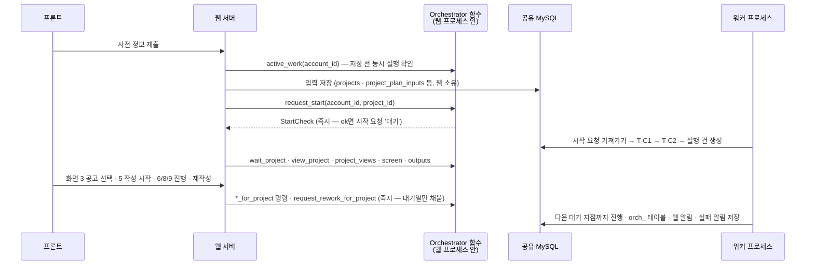

# Orchestrator 웹 연동 함수 명세 (웹팀 전달용)

| 항목 | 내용 |
|---|---|
| 기준일 | 2026-10-17 — 지금 코드 기준. 날짜별로 바뀐 점은 27절 |
| 상태 | 함수 이름 · 인자 · 결과 필드 · 오류 코드는 **구현 완료**. 화면 조회(5.1절)의 화면별 모양은 **초안** — 웹팀과 맞춰 고친다 |
| 근거 | 기능정의서 v1.11(참고: 기획서 v1.12), 웹팀 합의 · 회신 |
| 코드 | `sbrain/` — 명령 창구 `flow/service.py`(`SBrainOrchestrator`), 화면 · 결과 · 관리자 조회 · 파일 읽기 `flow/reads.py`, 파일 참조 `models/files.py`, 파일 저장소 `orchestrator/files.py`(창구 · 로컬 폴더) · `store_s3/`(S3), 파일 삭제 대기열 처리 `orchestrator/file_deletion.py`, 재작성 묶음 `flow/rework_map.py`, 산출물층 환산 `flow/score_scale.py`, 조립 `bootstrap.py`, 워커 `worker.py`, 웹 테이블 쓰기 `store_sql/web_tables.py`, 시각 `models/clock.py`, 실행 로그 12개월 처리 `flow/retention.py` · 통계 줄 `flow/log_stats.py` |
| 독자 | 웹팀(백엔드) |

---

## 1. 한눈에 보기

웹 서버와 워커는 **별도 프로세스**이고 같은 공유 MySQL을 본다. 웹은 입력을 저장하고, 아래 함수를 부르고, 읽기만 한다. 상태를 바꾸고 단계를 진행하는 일은 전부 Orchestrator(워커)가 한다. 진행 상태의 원본은 Orchestrator이고, 웹 `projects`에는 진행 값을 쓰지 않는다.



| 함수 (`orch = app.orchestrator`) | 웹에서 부르는 때 (예) | 돌려주는 것 | 절 |
|---|---|---|---|
| `active_work(account_id)` | `POST /projects` 입력 **저장 전** 동시 실행 확인 | `ActiveWork` 또는 `None` | 3.3 |
| `request_start(account_id, project_id)` | `POST /projects` 저장 직후, 다시 시도할 수 있는 시작 실패 뒤 | `StartCheck` | 3.1 |
| `start_status(project_id)` | 사전 단계 진행 화면 | `StartStatus` 또는 `None` | 3.2 |
| `view_project(project_id)` | 프로젝트 진행 상태 · 이어하기 · 진행 화면 (폴링) | `ProjectView` | 4 |
| `project_views(project_ids)` | 프로젝트 목록 · 알림 종 (여러 건 한 번에) | `list[ProjectView]` | 4.2 |
| `wait_project(project_id, timeout_sec=60.0)` | 공고 후보 · 공고 다시 찾기 · 자격 확인처럼 한 번 요청하고 응답을 기다리는 곳 | `ProjectView` | 4.3 |
| `screen(project_id, n)` | 화면 3 · 4 · 6 · 8 · 9 · 11 (화면 10은 없음) | 화면별 모델 (초안) | 5.1 |
| `outputs(project_id)` | 이어하기 · 계획서 미리보기 · 내려받기 · 결과 화면 | `Outputs` | 5.2 |
| `rework_result(project_id)` | 재작성이 끝난 뒤 변경 내역 · 전후 비교 · 실패 안내 | `ReworkResult` 또는 `None` | 5.3 |
| `read_artifact_file(project_id, key)` | 산출물 파일 보기 · 내려받기 — 결과의 파일 참조 `key`로 | `ArtifactFile` | 5.5 |
| `more_candidates_for_project(project_id)` | 화면 3 공고 추가 조회 | 없음 | 6.1 |
| `select_announcement_for_project(project_id, announcement_id)` | 화면 3 공고 선택 | 없음 | 6.1 |
| `start_writing_for_project(project_id)` | 화면 5 작성 시작 | 없음 | 6.1 |
| `decide_for_project(project_id, screen, "진행", confirmed=False)` | 화면 6 · 8 · 9 진행 | `ConfirmationNeeded` 또는 `None` | 6.2 |
| `request_rework_for_project(project_id, bundle)` | 화면 6 · 8 · 9 재작성 (묶음마다 한 번) | `ReworkAccepted` | 6.3 |
| `abort_project(project_id)` | `DELETE /projects/{id}`(보관), 중단하고 새로 시작 | `AbortResult` | 7.1 |
| `delete_project_data(project_id)` | `DELETE /projects/{id}/permanent`, 계정 삭제 | `DeleteResult` | 7.2 |
| `delete_account_data(account_id)` | `DELETE /auth/me` — 프로젝트마다 위 둘을 마친 뒤, 웹 행을 지우기 전 | `AccountDeleteResult` | 7.3 |
| `missing_projects(project_ids)` | 웹 일괄 작업 — 실행 건이 없어진 프로젝트의 알림 정리 | `list` (실행 건이 없는 프로젝트 ID) | 7.4 |
| `admin_executions(**조건)` | 관리자 "에이전트 테스크" 탭 | `list[AdminExecution]` | 8.1 |
| `admin_calls(execution_id)` | 관리자 실행 상세 | `list[AdminCall]` | 8.2 |
| `admin_runs(...)` | 관리자 "진행 현황" 탭 | `list[AdminRun]` | 8.4 |
| `admin_score_history(project_id)` | 관리자 "이력보기" | `AdminScoreHistory` | 8.5 |
| `admin_summary()` | 관리자 "운영 현황" · "운영 지표 요약" | `AdminSummary` | 8.6 |
| `admin_agent_tasks()` | 관리자 "Task별 보기" | `list[AdminAgentTask]` | 8.7 |
| `admin_file_deletions(status=None, limit=50, offset=0)` | 관리자 — 파일 삭제 대기열(포기한 줄 알림) | `list[AdminFileDeletion]` | 8.9 |
| `admin_retry_file_deletion(deletion_id, admin_id)` | 관리자 — 포기한 파일 삭제 다시 시도 | `AdminFileDeletion` | 8.9 |

- 웹은 **project_id로** 부른다. 함수가 안에서 실행 건을 찾는다(프로젝트 1건에 실행 건은 최대 1건).
- 웹은 모든 함수를 부르기 전에 **주인 확인**을 한다(관리자 함수는 관리자 확인). Orchestrator는 `request_start`만 주인을 다시 확인한다. 예외: `missing_projects`는 사용자 요청이 아니라 웹 일괄 작업에서 부르는 함수라 주인 확인 없이 부른다(실행 건이 있는지만 알려 준다, 7.4).
- 모든 함수는 금방 끝난다(`wait_project`는 정한 시간까지 기다린다). 오래 걸리는 일(사전 단계, 계획서 작성 · 프로토타입 제작 · 재작성 · 결과 통합, 재개)은 워커만 한다.
- 받을 수 없는 요청이면 `CommandError`(`.code` · `.detail`)를 올린다(10.2절).
- 결과는 기준 문서 모양이다. 웹 응답 모양으로 바꾸는 일은 웹이 한다.
- 사용자용 결과(`view_project` · `project_views` · `wait_project` · `outputs` · `rework_result` · 화면 조회)에는 관리자용 실패 사유를 싣지 않는다. 실패는 진행 상태와 안내(E-RUN-FAIL 문구)로만 알린다.

## 2. 웹 프로세스 준비

### 2.1 설치

```bash
pip install -e <저장소>/agent-orchestration      # 개발 중 — 코드 변경이 바로 반영된다
pip install <저장소>/agent-orchestration         # 배포
```

- Python 3.12 이상. 의존성(`pydantic` · `SQLAlchemy` · `PyMySQL` · `openai` · `python-dotenv` · `requests` · `beautifulsoup4` · `boto3` · `botocore`)은 `pyproject.toml`에 고정돼 있다. `requests` · `beautifulsoup4`는 워커의 시장 자료 검색이 쓰고, 웹 프로세스는 불러오기만 한다. `boto3` · `botocore`(AWS 라이브러리)는 파일 저장소가 S3일 때만 불러온다(2.2) — 웹 가상환경에도 이 패키지가 있어야 S3 파일을 읽으므로, 코드를 받으면 우리 패키지를 다시 설치한다.

### 2.2 조립 — `build_web`

```python
from dataclasses import asdict
from sbrain.bootstrap import build_web
from sbrain.orchestrator.errors import CommandError

sbrain = build_web(DB_URL, profile_count=lambda account_id: 1 if has_profile(int(account_id)) else 0)
orch = sbrain.orchestrator          # 서버 시작 때 한 번 만들어 모든 요청 처리에서 함께 쓴다
```

| 인자 | 내용 |
|---|---|
| `db_url` | 웹과 같은 공유 MySQL 접속 URL(`mysql+pymysql://…?charset=utf8mb4`). 비우면 환경 변수 · `.env`의 `SBRAIN_DB_URL` |
| `profile_count` | **필수.** 계정의 필수 항목을 채운 프로필 수(0이면 E-AUTH-PROFILE). 웹의 `compute_has_profile`을 감싸 넘긴다(참 = 1) |
| `artifact_root` | 선택. 파일 저장소 — 로컬 폴더의 **절대 경로**, 또는 S3 주소 `s3://<버킷>` · `s3://<버킷>/<접두어>`. 비우면 환경 변수 · `.env`의 `SBRAIN_ARTIFACT_ROOT` |

- **파일 저장소:** `SBRAIN_ARTIFACT_ROOT`(또는 `artifact_root`)를 **읽기 전용**으로 열어 `read_artifact_file`(5.5)에만 쓴다. 웹 조립은 파일을 쓰지도 지우지도 않는다(파일 삭제는 모두 워커가 한다). 값은 두 모양이다.
  - **로컬 폴더:** 절대 경로. 웹 조립은 폴더를 만들지 않는다. 상대 경로는 프로세스를 띄운 폴더 기준으로 풀려 웹과 워커가 서로 다른 폴더를 볼 수 있어 받지 않는다.
  - **S3:** `s3://<버킷>` · `s3://<버킷>/<접두어>`(버킷 안 그 접두어 아래 — 스킴은 소문자 `s3://`만, 대문자 `S3://`는 상대 경로로 본다). 리전 환경 변수 `AWS_REGION`(없으면 `AWS_DEFAULT_REGION`)이 필요하다 — 버킷과 같은 리전을 넣는다. 자격 증명은 AWS 기본 순서(EC2에서는 서버 IAM 역할)이고, Orchestrator는 AWS 키를 읽지 않는다(`.env`에 넣지 않는다). 웹 조립은 S3 연결을 미리 확인하지 않고 조립할 때 S3를 부르지 않는다 — 처음 읽을 때 연결한다.
  - 값이 없음 · 상대 경로 · S3 주소 형식이 틀림 · S3인데 리전 없음 · AWS 라이브러리가 없음(웹 가상환경을 다시 설치하지 않음) · S3 저장소를 만들지 못함이면 조립은 되고(웹 서버는 뜬다) `read_artifact_file`만 `FILE_STORE_UNAVAILABLE`이다.
  - 웹 역할에 필요한 S3 권한: 버킷 `s3:ListBucket`, `<접두어>*`에 `s3:GetObject`(목록 권한이 없으면 S3가 없는 파일에도 권한 없음을 돌려준다).
- **웹과 모든 워커는 같은 값을 봐야 한다** — 같은 폴더(같은 서버, 또는 같은 공유 폴더를 같은 절대 경로로), 또는 같은 버킷 · 같은 접두어. 한쪽이 로컬 폴더 · 한쪽이 S3면 파일 읽기가 `FILE_NOT_FOUND`이고 Orchestrator가 잡아 주지 못한다. 저장소가 어디든 웹이 부르는 함수 모양은 같다. 서명 URL(브라우저가 저장소에서 바로 받는 방식)은 아직 없다 — 맞춘 뒤 더한다(12절).
- 웹 프로세스가 로그를 루트 로거에 모으면 AWS 라이브러리(boto3 · botocore)의 경고 줄에 버킷 이름이 든 주소가 남을 수 있다. Orchestrator는 그 로거에 처리기를 달지 않는다 — 웹 로그 설정에서 그 로거의 수준을 정한다.
- `build_web`은 LLM 호출처가 없고 단계를 돌지 않는다. 여러 스레드에서 함께 써도 된다(상태는 DB에만 있다).
- **사전 단계 차단:** 웹 조립에서 `run_start_request`(와 동기 경로 `start_run` · `start_run_for_project`)를 부르면 시작 요청을 점유하거나 바꾸지 않고 바로 `CommandError("WEB_NOT_ALLOWED")`를 올린다. 사전 단계는 워커가 돈다.
- 웹 조립은 공고 서버를 부르지 않는다. 공고 후보 · 공고 상세 · 자격 판정은 워커가 공고 서버에서 받는다(2.3). 공고 선택 명령은 고른 공고 ID만 남긴다(6.1).

### 2.3 워커 (참고 — 웹 프로세스와 따로 띄운다)

```bash
python -m sbrain.worker          # 또는 sbrain-worker. Ctrl+C · SIGTERM으로 멈춤 (하던 단계는 끝낸다)
```

환경 변수(또는 코드 폴더의 `.env`):

| 이름 | 내용 |
|---|---|
| `SBRAIN_DB_URL` | 필수 — 공유 MySQL |
| `OPENAI_API_KEY` | 필수 |
| `SBRAIN_ARTIFACT_ROOT` | 필수 — 파일 저장소, 웹과 같은 값(로컬 폴더의 절대 경로 또는 `s3://<버킷>[/<접두어>]`). 없음 · 상대 경로 · S3 주소 형식 오류 · S3인데 리전 없음이면 워커가 시작하지 않는다. 로컬 폴더가 없으면 만들고, S3면 시작할 때 시험 객체로 읽기 · 쓰기 · 지우기를 한 번 확인한다(실패하면 시작하지 않음) |
| `AWS_REGION` | S3일 때 필수 — 버킷이 있는 리전(없으면 `AWS_DEFAULT_REGION`). 웹과 같게 |
| `SBRAIN_WORKER_POLL_SEC` · `SBRAIN_WORKER_THREADS` · `SBRAIN_WORKER_LEASE_SEC` | 선택 — 잠정 기본값 1초 · 4 · 120초 |
| `SBRAIN_NOTICE_API_URL` | 선택 — 공고 서버 주소. 있으면 공고 매칭 · 자격 확인이 공고 서버에 연결되고, 없으면 Orchestrator 안의 스텁 공고 · 스텁 판정을 쓴다. Orchestrator 담당이 설정한다. 어느 쪽이든 웹이 보는 동작은 같다 |
| `SBRAIN_KIET_SEARCH` | 선택 — 실행마다 KIET 시장 자료를 검색할지(기본 꺼짐). 웹이 보는 동작은 같다 |
| `SBRAIN_WORKER_LOG_DIR` · `SBRAIN_WORKER_LOG_KEEP_DAYS` | 선택 — 워커 운영 로그 파일 폴더 · 자동 삭제 일수(기본 꺼짐) |

- 여러 대를 띄워도 같은 일을 두 번 하지 않는다(`SKIP LOCKED` + 점유). 재작성 요청을 모으는 중인 실행 건(`orch_runs.collect_until`이 지금보다 뒤)은 그 시각이 지날 때까지 가져가지 않는다.
- **실행 로그 12개월 처리:** 여러 워커 중 한 대만 하루 한 번(잠정) 돌며, 마지막 활동이 12개월보다 오래된 실행 건 · 끝난 시작 요청의 기록을 식별자 없는 통계 줄로 옮기고 지운다(웹 테이블은 건드리지 않는다). 웹 조립(`build_web`)은 이 일을 하지 않는다.
- **파일 삭제 대기열:** 작업 확인 주기(10분, 잠정)마다 지울 때가 된 대기열 줄을 가져가 그 실행 건의 파일을 지운다. 완전 삭제 · 탈퇴 · 12개월 처리가 산출물을 지울 때 같은 트랜잭션에서 대기열 줄을 넣고, 첫 시도는 넣은 뒤 10분(잠정) 뒤다. 실패하면 10분(잠정)마다 다시 하고 3번 실패하면 포기로 표시한다(관리자 함수 8.9). 결과는 워커 운영 로그에 `파일삭제` · `파일삭제실패` · `파일삭제포기` 줄로 남는다(실행 건 · 대기열 줄 ID까지, 계정 · 파일 이름 · 키 없음).
- 워커 로그 줄 앞의 시각은 UTC다(끝에 `Z`, 예: `2026-09-26 09:00:05Z`).

### 2.4 공유 DB 준비

1. 웹 스키마(`app_schema.sql`)와 웹 마이그레이션 `004_budget_phase.sql`(`project_budget_items.phase`) · `005_target_customer.sql`(`project_plan_inputs.target_customer`) · `006`(`notifications.kind` ENUM에 '결과물')이 있어야 한다. **006을 적용한 뒤 새 워커를 띄운다** — 그 전에 띄우면 결과 통합이 끝나는 저장이 실패한다(4.4).
2. `sql/orchestrator_schema.sql`을 적용한다 — `orch_` 테이블 13개, `CREATE TABLE IF NOT EXISTS`만 있다. `orch_runs.project_id`가 `projects(project_id)`를 참조한다(`ON DELETE SET NULL`). **공유 DB 적용은 Orchestrator 담당이 한다.**
3. `CREATE TABLE IF NOT EXISTS`는 이미 있는 표를 고치지 않는다. 예전 DDL로 표를 만든 DB에는 그 뒤 늘어난 것 — `orch_runs.collect_until`(`DATETIME(6) NULL`), `orch_executions.image_input_tokens` · `image_output_tokens`(`BIGINT UNSIGNED NULL`), 인덱스 `ix_orch_runs_updated` ON `orch_runs (updated_at)` · `ix_orch_start_requests_status_updated` ON `orch_start_requests (status, updated_at)` — 를 Orchestrator 담당이 따로 더한다. 웹은 `orch_` 테이블을 쓰지 않으므로 할 일이 없다.
4. **웹은 `orch_` 테이블을 읽지도 쓰지도 않는다.** 통계 표 `orch_log_stats` · 작업 상태 표 `orch_jobs` · 파일 삭제 대기열 `orch_file_deletions`도 같다 — 통계가 필요하면 `orch_log_stats`를 DB에서 직접 조회하고(계정 · 프로젝트 · 실행 건 ID 없음), 대기열은 관리자 함수(8.9)로 본다.
5. 공유 DB 서버 시간대: `@@global.time_zone`=SYSTEM, `@@session.time_zone`=SYSTEM, `@@system_time_zone`=UTC — DB 기본값으로 채워지는 시각도 UTC다. 바꾸지 않는다.
6. 공유 DB에 `005`를 적용한 날에는 워커를 다시 띄운다 — 워커는 웹 테이블 구조를 프로세스에서 처음 한 번 읽어 두기 때문이다(4.4).

### 2.5 식별자

| 이름 | 값 |
|---|---|
| `account_id` | 웹 `users.user_id`를 문자열로 (`str(user_id)`) |
| `project_id` | 웹 `projects.project_id` (정수 또는 숫자 문자열) |
| `run_id` · `request_id` · `execution_id` · `cycle_id` | Orchestrator가 만드는 12자 문자열. 웹이 보관할 필요는 없다(관리자 상세 조회의 `execution_id`만 쓴다) |
| `announcement_id` | 공고 ID (T-C2 후보 카드의 `announcementId`). 공고 표 `notices.notice_id`와 같은 값이다 — 공고팀 추천이 그 표를 읽는다 |

### 2.6 시각

**모든 시각은 UTC이고 시간대가 붙는다. 화면 표시는 한국 시간으로 바꾼다. 웹 코드가 우리 값과 자기 값(`utcnow`, 시간대 없음)을 비교 · 저장할 때는 시간대를 맞춘다.**

| 구분 | 규칙 |
|---|---|
| 돌려주는 시각 | 모든 함수 결과의 시각은 시간대 있는 UTC다. dataclass(`RunView` · `ReworkAccepted` · `StartStatus` 등)의 `datetime`은 `tzinfo=UTC`(`isoformat()`이면 `+00:00`), pydantic `.dump()`의 시각 문자열은 끝에 `Z`. 대상 예: `next_resume_at` · 알림 `created_at` · `read_at` · 안내 `at` · `collect_until` · 재작성 결과 `startedAt` · `endedAt` · 관리자 조회 `updatedAt` · `startedAt` · `endedAt` · `scoredAt` |
| 받는 시각 | 시간대 없는 값(`admin_executions`의 `since` · `until`)은 UTC로 본다 |
| DB 칸 | `orch_` 표와 워커가 INSERT하는 웹 표 둘의 `DATETIME` 칸에는 시간대 없는 UTC를 넣는다 — 웹 `utcnow()`와 같은 기준. 웹 표에서 읽은 시각(예: 알림 `read_at`)에는 UTC를 붙여 돌려준다 |
| "오늘" | 자격 확인 기준일 · 마감 안내(E-RUN-CLOSED)의 "오늘"은 한국 날짜(UTC+9) |

- 시간대 있는 값과 시간대 없는 값(`datetime.datetime.utcnow()`)은 파이썬에서 빼거나 비교할 수 없다(`TypeError`). 웹이 우리 결과와 자기 값을 함께 계산하는 곳은 한쪽으로 맞춘다.

## 3. 시작 — 사전 정보 제출 → 공고 후보

### 3.1 `request_start(account_id, project_id) -> StartCheck`

입력을 저장한 직후 부른다. 웹이 저장한 사전 정보를 DB에서 읽어 아래 순서로 확인하고, 통과하면 시작 요청을 '대기'로 넣는다. 사전 단계(T-C1 → T-C2)는 워커가 돈다. 첨부(`project_attachments`)는 읽지 않는다(첨부 추출이 흐름 밖 — 26절).

| 순서 | 확인 | 걸리면 |
|---|---|---|
| ① | 프로젝트가 있고(보관 처리 안 됨) `account_id`가 주인인가 | `CommandError("PROJECT_NOT_FOUND")` |
| — | 이미 실행 건이 있는 프로젝트인가(끝난 것 포함) | `CommandError("PROJECT_ALREADY_STARTED")` — 새로 시작은 새 프로젝트로 |
| ② | 필수 항목 | `StartCheck(ok=False, code="E-C1-REQUIRED", missing=[누락 항목 이름])` — T-C1을 실행하지 않는다 |
| ③ | 프로필 (`profile_count`) | `code="E-AUTH-PROFILE"` |
| ④ | 계정 잠금 안에서 진행 중 실행 건 **또는** 대기 · 처리중 시작 요청이 있는가 | `code="E-RUN-CONCURRENT"`, `active=ActiveWork(…)` |

- ② ~ ④에서 걸리면 시작 요청을 넣지 않는다. 같은 프로젝트로 다시 부를 수 있다.
- **사업비 · 일정:** 이 함수가 다른 사전 정보와 함께 `project_budget_items` · `project_schedule_items`를 읽는다(4.4). **사업비 · 일정을 읽는 때는 이 시작 요청(`request_start`)뿐이다** — 작성 시작(`start_writing_for_project`) 때 다시 읽지 않는다. 그래서 사업비 · 일정은 `request_start`를 부르기 전에 저장되어 있어야 한다.
  - 필수 확인은 코드 스위치(`PLAN_TABLES_REQUIRED`)로 두며 **켜져 있다**(웹 `REQUIRE_BUDGET_SCHEDULE`과 같은 값). 끄면 비어도 통과한다(계획서의 그 표는 '확인 필요'로 나간다).
  - 켜져 있으면 ②에서 아래를 어긴 것이 `missing`에 더해진다(이름 글자는 잠정).

    | 조건 | `missing` 이름 |
    |---|---|
    | 사업비 row가 1건 이상 | `사업비 집행계획` |
    | 예비창업자: `phase = '1단계'`인 사업비 row가 1건 이상 | `사업비 집행계획(1단계)` |
    | 예비창업자: `phase = '2단계'`인 사업비 row가 1건 이상 | `사업비 집행계획(2단계)` |
    | 일정 row 중 `section = 'feasibility'`(협약기간 내)가 1건 이상 | `추진 일정(협약기간 내)` |

  - 공유 DB에 웹 마이그레이션 `004_budget_phase.sql`(`phase` 컬럼)이 적용되어 있어야 한다 — 없으면 예비창업자는 단계 조건으로 늘 막힌다.
  - 협약 이후 일정(`growth`)은 선택 입력이다. 담당자 일반형 양식은 대응하는 신청자 유형이 없어 쓰지 않는다.
- **다시 시도:** 마지막 시작 요청이 다시 시도할 수 있는 실패(`E-C1-TIMEOUT` · `X-C2-FAIL` · `E-C2-STALE`)로 끝났으면 웹이 같은 프로젝트로 `request_start`를 다시 부른다. `E-C2-NOMATCH`(신청 가능한 공고 없음)는 다시 넣지 않는다(입력 확인 안내).

`StartCheck` (dataclass)

| 필드 | 내용 |
|---|---|
| `ok` | 요청을 넣었으면 참 |
| `request_id` | 넣은 시작 요청 ID |
| `code` · `message` | 실패 코드와 안내 문구(시트 6, 10.1절) |
| `missing` | E-C1-REQUIRED — 누락 항목 이름 목록 (예: `["수익모델 단가", "성별"]`) |
| `active` | E-RUN-CONCURRENT — 진행 중인 작업 `ActiveWork`. **웹의 기존 409 응답 `blocked` 정보(`active_project_id` · `active_stage` · `active_screen` · `active_display_status`)를 대신한다** |

`ActiveWork` (dataclass)

| 필드 | 내용 |
|---|---|
| `project_id` | 진행 중인 프로젝트 |
| `run_id` · `step` · `resume_step` · `screen_status` | 실행 건이 있을 때: 단계명 · 이어하기 복귀 화면 번호 · 화면 상태(진행 중 · 확인 필요) |
| `request_id` | 사전 단계 요청이 아직 처리 중일 때(실행 건 없음). 이때 `screen_status`는 '진행 중' |

"중단하고 새로 시작"을 고르면 웹은 `abort_project(active.project_id)`(7.1)를 부르고 새 프로젝트로 다시 시작한다.

### 3.2 `start_status(project_id) -> StartStatus | None`

그 프로젝트의 **마지막** 시작 요청 상태. 요청이 없으면 `None`.

- 끝난 지(마지막 갱신) 12개월이 지난 시작 요청(완료 · 실패 · 취소)은 워커가 통계 줄로 옮기고 지운다. 그래서 실행 건 없이 실패 · 취소 요청만 있던 프로젝트는 12개월 뒤 `None`(시작 전과 같음)으로 보인다.

| `status` | 뜻 | 웹 화면 |
|---|---|---|
| 대기 · 처리중 | 워커가 가져가기 전 · 사전 단계 진행 중 | 진행 중 |
| 완료 | 실행 건을 만들었다(`run_id`) | 화면 3 공고 후보 (`screen(project_id, 3)`) |
| 실패 | `code`: E-C1-TIMEOUT · X-C2-FAIL(다시 시도 안내), E-C2-STALE(공고 갱신 중), E-C2-NOMATCH(후보 없음 → 입력 확인), E-RUN-CONCURRENT(`active` 포함) | `message`를 보여 준다. E-C1-TIMEOUT · X-C2-FAIL · E-C2-STALE이면 웹이 `request_start`를 다시 부른다(3.1) |
| 취소 | 중단(7.1)으로 취소됨 | — |

`StartStatus` (dataclass): `request_id` · `status` · `code` · `message` · `notices`(안내 목록, 예: E-C2-EMBED 추천 정확도 안내) · `run_id` · `active`.

### 3.3 `active_work(account_id) -> ActiveWork | None`

웹이 사전 정보를 **저장하기 전에** 동시 실행을 확인한다(기존 409 응답 유지용). 진행 중인 작업이 없으면 `None`.

- 세는 기준은 `request_start` ④와 같다 — 진행 중 · 확인 필요 실행 건(실행 · 재개대기 · 사용자대기)을 먼저, 그다음 대기 · 처리중 시작 요청.
- 계정 잠금 없이 읽는다. 최종 확인은 `request_start`가 계정 잠금 안에서 다시 한다(그 사이에 생긴 작업은 `E-RUN-CONCURRENT`).

## 4. 진행 상태 — `view_project(project_id) -> ProjectView`

| 필드 | 내용 |
|---|---|
| `project_id` | |
| `run` | 실행 건이 있으면 `RunView` |
| `start` | 실행 건이 없으면 마지막 시작 요청 `StartStatus` (요청도 없으면 `run` · `start` 모두 `None`). 끝난 지 12개월이 지난 시작 요청은 지워지므로, 실행 건 없이 그런 요청만 있던 프로젝트도 `None`이다(3.2) |

### 4.1 `RunView` (dataclass, 사용자용 — 실패 사유 없음)

| 필드 | 내용 |
|---|---|
| `run_id` | |
| `step` | 단계명 8개 — 공고선택 · 자격확인 · 계획서작성 · 문서평가 · 프로토타입제작 · 산출물확인 · 종합평가 · 결과물. 화면 9 '진행' 뒤 결과 통합이 도는 동안은 `결과물` · `실행`이다 |
| `progress` | 실행 · 재개대기 · 사용자대기 · 실패 · 완료 · 중단 |
| `screen_status` | 진행 중 · 확인 필요 · 문제 발생 · 완료 · 중단됨 |
| `resume_step` | 이어하기 복귀 화면 번호 (재작성 중이면 요청한 화면) |
| `percent` | 진행률(%) — 진행 중(실행 · 재개대기)이면 지금 구간에서 끝난 단계 비율, 완료 100, 그 밖 0 |
| `current_label` | 지금 하는 단계 한 줄 (예: "요구사항 분석") |
| `notices` | 안내 목록 `Notice(code, message, at)` — 실행 건의 안내를 계속 쌓는다. 진행 중 · 대기 중이고 선택 공고의 `applyEnd`가 오늘(한국 날짜)보다 앞이거나(`null`이면 보지 않음) `status`가 '마감'이면 E-RUN-CLOSED가 붙는다(모집 상태 모름은 마감이 아니다) |
| `notifications` | 작업 알림 목록 `Notification` — 웹 `notifications` 테이블의 행. `notificationId`는 그 행의 ID |
| `retry_count` · `resume_count` | 재시도 · 재개 횟수 (실행 건 값 그대로) |
| `next_resume_at` | 다음 재개 예정 시각 (재개대기일 때). 시간대 있는 UTC(2.6) |
| `last_error_kind` | 마지막 오류 종류 (일시 · 입력 · 운영) |
| `rework_screen` | 재작성 중인 화면 (6 · 8 · 9, 재작성 중이 아니면 `None`) |
| `collecting` | 재작성 요청을 모으는 중이면 참 (6.3) |
| `announcement_id` | 선택 공고 ID (고르기 전이면 `None`). 자격 확인(G-01)이 끝났을 때 그 공고 ID로 바뀐다(불통과여도). 공고 선택 명령 직후에는 아직 이전 값이고, G-01이 실패하면 고르기 전 값 그대로다 |

- 재작성을 요청한 화면을 다시 열었을 때: `rework_screen`이 그 화면이고 `progress`가 실행 · 재개대기면 '진행 중'으로 보인다(모으는 중도 실행).
- 실행 건이 실패로 끝나면 `progress="실패"`, `screen_status="문제 발생"`, `notices`에 E-RUN-FAIL(새 작업으로 시작 안내). 관리자용 실패 사유는 관리자 조회(8.4)에만 있다.
- `retry_count`는 실행 건이 센 재시도 수다. 다시 보내도 같은 답이 오는 오류(입력 · 운영 응답 코드, 결제 · 한도 코드)는 다시 보내지 않으므로 그런 실패에서는 0일 수 있다.

### 4.2 `project_views(project_ids) -> list[ProjectView]`

여러 프로젝트의 `view_project`를 한 번 호출로 준다(프로젝트 목록 · 알림 종). 넘긴 순서대로 돌려주고, 실행 건 · 마지막 시작 요청은 한 번씩 모아 읽는다. 내용은 `view_project`와 같다.

### 4.3 `wait_project(project_id, timeout_sec=60.0) -> ProjectView`

공고 후보 · 공고 다시 찾기 · 자격 확인처럼 화면이 한 번 요청하고 응답을 기다리는 곳에서 쓴다.

- 마지막 시작 요청이 대기 · 처리중이 아니고, 실행 건이 '실행'(재작성 요청을 모으는 중 포함)이 아닐 때까지 기다린 뒤 `view_project` 결과를 준다.
- 재개대기 · 사용자대기 · 끝난 상태면 기다리지 않고 바로 준다.
- 제한 시간(잠정 기본 60초)을 넘기면 그때의 `ProjectView`를 그대로 준다(**오류 아님**). DB는 잠정 0.5초마다 다시 읽는다.
- 계획서 작성 · 프로토타입 제작 · 재작성 · 결과 통합처럼 오래 걸리는 구간은 이 함수로 붙잡고 기다리지 않는다. 재개대기(15분~)가 웹 요청 제한 시간을 넘기 때문이다. 프론트가 진행 상태를 주기적으로 확인한다.

### 4.4 웹 테이블 — Orchestrator가 쓰는 것과 읽는 것

**Orchestrator는 웹 `projects`의 어떤 컬럼에도 쓰지 않는다.** 목록은 `project_views`, 상세는 `view_project`로 읽는다. `projects`의 옛 진행 컬럼(`status` · `stage` · `progress_percent` · `notice_id` · `failure_reason` 등)은 누구도 쓰지 않는 웹 정리 대상이다.

웹 테이블 쓰기는 정확히 아래 두 가지 INSERT뿐이고, 모두 단계 저장과 **같은 트랜잭션**이다. 실행 건에 `project_id`가 있을 때만 쓴다.

| 웹 테이블 | 언제 | 웹이 하는 일 |
|---|---|---|
| `notifications` | 알림을 만들 때 INSERT — 문서평가(6) · 산출물확인(8) · **결과물(11 — 결과 통합이 끝남)** · 실패(실행 실패는 `target_step` 없음, 재작성 실패는 요청한 화면). 재작성이 끝나도 요청한 화면으로 문서평가 · 산출물확인 알림. '표현검수'(10)는 새로 쓰지 않는다(옛 행은 그대로 읽는다). **웹 스키마의 `kind` ENUM에 '결과물'이 있어야 운영 DB에 저장된다**(웹 마이그레이션 006 — 2.4) | 목록 조회, 사용자가 읽으면 `read_at`만 갱신 |
| `generation_failure_alerts` | 실행이 실패로 바뀔 때 한 행(`stage`: 기준 문서 단계 — 결과 통합 실패면 '결과물', `last_error_kind`: 일시 = 재개 상한 초과, 입력 · 운영 = 영구 오류, `failure_reason`: 관리자용 실패 사유). 재작성 실패(되돌림)는 실행 실패가 아니라 쌓지 않는다 | 관리자 확인 때 `acknowledged_at`만 갱신 |

읽기만 하는 웹 테이블: 사전 정보 입력 5개(`companies` · `projects` 입력 컬럼 · `team_members` · `pricing_items` · `project_plan_inputs`), 사업비 · 일정 2개(`project_budget_items` · `project_schedule_items`), `verification_policies`(실행 시작 때 읽어 고정), `notifications`(진행 상태의 알림 목록). `notices` · `project_attachments` · `proofread_logs` · 학습 동의(`users.ai_training_agreed`)는 읽지 않는다.

**선택 컬럼** — 아래 컬럼은 없어도 오류 없이 돈다(없으면 빈 값). 다른 컬럼이나 테이블이 없으면 웹 DB 구조 불일치 오류(`SchemaMismatch`)다. 워커는 웹 테이블 구조를 프로세스에서 처음 한 번 읽어 두므로, 컬럼을 더한 뒤 **워커를 다시 띄운 때부터** 값이 들어간다.

| 컬럼 | 없을 때 |
|---|---|
| `project_budget_items.phase` (웹 마이그레이션 `004`) | 단계 미지정 — 예비창업자는 필수 확인에서 막힌다(3.1) |
| `project_plan_inputs.target_customer` (웹 마이그레이션 `005`) | 목표 고객 없음 |
| `verification_policies.token_retry_cap` | 코드 기본값(검수 재수행 횟수 — 검수가 흐름 밖이라 쓰이지 않으므로 웹이 컬럼을 지워도 된다) |

**사업비 · 일정 테이블 읽기** — `request_start`(3.1)가 프로젝트의 row를 모두 읽는다. 읽기만 한다.

| 테이블 | 읽는 컬럼 (뜻) | 처리 |
|---|---|---|
| `project_budget_items` | `project_id` · `item_order` · `category`(비목) · `execution_plan`(집행계획) · `total_amount`(총사업비) · `government_amount`(정부지원사업비) · `self_cash_amount`(자기부담 현금) · `self_in_kind_amount`(자기부담 현물) · `phase`(`'1단계'` · `'2단계'`, 예비창업만 — 선택 컬럼) | `item_order` 순(빈 순서는 뒤, 같은 순서는 기본키 순). 금액(DECIMAL)은 정수 원으로 읽는다 — 소수 부분이 있으면 오류. `NULL` 금액은 0으로 보지 않고 비운다(표에서 '확인 필요'). 총사업비 · 정부지원 · 현금 · 현물이 **모두 있고** 총사업비 ≠ 세 금액의 합이면 총사업비를 세 금액의 합으로 다시 낸다. **총사업비가 비면 그대로 비워 둔다.** '1단계' · '2단계' 밖의 `phase` 값은 비운 것으로 본다(잠정) |
| `project_schedule_items` | `project_id` · `item_order` · `section`(`feasibility` 협약기간 내 / `growth` 협약 이후) · `category`(구분) · `content`(추진내용) · `period`(추진기간) · `detail`(세부내용) | `item_order` 순. `section`이 두 값 밖인 row는 버린다(잠정) |

- 음수 · 합계 불일치(`total_amount` ≠ `government_amount` + `self_cash_amount` + `self_in_kind_amount`) row는 웹이 입력 때 막는다(합의). **총사업비가 빈 row는 계획서 사업비 표에는 남지만 담당자 예산 계산 입력에서 빠져, 그 표 항목이 검증-1에서 fail로 판정될 수 있다.**
- 이름 바꾸기(웹 컬럼 → 계획서 표 열)는 Orchestrator가 한다. 웹은 지금 컬럼 이름 그대로 두면 된다.

**팀원 · 목표 고객 · 창업아이템명 읽기** — `request_start`(3.1)가 다른 사전 정보와 함께 읽는다. 읽기만 한다. 셋 모두 필수 확인(E-C1-REQUIRED)에 넣지 않는다.

| 웹 칸 | Orchestrator가 만드는 값 | 처리 |
|---|---|---|
| `team_members.role` · `experience` | 팀원 '역할: 경력' 줄 · 팀원 표 행 | 저장 순서(기본키 순)로 한 명마다 역할 · 경력(각각 앞뒤 공백 제거, 비면 없음). **이름(`name`)은 넣지 않는다.** 역할 · 경력이 둘 다 비어도 한 줄로 둔다(웹 표가 그 사람을 "팀원 / - / -"로 보이므로). 팀원이 없으면 빈 목록. 전략 · 작성 Agent에는 '역할: 경력'만 보내고, 일반현황 항목에는 웹 표 모양의 팀 구성현황을 보낸다(아래) |
| `project_plan_inputs.target_customer` (`VARCHAR(200) NULL`, 선택 컬럼) | 목표 고객 | 앞뒤 공백을 지우고, 비면 없음. 값이 있으면 요구사항 해석(T-C1) 결과의 목표 고객(`itemSpec.targetCustomer`)을 그 값으로 바꿔 모든 단계(공고 추천 · 작업 분해 · 전략 · 작성 · 검증-1 · 프로토타입 · 인포그래픽)가 같은 값을 쓴다. 없으면 계획서 목표 고객 원본 사실은 '확인 필요'이고, 그 밖의 단계는 요구사항 해석이 추정한 값을 쓴다 |
| `projects.description` (아이디어 설명) | 창업아이템명 | 설명 전체의 앞뒤 공백을 지운 뒤 **첫 줄**(줄바꿈 `\r\n` · `\r` · `\n` 앞까지)을 다시 앞뒤 공백을 지우고 **60자까지** 자른 값. 비면 없음(그 항목 근거에 창업아이템명 칸을 넣지 않는다). 웹 일반현황 표 · 개요 표의 "첫 줄, 60자까지"와 같게 하려는 규칙이다. 설명이 빈 줄로 시작하면 전체 공백 제거 때문에 첫 글자가 있는 줄을 쓴다(웹 규칙 확인 전 — 이 부분만 잠정) |

- 일반현황 항목(예비창업 `2.1.1` · 초기창업 `3.1.1`)을 쓰고(F16) 검증하는(F19) AI 요청의 원본 사실에만 `창업아이템명` · `팀구성현황`이 붙는다. `팀구성현황`은 한 명마다 `{"직위": 역할 또는 "팀원", "담당업무": 역할 또는 "-", "보유역량": 경력 또는 "-"}`(웹 표 모양), 팀원이 없으면 `"팀원 없음(대표자 단독)"`이다. 다른 항목에는 붙지 않는다.
- 요구사항 해석의 아이템 이름(`itemSpec.itemName` — 프로토타입 제목 등)은 바꾸지 않는다. 그래서 창업아이템명(일반현황)과 다를 수 있다.
- 이 값들은 실행 기록 · 로그 · 관리자 조회에 싣지 않는다(다른 사전 정보와 같다).

## 5. 조회 — 화면 · 지금까지 결과 · 재작성 결과

### 5.1 화면 조회 — `screen(project_id, n)` (모양은 초안)

대기 지점에서만 연다. 아니면 `CommandError("SCREEN_NOT_READY")`. 결과는 pydantic 모델이고 `.dump()`가 기준 문서 이름(camelCase) JSON을 준다. 모든 화면에 공통 필드 `screen` · `projectId` · `runId` · `step` · `progress` · `notices`가 있다.

| 화면 | 여는 때 | 내용 (필드) |
|---|---|---|
| 3 공고 후보 | 공고선택 · 사용자대기, 계획서작성 · 사용자대기(자격 통과 뒤 작성 시작 전) | `candidates`(첫 조회 — 추가 조회에 다시 나온 카드는 새 내용) · `moreCandidates`(추가 조회 — 첫 조회와 겹친 공고 없음) · `moreAvailable`(추가 조회 가능 — 1회, 합계 최대 20건) · `collectionStatus` · `filteredCount` · `fallbackUsed` · `fallbackMode` · `blockedAnnouncementIds`(막힌 공고 ID, 확장) |
| 4 자격 확인 | 공고선택 · 계획서작성 사용자대기, 자격 확인 결과가 있을 때 | `announcementId` · `gateResult`(통과 · 불통과 조건 `failedConditions` · 누락 입력 `missingInputs` · 확인 필요 조건 `unknownConditions` · `undecidable`(늘 거짓)) · `businessAgeYears` · `canStartWriting`(통과해 화면 5로 갈 수 있음). 확인 필요 조건이 있으면 `notices`에 E-G1-UNPARSED |
| 6 문서 평가 | 문서평가 · 사용자대기 | `planDoc`(계획서) · `score`(환산 점수 등) · `tableFallbacks`(표 대체 안내, 확장 — 아래) · `failedTaskIds` · `reworkOptions`(재작성 목록) · `nextAction`(진행가능 · 재작성권유 · 상한도달) |
| 8 산출물 확인 | 산출물확인 · 사용자대기 | `prototype` · `infographic` · `codeCheck` · `featureMatch` · `reworkOptions`(산출물층만) |
| 9 종합 평가 | 종합평가 · 사용자대기 | `score`(종합 점수 · 층별 내역 `docScore` · `artifactScore` · 전후 비교 `comparisons`) · `reworkOptions` · `nextAction` · `reworkDiff`(변경 내역) |
| 11 결과물 | 결과물 · 완료 | `deliverable` · `userMessage` · `planDoc` · `prototype` · `infographic` · `tableFallbacks`(표 대체 안내, 확장 — 아래) |

- 화면 3은 작성을 시작한 뒤(계획서작성 · 실행 이후)에는 `CommandError("INVALID_STATE")`다(공고 다시 고르기 · 추가 조회와 같은 거절). 그 밖에 맞지 않는 상태는 `SCREEN_NOT_READY`.
- 화면 10(검수 전후)은 없다 — 어느 상태에서도 `INVALID_SCREEN`(26절). 화면 9 '진행' 뒤에는 결과 통합 하나가 돌고 바로 화면 11이다.
- 화면 5(작성 시작)와 7(프로토타입 제작 중)은 따로 조회할 내용이 없다 — `view_project`로 단계 · 진행률을 본다. 화면 9 '진행' 뒤 결과 통합이 도는 동안(`결과물` · `실행`)도 같다.
- 없는 화면 번호는 `INVALID_SCREEN`, 실행 건이 없으면 `RUN_NOT_FOUND`.

**화면 3 · 4**

- **카드(`AnnouncementCard`)** — `announcementId` · `title` · `agency` · `applyEnd`(`null` 가능 — 마감일 없는 공고) · `supportAmountMax`(`null` 가능 — 추천 결과에는 금액이 없어 지금은 늘 `null`) · `fitScore` · `rank` · `displayType` · `matchReason` · `sourceNotice` · `originalUrl`, 그리고 `applyPeriodType`(모집 형태 표기) · `contentChanged`(내용 바뀜) · `contentVersion`(웹은 쓰지 않음) · `bonusScore`(가산점 합계, `null` = 계산 못 함, `0` = 해당 없음) · `bonusItems`(`name` · `points`). 가산점은 스위치가 꺼져 있어 **늘 `null` · `[]`**다(공고팀 가산점 시험 단계, 화면에 쓰지 않음 — 키는 그대로, 17절). `originalUrl`은 `""`일 수 있다. 순서는 `rank` 그대로이며 웹이 다시 정렬하지 않는다.
- **추가 조회 반영** — 성공한 추가 조회가 있으면 `candidates`는 첫 조회 카드 중 다시 나온 것을 새 내용으로 바꾼 목록(자리 · `rank` · `displayType` 그대로, 내용이 바뀌었으면 `contentChanged` 참)이고, `moreCandidates`는 첫 조회와 겹친 공고를 뺀 목록이다(0건일 수 있다). 실패한 추가 조회는 없던 것으로 본다 — 후보 · `collectionStatus` · `filteredCount` · `fallbackUsed` · `fallbackMode`가 조회 전 그대로다.
- **`blockedAnnouncementIds`** — 자격 불통과(E-G1-REJECT)가 나온 공고 ID. 그 실행 건에서 고를 수 없다(`ANNOUNCEMENT_BLOCKED`, 6.1). 추가 조회에서 그 공고 카드가 `contentChanged` 참이 되면 빠진다. 공고 없음 · 오류 · 설립일 없음은 들어가지 않는다. 카드에는 자격 정보를 싣지 않는다.
- **화면 4 확인 필요** — `gateResult.unknownConditions`(`지원대상 유형` · `업력`)가 있으면 `notices`에 E-G1-UNPARSED가 하나 붙는다. 진행을 막지 않고(`canStartWriting` 참), 실행 건 안내 목록에는 쌓지 않아 `view_project`의 `notices`에는 나오지 않는다. 화면 4를 열 때마다 지금 자격 결과로 다시 만든다.

**점수와 재작성 목록**

- `score`(`ScoreView`): `displayScore`(환산 점수) · `total` · `threshold` · `passed` · `phase` · `docScore` · `artifactScore` · `carriedOverLayer` · `comparisons` · `notices`, 환산 칸 여덟 개(아래 '점수 보고서 환산 칸'). 판정에 쓴 실행 설정 스냅샷은 싣지 않는다.
- `reworkOptions`(`ReworkOption`): `order`(판정 G-02a · G-02b의 재작성 지시를 그대로) · `bundles`(그 지시의 기회를 세는 **묶음 이름**, 6.3) · `remaining`(남은 기회) · `selectable`(고를 수 있음).
  - 산출물층 지시 → 그 Task의 묶음(`실행 파일` · `인포그래픽`).
  - 문서층 지시는 **묶음마다 하나**다(`order.targets` = [묶음 이름], `bundles`도 그 묶음 하나). `remaining`은 그 묶음의 남은 기회, `selectable`은 그 값이 0보다 클 때.
  - 문서층 후보(판정 G-02a · G-02b): 그 묶음의 항목 중 검증-1 판정이 fail 또는 warning인 항목이 있으면 후보다(입력 없음 warning과 입력 오류 항목은 뺀다. 사유에 '<항목 번호> <문제>' 줄을 잇는다). 문서층 점수가 기준(80) 미만인데 후보가 하나도 없으면 묶음 모두 — `그림`을 뺀 5개 — 가 후보다(사유는 고정 문구. 입력 오류 항목만 남아 점수가 모자란 경우도 같다). `그림`은 그 항목에 fail · warning이 있을 때만 후보다. 기회를 다 쓴 묶음도 목록에 남는다(`selectable` 거짓). 다음 동작의 '상한도달'은 후보 묶음의 기회가 모두 끝났을 때다.
  - 원페이지의 `실행 파일`은 고를 수 없다.
  - 기회 계산은 `outputs`의 `reworkUsage`(5.2)와 같은 기준이다. 재작성 요청은 이 목록이 아니라 묶음 이름으로 한다(6.3). 미달이 아닌 묶음도 요청할 수 있다.
- **입력 없음 안내** — 입력 없음 항목이 있으면 점수 보고서 `notices`에 '입력 확인 필요 — 사업비 집행계획 · 추진 일정을 입력하면 해당 표가 채워집니다.'(잠정 문구)가 붙는다.
- **입력 오류 안내 (문구 잠정)** — 입력 오류 항목이 하나라도 있으면 점수 보고서(화면 6 · 9의 `score`, `outputs`의 `documentScoreReport` · `overallScoreReport`) `notices`에 아래 안내가 **한 번** 붙는다. 항목 번호는 넣지 않는다(입력 없음 안내와 같은 방식). 입력 없음 안내가 함께 있으면 그 바로 뒤에 온다.

  ```text
  입력한 협약기간 일정이나 사업비가 기준(협약기간 최대 개월 수 · 개발 기간 · 공고 지원 금액 상한)을 벗어나 일부 항목이 검증을 통과하지 못했습니다. 이 항목은 다시 만들어도 고쳐지지 않습니다. 이대로 진행하거나, 입력을 고쳐 새로 만들 수 있습니다.
  ```

  - 입력 오류는 사용자가 입력한 값이 기준을 벗어나 생긴 검증-1 fail이다 — ① 협약기간 일정의 첫 달 ~ 끝 달이 협약기간 최대 개월 수(예비창업자 8개월 · 개인사업자 · 법인 10개월 — 2026년 공고 기준 고정값)를 넘음 ② 협약기간 일정 한 줄의 종료월이 개발 종료월(사전 정보 개발 기간의 끝)보다 늦음 ③ 입력한 정부지원사업비가 선택 공고의 지원 금액 상한을 넘음. ① · ②는 웹 입력 화면이 막으므로 거의 생기지 않는다. 실행 중에는 입력을 고칠 수 없어 다시 만들어도 고쳐지지 않는다. 그 항목은 검증-1 자동 재수행 · 표 대체를 하지 않으므로(표가 그대로 남는다) fail 판정 · 점수가 그대로 보이고, 재작성 목록에서만 빠진다.
  - 점수가 기준 미만이면 다른 묶음을 다시 써 점수를 올릴 수 있어서 묶음 모두(`그림` 제외)가 후보로 나올 수 있다 — 입력 오류 안내와 재작성 권유가 함께 보일 수 있다.

**표 대체 안내 `tableFallbacks`(`TableFallback`, 확장)** — 화면 6 · 11과 `outputs`(5.2)에 있다. 검증-1에서 끝내 fail이라 표를 본문 서술로 바꾼 항목마다 하나(그 항목은 `planDoc.tables`에서 빠진다). `sectionCode` = 항목 번호, `displayReason` = 사용자에게 보여 줄 쉬운 안내, `fallbackReasonCodes` = 대체 사유 코드 목록, `reason` = 담당자 판정 사유 원문(내부 진단용). 웹 화면은 `displayReason`을 표시하고 `reason`은 사용자 화면에 노출하지 않는다. 계획서 문장에는 사유가 들어가지 않는다. 대체한 표가 없으면 빈 목록이다.

- 표를 본문 서술로 바꿀 때 사유 코드를 정하고 그 **코드로** 안내 문구를 골라 그 항목 결과에 함께 저장하며, 화면 · 결과 조회는 저장된 값을 그대로 옮긴다. 코드와 문구는 아래와 같다(여러 코드면 위에서부터 처음 맞는 것). 저장된 값이 없는 옛 결과는 코드 빈 목록 · 일반 안내다.

  | 코드 | `displayReason` |
  |---|---|
  | `SUPPORT_LIMIT_EXCEEDED` | 입력한 정부지원사업비가 지원 상한을 초과해 표 대신 설명으로 표시합니다. 사업비를 확인해 주세요. |
  | `AGREEMENT_SCHEDULE_AFTER_DEADLINE` | 작성된 표 일정이 원본 협약 일정과 맞지 않아 설명으로 표시합니다. 일정 입력과 표 내용을 확인해 주세요. |
  | `AGREEMENT_TABLE_SCHEDULE_MISMATCH` | 작성된 표 일정이 원본 협약 일정과 맞지 않아 설명으로 표시합니다. 표 내용을 확인해 주세요. |
  | `AGREEMENT_MONTHS_EXCEEDED` | 입력한 협약 일정이 허용 기간을 벗어나 표 대신 설명으로 표시합니다. 일정 입력을 확인해 주세요. |
  | `TABLE_STRUCTURE_INVALID` | 표의 필수 항목을 검증 기준에 맞추지 못해 설명으로 표시합니다. 표 내용을 확인해 주세요. |
  | `F19_VALIDATION_FAILED` · 그 밖 · 없음 | 표를 검증 기준에 맞춰 완성하지 못해 설명으로 표시합니다. 입력 내용과 생성 결과를 확인해 주세요. |

- 입력 오류(사업비 상한 · 협약 개월 수 · 개발 종료월)인 표는 대체하지 않으므로 앞의 세 코드 줄과 `AGREEMENT_MONTHS_EXCEEDED`는 실제로는 거의 나오지 않는다.

**산출물층 점검 결과** — 화면 8의 `codeCheck` · `featureMatch`, 화면 9 `score.artifactScore`(`codeCheck` · `featureMatch`), `outputs`의 `codeCheck` · `featureMatch`에 같은 필드가 붙는다(없으면 기본값).

| 필드 (JSON) | 위치 | 뜻 |
|---|---|---|
| `gateFailures` | `codeCheck` | 통과 필수 조건 중 어긴 것(`entry` 진입 파일 · `secret` 비밀값 · `sandbox` 스크립트 제한). 비어 있지 않으면 산출물층은 0점이다. 기본 빈 목록 |
| `defectSources` | `codeCheck.checks[]` | 그 칸의 미충족 결함이 있는 산출물(`prototype` · `infographic`). 웹개발 · AI API의 2번(대체 텍스트)만 채운다. 기본 빈 목록 |
| `withheld` | `featureMatch` | 계획서 대조 판정 보류. 참이면 대조 점수는 0으로 합산되어 있다(재정규화하지 않음). **웹이 "대조 불가"로 표시한다.** 기본 거짓 |
| `withheldReason` | `featureMatch` | 보류 사유 오류코드(예: `E-V2-NOFEATURE`). 사용자 노출 문구는 정해지지 않아 비어 있다. 기본 `null` |
| `partialFeatures` | `featureMatch` | 일부만 인정된 기능 이름(인정 몫이 0과 1 사이). 미충족 기능은 `missingFeatures`. 기본 빈 목록 |
| `earned` | `codeCheck.checks[]` | 그 항목에서 얻은 점수 — 검사 배점(`weight`) 기준, 0 이상 `weight` 이하. 부분 점수가 있는 항목(예: 3점 중 2점)도 이 값으로 보인다(`passed`는 만점인지만 뜻한다). 비어 있으면(`null`) 옛 결과다 |
| `applicable` | `codeCheck.checks[]` | 검사할 대상이 있는가. 거짓이면 해당 없음 — 그 항목은 배점에서 빠지고, 검증-2가 남은 항목으로 15점을 다시 환산한다. 해당 없음 항목은 `passed` 참 · `earned` 0이고 `detail`은 '해당 없음 — 이유'. 기본 참 |

- 이 필드들은 화면 표시에 쓸 수 있는 결과 값이다. 재작성 판정은 Orchestrator가 이미 이 값으로 했다(`reworkOptions`).
- **`codeCheck`는 검증-2 원점수(15점 기준)다.** `codeCheck.total`, `checks[].weight` · `earned`는 그 실행 건 배점과 상관없이 15점 기준이다. 화면에 층 점수 · 항목 줄을 그릴 때는 아래 점수 보고서 환산 칸을 쓴다.

**점수 보고서 환산 칸** — `ScoreView`(화면 6 · 9의 `score`, `outputs`의 `documentScoreReport` · `overallScoreReport`)에 붙는다. 검증-2는 코드 점검 15점 + 계획서 대조 15점으로 채점하고, Orchestrator가 그 실행 건의 배점(코드 점검 C = `verification_policies.code_weight`, 계획서 대조 P = `plan_weight`, 문서층 D = `doc_weight` — 실행 시작 때 고정)으로 환산해 싣는다.

| 칸 (JSON) | 값 | 문서 보고서(G-02a) | 종합 보고서(G-02b) |
|---|---|---|---|
| `docLayerMax` | 문서층 만점 D | 있음 | 있음 |
| `codeCheckScore` · `codeCheckMax` | 코드 점검 환산 점수(원점수 × C ÷ 15) · 만점 C | `null` | 있음 |
| `featureMatchScore` · `featureMatchMax` | 계획서 대조 환산 점수(원점수 × P ÷ 15) · 만점 P | `null` | 있음 |
| `artifactLayerScore` · `artifactLayerMax` | 산출물층 환산 점수(앞 둘의 합) · 만점 C + P | `null` | 있음 |
| `codeCheckItems` | 코드 점검 항목 줄 8칸 — `codeCheck.checks[]`와 같은 모양(`no` · `name` · `weight` · `passed` · `detail` · `defectSources` · `earned` · `applicable`) | 빈 목록 | 있음 |

- **`codeCheckItems`는 그 실행 건 배점 기준으로 다시 계산한 줄이다.** `weight` = 환산 배점, `earned` = 환산 점수, `detail`은 앞 숫자('얻은 점수/배점점')만 '환산 점수/환산 배점점'으로 바꾼 글(근거 글은 그대로). 해당 없음 항목은 `weight` · `earned` 0이고 `detail`은 '해당 없음 — 이유' 그대로이며, 나머지 항목이 C를 나눠 갖는다. 항목 줄 `earned`의 합 = `codeCheckScore`, `weight`의 합 = C다. `no` · `name` · `passed` · `applicable` · `defectSources`는 원본과 같다.
- 통과 필수 조건 실패(`codeCheck.gateFailures`가 비어 있지 않음)면 `codeCheckScore` · `featureMatchScore` · `artifactLayerScore`와 항목 줄 `earned`가 모두 0이다.
- 환산 값은 소수 둘째 자리(반올림은 0.5 올림 — 잠정), 총점(`total` · `displayScore`)은 소수 첫째 자리다. 종합 총점 `total` = 문서층 `docScore.total` + `artifactLayerScore`.
- 배점이 0이면 그 층의 환산 값은 0이다(문서층 D가 0이면 문서 보고서의 `displayScore`도 0). 0을 기본값으로 바꾸지 않는다 — 웹 관리자 배점 저장이 각 배점을 0보다 크게 받으므로 실제로는 생기지 않는다.
- 원점수 `artifactScore`(`codeCheck` · `featureMatch`)도 그대로 실린다. 사용자 화면에는 환산 칸을 쓰고, 원점수는 근거 · 관리자 진단용으로 쓴다.
- 화면 8 모양에는 점수 보고서가 없다. 화면 8의 층 점수 · 코드 점검 항목 줄은 `outputs`의 `overallScoreReport`에서 읽는다(종합 판정 G-02b는 T-V2 바로 뒤에 계산되어 화면 8 대기 전에 있다).
- 예: 관리자가 코드 점검 10 · 계획서 대조 20으로 바꾼 뒤 시작한 실행 건에서 검증-2 원점수가 코드 점검 12 · 계획서 대조 15면, `codeCheckScore` 8(`codeCheckMax` 10) · `featureMatchScore` 20(`featureMatchMax` 20) · `artifactLayerScore` 28(`artifactLayerMax` 30)이다. 바꾸기 전에 시작한 실행 건은 그 실행 건의 배점(15 · 15) 그대로다.

### 5.2 `outputs(project_id) -> Outputs`

진행 중 · 대기 중 · 재개대기 · 완료 상태에서 지금까지 만든 결과를 현재 버전으로 읽는다(이어하기, 계획서 미리보기 · 내려받기, 화면 9의 산출물 파일, 화면 11). pydantic이며 `.dump()`는 camelCase JSON. 아직 없는 것은 `None` · 빈 목록이다.

| 필드 (JSON) | 내용 |
|---|---|
| `projectId` · `runId` · `step` · `progress` | |
| `candidates` · `moreCandidates` | 공고 후보(첫 조회 · 추가 조회) `AnnouncementCard` 목록 — 화면 3과 같다(추가 조회 반영 · 실패한 추가 조회 무시, 5.1) |
| `selectedAnnouncement` | 선택 공고 `Announcement` 전체. `formSpec` · `evaluationItems`는 자리 표시 값(기본 양식 `1-1` · `2-1` · `3-3`)이라 쓰지 않는다 — 평가 항목은 아래 `evaluationItems`, 항목 번호 · 제목은 `planDoc.sections`에서 읽는다. `applyStart` · `applyEnd` · `supportAmountMax` · `supportAmountText`는 `null`일 수 있고, `applyPeriodType`(모집 형태 표기)이 있으며, `summaryEmbedding`은 늘 빈 목록이다. `status`가 '모집중'이어도 공고 서버가 모집 상태를 몰랐을 수 있다. 워커의 G-01이 성공할 때만 바뀐다 |
| `gateResult` · `businessAgeYears` | 자격 확인 결과 · 업력 |
| `category` | 원페이지 · 웹개발 · AI_API |
| `planDoc` · `docScore` | 계획서(항목 · 문장 · 차트 · 표 · 보호 토큰, 그림 `diagrams`) · 문서층 점수 — 아래 '계획서 모양' |
| `tableFallbacks` | **확장.** 표 대체 안내 `TableFallback`(`sectionCode` · `reason` · `fallbackReasonCodes` · `displayReason`) 목록 — 화면 6 · 11과 같다(5.1). 대체한 표가 없으면 빈 목록 |
| `documentScoreReport` · `overallScoreReport` | 문서 · 종합 점수 보고서(`ScoreView`, 설정 스냅샷 없음, 환산 칸 포함 — 5.1). **화면 8의 층 점수 · 코드 점검 항목 줄은 `overallScoreReport`에서 읽는다** |
| `prototype` · `infographic` · `codeCheck` · `featureMatch` | 산출물과 산출물층 점검 결과(확장 필드는 5.1 표) |
| `formatFindings` · `sentenceResults` · `proofreadLog` | 형식 지적 · 문장별 결과 · 검수 기록 — 기준 문서 타입이라 키는 남지만 **늘 빈 목록 · `null`**이다(검수가 흐름 밖, 26절) |
| `deliverable` · `userMessage` | 결과물 묶음 · 안내 문구 — 아래 |
| `reworkUsage` | 묶음 이름마다 `BundleUsage`(`bundleId` · `layer` · `usedCount` · `remaining`) — 문서층 6개(`일반현황 · 개요` · `그림` · `문제인식` · `실현가능성` · `성장전략` · `팀 구성`)와 산출물층 2개(`실행 파일` · `인포그래픽`, 원페이지는 `실행 파일` 없음). 쓴 적 없는 묶음은 상한 그대로. 새 묶음 스위치를 끄면 문서층 줄에서 `일반현황 · 개요` · `그림`이 빠진다(23절) |
| `reworkLimit` | 실행 시작 때 고정한 묶음마다의 재작성 상한(`rework.perBundle`) |
| `evaluationItems` | **확장.** 작업 분해(T-C3)가 신청자 유형으로 고른 평가 항목 `EvalItem` 목록(현재 버전). 작업 분해 전이면 빈 목록. **평가항목 = 계획서 항목**이다 — 항목마다 `itemCode` = 항목 번호(예: `2.4.1`), `itemName` = 항목 제목(양식 원래 제목, 예: '기술개발 개요') 앞 40자, `maxScore` = 70 ÷ 항목 수(기본 배점 기준), `description` = 담당자 작성 지시. 점수 항목 이름은 `docScore.items[].itemCode`를 이 목록의 `itemCode`와 맞춰 `itemName`으로 만든다 |

- 실행 건이 실패 · 중단이면 `CommandError("RUN_NOT_VIEWABLE")`(기준 문서 E-RUN-FAIL — 결과를 볼 수 없음. 공고 마감 안내 `E-RUN-CLOSED`와 다른 코드). 실행 건이 없으면 `RUN_NOT_FOUND`.
- **산출물 파일:** `prototype` · `infographic` · `planDoc.charts[]` · `planDoc.diagrams[]` · `deliverable`의 파일 칸은 파일 참조(`FileRef`)다(5.4). 결과에는 파일 내용이 없고, 파일은 참조의 `key`로 `read_artifact_file`(5.5)을 불러 받는다. 진입 파일은 `index.html`(LLM이 만든 HTML), 인포그래픽은 원페이지 `onepage.svg` · 웹개발 · AI API `infographic.svg`(모든 카테고리 SVG), 안내 문서는 `README.md`(템플릿)다. 계획서 파일은 만들지 않는다 — `deliverable.planDocFile`은 늘 `null`이다(아래). 차트 그림은 없다.

**계획서 모양** — 화면 6 · 11과 `outputs`의 `planDoc`, `rework_result`의 `planBefore` · `planAfter`가 같은 모양이다. 기준 문서 칸에 확장 칸만 더했다.

| 칸 (JSON) | 값 |
|---|---|
| `sections` | 담당자 양식의 **모든 항목을 양식 순서대로** — 예비창업자 25개(2.1.1 ~ 2.7.4: 본문 20 · 표 4 · 그림 1), 개인사업자 · 법인 24개(3.1.1 ~ 3.7.4: 본문 20 · 표 3 · 그림 1). `sectionCode` = 항목 번호, `title` = 항목 제목(양식 원래 제목 — 담당자 계약 `displayTitle`, 없으면 작성 지시가 섞인 제목) |
| `sections[].tag` (확장) | 웹 태그 — 2.1.x · 2.2.x · 2.3.1 ~ 2.3.5 / 3.1.x · 3.2.x · 3.3.1 ~ 3.3.5 → `0-1`, 2.3.6 · 3.3.6 → `0-2`, 2.4.x · 3.4.x → `1-1`, 2.5.x · 3.5.x → `2-1`, 2.6.x · 3.6.x → `3-1`, 2.7.x · 3.7.x → `4-1`(잠정). 새 묶음 스위치를 끄고 만든 계획서는 `0-1` · `0-2` 자리가 `null`이다(이미 만든 계획서의 태그는 고치지 않는다 — 23절) |
| `sections[].contentType` | `section`(본문) · `table`(표 항목 — 표를 설명하는 서술 문장, 또는 표가 대체되었으면 대체 본문(표 row를 '열: 값' 꼴로 풀어 쓴 줄). 대체 사유는 문장에 넣지 않고 `tableFallbacks`로 따로 준다) · `image`(그림 항목 — **문장 0개**) |
| `tables` | 표 항목마다 하나 — `tableId` = `table-<항목 번호>`, `sourceRef` = 항목 번호, `headers` · `rows`(셀 글자, 값이 없으면 `'확인 필요'`). 검증-1에서 끝내 fail이라 본문 서술로 대체된 표는 빠진다(사유는 `tableFallbacks`). 입력 오류로 fail인 표는 대체하지 않아 그대로 있다 |
| `charts` | **늘 빈 목록**(차트를 만들지 않는다) |
| `diagrams` | 그림 항목의 그림 두 개 — `diagramId`(예: `2.3.6-USER_FLOW`) · `flowType`(`USER_FLOW` 서비스 흐름도 · `SERVICE_ARCHITECTURE` 서비스 구조도) · `nodes`(3 ~ 6개) · `visualStyle` · `sourceRef`(항목 번호) · `imageFile`(`FileRef` — SVG, 파일 하나로 열림). SVG 안의 그림 제목은 흐름도 '서비스 흐름도' · 구조도 '서비스 구조도' |

- 태그가 `null`인 항목을 웹 계획서 화면의 어디에 보일지는 웹팀이 정한다.
- `docScore.items[]`는 계획서 항목마다 하나다 — `itemCode` · `evidenceLocator` = 항목 번호, `score` = 항목 점수(소수 둘째 자리), `maxScore` = 실행 설정 문서층 배점 ÷ 항목 수, `comment` = 감점 사유(없으면 '감점 없음'). 항목 점수를 더하면 문서층 총점(`total`)이다. 배점은 실행 시작 때 고정한 `verification_policies` 값을 쓴다(관리자가 60으로 바꾸면 그 뒤 실행은 60 기준).
- `varianceFlag`는 늘 거짓이다(편차 검사를 하지 않는다). 편차 상한(`verification_policies.deviation_cap`)은 읽어 두기만 하고 쓰지 않는다.

**계획서 내려받기는 웹이 만든다** — 계획서 파일은 웹이 `planDoc`으로 만든다(T-C4는 만들지 않는다 — 웹팀 · 전략 · 작성 · 검증-1 담당자 동의, 기준 문서의 "계획서 파일 조립은 조율"과 다르다). 웹은 기준 문서대로 첫 장에 `deliverable.disclaimer`를, 본문에 인포그래픽(`deliverable.infographicFile`)을 넣는다.

1. `sections`를 양식 순서대로 잇는다 — 항목 제목 다음에 `sentences[].text`(같은 `paragraphNo`는 한 문단). 웹 계획서 화면처럼 태그별로 모으려면 `tag`로 묶는다.
2. `contentType = 'table'` 항목은 같은 `sourceRef`의 `tables[]`로 표를 그리고 서술 문장을 함께 둔다(표가 없으면 대체 본문만).
3. `contentType = 'image'` 항목은 같은 `sourceRef`의 `diagrams[]`마다 `imageFile.key`로 `read_artifact_file`(5.5)을 불러 SVG를 받아 넣는다.
4. `deliverable.planDocFile`은 늘 `null`이다(선택 칸). 계획서 내용이 아니므로 읽지 않는다.

**결과물 묶음 `deliverable`** — 화면 11의 `deliverable`과 `outputs`의 `deliverable`이 같은 값이다(`Deliverable`, `.dump()`는 camelCase · `null`도 키가 있음). 결과 통합(T-C4)이 LLM을 부르지 않고 규칙으로 만든다.

| 칸 (JSON) | 값 |
|---|---|
| `planDocFile` | **늘 `null`**(선택 칸 — 기준 문서는 필수). 계획서 파일은 웹이 `planDoc`으로 만든다 |
| `prototypeFiles` | `FileRef` 목록 — 진입 파일(있으면) · 안내 문서(있으면) · 자산 순 |
| `infographicFile` | 인포그래픽 `FileRef` |
| `scoreReport` | 종합 점수 보고서 |
| `proofreadLog` | **늘 `null`**(선택 칸 — 표현 검수 기록, 향후 도입). 검수가 흐름 밖이다 |
| `disclaimer` · `prototypeNotice` · `scoreNotice` · `submissionNotice` | 고지 4칸 — 문구 그대로(기획서 6-8). `disclaimer` = "본 문서는 S-Brain이 생성한 초안입니다. 제출 전 작성자 본인의 확인과 수정이 필요합니다.", `submissionNotice` = "공고에 따라 AI 작성 문서의 제출을 제한하거나 명시를 요구할 수 있습니다. 제출 요건을 확인해주세요." |
| `shortfallItems` | 미달 항목 `ShortfallItem` 목록(아래). 모자란 항목이 없거나 이 칸이 없던 옛 실행 건이면 빈 목록 |

**`ShortfallItem` 한 줄**

| 칸 (JSON) | 타입 | 뜻 |
|---|---|---|
| `layer` | `"document"` · `"artifact"` | 층 — 계획서(문서층) · 프로토타입(산출물층) |
| `kind` | 아래 7개 중 하나 | 종류 |
| `code` | 글자 또는 `null` | 문서층 = 계획서 항목 번호(예: `2.5.2`), `codeCheck` = 점검 번호 글자(`"1"` ~ `"8"`), `gateFailure` = 어긴 조건 코드(`entry` · `secret` · `sandbox`), 그 밖 = `null` |
| `tag` | 글자 또는 `null` | 문서층 = 검증-1 판정의 웹 태그(예: `1-1`, 없으면 `null`), 산출물층 = `null` |
| `name` | 글자 | 문서층 = 계획서 항목 제목(`planDoc.sections`의 같은 번호 `title`, 없으면 항목 번호), `codeCheck` = 점검 이름, 기능 줄 = 기능 이름, 그 밖 = 고정 이름(잠정 — 아래) |
| `score` · `maxScore` | 숫자 또는 `null` | 화면에 보이는 점수 · 배점 그대로(아래 '점수 출처'). 없으면 둘 다 `null` |
| `reason` | 글자 | 사유 — 판정 글을 옮기거나 고정 문구(잠정) |

**`kind` 값 (이 7개뿐)**

| `kind` | `layer` | 언제 |
|---|---|---|
| `verifyFail` | `document` | 검증-1 판정이 fail이고 입력 오류가 아님 |
| `inputError` | `document` | 검증-1 판정이 fail이고 입력 오류(`inputError` 참 — 5.1 입력 오류 안내) |
| `gateFailure` | `artifact` | 검증-2 통과 필수 조건(`codeCheck.gateFailures`)을 어김 — 어긴 조건마다 한 줄 |
| `codeCheck` | `artifact` | 코드 점검 항목이 만점이 아님(`passed` 거짓)이고 해당 있음(`applicable` 참) — **부분 점수 항목도 넣는다** |
| `featureMatchWithheld` | `artifact` | 계획서 대조가 판정 보류(`featureMatch.withheld` — "대조 불가") |
| `missingFeature` | `artifact` | 계획서 대조의 빠진 기능(`featureMatch.missingFeatures`) 하나마다 |
| `partialFeature` | `artifact` | 계획서 대조의 부분 인정 기능(`featureMatch.partialFeatures`) 하나마다 |

**넣는 규칙** — 판정 칸으로만 가른다(판정 글을 읽어 가르지 않는다).

- **문서층:** 검증-1 항목 판정 가운데 fail인 항목만 넣는다. **총점이 통과여도 넣는다**(fail이 남아도 초안으로 주고 미달 항목을 함께 보인다). warning은 넣지 않는다 — 사업비 · 일정 입력이 비어 생긴 경고(입력 없음)도 넣지 않는다(점수 보고서의 '입력 확인 필요' 안내로 이미 보인다). 표를 본문 서술로 바꾼 항목도 fail이면 넣는다 — 그 항목은 `tableFallbacks`(5.1)에도 함께 나온다. 검증-1 판정 목록이 없는 옛 실행 건이면 문서층 줄은 없다.
- **산출물층:**
  - 통과 필수 조건을 어겼으면 어긴 조건마다 `gateFailure` 한 줄**만** 넣는다. 그때 코드 점검 · 대조 줄은 넣지 않는다(코드 점검 8칸이 모두 0점, 기능은 모두 빠진 기능으로 잡혀 원인이 묻히므로 원인만 보인다).
  - 그렇지 않으면 `codeCheck` 줄들을 넣고, 이어서 계획서 대조가 판정 보류면 `featureMatchWithheld` 한 줄**만**(기능 줄 없음), 보류가 아니면 `missingFeature` · `partialFeature` 줄들을 넣는다.
- 진입 파일이 없으면 검증-2가 통과 필수 조건 `entry`로 판정해 `gateFailure`(`code` = `entry`) 줄로 보인다(T-C4가 `prototype.entryFile`을 직접 보지는 않는다).
- **웹이 골라 보여도 된다.** Orchestrator는 위 줄을 모두 준다.

**순서 (잠정)** — 문서층(검증-1 판정 목록 순서 = 양식 순서) → `gateFailure`(`gateFailures` 순서) → `codeCheck`(점검 번호 순) → `featureMatchWithheld` → `missingFeature`(받은 순서) → `partialFeature`(받은 순서).

**점수 출처** — 화면에 이미 보이는 값을 그대로 옮긴다.

| `kind` | `score` · `maxScore` | `reason` |
|---|---|---|
| `verifyFail` · `inputError` | 점수 보고서 `docScore.items[]` 중 `itemCode`가 그 항목 번호인 줄의 `score` · `maxScore`(없으면 둘 다 `null`) | 검증-1 판정 문제(`issues`)를 ` · `로 이은 글(비면 `fail`) |
| `gateFailure` | `null` · `null` | 조건별 고정 문구(잠정 — 아래) |
| `codeCheck` | 점수 보고서 환산 칸 `codeCheckItems`(5.1)의 같은 번호 줄 `earned` · `weight` — 그 실행 건 배점 기준 | 그 줄의 `detail`(환산 칸 글 그대로, '환산 점수/환산 배점점 — 근거'). 빈 글이면 "만점을 받지 못했습니다." |
| `featureMatchWithheld` | 점수 보고서 `featureMatchScore` · `featureMatchMax`(환산 칸) | "계획서 대조를 판정하지 못해 0점으로 합산했습니다(대조 불가)." |
| `missingFeature` | `null` · `null` | "프로토타입에서 이 기능을 찾지 못했습니다." |
| `partialFeature` | `null` · `null` | "프로토타입에 이 기능의 일부만 있습니다." |

- 환산 칸이 빈 옛 점수 보고서는 판정 G-02b와 같은 환산 규칙으로 한 번 계산해 같은 값을 쓴다.
- 코드 점검 줄의 `score` · `maxScore`는 반올림 몰아주기(21절) 때문에 0점 항목도 `0.01`처럼 보일 수 있다 — 환산 칸 값 그대로다(소수 한 자리로 보이면 `0.0`).

**고정 이름 · 사유 (잠정)**

| `kind` · `code` | `name` | `reason` |
|---|---|---|
| `gateFailure` · `entry` | 진입 파일 | 실행할 진입 파일이 없어 산출물층이 0점입니다. |
| `gateFailure` · `secret` | 비밀값 노출 | 코드에 비밀값(API 키 등)이 들어 있어 산출물층이 0점입니다. |
| `gateFailure` · `sandbox` | sandbox 제한 | 허용되지 않은 브라우저 기능(저장소 등)을 써서 산출물층이 0점입니다. |
| `featureMatchWithheld` | 계획서 대조 | 계획서 대조를 판정하지 못해 0점으로 합산했습니다(대조 불가). |

**`userMessage` (안내 문구, 잠정)** — 줄은 `\n`으로 잇는다.

- 미달 항목이 없고 총점이 통과면 이 한 줄뿐이다(기준 문서 T-C4 예시 그대로): `계획서 · 프로토타입 · 검증 결과를 내려받을 수 있습니다.`
- 미달 항목이 있거나 총점이 미달이면 아래 순서로 줄을 잇는다.
  1. `계획서 · 프로토타입 · 검증 결과를 내려받을 수 있습니다.`
  2. 총점 미달이면: `총점 {score}점으로 기준 점수 {threshold}점에 미달합니다.` — 총점 미달은 점수 보고서의 `passed`가 거짓인 것, 값은 표시 값 `displayScore` · `threshold`
  3. 문서층 줄이 있으면 머리줄 `계획서에서 보완이 필요한 항목:`, 그 아래 항목마다 한 줄
  4. 산출물층 줄이 있으면 머리줄 `프로토타입에서 보완이 필요한 항목:`, 그 아래 항목마다 한 줄
  5. `제출 전 작성자 본인의 검토가 필요합니다.`
- 항목 줄은 `- {name} ({score}/{maxScore}점): {reason}`이다. `score` · `maxScore`가 둘 다 있을 때만 괄호가 붙고, 아니면 `- {name}: {reason}`. 숫자는 끝의 0을 뺀 꼴(예: `2.8`, `15`)이다. 순서는 `shortfallItems`와 같다.
- `userMessage`는 `shortfallItems`를 글로 옮긴 것이다. 항목별로 보여 줄 때는 `shortfallItems`를 쓴다.

**산출물이 빠졌을 때 (실행 실패)** — T-C4는 먼저 아래를 본다. 하나라도 맞으면 결과물 묶음을 만들지 않고 실행 건을 실패로 끝낸다.

| 경우 | 내용 |
|---|---|
| ① | 계획서(`planDoc`) · 프로토타입(`prototype`) · 인포그래픽(`infographic`) · 종합 점수 보고서 중 하나라도 없음 |
| ② | 계획서 항목(`planDoc.sections`)이 0개 |
| ④ | 점수 보고서에 검증-2 점수(`artifactScore`)가 없음 |

- 실행 건 진행 상태 '실패', 관리자 실패 알림 대상(`generation_failure_alerts`), 관리자 실패 사유 `T-C4: 운영오류 — ContractError: E-C4-MISSING <경우 번호들>: <빠진 산출물 키 이름들>`(예: `E-C4-MISSING ①④: prototype, scoreReport.overall.artifactScore` — 산출물 내용 · 파일 이름은 없다). 오류 코드 `E-C4-MISSING`은 사용자 노출 문구가 없는 코드다(기준 문서 시트 6).
- 사용자에게는 다른 실패 실행 건과 같다 — `notices`의 `E-RUN-FAIL`(10.1), `outputs` · `rework_result`는 `RUN_NOT_VIEWABLE`. 전달 보류 상태는 따로 없다.
- 정상 흐름(앞 단계가 모두 성공한 실행 건)에서는 생기지 않는다. 진입 파일 없음(③ — 기준 문서대로 생기는 정상 경로)과 실행 안내 문서 없음은 실패가 아니다.

### 5.3 `rework_result(project_id) -> ReworkResult | None`

**마지막 재작성 한 건**의 결과. 재작성한 적이 없으면 `None`. 실행 건이 실패 · 중단이면 `RUN_NOT_VIEWABLE`, 없으면 `RUN_NOT_FOUND`. pydantic(camelCase JSON).

| 필드 (JSON) | 언제 | 내용 |
|---|---|---|
| `projectId` · `runId` · `cycleId` · `screen` · `bundles` · `status` · `startedAt` · `endedAt` | 항상 | 모은 묶음(요청 순서), 요청한 화면, 결과 상태(`진행중` · `완료` · `실패`) |
| `kept` · `basis` · `beforeScore` · `afterScore` | 완료 | 남긴 쪽(`전` · `후`), 비교 기준(document · artifact · total), 전후 점수. 산출물층 점수는 그 실행 건 배점으로 환산한 값이다(artifact = 산출물층 환산, total = 문서층 + 산출물층 환산 — 5.1 '점수 보고서 환산 칸') |
| `beforeRefs` · `afterRefs` | 완료 | 바뀐 산출물의 재작성 전 · 후 '이름@버전' |
| `planBefore` · `planAfter` | 완료, 계획서가 바뀌었을 때 | 전후 항목 본문(`PlanSection` 목록) |
| `files` | 완료, 산출물이 바뀌었을 때 | `ReworkFileChange` — `artifact`(`prototype` 진입 파일 · `infographic` 이미지) · `beforeFile` · `afterFile`(재작성 전 · 후 파일 참조 `FileRef`, 없으면 `null`). 파일 내용은 `read_artifact_file`(5.5)로 따로 읽는다 |
| `rolledBack` · `refundedBundles` · `noticeCode` | 실패 | 되돌렸다는 사실, 돌려준 묶음, 안내 코드(`E-RUN-ROLLBACK`). 전후 내용은 주지 않는다(산출물이 요청 전 그대로이기 때문) |

- 이전에 성공한 재작성의 결과를 마지막 결과처럼 돌려주지 않는다. 실패한 재작성도 '마지막 재작성'이다. 진행 중이면 `status="진행중"`과 공통 필드만 있다.
- 실패 원인(관리자용)은 싣지 않는다.
- 되돌린 재작성의 '전' 파일 참조도 그대로 열린다. 넣을 때마다 새 키이고 되돌리기는 포인터만 옮기므로, 옛 키의 파일이 남아 있다(완전 삭제 전까지).

### 5.4 산출물 파일 칸 — 파일 참조 `FileRef`

산출물 파일은 DB가 아니라 파일 저장소에 있고, 결과(`screen` · `outputs` · `rework_result`)에는 **파일 참조만** 실린다. 결과 JSON에 파일 내용은 들어 있지 않다. 파일 칸은 기준 문서의 파일 참조(시트 4 `FileRef`) 칸이다(재작성 결과의 `ReworkFileChange` 칸만 확장).

**`FileRef` 모양** (pydantic, `.dump()`는 camelCase)

| 필드 (JSON) | 내용 |
|---|---|
| `key` | 저장소 안 위치. Orchestrator가 짓는다(`<runId>/<executionId>/<고유값>/<name>`). **웹은 이 값을 그대로 `read_artifact_file`에 넘기기만 한다** — 뜻을 풀거나 경로로 쓰지 않는다 |
| `name` | 파일 이름(예: `index.html` · `onepage.svg` · `README.md`). 내려받기 파일 이름으로 쓸 수 있다 |
| `mediaType` | 형식 — 8종 중 하나(`text/html` · `image/svg+xml` · `image/png` · `text/markdown` · 워드 `application/vnd.openxmlformats-officedocument.wordprocessingml.document` · 한글 `application/x-hwp` · `application/hwp+zip` · `application/json`) |
| `size` | 바이트 수(파일 하나 30MB까지) |
| `sha256` | 내용의 SHA-256(소문자 16진수 64자) |

**파일 칸** — 기준 문서의 칸은 지웠다(저장된 실행 건이 없을 때 바꿔 남기지 않았다).

| 위치 | 기준 문서 칸 (지움) | 칸 (JSON) |
|---|---|---|
| `prototype` (화면 8 · 11, `outputs`) | `entryFilePath` · `sourceText` | `entryFile` — `FileRef` 또는 `null`(**`null`이면 진입 파일 없음**) |
| `prototype` | `assetPaths` | `assetFiles` — `FileRef` 목록(빈 목록 가능, 따로 내려받을 파일만) |
| `prototype` | `readmePath` | `readmeFile` — 실행 안내 문서, `FileRef` 또는 `null` |
| `infographic` (화면 8 · 11, `outputs`) | `imagePath` | `imageFile` — `FileRef`. 모든 카테고리 SVG(`image/svg+xml`) — 원페이지는 지면 `onepage.svg`, 웹개발 · AI API는 `infographic.svg` |
| `planDoc.charts[]` (화면 6 · 11, `outputs`) | `imagePath` | `imageFile` — `FileRef` 또는 `null`(그림 없음) |
| `deliverable` (화면 11, `outputs`) | `planDocPath` | `planDocFile` — 선택 칸 · **늘 `null`**(계획서 파일은 웹이 `planDoc`으로 만든다 — 5.2) |
| `deliverable` | `prototypePath` | `prototypeFiles` — `FileRef` 목록: 진입 파일(있으면) · 안내 문서(있으면) · 자산 순 |
| `deliverable` | `infographicPath` | `infographicFile` — `FileRef` |
| `rework_result().files[]` | `beforePath` · `afterPath` | `beforeFile` · `afterFile`(5.3) |

- `prototype.kind` · `implementedFeatures`, `infographic.format` · `altText`, 계획서 본문(`planDoc`의 항목 · 문장 · 표)은 기준 문서 그대로다. `infographic.format`은 늘 `svg`다.
- **`infographic.iconFallback`** — 인포그래픽에 넣을 맞춤 아이콘을 만들지 못해 기본 아이콘으로 대신했으면 참(아이콘이 들어갈 항목이 없으면 거짓). 사용자 화면에는 알리지 않기로 했으므로 웹은 쓰지 않아도 된다. 관리자에게는 사건 `이미지대체`가 따로 남는다(8.8).
- 원페이지는 `prototype.entryFile`이 `infographic.imageFile`과 같은 참조다(같은 파일).
- 진입 파일 · 원페이지 지면은 **파일 하나로 열린다**(그림 등을 안에 넣고, 다른 파일을 상대 경로로 부르지 않는다 — Agent 팀 약속). 그래서 웹은 진입 파일 하나만 받아 보여 주면 된다.
- **내려받기용 압축(zip)은 웹이 만든다.** `deliverable.prototypeFiles` 등의 참조마다 `read_artifact_file`로 받아 묶는다. Orchestrator는 압축을 만들지 않는다.

### 5.5 `read_artifact_file(project_id, key) -> ArtifactFile`

프로젝트 실행 건의 산출물 파일 하나를 읽는다(확장). **웹이 주인 확인을 한 뒤 부른다**(다른 함수와 같음). 읽기만 하고 점유를 잡지 않는다. 웹 조립(`build_web`)에서 부른다.

| 순서 | 확인 | 결과 |
|---|---|---|
| 1 | 프로젝트의 실행 건이 없음 | `RUN_NOT_FOUND` |
| 2 | 실행 건이 실패 · 중단 | `RUN_NOT_VIEWABLE` (`outputs`와 같은 규칙) |
| 3 | 웹 조립에 쓸 수 있는 파일 저장소 설정이 없음(`SBRAIN_ARTIFACT_ROOT` 없음 · 상대 경로 · S3 주소 형식 오류 · S3인데 리전 없음 · AWS 라이브러리 없음 · S3 저장소를 만들지 못함 — 2.2) | `FILE_STORE_UNAVAILABLE` |
| 4 | `key`가 키 규칙을 어기거나, 첫 마디가 그 프로젝트 실행 건 ID가 아님(다른 프로젝트의 파일) | `FILE_NOT_FOUND` |
| 5 | 저장소에 없음(완전 삭제 뒤 등) | `FILE_NOT_FOUND` |
| 6 | 읽은 내용의 `sha256` · 크기가 저장된 값과 다름 | `FILE_NOT_FOUND` (관리자용 사유는 남기지 않는다, 잠정) |

`ArtifactFile` (파이썬 dataclass — pydantic이 아니며 JSON으로 바꾸지 않는다)

| 필드 | 내용 |
|---|---|
| `name` | 파일 이름 |
| `media_type` | 형식 |
| `size` | 바이트 수 |
| `sha256` | 내용의 SHA-256 |
| `data` | 파일 내용(`bytes`) |

- **웹은 `data`를 그대로 응답 본문으로, `media_type`을 응답 형식(Content-Type)으로 쓴다.** `name` · `media_type`은 Orchestrator가 파일을 넣을 때 기록한 값이다 — 웹이 넘긴 값이나 키의 확장자로 정하지 않는다.
- `repr()`에는 형식 · 크기만 나온다(내용 · 이름이 로그에 섞이지 않게).
- 오류 메시지(`detail`)에는 키 · 파일 이름 · 계정을 넣지 않는다.
- **저장소 오류는 다시 시도하지 않고 그대로 올라간다**(다른 조회 함수의 DB 오류처럼 — `CommandError`가 아니다). 화면에 어떻게 보일지 · 다시 부를지는 웹이 정한다.

| 저장소 | 올라갈 수 있는 예외 | 뜻 |
|---|---|---|
| 로컬 폴더 | `OSError` | 디스크 오류 |
| S3 | `sbrain.store_s3.S3TemporaryError`(`ConnectionError` 계열) · `S3TimeoutError`(`TimeoutError` 계열) | 일시 — 연결 오류 · 시간 초과 · 서버 오류(5xx) · 속도 제한 · 자격 증명을 얻지 못함 |
| S3 | `sbrain.orchestrator.errors.ProviderError`(`.status` · `.code` — 예: 403 `access_denied`) | 영구 — 권한 없음 · 버킷 없음 등. 웹 역할 권한 · 값을 확인한다 |
| S3 | `sbrain.store_s3.S3StoreError`(`RuntimeError`) | 드묾 — 처음 읽을 때 S3 클라이언트를 만들지 못함 · 예상하지 못한 라이브러리 오류 |

  - 예외 메시지에 버킷 · 접두어 · 키 · 리전이 없다(종류 · 상태 · 오류 코드만).
- 예:

```python
f = orch.read_artifact_file(project_id, outputs.prototype.entry_file.key)
return Response(content=f.data, media_type=f.media_type)   # 웹 프레임워크에 맞춰 쓴다
```

- **LLM이 만든 HTML · SVG를 웹에서 보여 줄 때는 격리한다(웹팀 몫).** 진입 파일은 실제 LLM 결과라 스크립트가 들어 있다. 서비스와 다른 도메인에서 내려 주거나, `sandbox` 속성을 단 `iframe`으로 보여 주어 서비스 화면 · 로그인 정보에 닿지 못하게 한다.
  - T-B1 자체 검사(외부 의존 · 샌드박스 금지 기능 · 비밀값)에 걸린 HTML도 다시 만들기를 다 쓰면 그대로 진입 파일로 오고, 검증-2가 채점한다(기준 문서 T-B1). 외부 의존(CDN 등 외부 주소를 부르는 것)은 검증-2 코드 점검 7번에서 감점되지만 HTML 안에는 남을 수 있다. 그래서 **격리하고 외부 요청을 막아(예: `sandbox` 속성 · 콘텐츠 보안 정책) 보여 준다.** 비밀값에 걸린 HTML 안의 값은 LLM이 지어낸 가짜 값이다.
- 서명 URL(브라우저가 저장소에서 바로 받는 방식)은 아직 없다. 저장소가 S3여도 이 함수로만 받는다(12절).

## 6. 명령 — 화면 3 · 5 · 6 · 8 · 9

명령은 상태를 확인하고 **대기열만 채운다**(금방 끝남). 실제 진행은 워커가 한다. 웹은 `view_project`로 진행을 확인하고, 다음 대기 지점(`progress`가 사용자대기)이 되면 `screen` · `outputs`를 연다. 명령은 점유를 잡기 전에 상태를 본다. 받을 수 없는 상태면 기다리지 않고 바로 `INVALID_STATE`다(웹은 `view_project`로 지금 상태를 돌려주면 된다). 워커가 단계를 도는 중, 그리고 재작성 요청이 아닌 명령(공고 선택 · 추가 조회 · 작성 시작 · 진행)이면 재작성을 모으는 중도 받을 수 없는 상태다. 재작성 요청은 같은 화면에서 모으는 중이면 받는다(6.3). `BUSY`는 받을 수 있는 상태에서 점유가 겹칠 때만 난다(다른 명령, 또는 대기 지점에 막 저장하고 아직 점유를 풀지 않은 워커 — 다시 부르면 된다).

### 6.1 화면 3 · 5

| 함수 | 받는 때 | 하는 일 · 오류 |
|---|---|---|
| `more_candidates_for_project(project_id)` | 공고선택 · 사용자대기, 계획서작성 · 사용자대기(자격 통과 뒤 작성 시작 전) | 공고 추가 조회 (1회, 합계 최대 20건). 넘으면 `MORE_LIMIT`. 성공 · 실패 모두 끝나면 공고선택 · 사용자대기로 돌아간다. 한도는 성공한 추가 조회만 센다 |
| `select_announcement_for_project(project_id, announcement_id)` | 위와 같음 | 후보(첫 조회 · 성공한 추가 조회) 중 하나를 고른다 → 고른 공고 ID와 고르기 전 대기 지점만 남기고 자격 확인(G-01)을 대기열에 넣는다 → 워커가 공고 상세 · 자격 판정을 받아 결과에 따라 대기. 후보에 없으면 `INVALID_ANNOUNCEMENT`, 그다음 막힌 공고면 `ANNOUNCEMENT_BLOCKED` |
| `start_writing_for_project(project_id)` | 계획서작성 · 사용자대기 | 계획서 작성 구간 시작 |

- 자격 확인 화면의 '매칭 결과로 돌아가기'로 돌아온 화면이 동작하도록, 자격 통과 뒤에도 작성을 시작하기 전이면 화면 3 조회 · 추가 조회 · 다른 공고 선택을 받는다(기준 문서 v1.10 시트 2 G-01).
- 작성을 시작한 뒤(계획서작성 · 실행 이후)에는 셋 다 `INVALID_STATE`다. 이 거절은 점유를 잡기 전에 하므로 워커가 점유 중이어도 `BUSY`가 아니라 `INVALID_STATE`다.
- 오류: `INVALID_ANNOUNCEMENT` · `ANNOUNCEMENT_BLOCKED` · `MORE_LIMIT` · `INVALID_STATE` · `BUSY` · `RUN_NOT_FOUND`. 거절하면 실행 건은 바뀌지 않는다.

**공고 선택 뒤**
- 명령은 선택 공고를 만들지 않고 `announcement_id`도 바꾸지 않는다. 워커의 G-01이 공고 상세(선택 공고) · 자격 결과 · 업력을 한 번에 저장할 때 `RunView.announcement_id`와 `outputs.selectedAnnouncement`가 바뀐다. 웹은 `wait_project`로 기다린 뒤 화면 4를 연다.
- G-01 결과에 따라: 통과(확인 필요 포함) → 계획서작성 · 사용자대기. 불통과 → 공고선택 · 사용자대기 + E-G1-REJECT, 그 공고는 `blockedAnnouncementIds`에 들어간다. 설립일 없음 → 공고선택 · 사용자대기 + E-G1-MISSING(막지 않음).
- **G-01 실패**(공고 서버 오류 · 응답 형식 오류 · 코드 오류 등 어떤 오류든, 또는 공고 없음)는 실행을 실패시키지 않는다. 공고 없음이면 X-C2-GONE, 그 밖은 X-C2-FAIL 안내를 `notices`에 남기고 **고르기 전 대기 지점**(공고선택 또는 계획서작성 · 사용자대기 — 명령을 받을 때의 단계)으로 돌아간다. 선택 공고 · 자격 결과 · 업력 · `announcement_id`는 고르기 전 그대로라 화면 4는 이전 공고의 결과다(없으면 `SCREEN_NOT_READY`).
- 공고 없음 · 오류였던 공고는 막지 않는다. 작성 시작 전이면 언제든 다시 고를 수 있고, 고를 때마다 공고 서버에 새로 묻는다.

**추가 조회 실패**
- 추가 조회의 공고 매칭이 어떤 오류로 끝나면 X-C2-FAIL, 수집 상태가 정상이 아니어서 매칭하지 않았으면 E-C2-STALE을 `notices`에 남긴다. 실행을 실패시키지 않고 공고선택 · 사용자대기로 돌아간다.
- 추가 조회 기회를 돌려준다(`moreAvailable` 다시 참). 화면 3의 나머지 값은 추가 조회 전 그대로이고, 실패한 추가 조회의 카드는 보이지도 고를 수도 없으며 20건 한도에 세지 않는다.

### 6.2 진행 — `decide_for_project(project_id, screen, "진행", confirmed=False)`

| 화면 | 받는 때 | 하는 일 | 프론트 |
|---|---|---|---|
| 6 | 문서평가 · 사용자대기 | 프로토타입 제작 구간 시작 | 문서 평가 화면의 진행 |
| 8 | 산출물확인 · 사용자대기 | 실행할 단계 없이 바로 종합평가 · 사용자대기 → `screen(project_id, 9)`를 바로 열 수 있다 | 산출물 화면 '종합 평가 확인하기' 버튼이 **부른다** |
| 9 | 종합평가 · 사용자대기 | 결과 통합(T-C4) 하나 — 도는 동안 결과물 · 실행 → 끝나면 결과물 · 완료 + 알림 '결과물'(화면 11) | 종합 평가 화면의 진행 버튼이 **부른다**. 끝나면 화면 11로 간다(화면 10 없음) |

- **화면 9에서 미달 상태(판정 G-02b의 다음 동작이 진행가능이 아님)로 '진행'**하면 진행하지 않고 `ConfirmationNeeded(reason, items)`를 돌려준다. `reason`은 '결과 통합 진입 확인'이다. `items`: 현재 점수 · 기준 · 남는 미달 항목 · 되돌릴 수 없음 안내(기획서 4-7). 사용자가 확인하면 `confirmed=True`로 다시 부른다.
- 상태에 맞지 않으면 `INVALID_STATE`(워커가 단계를 도는 중 · 재작성 요청을 모으는 중 포함 — 점유를 기다리지 않는다), 없는 화면 번호면 `INVALID_SCREEN`, `action`이 '진행' · '재작성'이 아니면 `INVALID_ACTION`.

### 6.3 재작성 — `request_rework_for_project(project_id, bundle) -> ReworkAccepted`

웹은 고른 **묶음마다 따로** 부른다. 받기만 하고 바로 돌아온다(접수). 결과는 `view_project`(진행 상태)와 `rework_result`(5.3)로 본다.

**묶음 이름과 대상**

| 층 | 묶음 이름 (`bundle`) | 받는 화면 | 다시 돌릴 것 |
|---|---|---|---|
| 문서층 | `일반현황 · 개요` · `그림` · `문제인식` · `실현가능성` · `성장전략` · `팀 구성` (앞의 둘은 새 묶음 스위치 — 켜져 있음, 23절) | 6, 9 | 그 묶음 태그에 속한 항목만(본문 T-W1 · 표 T-W3 · 그림 T-W2, 해당 항목이 없는 Task는 부르지 않음) 다시 만든다(아래) |
| 산출물층 | `실행 파일` | 8, 9 (원페이지는 없음) | T-B1 → G-04 → M-3 → T-V2 (시트 7) |
| 산출물층 | `인포그래픽` | 8, 9 | T-B2(원페이지면 M-2 포함) → G-04 → M-3 → T-V2 (시트 7) |

**화면과 상태**
- 화면은 실행 건의 지금 상태로 정한다: 문서평가 · 사용자대기 → 6, 산출물확인 · 사용자대기 → 8, 종합평가 · 사용자대기 → 9. 같은 화면에서 모으는 중이면 그 화면으로 받는다.
- 그 밖의 상태(진행 중 · 재개대기 · 모으는 시간 끝남 · 재작성 진행 중)는 `INVALID_STATE`. 상태 확인은 점유를 잡기 전에 하므로 워커가 진행하며 점유하고 있어도 기다리지 않고 바로 `INVALID_STATE`다. 같은 화면에서 재작성이 도는 동안 프론트는 버튼을 막는다.
- 화면 8에서 문서층 묶음, 화면 6에서 산출물층 묶음, 원페이지에서 `실행 파일`, 표에 없는 이름은 `INVALID_ORDER`.

**모으기 (같은 화면의 요청을 한 번에)**
- 같은 실행 건 · 같은 화면에서 첫 요청을 받은 때부터 **모으는 시간(2초)** 안에 들어온 요청은 재작성 한 번으로 합친다. 다시 돌릴 Task는 묶음들의 합집합이고, 실행 순서는 기준 문서 순서다(시트 7 R24). 전후 비교 · 되돌리기 · 실패 시 기회 반환은 이 한 번 단위다.
- 모으는 동안 실행 건은 '실행'(화면 '진행 중')이고 워커는 가져가지 않는다. 시간이 지나면 워커가 가져가 진행한다. 모으는 동안 '진행' 명령은 `INVALID_STATE`, 중단(`abort_project`)하면 모은 재작성은 실행하지 않고 끝낸다.
- 동시에 들어온 요청이 서로 막히지 않도록 요청 함수는 점유를 짧게(잠정 최대 5초) 다시 시도한다. 그래도 못 잡으면 `BUSY`.
- 이미 모으는 중인 같은 묶음을 또 요청하면 거절하지 않고 한 번으로 친다(`duplicate=True`, 기회를 더 쓰지 않음).
- 프론트는 고른 묶음마다 동시에 보내면 된다.

**횟수**
- 재작성 횟수는 묶음마다 센다. 화면 6 · 8 · 9가 같은 횟수를 함께 쓰고, 문서층 묶음과 산출물층 묶음은 따로 센다. 상한은 실행을 시작할 때 고정한 `rework.perBundle`(웹 `verification_policies.rework_cap`, 기본 1)이다. 그래서 화면 8에서 쓴 묶음은 화면 9에서 고를 수 없다(기본 1회일 때).
- 요청을 받는 순간 그 묶음의 기회를 쓴다. 남은 기회가 없으면 `E-G2-LIMIT`.
- 재작성이 실패하면(재개 상한 초과 · 영구 오류) 요청 전 결과로 되돌리고 모은 묶음 모두의 기회를 돌려준다(E-RUN-ROLLBACK, 실행 실패 아님). 알림 `실패`(재작성 범위)가 요청한 화면으로 간다.
- 첫 실행은 세지 않는다. 화면 9 문서층 재작성 때 함께 도는 T-B1(원페이지면 T-B2)은 `실행 파일` · `인포그래픽` 기회를 쓰지 않는다.

**미달이 아닌 묶음 (기준 문서 v1.10 시트 5 R-6)** — 판정이나 산출물 점검이 미달로 짚지 않은 묶음도 받아 다시 만들고 다시 채점한다. 판정의 다음 동작이 진행가능(통과)이어도 받는다.

**문서층 — 태그 묶음 재작성** — 문서층 묶음 이름 하나를 요청하면 그 이름으로 기회를 세고, **그 묶음의 태그에 속한 항목만** 다시 만든다. 여러 묶음을 모으면 항목은 합집합이다.

| 묶음 | 다시 만드는 항목 (예비창업 / 초기창업) | 부르는 Task |
|---|---|---|
| `일반현황 · 개요` (`0-1`) | 2.1.x · 2.2.x · 2.3.1 ~ 2.3.5 / 3.1.x · 3.2.x · 3.3.1 ~ 3.3.5 — 본문 | T-W1 |
| `그림` (`0-2`) | 2.3.6 / 3.3.6 — 그림 명세만 다시 만들고 다시 검증(전략 · 본문 · 표는 다시 하지 않음) | T-W2 |
| `문제인식` (`1-1`) | 2.4.x / 3.4.x — 본문 | T-W1 |
| `실현가능성` (`2-1`) | 2.5.x / 3.5.x — 본문 + 개발계획 · 사업비 표 | T-W1 · T-W3 |
| `성장전략` (`3-1`) | 2.6.x / 3.6.x — 본문 + 전체 일정 표 | T-W1 · T-W3 |
| `팀 구성` (`4-1`) | 2.7.x / 3.7.x — 본문 | T-W1 |

- 화면 6: (T-W1 · T-W2 · T-W3 중 그 묶음 항목이 있는 것) → M-1 → T-V1(다시 만든 항목만 다시 검증, 나머지 판정 · 점수는 이어받음) → 검증-1 fail 재수행(아래) → 전후 비교 → G-02a
- 화면 9: (같은 작성 Task) → M-1 → T-V1 → 검증-1 fail 재수행 → (원페이지가 아니면 T-B1, HTML 반영 · 원페이지면 T-B2 → M-2) → G-04 → M-3 → T-V2 → 전후 비교 → G-02b. 두 층을 모두 다시 채점한다. 같이 고른 산출물층 묶음이 있으면 그 Task가 같은 줄에 기존 순서대로 들어간다.
- 항목 → 묶음 표는 Orchestrator 쪽에서 정했고 웹팀 · 담당자가 확인한 잠정 값이다(Orchestrator 표 한 곳 — 바뀌어도 웹 함수는 그대로다). 판정 후보 · '묶음 모두' 후보는 5.1.
- 새 묶음 스위치(`일반현황 · 개요` · `그림`)는 23절. 끄면 이 두 묶음은 목록 · 접수에서 빠지고(요청하면 `INVALID_ORDER`) 그 항목은 사용자 재작성 대상이 아니다.

**검증-1 fail 재수행** — 첫 작성과 문서층 재작성 사이클에서 T-V1 바로 뒤에, 검증-1이 fail로 판정한 항목(입력 없음 · 입력 오류 제외 — 5.1)을 그 항목만 한 번 다시 쓰고 다시 검증한다(본문 T-W1 · 그림 T-W2 → M-1 → T-V1. 표 항목은 다시 만들지 않고 다시 검증만 하며, 그래도 fail이면 표를 본문 서술로 대체한다). 재작성 기회를 쓰지 않고, 웹이 할 일은 없다. 그동안 진행 상태는 '진행 중'이고 진행률의 전체 단계 수가 그만큼 늘어난다.

**Agent에 주는 재작성 지시** — 그 묶음에 해당하는 판정 지시(사유 · 보완 지시)가 있으면 그것을 쓴다. 문서층은 고른 묶음들을 대상으로 한 판정 지시를 합쳐 쓴다. 해당 지시가 없으면 사유 · 보완 지시 모두 고정 문구 '사용자가 이 묶음의 재작성을 요청했습니다.'(시트 4 `ReworkOrder.reason`).

`ReworkAccepted` (dataclass)

| 필드 | 내용 |
|---|---|
| `project_id` · `run_id` | |
| `cycle_id` | 모으는 재작성 ID. 같은 화면에서 `collect_until` 전에 들어온 요청은 같은 `cycle_id`로 합쳐진다 |
| `screen` | 받은 화면 (6 · 8 · 9) |
| `bundles` | 지금까지 모인 묶음 (요청 순서) |
| `collect_until` | 모으는 시간이 끝나는 시각 |
| `duplicate` | 이미 모은 묶음이라 한 번으로 쳤다 |

오류: `INVALID_STATE` · `INVALID_ORDER` · `E-G2-LIMIT` · `BUSY` · `RUN_NOT_FOUND`.

**`decide_for_project(project_id, screen, "재작성", selected_orders)`** — 같은 기준으로 맞췄다. 산출물층 지시는 그 Task의 묶음 이름 요청으로 바꿔 같은 경로로 처리하고(2초 모으기 포함), 문서층 지시는 `INVALID_ORDER`(문서층은 묶음 이름으로 요청), 선택이 비면 `NO_SELECTION`. **웹은 이 경로를 쓰지 않는다** — `request_rework_for_project`를 쓴다.

## 7. 중단 · 완전 삭제 · 계정 삭제

프로젝트 행을 지우거나 숨기는 **모든 경로**(휴지통 · 완전 삭제 · 계정 삭제)에서 웹은 먼저 아래 함수를 부른다. 빠뜨리면 진행 중 실행 건이 주인 없이 남아 그 계정이 새 작업을 시작하지 못한다(`active_work` · `request_start`가 그 실행 건을 센다).

### 7.1 `abort_project(project_id) -> AbortResult`

`DELETE /projects/{id}`(보관)와 "중단하고 새로 시작"에서 부른다. 사용자 확인은 웹이 이미 받았다고 본다. 그 뒤 웹이 보관 처리한다.

| 대상 | 처리 |
|---|---|
| 대기 중 시작 요청 | 취소 (`cancelled_requests`) |
| 처리 중 시작 요청 | 취소 요청 — 워커가 실행 건을 만들기 직전에 확인하고 만들지 않는다 (`cancel_requested`) |
| 진행 중 실행 건 | 중단 (`run_action="중단"`). 워커가 단계를 도는 중이면 중단 요청으로 남고 단계 사이에 반영된다 (`"중단요청"`). 재작성 요청을 모으는 중이면 모은 재작성은 실행하지 않는다 |
| 끝난 실행 건 | 그대로 (`"이미끝남"`) |

`AbortResult` (dataclass): `project_id` · `cancelled_requests` · `cancel_requested` · `run_id` · `run_action`(중단 · 중단요청 · 이미끝남 · None).

### 7.2 `delete_project_data(project_id) -> DeleteResult`

`DELETE /projects/{id}/permanent`에서 **웹이 프로젝트 행을 지우기 전에** 부른다. 진행 중이면 먼저 중단한다(7.1).

| 지운다 | 남긴다 (실행 로그, 기획서 6-7 — 12개월 보관) |
|---|---|
| 산출물 내용(버전 · 현재 버전 포인터): 입력 사본, 계획서, 프로토타입 등 | 실행 건 상태, 실행 기록, 호출 기록, 추적 사건 |
| 시작 요청의 입력 사본 | 시작 요청의 상태 · 코드 |

- **워커가 그 실행 건의 단계를 도는 중이면** 중단 요청만 남기고 지우지 않은 채 `CommandError("BUSY")`를 올린다. 그 단계가 끝나며 저장하는 산출물이 지운 뒤에 남지 않게 하기 위해서다. 단계가 끝나면 워커가 곧 중단하므로 **잠시 뒤 다시 부르면 지워진다**(웹은 몇 초 간격으로 다시 부르거나 사용자에게 잠시 뒤 다시 시도하라고 안내).
- `DeleteResult` (dataclass): `project_id` · `abort`(AbortResult) · `run_id` · `deleted_artifacts` · `cleared_forms`(입력 사본을 지운 시작 요청 수).
- **산출물 파일:** 이 함수는 DB만 다룬다. 산출물을 지우는 같은 트랜잭션에서 그 실행 건의 파일 삭제 대기열 줄을 넣고, 실제 파일은 워커가 나중에 지운다(2.3). 그래서 함수가 끝난 직후에도 잠시 파일이 남아 있을 수 있지만, 실행 건의 산출물이 지워졌으므로 웹이 받을 참조가 없다. 웹은 파일을 지우지 않는다.
- **`cleared_forms`:** 시작 요청의 입력 사본(`form_json`)은 요청이 끝나면(완료 · 실패 · 취소) 그 상태를 바꾸는 같은 저장에서 비운다. 그래서 `cleared_forms`는 아직 남은 사본, 곧 끝나지 않은 요청의 사본만 센다. 대기 요청은 이 함수가 먼저 하는 중단(7.1)에서 취소되며 그때 비워지므로 실제로는 처리중 요청만 세는 일이 많고, 0이어도 정상이다.
- 웹이 `projects` 행을 지우면 `orch_runs.project_id`는 NULL이 되고(외래 키 `ON DELETE SET NULL`) 실행 로그는 남는다. 관리자 실행 기록의 `project_id`는 옛 번호로 남는다. 마지막 활동 12개월 뒤 워커가 실행 로그를 식별자 없는 통계 줄로 옮기고 남은 실행 건 줄까지 지운다. 탈퇴하면 바로 지운다(7.3).

### 7.3 계정 삭제(탈퇴) — `delete_account_data(account_id) -> AccountDeleteResult`

기획서 6-7 "계정 식별자와 마이페이지 프로필, 모든 실행 건을 삭제한다. 진행 중인 실행이 있으면 중단한 뒤 삭제". 웹은 아래 순서로 부른다.

1. 그 계정의 **프로젝트마다** `abort_project(project_id)` → `delete_project_data(project_id)` — `BUSY`면 잠시 뒤 다시
2. 모두 끝나면 `delete_account_data(account_id)` (확장) — `account_id`는 `str(user_id)`
3. 웹이 프로젝트 · 계정 행을 지운다 — **2가 `BUSY`면 지우지 않는다**(잠시 뒤 다시)

- **탈퇴 처리 중에는 그 계정으로 `request_start`를 부르지 않는다.** 함수가 도는 동안 그 계정의 시작 요청 넣기는 계정 잠금을 기다리고, 함수가 끝난 뒤 들어간 요청은 지워지지 않고 남는다.

`delete_account_data`가 하는 일 (계정 잠금을 잡은 채 끝까지):

| 순서 | 처리 |
|---|---|
| ① | 대기 시작 요청은 취소, 처리중 요청에는 취소 요청을 남긴다 |
| ② | 진행 중(실행 · 재개대기 · 사용자대기) 실행 건은 중단한다. 워커가 단계를 도는 중이면 중단 요청만 남는다 |
| ③ | ① · ②에서 처리중 요청이나 단계를 도는 실행 건이 있으면 **아무것도 지우지 않고** `CommandError("BUSY")` — 중단 · 취소 요청은 남는다 |
| ④ | 그 계정의 모든 실행 건(끝난 것 · 완전 삭제한 것 포함)마다 점유를 잡고 한 트랜잭션으로: 옮길 실행 로그가 있으면 식별자 없는 통계 줄(까닭 '탈퇴')을 쓰고, 산출물 · 현재 버전 포인터 · 실행 로그 · 실행 건 줄을 지운다(완전 삭제를 빠뜨려 남은 산출물도). 점유를 못 잡으면 `BUSY` — 이미 지운 실행 건은 지운 채로 두고, 다시 부르면 남은 것부터 한다 |
| ⑤ | 모든 실행 건을 처리한 뒤, 끝난 시작 요청 전부를 통계 줄로 세고 같은 트랜잭션에서 지운다 |

- **여러 번 불러도 안전하다.** 남은 것이 없으면(다시 부름 · 없는 계정) 목록은 비고 개수는 모두 0이다. 다른 곳이 그 사이 지운 실행 건은 세지 않고 건너뛴다.
- 오류는 `BUSY` 하나다(기존 코드, 10.2). 계정 잠금을 제한 시간(잠정 10초) 안에 못 잡아도 `BUSY`. 메시지에 식별자를 싣지 않는다.
- 주인 확인은 하지 않는다 — 웹이 로그인 계정을 확인한 뒤 부른다. 웹 테이블은 건드리지 않고, 단계를 돌지 않는다. 웹 조립(`build_web`)에서 부른다.
- 같은 사람이 다시 가입해도 이전 기록과 연결되지 않는다.
- **산출물 파일:** ④에서 실행 건을 지울 때 같은 트랜잭션에서 파일 삭제 대기열 줄을 넣고, 파일은 워커가 나중에 지운다(2.3). 워커가 3번 실패해 포기한 파일은 탈퇴 뒤에도 남을 수 있고, 대기열 줄(실행 건 ID만 — 계정 · 프로젝트 ID 없음)은 관리자가 다시 시도해 성공할 때까지 남는다(정한 예외, 8.9).

`AccountDeleteResult` (dataclass, 확장)

| 필드 | 내용 |
|---|---|
| `account_id` | 넘긴 계정 ID |
| `cancelled_requests` | 대기 → 취소한 시작 요청 ID 목록 |
| `aborted_runs` | 바로 중단한 실행 건 ID 목록 |
| `deleted_runs` | 지운 실행 건 줄 수 |
| `deleted_requests` | 지운 시작 요청 줄 수 |
| `stats_rows` | 쓴 통계 줄 수 (실행 + 시작요청) |

### 7.4 실행 건이 없는 프로젝트 — `missing_projects(project_ids) -> list`

넘긴 프로젝트 ID 중 **실행 건이 없는 것**을 돌려준다(확장). 웹 표 중 프로젝트 ID로 묶인 행(알림 등)을 정리하는 웹 일괄 작업에서 쓴다. 사용자 요청에서 부르지 않는다.

| 항목 | 내용 |
|---|---|
| 인자 `project_ids` | 프로젝트 ID 목록(리스트 등 순회할 수 있는 것). 각 값은 정수 또는 숫자 문자열(`7` · `"7"`). 개수 제한은 없다 |
| 결과 | `list` — 실행 건이 없는 프로젝트의 ID. **받은 값 그대로**(정수는 정수, 문자열은 문자열), **넘긴 순서대로**. 같은 정수 값(`7` · `"7"` · `"07"`)은 한 프로젝트로 보고 처음 나온 값 하나만 남긴다. 빈 목록을 넘기면 `[]` |
| '없음'의 뜻 | 실행 건 줄을 프로젝트 ID로 찾지 못하고(다른 함수가 프로젝트로 실행 건을 찾는 기준과 같음), 끝나지 않은(대기 · 처리중) 시작 요청도 없음. 시작한 적 없는 프로젝트, 끝난(실패 · 취소) 시작 요청만 있는 프로젝트도 '없음'이다 |
| 오류 | 정수 또는 숫자 문자열이 아닌 값이 하나라도 있으면 `ValueError`(DB를 읽기 전, 메시지에는 몇 번째 값인지만 — 값은 싣지 않음). 값은 파이썬 `int()`로 한 번 바꾸므로 앞뒤 공백이 있는 숫자 문자열 · `True`(1) · 소수(버림)도 받아들인다. 웹은 정수나 숫자 문자열만 넘긴다. `CommandError` 새 코드는 없다. DB 오류는 다른 조회 함수처럼 그대로 올라간다 |
| 성격 | 잠금 · 점유 없이 **읽기만** 한다. **주인 확인을 하지 않는다**(계정 ID를 받지 않는 일괄 함수, 있는지 없는지만 알려 준다). 웹 조립(`build_web`)에서 부른다. 지운 프로젝트 ID를 Orchestrator가 따로 적어 두지 않는다 — 묻는 ID에 답만 한다 |

언제 '없음'이 되나:

| 경우 | 결과 |
|---|---|
| 완전 삭제(`delete_project_data`, 7.2)만 함 | **있음** — 실행 건 줄과 프로젝트 ID가 남는다(실행 로그 12개월 보관) |
| 웹이 `projects` 행을 지움 | **없음** — 공유 DB 외래 키(`orch_runs.project_id` `ON DELETE SET NULL`)가 프로젝트 ID를 비운다 |
| 실행 로그 12개월 처리가 실행 건 줄을 지움(완전 삭제된 실행 건) | **없음** |
| 탈퇴(`delete_account_data`, 7.3) | **없음** |
| 살아 있는 실행 건의 12개월 처리 | **있음** — 실행 건 줄이 남는다(알림도 남긴다, 11절) |

예:

```python
# 알림 정리 일괄 작업 (웹) — db.query · db.execute는 모양을 보이려는 예다. 웹 코드에 맞춰 쓴다
ids = [row.project_id for row in db.query("SELECT DISTINCT project_id FROM notifications")]
gone = orch.missing_projects(ids)          # 예: [103, 2051]
if gone:
    db.execute("DELETE FROM notifications WHERE project_id IN :ids", ids=tuple(gone))

orch.missing_projects([101, "102", 103, "104"])   # 101 · 102는 실행 건 있음 → [103, "104"]
orch.missing_projects(["07", 7, "7"])             # 같은 프로젝트 → ["07"] (실행 건이 없을 때)
orch.missing_projects([])                         # []
orch.missing_projects(["abc"])                    # ValueError
```

## 8. 관리자 조회 — 메타데이터 · 점수 · 개수만 (산출물 · 입력 · 문장 내용 없음)

관리자 조회 결과는 pydantic이고 `.dump()`는 camelCase JSON이다. 시각은 끝에 `Z`가 붙은 UTC다(2.6).

**범위:** `admin_runs`(8.4) · `admin_summary`(8.6)는 **최근 12개월 기준** — 마지막 활동(실행 건의 마지막 갱신 시각)이 지금에서 12개월 전 이후인 실행 건만 본다. **그보다 오래된 것은 통계 표(`orch_log_stats`)를 DB에서 직접 조회한다**(조회 함수는 두지 않는다. 계정 · 프로젝트 · 실행 건 ID 없음). 나머지 관리자 조회(8.1 · 8.2 · 8.5 · 8.7)는 범위를 두지 않고 남은 기록을 보여 준다 — 워커가 마지막 활동 12개월이 지난 실행 건의 실행 로그를 통계 줄로 옮기고 지우므로, 그 몫은 어느 관리자 조회에도 없다. 12개월 처리 뒤 다시 움직인 실행 건은 8.4 · 8.6 범위에 다시 들어오지만 옮긴 기록 몫의 점수 이력 · 시도 수는 없다.

**산출물층 점수 · 만점:** 관리자 조회(8.4 · 8.5 · 8.6)의 산출물층 · 코드 점검 · 계획서 대조 점수는 실행 건마다 **그 실행 건의 배점**(실행 시작 때 고정)으로 환산한 값이다. 실행 기록 안의 원점수(15점 기준)는 바꾸지 않고, 읽을 때 환산한다. 통계 테이블 `orch_log_stats`의 실행 row도 같다 — `data_json`의 점수(채점 이력 `scores` · 마지막 점수 `finalScores`)는 환산 값이고, 최상위 키 `maxScores`(`{"docScore": D, "codeCheck": C, "featureMatch": P}`)가 붙는다. 웹 함수는 통계 테이블을 읽지 않는다(DB에서 직접 조회할 때만 해당).

### 8.1 `admin_executions(...) -> list[AdminExecution]` — "에이전트 테스크" 탭

| 조건 (모두 선택) | 내용 |
|---|---|
| `project_id` · `task_id` · `status` · `agent` | 같은 값만 (`status`: 실행 · 성공 · 실패 · 재개대기 · 생략) |
| `since` · `until` | 시작 시각 `since` 이상 `until` 미만 (`datetime`. 시간대가 없으면 UTC로 본다) |
| `limit` · `offset` | 기본 50 · 0 |
| `order` | `"desc"`(최근 순, 기본) · `"asc"` |

`AdminExecution` 필드: `projectId` · `runId` · `executionId` · `taskId` · `agent`(담당 Agent) · `attempt`(시도 번호) · `trigger`(이유: 첫실행 · 재작성 · 재수행) · `redoCount` · `status` · `model` · `reasoningEffort` · `temperature` · `errorKind` · `error`(오류 사유) · `startedAt` · `endedAt` · `durationSec`(걸린 시간) · `tokens` · `imageInputTokens` · `imageOutputTokens`(확장 — 그 실행의 이미지 호출 토큰 합계. `tokens`(글 토큰)에 더하지 않고 따로 준다. 이미지 호출이 없으면 `null`).

- `model` · `reasoningEffort` · `temperature`는 그 Task 설정의 글 모델 값이다. 모델 설정은 **Task별**이라 같은 Agent의 Task라도 모델이 다를 수 있다(예: 구현 T-B2는 글 모델과 이미지 모델을 함께 쓴다). 설정은 Orchestrator 코드에 있고 웹 표 · 화면은 없다.
- LLM을 부르지 않는 Task(T-C2 · G-01 · T-W3 · T-C4)는 설정이 없어 `model` · `temperature` · `reasoningEffort`가 `null`이다. 화면에서 빈 값을 '없음' 등으로 보여 주면 된다.
- 워커의 실구현 Task(조율 T-C1 · T-C3, 전략 · 작성 · 검증-1, 구현 · 검증-2)는 실제 OpenAI를 부른다. T-B2는 이미지 호출도 실제로 나가므로 T-B2 실행 기록의 `imageInputTokens` · `imageOutputTokens`가 채워진다.

### 8.2 `admin_calls(execution_id) -> list[AdminCall]` — 실행 상세

`AdminCall` 필드: `callId` · `purpose`(목적) · `itemKey`(항목 키) · `callType`(llm · search · image — 이미지 호출 · file — 파일 넣기 · 읽기 · 출력 파일 확인) · `provider` · `model` · `finalOutcome`(성공 · 소진) · `error` · `errorKind` · `tries`(시도별 `no` · `outcome` · `errorKind` · `detail` · 시각 · `tokens`) · `tokens`(시도 합계).

- **`callType=file`:** Agent가 산출물 파일을 넣거나(`purpose`=`put`) 읽은(`get`) 호출, 그리고 Orchestrator가 단계 출력을 저장하기 전에 출력 안의 파일 참조를 저장소와 대조한 호출(`purpose`=`check` — 참조 하나에 하나, 잠정 이름)이다. 그래서 파일 참조를 내는 단계(결과 통합 T-C4 · 합치기 · 안내 문서 등)에도 `check` 줄이 있다. `provider` · `model` · `tokens`는 비어 있다. 시도별 결과 · 오류 종류 · 시각만 있고, **파일 내용 · 이름 · 키 · 저장소 위치는 실리지 않는다.**
- **시도 설명 `detail`:** 응답 코드 오류면 `status=429 code=insufficient_quota`처럼 응답 코드와 오류 코드만 남는다. 응답 메시지 · 본문은 남지 않는다.
- **기능 이름:** 검증-2(T-V2) 계획서 대조 호출의 `purpose` · `itemKey`에는 담당자 문구 그대로 기능 이름이 들어간다 — `purpose` 예: `계획서 대조 요소: <기능 이름>` · `계획서 대조: <기능 이름 또는 칸 이름>`, `itemKey` 예: `<기능 이름>#요소` · `<기능 이름>#0`(판정 3번 중 몇 번째인지 0 ~ 2). 정한 기록 예외다. 그 밖의 호출 목적은 짧은 이름이다(예: `T-B1 HTML 생성` · `T-B2 인포그래픽 정보 추출` · `인포그래픽 아이콘`).
- **길이:** `purpose` · `itemKey`는 DB 칸 길이(200자)를 넘지 않게 뒤를 잘라 저장한다. 모든 Task에 같은 규칙이다.

### 8.3 토큰 (`tokens`)

| 필드 | 뜻 |
|---|---|
| `inputTokens` | 입력 — 캐시 입력을 **포함한** 전체 |
| `cachedInputTokens` | 캐시 입력 — 입력의 일부 |
| `outputTokens` | 출력 — 추론을 **포함한** 전체 |
| `reasoningTokens` | 추론 — 출력의 일부 |

- 시도마다 남긴다(형식 오류로 버린 응답 포함). 호출 · 실행은 그 합계다. 사용량을 주지 않는 호출(검색 등)은 비어 있다.
- 이미지 호출(`callType=image`)의 호출 기록 `tokens`에는 그 호출의 이미지 토큰이 같은 칸(`inputTokens` · `outputTokens`)에 나온다. 실행 기록(8.1)의 `tokens`에는 더하지 않고 `imageInputTokens` · `imageOutputTokens`에 따로 더한다 — 단가가 달라 합치면 토큰 수로 비용을 가늠할 수 없기 때문이다.
- 비용(원 · 달러)은 계산하지 않는다.

### 8.4 `admin_runs(*, progress=None, step=None, limit=50, offset=0) -> list[AdminRun]` — "진행 현황" 탭

여러 프로젝트의 실행 건 목록. 마지막 갱신 시각(`updatedAt`) 최근 순. `progress`(진행 상태) · `step`(단계명)으로 거르고 `limit` · `offset`으로 나눈다. 실행 건이 없는 프로젝트는 나오지 않는다. **마지막 갱신이 최근 12개월 안인 실행 건만 나온다**(8절 범위).

| 필드 (JSON) | 내용 |
|---|---|
| `projectId` · `runId` · `step` · `progress` | |
| `currentTask` | 지금 Task — 대기열 맨 앞(도는 중 · 다음에 돌 단계, 재개대기면 재개할 단계), 대기열이 비었으면 마지막으로 돈 단계 |
| `agent` | 그 Task의 담당 Agent (내부 단계는 `None`) |
| `attempt` | 가장 나중에 기록된 실행의 시도 번호 |
| `updatedAt` | 실행 건의 마지막 갱신 시각 |
| `docScore` · `artifactScore` · `totalScore` | 현재 버전(되돌리기 반영) 점수 — 문서층 `docScore.total`, 산출물층 = 그 버전을 만든 검증-2 결과의 코드 점검 · 계획서 대조 원점수를 **그 실행 건 배점으로 환산한 합**, 총점 `scoreReport.overall.total`. 없으면 `None` |
| `docMax` · `artifactMax` | **확장.** 그 실행 건의 문서층 만점 D · 산출물층 만점 C + P(실행 시작 때 고정한 배점). **화면의 만점은 지금 정책 값(`verification_policies`) 대신 이 칸을 쓴다** — 배점을 바꾼 뒤에도 그 전에 시작한 실행 건은 옛 배점으로 채점되기 때문이다 |
| `resumeCount` · `lastErrorKind` | 재개 횟수 · 마지막 오류 종류 |
| `failureReason` | 관리자용 실패 사유 `"<Task>: <재개상한초과 · 영구오류> — <오류 요약>"`. **관리자 화면에만** 보인다 |

### 8.5 `admin_score_history(project_id) -> AdminScoreHistory` — "이력보기"

층별 채점 이력(최근 순): `projectId` · `runId` · `docScore`(문서층 T-V1 `docScore.total`) · `codeCheck`(코드 점검 T-V2 `codeCheck.total`) · `featureMatch`(계획서 대조 T-V2 `featureMatch.score`). `codeCheck` · `featureMatch` 점수는 그 실행 건 배점(C · P)으로 환산한 값이고, 확장 칸 `docMax` · `codeCheckMax` · `featureMatchMax`(그 실행 건의 D · C · P 만점)가 붙는다 — 화면의 만점은 지금 정책 값 대신 이 칸을 쓴다. 각 항목은 `ScoreEntry`(`scoredAt` · `score` · `afterRework`(재작성 사이클 안의 채점) · `executionId`). 되돌린 채점도 남는다(채점 기록이다). 실행 건이 없으면 `RUN_NOT_FOUND`(웹은 빈 목록을 돌려준다 — 웹이 받아 빈 목록으로 바꾼다). 12개월 처리로 실행 로그를 옮긴 실행 건은 채점 이력이 빈 목록이다.

### 8.6 `admin_summary() -> AdminSummary` — "운영 현황" · "운영 지표 요약"

**마지막 갱신이 최근 12개월 안인 실행 건과 그 실행 건들의 실행 기록에서 센다**(8절 범위). 아래 모든 필드가 같은 범위다. 비율은 분모가 0이면 `None`, 백분율 소수 1자리. 평균은 소수 1자리.

| 필드 (JSON) | 정의 |
|---|---|
| `statusCounts` | 진행 상태 6개(실행 · 재개대기 · 사용자대기 · 실패 · 완료 · 중단)별 실행 건 수 |
| `docAvg` · `docCount` | 현재 문서층 점수(`docScore.total`)의 평균 · 건수 |
| `totalAvg` · `totalCount` | 현재 총점(`scoreReport.overall.total`)의 평균 · 건수 |
| `passCount` · `passRate` · `passThreshold` | 총점 ≥ 기준 점수(지금 설정) 건수, 통과 수 / 총점이 있는 실행 건 수 × 100, 지금 기준 점수 |
| `reworkedRuns` · `runsWithExecutions` · `reworkRate` | 재작성 실행 기록이 있는 실행 건 수, 실행 기록이 하나라도 있는 실행 건 수, 앞 / 뒤 × 100 |
| `scoreBuckets` | 총점 구간 `90~100점` · `80~89점` · `70~79점` · `60~69점` · `60점 미만`별 건수(`label` · `count`). 정수 경계 양 끝 포함(lo ≤ 총점 ≤ hi) — 웹 지금 계산과 같다 |
| `layerChanges` | 층별(`docScore` · `codeCheck` · `featureMatch`) `LayerChange`(`layer` · `firstAvg` · `afterAvg` · `delta` · `count`) — 실행 건마다 그 층의 첫 채점과 마지막 재작성 사이클 안의 마지막 채점(되돌린 사이클 포함)이 둘 다 있는 것만. `delta` = 반올림한 평균끼리의 차이. 코드 점검 · 계획서 대조 점수는 실행 건마다 그 실행 건 배점으로 환산한 값이다 |
| `triggers` | 시도 계기(첫실행 · 재작성 · 재수행)별 `TriggerStat`(`trigger` · `count` · `avgTokens`) — 평균 토큰 = (입력 + 출력) 합 / 그 계기의 실행 기록 수(토큰 기록이 없는 실행은 0) |
| `totalTokens` | 모든 실행 기록의 입력 + 출력 토큰(글 토큰만) |
| `totalImageTokens` | 모든 실행 기록의 이미지 입력 + 출력 토큰(확장). `totalTokens`와 따로 센다 |

- 우리 기록으로 셀 수 없어 뺀 것: 실행 건이 없는 프로젝트(웹의 '공고 매칭 전'), 웹 상태 문구('판단 대기' 등). 완전 삭제한 실행 건은 현재 점수를 셀 수 없어 그 항목에서 빠진다(채점 이력 · 실행 기록 수 · 토큰은 남는다 — 마지막 활동 12개월까지).
- 웹의 옛 익명화 스크립트(줄은 남기고 식별자만 비움)와 달리 12개월이 지난 실행은 이 숫자에서 빠진다.
- 실행 기록 전체를 읽고 범위 안 실행 건의 것만 센다. 규모가 커지면 다시 본다.
- 검수 시도 칸(`proofreadAttempts` · `proofreadRejected` · `proofreadRejectRate`)은 없다(검수가 흐름 밖, 26절).

### 8.7 `admin_agent_tasks() -> list[AdminAgentTask]` — "Task별 보기"

Agent별(기준 문서 Agent 순서) 한 줄: `agent` · `taskCount`(등록된 단계 수 — 규칙 · 합치기 단계 포함, 흐름 밖 단계 R-8 · G-03 · T-P1 · T-P2 · M-4는 빼고 셈, 예: 조율 11개) · `taskIds` · `executionCount`(실행 기록 수 — 남은 기록만, 12개월 처리로 옮긴 몫은 빠진다) · `recentProjectId` · `recentStatus`(가장 최근 시작 실행의 프로젝트 · 상태).

- 남은 단계가 없는 Agent 줄(검수)은 내지 않는다 — 6줄 · 20단계다.

### 8.8 추적 사건 종류

Orchestrator는 실행 건마다 추적 사건(`orch_trace_events`, 종류 칸 `kind`)을 남긴다. 아래 다섯 종류는 관리자가 알아야 할 수 있는 사건이다. **모두 잠정 이름**이다. 설명에는 산출물 내용 · 지시문이 없다.

| 종류 | 언제 | 설명 예 |
|---|---|---|
| `대조보류` | 검증-2가 계획서 대조 판정을 보류했다(`featureMatch.withheld`) — 0점 합산 | "T-V2 대조 판정 보류 (E-V2-NOFEATURE) — 0점 합산" |
| `검증2진단` | 검증-2의 진단 한 줄마다 하나 — 관리자 진단 전용 | 검증-2 담당이 쓴 진단 문장. 기능 이름과 비밀값 앞 8자가 들어갈 수 있다(정한 기록 예외). 파일 이름 · 경로는 들어가지 않는다 |
| `안내문서자체검사실패` | 실행 안내 문서(G-04) 자체 검사가 다시 만들기를 다 쓰고도 통과하지 못했다 — 기록만 하고 계속 | "G-04 자체 검사 불통과 n건 — 재수행 횟수를 다 써 그대로 계속" |
| `이미지대체` | 인포그래픽 제작(T-B2)이 맞춤 아이콘을 쓰지 못해 기본 아이콘으로 계속했다 — 사용자 화면에는 알리지 않는다. 세 경우(이미지 호출이 끝내 실패 · 그림의 아이콘 칸 수가 맞지 않음 · 그림을 읽지 못함) 모두, T-B2 실행 기록마다 하나. 결제 · 한도 코드로 끝난 이미지 호출은 대체하지 않고 재개 대기로 가므로 이 사건이 없다 | 이미지 호출 실패면 "T-B2 이미지 호출 실패 — 기본 아이콘으로 계속"(마지막 시도에 오류 코드가 있으면 끝에 ` (code=<코드>)`), 그 밖이면 "T-B2 맞춤 아이콘 사용 불가 — 기본 아이콘으로 계속"(잠정) |
| `대체텍스트출처누락` | 검증-2의 대체 텍스트 칸이 미충족인데 결함 출처(`defectSources`)가 비었다 — 대비용 | "HTML 2번 미충족인데 defect_sources가 비어 있음 — T-B2로 보냄" |

- **관리자에게 어떻게 알릴지(알림 · 목록 · 표시 방식)는 웹팀이 정한다.** 웹이 부르는 관리자 조회 함수(8.1 ~ 8.7)에는 추적 사건 목록이 없다. 함수로 받아야 하면 필요한 모양을 알려 주면 맞춘다.
- 사용자용 결과(화면 · `outputs`)에는 이 사건이 실리지 않는다.

### 8.9 파일 삭제 대기열 — `admin_file_deletions` · `admin_retry_file_deletion`

산출물 파일은 DB를 먼저 지우고(대기열 줄을 같은 트랜잭션에 넣음) 워커가 나중에 지운다(2.3). 워커가 **3번**(확정값) 실패하면 그 줄을 `포기`로 표시한다. 포기한 줄을 관리자에게 보여 주고 다시 시도하게 하는 함수 둘이다(확장). **관리자 화면(목록 · 알림 · 다시 시도 버튼)은 웹팀 몫이다.** 웹은 관리자 확인을 한 뒤 부른다.

**`admin_file_deletions(status=None, limit=50, offset=0) -> list[AdminFileDeletion]`**

- 대기열 줄 목록. 넣은 시각(`createdAt`) 최근 순. `status`로 `대기` · `포기`를 거르고 `limit` · `offset`으로 나눈다. 그 밖의 `status` 값은 `ValueError`(값은 메시지에 싣지 않는다).
- 실행 건 하나에 줄은 많아야 하나다.

`AdminFileDeletion` (pydantic, `.dump()`는 camelCase, 시각은 끝에 `Z`인 UTC)

| 필드 (JSON) | 내용 |
|---|---|
| `deletionId` | 줄 ID |
| `runId` | 실행 건 ID |
| `status` | `대기` · `포기` |
| `attempts` | 이번 대기 이후 실패한 시도 수 |
| `lastErrorKind` | 마지막 실패의 오류 종류(`일시` · `입력` · `운영`) 또는 `null`. 오류 메시지는 없다 |
| `createdAt` | 넣은 시각 |
| `nextAt` | 다음 시도 가능 시각 |
| `lastTriedAt` | 마지막 시도 시각 또는 `null` |
| `gaveUpAt` | 포기한 시각 또는 `null` |
| `retriedBy` | 마지막으로 다시 시도를 누른 **관리자** ID 또는 `null` |
| `retriedAt` | 그 시각 또는 `null` |
| `retryCount` | 다시 시도를 누른 횟수 |

- 사용자 계정 · 프로젝트 ID, 파일 이름 · 키, 오류 메시지는 싣지 않는다. 사람을 가리키는 값은 `retriedBy`(관리자 ID)뿐이다 — 누가 눌렀는지까지 남긴다.

**`admin_retry_file_deletion(deletion_id, admin_id) -> AdminFileDeletion`**

- `포기` 줄만 받는다. 같은 줄을 `대기`로 바꾸고 `attempts=0` · `nextAt=지금` · `retriedBy=admin_id` · `retriedAt=지금` · `retryCount+1`을 한 트랜잭션으로 저장한다(`gaveUpAt`도 비운다). 결과는 바뀐 줄이다.
- 없는 줄이면 `FILE_DELETION_NOT_FOUND`, `대기` 줄이면 `INVALID_STATE`.
- `admin_id`는 문자열로 저장한다(숫자를 넘기면 `str()`로 바꾼다). 어느 ID를 넘길지(관리자 계정의 `user_id` 등)는 웹이 정한다.
- 실제 삭제는 워커가 다음 작업 확인 때(최대 10분, 잠정) 한다. 처리 결과는 워커 운영 로그에 남고, 다시 실패가 이어지면 3번 뒤 다시 `포기`가 된다. 성공하면 줄이 없어진다.
- 포기한 파일은 탈퇴 뒤에도 남을 수 있다(정한 예외).

## 9. 돌려주는 모양 정리

| 종류 | 타입 | JSON으로 |
|---|---|---|
| `StartCheck` · `ActiveWork` · `StartStatus` · `ProjectView` · `RunView` · `ConfirmationNeeded` · `ReworkAccepted` · `AbortResult` · `DeleteResult` · `AccountDeleteResult` | dataclass (파이썬 이름 snake_case) | `dataclasses.asdict()` — 안의 `Notice` · `Notification`은 pydantic이라 `model_dump(mode="json")`이 필요하면 웹 직렬화에서 처리. `datetime`은 시간대 있는 UTC(2.6) |
| `missing_projects` 결과 | `list` | 받은 값 그대로(정수 · 문자열) — 그대로 JSON에 실을 수 있다 |
| `read_artifact_file` 결과 `ArtifactFile` | dataclass (파이썬 이름 snake_case) | JSON으로 바꾸지 않는다 — `data`를 응답 본문으로, `media_type`을 응답 형식으로 쓴다(5.5) |
| 화면 모델(5.1) · `Outputs` · `ReworkResult` · `AdminExecution` · `AdminCall` · `AdminRun` · `AdminScoreHistory` · `AdminSummary` · `AdminAgentTask` · `AdminFileDeletion` · 결과 안의 `FileRef` | pydantic | `.dump()` — 기준 문서 이름(camelCase), 시각은 시간대 표시가 붙은 ISO 문자열(끝에 `Z` — 2.6) |

## 10. 오류 · 안내 코드

### 10.1 결과 코드 (기능정의서 시트 6 — `message`에 문구가 담겨 온다)

| 코드 | 어디서 | 뜻 |
|---|---|---|
| E-C1-REQUIRED | `request_start` | 필수 항목 누락 — `missing`에 이름 |
| E-AUTH-PROFILE | `request_start` | 프로필 없음 |
| E-RUN-CONCURRENT | `request_start` · `start_status` | 진행 중인 작업 있음 — `active` |
| E-C1-TIMEOUT | `start_status` | 요구사항 해석 실패 — 다시 시도 (워커가 여러 번 멈춘 요청도 이 코드). 웹이 `request_start`를 다시 부른다 |
| X-C2-FAIL | `start_status` · `notices`(추가 조회 실패 · 자격 확인 실패) | 공고 매칭 · 자격 확인 실패 — 다시 시도. 사전 단계면 웹이 `request_start`를 다시 부른다. 추가 조회의 모든 오류(기회 반환), G-01의 공고 없음이 아닌 모든 오류(고르기 전 대기 지점으로) |
| X-C2-GONE | `notices`(자격 확인 실패) | "선택하신 공고를 더 이상 확인할 수 없습니다. 다른 공고를 선택해주세요." — 고른 공고가 공고 서버에 없음. 고르기 전 대기 지점으로 돌아가며, 그 공고는 막지 않는다 |
| E-C2-STALE · E-C2-NOMATCH | `start_status`, E-C2-STALE은 `notices`(추가 조회)에도 | 공고 수집 갱신 중(사전 단계면 웹이 `request_start`를 다시 부른다. 추가 조회면 기회를 돌려준다) · 신청 가능한 공고 없음(다시 부르지 않음) |
| E-C2-EMBED | `notices` · `start_status.notices` | 추천 정확도 낮음(대체 경로가 마감 임박순이면 문구 끝에 " 마감 임박순으로 보여드립니다.") |
| E-C1-DOC | — | 첨부 문서를 읽지 못함 — 첨부 추출이 흐름 밖이라 생기지 않는다(코드는 남김) |
| E-G1-MISSING · E-G1-REJECT | `notices` | 자격 확인 판정 보류 · 불통과 |
| E-G1-UNPARSED | **화면 4 결과의 `notices`에만** | 확인 필요 조건이 있음 — 진행을 막지 않는 안내. 실행 건 안내 목록 · `view_project`에는 없다 |
| E-RUN-FAIL · E-RUN-ROLLBACK · E-RUN-CLOSED · E-W1-REMOVED | `notices` | 실행 실패(새 작업으로 시작) · 재작성 실패 되돌림 · 공고 마감(조건은 4.1) · 입력에 없는 경력 등 삭제 |

### 10.2 `CommandError.code`

| 코드 | 뜻 |
|---|---|
| PROJECT_NOT_FOUND | 프로젝트가 없거나 보관됐거나 다른 계정 것 |
| PROJECT_ALREADY_STARTED | 실행 건이 이미 있는 프로젝트 — 새 프로젝트로 시작 (확장) |
| RUN_NOT_FOUND | 실행 건이 없는 프로젝트에 명령 · 조회 (확장) |
| RUN_NOT_VIEWABLE | 실패 · 중단된 실행 건 — `outputs` · `rework_result` · `read_artifact_file`이 결과를 보여 주지 않음. 공고 마감 안내 E-RUN-CLOSED와 다르다 (확장) |
| WEB_NOT_ALLOWED | 웹 조립(`build_web`)에서 부를 수 없는 함수 — 사전 단계 실행(`run_start_request` · `start_run` · `start_run_for_project`)은 워커가 한다. 시작 요청은 그대로 (확장) |
| SCREEN_NOT_READY · INVALID_SCREEN | 대기 지점이 아님 · 없는 화면 번호(화면 10 포함) (확장) |
| INVALID_STATE | 지금 단계 · 진행 상태에서 받을 수 없는 명령 — 점유를 기다리지 않는다 (재작성: 대기 지점이 아님 · 모으는 시간 끝남 · 진행 중, 공고 다시 고르기 · 추가 조회 · 화면 3: 작성 시작 뒤, 작성 시작 · 진행: 워커가 단계를 도는 중 · 재작성을 모으는 중). `admin_retry_file_deletion`에 `대기` 줄을 넘겼을 때도(포기한 줄만 다시 시도) |
| BUSY | 받을 수 있는 상태에서 다른 명령과 점유가 겹침(재작성 요청은 5초 다시 시도한 뒤), 완전 삭제는 워커가 단계를 도는 중(7.2), 탈퇴(`delete_account_data`)는 단계를 도는 실행 건 · 처리중 시작 요청이 있거나 계정 잠금 · 점유를 못 잡음(7.3) — 잠시 뒤 다시. 탈퇴에서 `BUSY`면 웹 행을 지우지 않는다 |
| MORE_LIMIT · INVALID_ANNOUNCEMENT | 추가 조회 한도(1회 · 합계 20건) · 후보에 없는 공고 |
| ANNOUNCEMENT_BLOCKED | 자격 불통과로 막힌 공고 — 그 실행 건에서 다시 고를 수 없음(추가 조회에서 내용이 바뀌면 풀림). `INVALID_ANNOUNCEMENT` 확인 뒤에 본다. 문구는 웹이 정한다(예: "신청 자격에 맞지 않는 공고예요. 다른 공고를 선택해 주세요.") (확장) |
| NO_SELECTION · INVALID_ORDER · INVALID_ACTION · E-G2-LIMIT | 재작성 선택 없음 · 목록에 없는 지시 · 묶음 이름이 아님 · 화면에 맞지 않는 층 · 원페이지 실행 파일 · 잘못된 동작 · 기회 소진 |
| NO_PROJECT_SOURCE | 조립 오류 (웹 DB 입력 공급처 없음) — `build_web`으로 조립하면 생기지 않는다 |
| FILE_NOT_FOUND | `read_artifact_file` — 그 프로젝트 실행 건의 파일이 아님 · 키 규칙 위반 · 저장소에 없음 · 내용이 저장 값(`sha256` · 크기)과 다름. 넷을 구분하지 않는다 (확장) |
| FILE_STORE_UNAVAILABLE | `read_artifact_file` — 웹 조립에 쓸 수 있는 파일 저장소 설정이 없음: `SBRAIN_ARTIFACT_ROOT`(절대 경로 또는 `s3://<버킷>[/<접두어>]`)가 없거나 형식이 틀림, S3인데 리전(`AWS_REGION` · `AWS_DEFAULT_REGION`)이 없음, AWS 라이브러리가 없거나 S3 저장소를 만들지 못함 (확장, 2.2) |
| FILE_DELETION_NOT_FOUND | `admin_retry_file_deletion` — 없는 파일 삭제 대기열 줄 (확장) |

## 11. 웹이 하지 않는 것

- `run_start_request` · `advance` · `tick` · `resume`을 부르지 않는다(워커 몫). `build_web` 조립은 단계를 돌지 않고, `run_start_request`는 `WEB_NOT_ALLOWED`로 거절한다.
- `orch_` 테이블을 직접 쓰지 않는다. 웹 `projects`의 진행 컬럼은 누구도 쓰지 않으므로 읽지 않고 함수 결과를 쓴다(정리 대상).
- `notifications.read_at` · `generation_failure_alerts.acknowledged_at` 갱신만 웹이 한다. `proofread_logs`는 Orchestrator가 쓰지도 읽지도 않으므로 그 테이블은 모두 웹 몫이다. 알림(`notifications`)은 기준 문서 v1.10대로 실행 건과 함께 보관하고 실행 건을 지울 때 함께 지운다. 살아 있는 실행 건은 12개월 처리 뒤에도 실행 건 줄이 남으므로 그 알림은 남긴다. 웹은 프로젝트를 지울 때 알림을 지우고(완전 삭제 · 탈퇴), 일괄 작업으로 `notifications.project_id`를 `missing_projects`(7.4)에 넘겨 돌아온 프로젝트의 알림을 지울 수 있다. 읽음은 알림마다 표시하고 '모두 읽음'은 두지 않는다(시트 4 `Notification.readAt`). `generation_failure_alerts`의 보관은 기준 문서가 정하지 않아 웹팀이 정하며, 같은 방식을 쓸 수 있다.
- 실행 로그 12개월 처리(통계 줄로 옮기고 지우기)는 하지 않는다 — 워커가 한다. 통계 표 `orch_log_stats` · 작업 상태 표 `orch_jobs`는 읽지도 쓰지도 않는다(통계가 필요하면 DB에서 직접 조회).
- 탈퇴 처리 중에는 그 계정으로 `request_start`를 부르지 않는다(7.3).
- 산출물 파일을 쓰거나 지우지 않는다. 파일 저장소(로컬 폴더 · S3)는 `read_artifact_file`로만 읽는다 — 폴더 · 버킷을 직접 열거나 키를 경로 · 객체 이름으로 바꿔 읽지 않는다(저장소가 S3면 경로가 없고, 객체 이름에는 접두어가 붙는다). 파일 삭제는 워커가 대기열로 한다. 파일 삭제 대기열 표 `orch_file_deletions`는 읽지도 쓰지도 않는다(관리자 함수 8.9).
- 옛 가짜 파이프라인 · 클레임 · 복구 루프, "처음부터 다시 생성", 단계 사이 거꾸로 가기(8→6, 9→8)는 없다.
- 오래 걸리는 재작성 · 결과 통합을 웹 요청 안에서 끝날 때까지 붙잡고 기다리지 않는다. 접수 뒤 프론트가 진행 상태를 주기적으로 확인한다.

## 12. 함께 맞출 것

| 사항 | 지금 |
|---|---|
| 화면별 모양(5.1) | 초안. 필요한 필드 · 이름을 알려 주면 맞춘다 |
| `RunView.percent` | 대기 · 실패 · 중단은 0. 웹 응답(`progress_percent`)에서 해당 없는 단계를 NULL로 둘지는 웹이 정한다 |
| 공고 화면 표시 | "내용 바뀜" 문구, 가산점 `null` 표시, 화면 4 확인 필요 표시는 웹이 정한다 |
| `generation_failure_alerts` | 모든 실패를 쌓고 `last_error_kind`로 구분 (잠정). 보관은 웹팀이 정한다(11절) |
| `notifications.kind` ENUM '결과물' | 웹 마이그레이션 006으로 ENUM에 '결과물'을 더한다(2.4 · 4.4). 공유 DB에 적용한 뒤 새 워커를 띄운다 |
| 화면 흐름 | 화면 9 '진행' 뒤 바로 화면 11(화면 10 없음 — 5.1). `formatFindings` · `sentenceResults` · `proofreadLog`는 늘 비어 있다(5.2) |
| 완전 삭제 중 `BUSY` | 웹이 다시 부르는 방식. 기다리게 하는 쪽이 낫다면 알려 달라 |
| 오래 걸리는 웹 요청 제한 시간 | `wait_project` 기본 60초(잠정). 웹 서버 · 프록시 제한 시간에 맞춰 `timeout_sec`를 넘긴다 |
| 산출물 파일 화면 · 내려받기 | 진입 파일 보여 주기, 내려받기용 압축 만들기, 계획서 파일 만들기는 웹팀 몫이다. LLM이 만든 HTML · SVG는 별도 도메인이나 `sandbox` `iframe`으로 격리하고 외부 요청을 막아 보여 준다(5.5) |
| 파일 삭제 포기 관리자 화면 | `admin_file_deletions` · `admin_retry_file_deletion`(8.9)을 어떻게 보일지(목록 · 알림 · 버튼)는 웹팀이 정한다 |
| 파일 저장소 S3 · 서명 URL | 웹 · 워커가 같은 `SBRAIN_ARTIFACT_ROOT`(S3면 같은 버킷 · 접두어)와 `AWS_REGION`을 쓴다(2.2). 서명 URL은 아직 없다 — 지금처럼 `read_artifact_file`로 받아 내려준다. 서명 URL로 바꿀지 · 방식은 함께 정한다 |
| 진행 상황 알림 방식 | 폴링 전제. 서버가 밀어 주는 방식(SSE · WebSocket)은 따로 정한다 |
| 추적 사건의 관리자 알림 | `대조보류` · `검증2진단` · `안내문서자체검사실패` · `이미지대체` · `대체텍스트출처누락`을 관리자에게 어떻게 보일지 웹팀이 정한다. 조회 함수가 필요하면 알려 달라(8.8) |
| 새 재작성 묶음 | 켜져 있다(23절). 웹은 두 이름 · 태그를 받고, 모르는 묶음 이름은 오류 대신 건너뛴다 |
| 태그 없는 항목 표시 | `tag = null` 항목(스위치를 끄고 만든 계획서의 일반현황 · 개요 · 그림)을 웹 계획서 화면 · 내려받기의 어디에 둘지 웹팀이 정한다(5.2) |
| 미달 항목 · 표 대체 안내 표시 | 화면 11 '제출 전에 보완하면 좋은 항목' 칸에 `shortfallItems`를 계획서 / 프로토타입으로 나눠 보인다(웹 반영). 표 대체 안내는 `displayReason`을 대체된 표 자리에, `reason`은 사용자 화면에 노출하지 않는다 |
| 목표 고객 · 창업아이템명 | 웹 `project_plan_inputs.target_customer`(웹 마이그레이션 005)를 읽는다(4.4). 설명이 빈 줄로 시작할 때 웹이 어느 줄을 첫 줄로 보는지는 확인 요청 중(Orchestrator는 첫 글자가 있는 줄 — 잠정) |
| 사업비 · 일정 | 필수 확인을 켰다(3.1). 음수 · 합계 불일치 row 막기는 웹 몫(4.4). 금액 칸이 비는 row도 입력 때 막아 줄 수 있는지 확인 요청 |
| "대조 불가" 문구 | `featureMatch.withheld`가 참일 때의 화면 문구는 웹팀이 정한다(잠정 표현 "대조 불가" — 기준 문서 v1.10도 화면 문구를 미확정으로 둔다) |
| 웹에서 바뀌는 실행 상태의 로그 | 워커 운영 로그에는 워커가 처리한 것만 있다. 웹 명령 처리로 바로 바뀌는 상태(대기 중 중단 `abort_project`, 화면 8 → 9 진행 `decide_for_project` 등)는 웹 쪽 로그로 남겨 달라 |
| 점수 · 만점 표시 | 사용자 화면의 층 점수 · 만점 · 코드 점검 항목 줄은 점수 보고서 환산 칸(5.1), 관리자 화면의 만점은 실행 건 목록 · 점수 이력의 만점 칸(8.4 · 8.5)으로 그린다. 지금 정책 값을 만점으로 붙이면 배점을 바꾼 뒤 '13/10'처럼 어긋난다 |

## 13. 웹 연동 함수 · 재작성 요청의 잠정 · 확장 값

| 항목 | 값 · 내용 | 표시 |
|---|---|---|
| 재작성 모으는 시간 | 2초 | 기준 문서 값(시트 1) — 잠정 아님 |
| 재작성 요청의 점유 재시도 | 최대 5초 | 잠정(조정값) |
| `wait_project` 기본 제한 시간 · 다시 읽는 간격 | 60초 · 0.5초 | 잠정(조정값) |
| 판정 지시 없는 묶음의 재작성 문구 | '사용자가 이 묶음의 재작성을 요청했습니다.' | 기준 문서(시트 4 `ReworkOrder.reason`) — 잠정 아님 |
| 문서층 지시의 `reworkOptions` 기회 표시 | 문서층 지시는 묶음마다 하나, 남은 기회는 그 묶음의 값 (5.1) | 구현 규칙 |
| 미달이 아닌 묶음 재작성 | 6.3 | 기준 문서(시트 5 R-6) — 확장 아님 |
| 자격 통과 뒤 공고 다시 고르기 · 화면 3 · 추가 조회 | 5.1 · 6.1 | 기준 문서(시트 2 G-01) — 확장 아님 |
| 새 함수 · 오류 코드 | 1절 표의 웹 연동 함수, `WEB_NOT_ALLOWED` · `RUN_NOT_VIEWABLE` · `PROJECT_ALREADY_STARTED` · `RUN_NOT_FOUND` · `SCREEN_NOT_READY` · `INVALID_SCREEN` | 확장 |
| `RunView` 칸 | `retry_count` · `resume_count` · `next_resume_at` · `last_error_kind` · `rework_screen` · `collecting` · `announcement_id` (4.1) | 확장 |

## 14. 공고 서버 연결의 잠정 · 확장 값

| 항목 | 값 · 내용 | 표시 |
|---|---|---|
| X-C2-GONE 문구 | "선택하신 공고를 더 이상 확인할 수 없습니다. 다른 공고를 선택해주세요." | 기준 문서(시트 6) — 확장 · 잠정 아님 |
| 자격 확인(G-01) 제한 시간 | 30초 (공고 상세 · 자격 판정 호출, 공고 매칭과 같음) | 기준 문서 값(시트 1) |
| 공고 서버 호출 재시도 | 4xx(408 · 429 제외) · 3xx는 한 번만, 그 밖의 오류는 2초 고정 간격으로 최대 6번(처음 포함) — 워커 값이라 웹에는 영향이 없다 | 기준 문서 값(시트 1 재시도 · 재시도 간격) |
| 모집 상태 모름 | 선택 공고 `status`를 '모집중'으로 둔다 — 마감 안내가 붙지 않는다 | 기준 문서(시트 4 `Announcement.status`) — 잠정 아님 |
| 선택 공고의 양식 · 평가 항목 | 기본 양식(`formSpec` · `evaluationItems`) — **자리 표시 값이며 쓰지 않는다.** 양식 · 평가 항목은 작업 분해가 신청자 유형으로 고르고(담당자 양식 — 20절), 평가 항목은 `outputs.evaluationItems`(확장)로 준다 | 잠정 |
| 추천 이유(`matchReason`) | 공고 서버의 적합 구간 · 지역 일치로 정한 문장(AI 없음) | 잠정 |
| 공고 서버 호출 | 워커 프로세스 안에서 한 번에 하나씩, 운영 워커 1대(공고팀이 동시 호출 안전성을 확인하기 전까지) | 잠정 |
| 카드 필드 | `applyPeriodType` · `contentChanged` · `contentVersion` · `bonusScore` · `bonusItems`(`BonusItem`) | 기준 문서(시트 4 `AnnouncementCard`) — 확장 아님 |
| 선택 공고 필드 | `applyPeriodType` | 기준 문서(시트 4 `Announcement`) — 확장 아님 |
| 자격 결과 필드 | `gateResult.unknownConditions` | 기준 문서(시트 4 `GateResult`) — 확장 아님 |
| 화면 3 · 실행 건 | `blockedAnnouncementIds`(실행 건의 막힌 공고 목록) | 확장(막힌 공고 동작은 기준 문서 시트 2 G-01 ③, 목록 필드는 확장) |
| 명령 오류 | `ANNOUNCEMENT_BLOCKED` | 확장 |

## 15. 시각 UTC · 실행 로그 12개월 · 탈퇴의 잠정 · 확장 값

| 항목 | 값 · 내용 | 표시 |
|---|---|---|
| 탈퇴 함수 | `delete_account_data(account_id) -> AccountDeleteResult` (7.3) | 확장 |
| 통계 표 · 작업 상태 표 | `orch_log_stats` · `orch_jobs` (2.4) — 웹은 읽지도 쓰지도 않는다 | 확장 |
| 관리자 조회 범위 | `admin_runs` · `admin_summary` — 마지막 활동 최근 12개월(달력 기준, 실행 로그 12개월 처리와 같은 기준 시각) (8절) | 확장 |
| 계정 잠금 대기 | 10초 — `delete_account_data`는 넘기면 `BUSY` | 잠정(조정값) |
| 실행 로그 12개월 처리 주기 · 묶음 | 하루 한 번(마지막으로 끝까지 마친 뒤 24시간), 워커가 10분마다 때가 됐는지 확인, 한 번에 100건, 작업 점유 120초(워커 점유와 같음) — 워커 값이라 웹에는 영향이 없다 | 잠정(조정값) |
| 시각 | 결과의 모든 시각은 시간대 있는 UTC, "오늘"은 한국 날짜 (2.6) | 구현 규칙 |

## 16. 산출물층 검증 · 이미지 호출 · Task별 모델 설정의 잠정 · 확장 값

| 항목 | 값 · 내용 | 표시 |
|---|---|---|
| 산출물층 점검 결과 필드 | `codeCheck.gateFailures` · `codeCheck.checks[].defectSources` · `featureMatch.withheld` · `withheldReason` · `partialFeatures` (5.1) | 기준 문서(시트 4) — 확장 아님 |
| 대조 보류 | 0점 합산, 화면 "대조 불가"(웹), 관리자 사건 `대조보류` | 문구 잠정 |
| 관리자 실행 기록 · 운영 요약 | `imageInputTokens` · `imageOutputTokens` · `totalImageTokens`, `callType=image` (8.1 · 8.2 · 8.6) | 확장 |
| 추적 사건 종류 | `대조보류` · `검증2진단` · `안내문서자체검사실패` · `이미지대체` · `대체텍스트출처누락` (8.8) | 잠정 |
| `orch_executions` 칸 | `image_input_tokens` · `image_output_tokens` (`BIGINT UNSIGNED`, NULL 허용) | 확장 |
| Task별 모델 설정 | 모델 · 호출처 · 온도 · 추론 강도 · 이미지 설정을 Task마다 둔다(코드 기본값, 웹 표 없음). T-B2 이미지 모델 `gpt-image-2.5-flare` | Task별로 두는 것은 기준 문서(시트 1 · 시트 4 `Run.settingsSnapshot`), 값은 잠정 |

## 17. 가산점 스위치의 잠정 값

| 항목 | 값 · 내용 | 표시 |
|---|---|---|
| 가산점 스위치 | 공고팀 가산점이 시험 단계라 꺼 둔다. 꺼져 있으면 화면 3 · `outputs`의 모든 카드가 `bonusScore: null` · `bonusItems: []`(이전에 만든 프로젝트 포함, 키는 그대로). 공고팀이 정리를 알리면 켜고 웹팀에 알린다 (`orchestrator/settings.py` `BONUS_ENABLED`) | 잠정 |
| 그 밖의 공고 값 | 함수 · 필드는 그대로. 화면 표시에 영향 있는 값(`bonusInfo` 사용 가능, `supportAmountText` 늘 `null`, `originalUrl` `""`, 사업자 신청자의 확인 필요, 업력 상한 `null`의 뜻)은 그대로 쓴다 | — |

## 18. 기준 문서 새 판 · `missing_projects`의 잠정 · 확장 값

| 항목 | 값 · 내용 | 표시 |
|---|---|---|
| 기능정의서 v1.11에 들어간 칸 | 파일 참조 `FileRef`와 결과물 파일 칸, 사업비 · 일정 · 목표 고객 · 창업아이템명 · 팀원 표 행, 계획서 항목 태그 · 종류 · 그림, 검증-1 항목 판정, 점수 보고서 환산 칸 · `earned` · `applicable` · `iconFallback`, 미달 항목 `shortfallItems`, 알림 · 단계 '결과물', 재시도 간격 · 제한 시간 · 모으는 시간, 문서층 재작성 묶음 6개 — 19 ~ 26절의 표시를 그에 맞춰 고쳤다. 함수 · 결과 칸 모양 · 동작은 그대로다 | 기준 문서 칸 |
| 새 판과 다르게 둔 것 | 결과물 내려받기 화면 번호 — 기준 문서는 화면 10(표현 검수 화면을 없애며 당김), Orchestrator · 웹은 **11 그대로**(`screen(…, 11)`, `resumeStep` · 알림 `target_step` 11) | 해석(웹팀과 같은 값) |
| 새 함수 | `missing_projects(project_ids) -> list` (7.4) | 확장 |
| 한 번에 묻는 프로젝트 수 | SQL 저장소가 500개씩 나눠 묻는다(`store_sql/store.py` `PROJECT_CHUNK`) — 넘기는 개수에는 제한이 없고 웹에는 영향이 없다 | 잠정(조정값) |
| 새 판에서 빠졌지만 남긴 필드 | 사전 정보 · 회사 정보의 `revenueUnitPrice`(첫 수익모델 항목 단가) · `isFirstStartup`(늘 비어 있음), G-01 입력의 `eligibility` · `eligibilityParsed`(Orchestrator가 넣지 않음). 웹 입력 · 결과 모양은 그대로라 웹이 할 일은 없다 | 확장 |
| 알림 보관 | 실행 건과 함께 보관 · 실행 건을 지울 때 함께 지움, 읽음은 알림마다(11절) | 기준 문서(시트 4 `Notification`) |

## 19. 산출물 파일 참조형의 잠정 · 확장 값

| 항목 | 값 · 내용 | 표시 |
|---|---|---|
| 파일 참조 · 파일 칸 | `FileRef`, 결과의 파일 칸(5.4) | 기준 문서 칸(시트 4) |
| 재작성 결과의 파일 칸 | `ReworkFileChange.beforeFile` · `afterFile` (5.3) | 확장 |
| 새 함수 | `read_artifact_file` · `admin_file_deletions` · `admin_retry_file_deletion` (5.5 · 8.9) | 확장 |
| 새 오류 코드 | `FILE_NOT_FOUND` · `FILE_STORE_UNAVAILABLE` · `FILE_DELETION_NOT_FOUND` | 확장 |
| 호출 종류 | `AdminCall.callType`의 `file` (목적 `put` · `get` · `check`) (8.2) | 확장 — 목적 이름 `check`는 잠정 |
| 환경 변수 | `SBRAIN_ARTIFACT_ROOT` — 로컬 폴더의 절대 경로 또는 `s3://<버킷>[/<접두어>]`, 기본값 없음. 웹 선택 · 워커 필수. S3면 `AWS_REGION`(없으면 `AWS_DEFAULT_REGION`) 필수 (2.2 · 2.3) | 확장(조립) — 리전 순서 · 필수는 정한 값 |
| 워커가 저장소 설정 없이 시작하지 않음 | `SBRAIN_ARTIFACT_ROOT`가 없거나 절대 경로 · 형식이 맞는 S3 주소가 아니면 워커가 시작하지 않는다(`SBRAIN_DB_URL` · `OPENAI_API_KEY` 없을 때와 같은 방식) | 잠정 |
| S3 저장소 | 객체 이름 = 접두어 + 키, 파일마다 옆 메타 객체. 워커만 시작 확인(시험 객체 `<접두어>.probe/<고유값>`), 웹은 확인 없이 읽기 전용. S3 클라이언트 시간 제한 연결 10초 · 읽기 60초, 라이브러리 재시도 끔. 버킷 · 접두어 이름 모양(접두어 200자) — 워커 값이라 웹에는 영향이 거의 없다 | 잠정 |
| `read_artifact_file`의 S3 오류 | 다시 시도하지 않고 그대로 올라감 — 일시 `S3TemporaryError` · `S3TimeoutError`, 영구 `ProviderError`, 드물게 `S3StoreError` (5.5) | 확장(예외) |
| 서명 URL | 아직 없음 — `read_artifact_file`로만 받는다 (12절) | — |
| 내용 대조 실패 | 읽은 내용의 `sha256` · 크기가 저장 값과 다르면 `FILE_NOT_FOUND`로 보고 관리자용 사유는 남기지 않는다 | 잠정 |
| 파일 삭제 첫 시도 지연 · 다시 시도 간격 · 한 번에 가져가는 줄 수 | 10분 · 10분 · 20줄 — 워커 값이라 웹에는 영향이 없다 | 잠정(조정값) |
| MySQL 교착 때 다시 하기 | 완전 삭제 · 12개월 처리 · 탈퇴의 실행 건 정리가 교착(1213)으로 되돌려지면 처음부터 3번까지(처음 포함) 다시 한다 — 웹 함수 결과 모양은 같다 | 확정값 |
| 허용 형식 8종 · 파일 하나 30MB · 포기 전 실패 횟수 3 | 5.4 · 8.9 | **확정값 — 잠정 아님** |
| 대기열 표 | `orch_file_deletions` — 웹은 읽지도 쓰지도 않는다 | 확장(표) |

## 20. 전략 · 작성 · 검증-1 실구현의 잠정 · 확장 값

| 항목 | 값 · 내용 | 표시 |
|---|---|---|
| 계획서 항목 · 양식 | 담당자 양식 — 예비창업자 `pre_startup@2` 25개, 개인사업자 · 법인 `early_startup@2` 24개 (5.2) | 담당자 계약 값(항목 수는 기준 문서 시트 4) |
| 계획서 칸 | `planDoc.sections[].tag` · `contentType`, `planDoc.diagrams`(`DiagramSpec`) (5.2) | 기준 문서 칸 |
| 항목별 재작성 묶음 | 2.1 ~ 2.3 · 3.1 ~ 3.3(그림 제외) `일반현황 · 개요`, 2.3.6 · 3.3.6 `그림`, 2.4 · 3.4 `문제인식`, 2.5 · 3.5 `실현가능성`, 2.6 · 3.6 `성장전략`, 2.7 · 3.7 `팀 구성` (5.2 · 6.3) | 기준 문서 값(시트 7 주석) |
| 평가항목 이름 | 항목 제목 앞 40자 (5.2) | 기준 문서 값(시트 4 `EvalItem`) |
| 항목 점수 소수 자리 | 둘째 자리 반올림, 총점 = 항목 점수의 합 (5.2) | 기준 문서 값(시트 4 `DocScore`) |
| '입력 확인 필요' 문구 | 점수 보고서 안내 '입력 확인 필요 — 사업비 집행계획 · 추진 일정을 입력하면 해당 표가 채워집니다.' · 항목 warning '입력 확인 필요 — <사업비 집행계획 \| 추진 일정>' (5.1) | 잠정 |
| 편차 검사 | 하지 않음 — `varianceFlag` 늘 거짓, `deviation_cap` 미사용 (5.2) | 팀이 정함 |
| 검증-1 재수행 횟수 | 항목마다 · 사이클마다 1회, 웹 관리자 칸 없이 코드 기본값 (6.3) | 잠정 |
| 사업비 · 일정 필수 확인 | 사업비 집행계획 1건 이상(예비창업자는 1단계 · 2단계 각 1건 이상), 추진 일정은 협약기간 내 1건 이상 — 코드 스위치 `PLAN_TABLES_REQUIRED` 켬(되돌리기용) (3.1) | 기준 문서 값(시트 6 `E-C1-REQUIRED`) — 결측 이름 4개 글자만 잠정 |
| 사업비 · 일정 읽기 | `section` 밖 row 버림, `phase` 밖 값은 비움, `phase` 컬럼 없으면 비움 (4.4) | 잠정 |
| 예비창업 단계 미지정 사업비 row | 1 · 2단계 표 어디에도 넣지 않고 "단계 미지정" 줄로 보존, 두 사업비 표 항목을 입력 없음(warning)으로 (5.2) — 웹 `phase` 컬럼이 있으면 생기지 않는다 | 잠정 |
| 사전 정보 칸 | `PreInput` · `CompanyInfo`의 `budgetItems` · `scheduleItems` · `teamRoleCareers`(`BudgetItem` · `ScheduleItem`) — 웹 결과 모양과는 무관 | 기준 문서 칸 |

## 21. 구현 · 검증-2 실구현 · 산출물층 환산의 잠정 · 확장 값

| 항목 | 값 · 내용 | 표시 |
|---|---|---|
| 점수 보고서 환산 칸 | `ScoreView`의 `docLayerMax` · `codeCheckScore` · `codeCheckMax` · `featureMatchScore` · `featureMatchMax` · `artifactLayerScore` · `artifactLayerMax` · `codeCheckItems` (5.1) | 기준 문서 칸(시트 4 `ScoreReport`) |
| 코드 점검 항목 칸 | `codeCheck.checks[].earned` · `applicable` (5.1) — 이름은 구현 · 검증-2 담당자 코드와 같다 | 기준 문서 칸 |
| 관리자 만점 칸 | `AdminRun.docMax` · `artifactMax`, `AdminScoreHistory.docMax` · `codeCheckMax` · `featureMatchMax` (8.4 · 8.5) | 확장 |
| 통계 줄 | 실행 줄 `data_json`의 `maxScores` (8절) — 웹은 읽지 않는다 | 확장 |
| 인포그래픽 | 모든 카테고리 SVG(`onepage.svg` · `infographic.svg`), `infographic.iconFallback` (5.4) | 파일 이름은 담당자 약속, `iconFallback`은 기준 문서 칸 |
| 환산 값 반올림 | 소수 둘째 자리(0.5 올림). 항목 줄 환산 배점 합 = C, 환산 점수 합 = 층 값이 되도록 반올림 차이를 해당 항목 하나에 몰아준다(환산 점수가 환산 배점을 넘지 않는 항목에). 총점 · 표시 점수는 소수 첫째 자리 | 소수 둘째 자리 · 한 항목에 몰아주기는 기준 문서 값, 0.5 올림 · 몰아줄 항목 고르기는 잠정 |
| 층 배점 0 | 0 그대로 — 그 층 환산 값 0, 분모가 0인 표시 점수 0. 웹 관리자 배점 저장은 각 배점을 0보다 크게 받는다(0이면 422) | 정한 값 — 잠정 아님 |
| 산출물층 환산 | 그 실행 건 배점으로 환산(점수 보고서 · 전후 비교 · 결과 통합 · 관리자 조회 · 통계 줄) | 정한 값 — 잠정 아님 |
| `이미지대체` 둘째 설명 | "T-B2 맞춤 아이콘 사용 불가 — 기본 아이콘으로 계속" (8.8) | 잠정 |
| 호출 기록 `purpose` · `itemKey` | 기능 이름을 담당자 문구 그대로, 200자에서 자름 (8.2) | 정한 값 — 잠정 아님 |

## 22. 표 대체 안내 · 항목 제목 · 입력 오류의 잠정 · 확장 값

| 항목 | 값 · 내용 | 표시 |
|---|---|---|
| 표 대체 안내 칸 | `DocumentScreen` · `ResultScreen` · `Outputs`의 `tableFallbacks`, 새 타입 `TableFallback`(`sectionCode` · `reason` · `fallbackReasonCodes` · `displayReason`) (5.1 · 5.2) | 확장 |
| 표 대체 안내 글 | `displayReason` = 사용자에게 보여 줄 쉬운 안내 문구(사유 코드로 고름 — 5.1 표). `reason`은 검증-1 문제를 ' · '로 이은 원문 또는 '표 필수 구조 검증 실패'로, 내부 진단에만 사용 | 담당자 문구 |
| 항목 제목 · 평가항목 이름 | `planDoc.sections[].title` = 양식 원래 제목(담당자 계약 `displayTitle`, 없으면 작성 지시가 섞인 제목), `itemName` = 그 제목 앞 40자, `description` = 작성 지시 (5.2) | 제목은 담당자 계약 값, 40자 자르기는 기준 문서 값(20절) |
| 입력 오류 | 검증-1 fail 가운데 ① 협약기간 최대 개월 수 초과 ② 협약기간 일정 종료월이 개발 종료월보다 늦음 ③ 정부지원사업비가 공고 지원 금액 상한 초과 — 재수행 · 표 대체 · 재작성 후보에서 뺌 (5.1 · 6.3) | 기준 문서 값(시트 7 주석) |
| 입력 오류 안내 문구 | 5.1의 안내 한 줄(항목 번호 없음, 입력 없음 안내 바로 뒤, 끝 문장 "이대로 진행하거나, 입력을 고쳐 새로 만들 수 있습니다.") | 잠정 |
| 협약기간 최대 개월 수 | 예비창업자 8개월 · 개인사업자 · 법인 10개월 — 담당자 계약 파일의 고정값. 2026년 공고 기준이고 공고 값은 받지 않는다(다른 연도 공고는 범위 밖) | 담당자 계약 값 |

## 23. 새 재작성 묶음 · 표 대체 안내를 만드는 자리의 잠정 · 확장 값

| 항목 | 값 · 내용 | 표시 |
|---|---|---|
| 새 재작성 묶음 스위치 | 켬(Orchestrator 코드 값 `GENERAL_BUNDLES_ENABLED` — 실행별 설정 아님). 켜져 있으면 모든 실행 건에 바로 적용된다(묶음 목록 · 남은 기회 · 재작성 접수). 이미 만든 계획서의 태그는 고치지 않는다. 바꾸는 순서: 웹 배포 → 코드 값 변경 → 웹 · 워커 다시 띄우기. 다시 끄면 새 묶음은 목록 · 접수에서 빠지고(요청하면 `INVALID_ORDER`) 이미 쓴 기록은 지우지 않는다 (6.3) | 되돌리기용 코드 스위치 — 켠 값이 기준 문서와 같다 |
| 새 재작성 묶음 이름 · 태그 | `일반현황 · 개요`(`0-1`, 2.1.x · 2.2.x · 2.3.1 ~ 2.3.5 / 3.1.x · 3.2.x · 3.3.1 ~ 3.3.5, T-W1) · `그림`(`0-2`, 2.3.6 · 3.3.6, T-W2). 문서층 묶음 6개, '묶음 모두' 후보에서 `그림`은 뺌 (5.1 · 5.2 · 6.3) | 기준 문서 값(시트 7 주석 · 시트 5 R-6) |
| 표 대체 안내 `displayReason` | T-W3 연결 코드가 표를 바꿀 때 사유 코드(`fallbackReasonCodes`)로 여섯 가지 문구 중 하나를 골라 저장, 조회는 옮기기만. 저장 값이 없으면 일반 문구 (5.1) | 확장 |

## 24. 결과 통합(T-C4) 실구현의 잠정 · 확장 값

| 항목 | 값 · 내용 | 표시 |
|---|---|---|
| 미달 항목 칸 · 타입 | `Deliverable.shortfallItems`, 새 타입 `ShortfallItem`(`layer` · `kind` · `code` · `tag` · `name` · `score` · `maxScore` · `reason`) (5.2) | 기준 문서 타입 · 칸 |
| `kind` 값 집합 | `verifyFail` · `inputError` · `gateFailure` · `codeCheck` · `featureMatchWithheld` · `missingFeature` · `partialFeature` (5.2) | 기준 문서 값 |
| 계획서 파일 칸 | `Deliverable.planDocFile` 선택 칸(`FileRef` 또는 `null`), T-C4는 늘 `null` — 계획서 파일은 웹이 `planDoc`으로 만든다 (5.2 · 5.4) | 기준 문서 칸 · 값 |
| 넣는 규칙 | 문서층 = 검증-1 fail만(총점 통과여도, warning · 입력 없음 제외), 산출물층 = 통과 필수 조건 실패면 그 줄만, 아니면 코드 점검(부분 점수 포함 · 해당 없음 제외) → 대조 불가면 그 줄만, 아니면 빠진 · 부분 인정 기능 (5.2) | 기준 문서 값 |
| 줄 순서 | 문서층 → 통과 필수 조건 → 코드 점검(번호 순) → 대조 불가 → 빠진 기능 → 부분 인정 기능 (5.2) | 기준 문서 값 |
| 고정 이름 · 사유 | 통과 필수 조건 이름 · 사유, `계획서 대조` · 대조 불가 사유, 빠진 · 부분 인정 기능 사유, 빈 `detail`의 "만점을 받지 못했습니다.", 빈 `issues`의 `fail` (5.2) | 잠정 |
| `userMessage` 문구 | 첫 줄 "계획서 · 프로토타입 · 검증 결과를 내려받을 수 있습니다."(기준 문서 예시 — 잠정 아님), 총점 미달 줄 · 층별 머리줄 · 항목 줄 모양 · 끝 줄 "제출 전 작성자 본인의 검토가 필요합니다." (5.2) | 잠정 |
| 산출물이 빠졌을 때 | 실행 실패(운영 오류) — 오류 코드 `E-C4-MISSING`(사용자 노출 문구 없음, 처리 '실행 실패 · 관리자 알림'), 사용자에게는 `E-RUN-FAIL`. 진입 파일 없음 · 안내 문서 없음은 실패가 아님 (5.2) | 기준 문서 값(시트 2 T-C4 · 시트 6) — 관리자 실패 사유 글 모양만 잠정 |

## 25. 목표 고객 · 창업아이템명 · 팀 구성현황 · 흐름도 제목의 잠정 · 확장 값

| 항목 | 값 · 내용 | 표시 |
|---|---|---|
| 사전 정보 새 칸 | `PreInput` · `CompanyInfo`의 `targetCustomer` · `startupItemName` · `teamMemberRows`(새 타입 `TeamMemberEntry` — `role` · `experience`, 이름 없음). 이 칸이 없던 옛 실행 건은 셋 다 `null`이다(`teamMemberRows`가 `null` = 칸 없음 · 모름, 빈 목록 `[]` = 팀원 없음) (4.4) | 기준 문서 칸 · 타입 |
| 목표 고객 선택 컬럼 | `project_plan_inputs.target_customer` — 없으면 없는 것으로 봄, 앞뒤 공백 제거, 비면 없음, 필수 확인 아님 (4.4) | 확장(읽는 컬럼) |
| 사용자 목표 고객 덮기 | 값이 있으면 요구사항 해석 결과 `itemSpec.targetCustomer`를 그 값으로(모든 단계), 계획서 원본 사실 · F02 결과 · 마케팅 · 비즈니스 모델의 목표 고객도 그 값. 없으면 원본 사실은 '확인 필요' (4.4) | 구현 규칙 · '확인 필요' 문구는 잠정 |
| 창업아이템명 규칙 | 설명 전체 앞뒤 공백 제거 → 첫 줄 → 앞뒤 공백 제거 → 60자까지, 비면 없음. 빈 줄로 시작하는 설명은 첫 글자가 있는 줄(웹 규칙 확인 전) (4.4) | 첫 줄 · 60자는 기준 문서 값, 빈 줄로 시작할 때만 잠정 |
| 일반현황 근거 | 일반현황 항목(`2.1.1` · `3.1.1`)의 작성 · 검증 근거에만 '창업아이템명'(없으면 칸 없음) · '팀구성현황'(직위 = 역할 또는 '팀원', 담당업무 = 역할 또는 '-', 보유역량 = 경력 또는 '-', 팀원 없음이면 '팀원 없음(대표자 단독)', 옛 실행 건이면 칸 없음) (4.4) | 잠정 |
| 흐름도 제목 | '서비스 흐름도'(담당자 코드의 'USERFLOW'를 바꿈), 구조도 '서비스 구조도' 그대로 (5.2) | 구현 규칙 |

## 26. 검수 · 첨부 추출 흐름 밖의 잠정 · 확장 값

검수 Agent(보호 토큰 추출 G-03 · 문장 형식 검수 T-P1 · 윤문 T-P2 · 검수 결과 합치기 M-4)와 첨부 문서 텍스트 추출(R-8)은 서비스 흐름에 들지 않는다. 코드(스텁 · 입출력 타입 · 설정)는 남기고 실행 흐름에만 넣지 않는다.

| 항목 | 값 · 내용 | 표시 |
|---|---|---|
| 사전 단계 | 요구사항 해석(T-C1) → 공고 매칭(T-C2). 첨부가 있어도 첨부 추출을 돌지 않고 `project_attachments`를 읽지 않는다. E-C1-DOC은 생기지 않는다 (3.1 · 10.1) | 기준 문서 값(향후 도입) |
| 결과 통합 중 단계 · 상태 | 도는 동안 `결과물` · `실행`, 실패하면 `결과물` · `실패`(실패 알림 `stage`도 '결과물'), 끝나면 `결과물` · `완료` (4.1) | 기준 문서 값(시트 4 `RunState.step`) |
| 미달 진행 확인 사유 | '결과 통합 진입 확인' (6.2) | 잠정 |
| 알림 '결과물' | 결과 통합이 끝날 때 대상 화면 11 — 웹 `notifications.kind` ENUM에 '결과물'(웹 마이그레이션 006) (4.4) | 기준 문서 값(화면 번호는 11 그대로 — 18절) |
| `deliverable.proofreadLog` | 선택 칸, 늘 `null` (5.2) | 기준 문서 칸(향후 도입) |
| `outputs`의 검수 칸 | `formatFindings` · `sentenceResults`는 늘 빈 목록, `proofreadLog`는 늘 `null` — 키는 남는다 (5.2) | — |
| 화면 10 · 단계 '표현검수' | 없음 — `screen(…, 10)`은 `INVALID_SCREEN`, `step`은 8개 (4.1 · 5.1) | 기준 문서 값(단계 '표현검수'는 검수 도입 때) |
| 웹 테이블 | `proofread_logs`는 쓰지도 읽지도 않고, 학습 동의(`users.ai_training_agreed`)도 읽지 않는다. `verification_policies.token_retry_cap`은 선택 컬럼 (4.4) | — |
| 관리자 조회 | `admin_summary`에 검수 시도 칸이 없고, `admin_agent_tasks`는 흐름 밖 단계를 세지 않아 6줄 (8.6 · 8.7) | — |
| 작업 목록 Task 수 | 작업 분해 결과(`taskPlan.tasks`)에 검수 Task(T-P1 · T-P2)가 없어 웹개발 · AI API 12개, 원페이지 11개(받는 범위 11 ~ 14) | 기준 문서 값(도입 전 실행 Task 12개 · 원페이지 11개) |

## 27. 변경 이력

웹이 보는 함수 · 결과 · 동작이 바뀐 날을 적는다. 내용은 해당 절에 있다.

| 날짜 | 바뀐 것 | 절 |
|---|---|---|
| 2026-10-01 | 처음 씀 — 명령 창구 · 조회 · 관리자 조회 함수 | 1 ~ 12 |
| 2026-10-02 | 웹 `projects` 쓰기 없앰, 새 함수 10개(`active_work` · `project_views` · `wait_project` · `outputs` · `rework_result` · `request_rework_for_project` · `admin_runs` · `admin_score_history` · `admin_summary` · `admin_agent_tasks`), 묶음 이름 재작성 요청 · 2초 모으기, 자격 통과 뒤 다시 고르기, `RunView` 칸, `WEB_NOT_ALLOWED` · `RUN_NOT_VIEWABLE`, `orch_runs.collect_until` | 1 · 4 · 5 · 6 · 13 |
| 2026-10-03 | 공고 서버 연결 — G-01 결과로 선택 공고 저장, 막힌 공고 · `ANNOUNCEMENT_BLOCKED`, 카드 칸, 확인 필요 조건, X-C2-GONE | 5.1 · 6.1 · 14 |
| 2026-10-04 | 작업 분해(T-C3)가 고른 평가 항목 `outputs.evaluationItems`, 선택 공고 양식은 자리 표시 값 | 5.2 |
| 2026-10-05 | 시각 UTC, 실행 로그 12개월 처리, 탈퇴 함수 `delete_account_data`, 관리자 조회 12개월 범위, `orch_log_stats` · `orch_jobs` | 2.6 · 7.3 · 8 · 15 |
| 2026-10-06 | 산출물층 점검 결과 칸, 관리자 이미지 토큰, 새 추적 사건 종류, Task별 모델 설정 | 5.1 · 8 · 16 |
| 2026-10-07 | 가산점 스위치(꺼 둠) | 17 |
| 2026-10-08 | 기준 문서 v1.10 반영, `missing_projects`, 산출물 파일 참조형 · `read_artifact_file` · 파일 삭제 대기열 관리자 함수 · `SBRAIN_ARTIFACT_ROOT` | 5.4 · 5.5 · 7.4 · 8.9 · 18 · 19 |
| 2026-10-10 | 전략 · 작성 · 검증-1 실구현 — 계획서 항목 구조, 평가항목 = 계획서 항목, 태그 묶음 재작성, 사업비 · 일정 테이블 읽기 | 3.1 · 4.4 · 5.2 · 6.3 · 20 |
| 2026-10-11 | 구현 · 검증-2 실구현 — 점수 보고서 환산 칸, `earned` · `applicable`, 관리자 만점 칸, 인포그래픽은 모든 카테고리 SVG | 5.1 · 5.4 · 8 · 21 |
| 2026-10-12 | 표 대체 안내 `tableFallbacks`, 항목 제목 · 평가항목 이름 값, 입력 오류 안내 | 5.1 · 5.2 · 22 |
| 2026-10-13 | 새 재작성 묶음(스위치), 표 대체 사유 코드 `fallbackReasonCodes`, 결과 통합 T-C4 실구현(`shortfallItems` · `planDocFile` 늘 `null` · `userMessage`), 목표 고객 · 창업아이템명 · 팀 구성현황 · 흐름도 제목 | 5 · 6.3 · 23 · 24 · 25 |
| 2026-10-15 | 검수 · 첨부 추출을 흐름에서 뺌 — 화면 10 · 단계 '표현검수' 없음, 결과물 구간 · 알림 '결과물', `proofread_logs` 쓰기 없음, 관리자 검수 칸 지움 | 26 |
| 2026-10-16 | 배포 스위치 두 개 켬 — 사업비 · 일정 필수 확인(`PLAN_TABLES_REQUIRED`), 새 재작성 묶음 `일반현황 · 개요` · `그림`(`GENERAL_BUNDLES_ENABLED`). 함수 · 결과 칸 모양은 그대로 | 3.1 · 6.3 · 20 · 23 |
| 2026-10-16 | 기준 문서 기능정의서 v1.11 · 기획서 v1.12 반영 — 새 판에 들어간 칸 · 값의 확장 · 잠정 표시만 고침. 함수 · 결과 칸 모양 · 동작은 그대로, 결과물 내려받기 화면 번호는 11 그대로(기준 문서는 10) | 13 ~ 26 |
| 2026-10-17 | 파일 저장소 S3 — `SBRAIN_ARTIFACT_ROOT`가 `s3://<버킷>[/<접두어>]`도 받고 S3면 `AWS_REGION` 필수, 웹 · 워커 같은 값, 의존성 `boto3` · `botocore`(웹 가상환경 다시 설치), `FILE_STORE_UNAVAILABLE` 경우 늘어남, `read_artifact_file`에서 S3 오류가 올라갈 수 있음, 관리자 호출 기록 `file` 목적 `check`. 함수 이름 · 인자 · 결과 모양은 그대로, 서명 URL은 아직 없음 | 2.1 · 2.2 · 2.3 · 5.5 · 8.2 · 10.2 · 11 · 12 · 19 |
