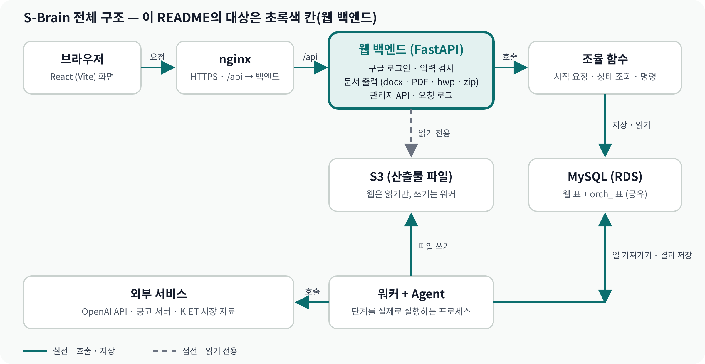
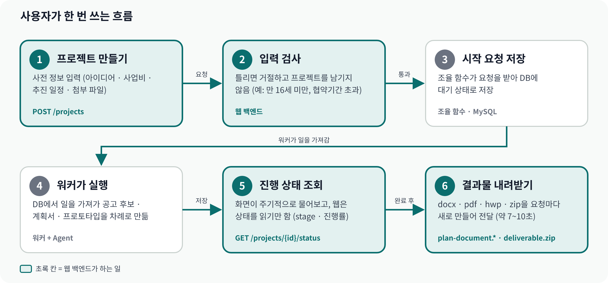
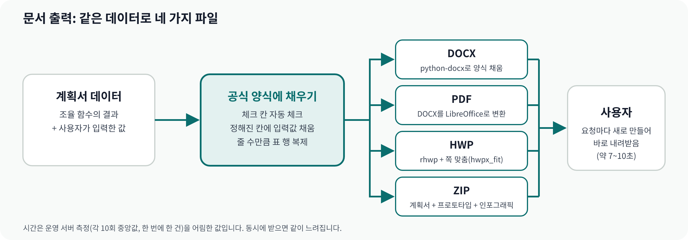
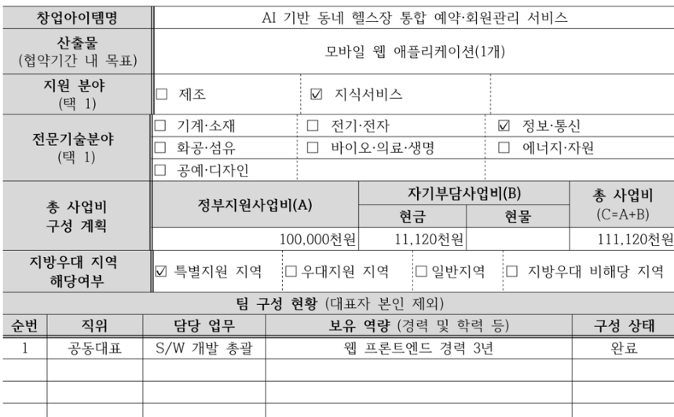

# S-Brain Web Backend

창업 아이템을 입력받아 지원 가능한 공고를 찾고, 사업계획서와 프로토타입을 생성하는 서비스 **S-Brain의 웹 백엔드**입니다. 프론트(React)와 조율 Agent(오케스트레이터) 사이에서 인증, 입력 검증, 상태 조회, 문서 출력을 담당합니다.


## 목차

1. [개요](#overview)
2. [핵심 설계](#design)
3. [아키텍처](#architecture)
4. [기술 스택](#stack)
5. [시작하기](#quickstart)
6. [환경변수](#env)
7. [오케스트레이터 · DB · 워커 연결](#orch)
8. [배포 (AWS)](#deploy)
9. [프로젝트 구조](#tree)
10. [API](#api)
11. [접근 제어](#access)
12. [문서 출력](#docs)
13. [성능 측정](#perf)
14. [테스트](#tests)
15. [DB 스키마와 마이그레이션](#db)
16. [런타임 파일과 로그](#files)
17. [운영 메모](#ops)
18. [트러블슈팅](#trouble)
19. [관련 문서](#more)

---

<a id="overview"></a>

## 개요

웹 백엔드는 Agent를 직접 호출하지 않습니다. 조율 함수로 명령을 보내고 진행 상태를 읽어 오며, 실제 단계 실행은 별도 워커가 맡습니다.

| 책임 | 내용 |
|---|---|
| 인증 · 계정 | 구글 ID 토큰 검증, JWT 세션(httpOnly 쿠키), 동의 · 탈퇴 · 프로필(마이페이지) |
| 입력 검증 | 프로젝트 생성 시 사전 정보(사업비 · 추진 일정 · 첨부 파일 등) 검사. 틀리면 거절하고 프로젝트를 남기지 않음 |
| 조율 함수 연동 | 시작 요청 · 상태 조회 · 재작성 · 삭제 명령 전달 |
| 문서 출력 | 계획서 `.docx` · `.pdf` · `.hwp`, 결과물 묶음 `.zip` 생성 |
| 산출물 파일 | 워커가 S3(또는 로컬 폴더)에 저장한 파일을 읽어 전달 (웹은 읽기 전용) |
| 관리자 API | 운영 현황 · 진행 현황 · 검증 정책 · 사용자 · FAQ · 파일 삭제 대기열 (메타데이터 한정) |
| 관측 | 요청 로그(개인정보 · 본문 미기록), `Server-Timing` · `X-Request-ID` 헤더 |

---

<a id="design"></a>

## 핵심 설계

| 주제 | 설계 | 근거 |
|---|---|---|
| 오케스트레이터 경계 | 웹은 `orch_*` 표를 직접 읽거나 쓰지 않고 허용된 함수(gateway)로만 접근. 웹 표에는 알림과 생성 실패 알림 두 가지만 INSERT | `app/orch/`, gateway 허용 목록 시험 |
| 소유자 중심 접근 제어 | `/projects/{id}/...`는 소유자만 접근. 남의 프로젝트는 존재 여부를 숨기는 404. 관리자도 `/admin/*` 메타데이터만 열람. 휴지통 프로젝트는 소유자에게도 404 | `test_admin_owner_check.py`, `test_archived_project_routes.py` |
| 세션 | 구글 ID 토큰 → Access JWT(30분) + Refresh Token 회전. 회전은 조건부 `UPDATE`로 토큰을 원자적으로 점유해 중복 · 동시 요청을 401로 거절 | `app/security.py` |
| 문서 출력 | `.docx`를 한 번 만들고 `.pdf`는 이를 그대로 변환해 레이아웃 코드를 두 벌로 만들지 않음. `.hwp`는 공식 양식을 rhwp로 채우고 쪽 맞춤(`hwpx_fit`) 적용. 변환 제한 시간 초과는 504 | `app/pdf_export.py`, `app/hwp_export.py` |
| 관측 가능성 | 요청 단위 로그(상태 · 처리 시간, 개인정보 · 본문 제외), `Server-Timing: app;dur=`, `X-Request-ID` ↔ 로그 `req_id` 대조 | `app/request_logging.py` |
| 안전한 배포 | 스크립트 3개로 서버 · 비밀 값 · 앱을 분리. 워커 점검(`--once`)이나 `/health` 확인이 실패하면 이전 코드로 자동 복귀. 비밀 값은 Parameter Store | `infra/aws/` |
| 멱등 마이그레이션 | 칸 설명 정리(007)는 옛 이름이 남은 칸만 고치고 여러 번 실행해도 안전. 스키마와 마이그레이션의 문구 일치를 정적 시험으로 검증 | `test_schema_comments.py` |

---

<a id="architecture"></a>

## 아키텍처



| 구성요소 | 역할 |
|---|---|
| 브라우저 (React) | 사용자 화면. 요청은 `/api/...`로 전송 |
| nginx | HTTPS 종단. `/api/`를 웹 백엔드로 전달 |
| **웹 백엔드 (FastAPI)** | **이 디렉터리.** 인증 · 입력 검증 · 문서 출력 · 관리자 API |
| 조율 함수 | 오케스트레이터(`sbrain`) 함수. 웹과 **같은 프로세스**에서 호출 |
| MySQL (RDS) | 웹 표와 `orch_` 표를 함께 쓰는 공유 DB |
| 워커 + Agent | 별도 프로세스. DB에서 일을 가져가 단계를 실행하고 Agent(OpenAI)를 호출 |
| S3 | 산출물 파일 저장소. 워커가 쓰고 웹은 읽기만 |

### 요청 흐름



1. 사용자가 프로젝트를 생성한다 (`POST /projects`) — 사전 정보 입력
2. 웹 백엔드가 입력을 검사한다 — 실패 시 거절하고 프로젝트를 남기지 않음
3. 조율 함수가 시작 요청을 DB에 대기 상태로 저장한다
4. 워커가 DB에서 일을 가져가 공고 후보 · 계획서 · 프로토타입을 순서대로 생성한다
5. 화면이 주기적으로 진행 상태를 조회한다 — 웹은 상태를 읽기만 한다
6. 완료 후 결과물을 내려받는다 — docx · pdf · hwp · zip을 요청마다 새로 생성

---

<a id="stack"></a>

## 기술 스택

| 영역 | 사용 기술 |
|---|---|
| 언어 · 프레임워크 | Python 3.12, FastAPI, Uvicorn, pydantic 2 |
| 데이터 | SQLAlchemy 2, PyMySQL, MySQL 8.4(RDS), 로컬 개발용 SQLite |
| 인증 | google-auth(ID 토큰 검증), PyJWT |
| 문서 | python-docx, LibreOffice(PDF 변환), rhwp v0.8.6(HWP), resvg-py(SVG → PNG) |
| 인프라 | AWS(EC2 · RDS · S3 · SSM Parameter Store), CloudFormation, nginx, systemd, Let's Encrypt |
| 품질 | pytest, ruff, GitHub Actions |

---

<a id="quickstart"></a>

## 시작하기

모든 명령은 **이 디렉터리(`app/main.py`가 있는 위치)** 에서 실행합니다.

| | 가벼운 확인 | 전체 흐름 |
|---|---|---|
| 용도 | 화면 · API 모양 확인 | 계획서 · 점수 · 산출물까지 end-to-end |
| DB | 개인 SQLite (더미 데이터) | MySQL |
| 필요한 것 | Python | MySQL + `sbrain` + 워커 |

### 1. 의존성 설치

```bash
python -m venv .venv
# Windows
.venv\Scripts\activate
# macOS/Linux
source .venv/bin/activate

pip install -r requirements.txt
pip install -r requirements-dev.txt pytest ruff   # 테스트 · 린트를 돌릴 때만 필요 (requirements-dev.txt에는 TestClient용 httpx2만 있어 pytest · ruff는 따로 설치)
```

### 2. 환경변수 준비

```bash
cp .env.example .env
```

값은 [환경변수](#env) 표를 참고해 채웁니다.

### 3. 서버 실행

**가벼운 확인 (MySQL 없이)**

```bash
DB_BACKEND=sqlite uvicorn app.main:app --reload --port 8000
```

**전체 흐름 (MySQL)** — `.env`에 `MYSQL_*`를 채운 뒤

```bash
uvicorn app.main:app --reload --port 8000
```

전체 흐름은 오케스트레이터 설치와 워커가 추가로 필요합니다 → [오케스트레이터 · DB · 워커 연결](#orch)

**SQLite 모드의 한계**

- 오케스트레이터가 SQLite를 지원하지 않아 계획서 · 점수 · 산출물 API는 503(`작업 서버가 아직 준비되지 않았어요`)을 반환합니다.
- 공고 표(`notices`)가 비어 있습니다. 더미 공고는 `python seed_dummy_notices.py`, 관리자 화면 초기 데이터는 `python seed_dummy_admin_data.py`로 넣습니다.
- SQLite 표는 `app_schema.sql`이 아니라 `models.py`로 생성되므로 MySQL과 타입이 100% 같다는 보장이 없습니다(로직 확인 용도).

### 4. 동작 확인

```bash
curl http://127.0.0.1:8000/health
# {"status":"ok"}
```

### 5. Swagger (선택)

API 문서(`/docs` · `/redoc` · `/openapi.json`)는 운영 보안상 기본으로 닫혀 있습니다. 로컬에서만 보려면 `.env`에 아래를 추가하고 서버를 재시작합니다.

```bash
ENABLE_API_DOCS=1
```

그다음 http://127.0.0.1:8000/docs 에 접속합니다.

> **주의** — 켜면 로그인 없이 관리자 API 목록까지 노출됩니다. 운영에서는 켜지 않습니다.

---

<a id="env"></a>

## 환경변수

`.env.example`을 복사해 `.env`를 만듭니다. 비밀 값은 git에 올리지 않습니다.

> **서버에는 `.env` 파일을 두지 않습니다.** 값은 AWS Parameter Store에 보관되고 `/etc/sbrain/web.env`로 생성되어 서비스에 전달됩니다. 이미 설정된 환경변수가 `.env`보다 우선하기 때문입니다 → [배포 (AWS)](#deploy)

### 필수

| 변수 | 용도 |
|---|---|
| `MYSQL_HOST` · `MYSQL_PORT` · `MYSQL_USER` · `MYSQL_PASSWORD` · `MYSQL_DATABASE` | MySQL 접속 정보. 파이프라인과 DB를 공유하므로 값이 같아야 함 |
| `GOOGLE_CLIENT_ID` · `JWT_SECRET` | 구글 로그인 · 세션 쿠키(JWT) 서명. 백엔드 전용 |
| `SBRAIN_ARTIFACT_ROOT` | 산출물 파일 저장소. 로컬 폴더의 **절대 경로** 또는 `s3://<버킷>/<접두어>`(스킴은 소문자만). 워커와 웹이 **같은 값**을 가리켜야 함. 비우거나 형식이 틀리면 웹은 뜨지만 산출물 파일 내려받기만 503 |
| `AWS_REGION` | `SBRAIN_ARTIFACT_ROOT`가 `s3://`일 때 필수(예: `ap-northeast-2`). 비우면 `AWS_DEFAULT_REGION`을 읽고, 둘 다 없으면 파일 내려받기만 503. 버킷 리전과 같게 설정 |

> **AWS 키(`AWS_ACCESS_KEY_ID` 등)는 `.env`에 넣지 않습니다.** 이 파일의 값은 `config.py`가 프로세스 환경변수로 옮기므로 넣으면 AWS 라이브러리가 그 키를 사용합니다. 자격 증명은 서버 IAM 역할로 받습니다.

### 기능 스위치

| 변수 | 기본 | 용도 |
|---|---|---|
| `REQUIRE_BUDGET_SCHEDULE` | 꺼짐 | 사업비 · 추진 일정 필수 입력(SB-332). `1`이면 사업비 1건 이상, 예비창업은 1 · 2단계 각 1건 이상, 협약기간 내 일정 1건 이상이 없는 프로젝트 생성을 `E-C1-REQUIRED`로 거절. 입력 화면이 배포된 **뒤에** 켜야 하며(먼저 켜면 모든 계획서 작성이 막힘) 오케스트레이터의 필수 확인 스위치도 같은 시점에 켬. AWS 서버의 `web.env`는 현재 `1` |
| `ENABLE_API_DOCS` | 닫힘 | `1` · `true` · `yes` · `on`일 때만 `/docs` · `/redoc` · `/openapi.json` 오픈. 운영 금지 |
| `COOKIE_SECURE` | 켜짐 | 로그인 쿠키의 Secure 속성. `http` 로컬 개발에서 `localhost`가 아닌 주소로 열 때만 `0` |

### 문서 출력

| 변수 | 기본 | 용도 |
|---|---|---|
| `RHWP_BIN` | `rhwp` (PATH) | `.hwp` 생성용 rhwp 실행 파일 경로. 용량 문제로 git에 없으므로 [공식 릴리즈](https://github.com/edwardkim/rhwp/releases/tag/v0.8.6)에서 받아 이 디렉터리에 `rhwp.exe`로 저장하고 `RHWP_BIN=./rhwp.exe` 지정. 없어도 서버는 정상이며 `.hwp` 다운로드만 500. 절차는 [`scripts/README.md`](scripts/README.md) |
| `RHWP_TIMEOUT_SECONDS` | `120` | rhwp 명령 **한 번**의 실행 제한(양의 정수, 0 이하이면 서버가 시작되지 않음). 초과 시 `504` + `code=HWP_CONVERSION_TIMEOUT` |
| `SOFFICE_BIN` | PATH · OS별 기본 경로 | `.pdf` 변환용 LibreOffice(`soffice`) 경로 (`.env.example`에는 없음) |

### 로컬 개발 · 기타

| 변수 | 용도 |
|---|---|
| `DB_BACKEND` | 비우거나 `mysql`이면 MySQL. `sqlite`는 MySQL 없이 개인 SQLite로 도는 보조 모드 |
| `SQLITE_PATH` | `DB_BACKEND=sqlite`일 때 DB 파일 경로 |
| `WEB_LOG_RETENTION_DAYS` | 요청 로그 보관 일수. `0`이면 자동 삭제 안 함(기본) |
| `WEB_LOG_MAX_BYTES` | 요청 로그 하루 최대 크기(기본 20MB, 초과 시 순번을 붙여 새 파일) |
| `ATTACH_MAX_FILES` · `ATTACH_MAX_MB` | 첨부 파일 개수 · 파일당 크기 상한(기본 5개 · 10MB). 초과 시 400 |
| `NTS_SERVICE_KEY` | 국세청 사업자등록정보 조회 API 키(선택, 없으면 사업자 조회만 비활성). 공공데이터포털에서 **디코딩 키**를 사용 — 인코딩 키는 이중 인코딩 오류 발생 |

---

<a id="orch"></a>

## 오케스트레이터 · DB · 워커 연결

웹 서버는 오케스트레이터(`agent-orchestration`의 `sbrain` 패키지)를 같은 프로세스에서 불러 씁니다. `requirements.txt`만으로는 계획서 · 점수 · 산출물 기능을 쓸 수 없습니다(MySQL 모드가 아니거나 `sbrain`이 없으면 해당 API는 503).

> 아래는 로컬에서 직접 띄울 때의 절차입니다. AWS 서버에서는 스크립트가 자동으로 수행합니다 → [배포 (AWS)](#deploy)

### 1. `sbrain` 설치

```bash
# 같은 가상환경에서 — sbrain과 의존성(pydantic · SQLAlchemy · PyMySQL · openai · python-dotenv · requests · beautifulsoup4)이 함께 설치됨
pip install -e ../../agent-orchestration
```

- `agent-orchestration/requirements.txt`만 설치하면 `sbrain` 자체가 빠집니다. `pyproject.toml`로 설치해야 의존성이 같이 설치됩니다.
- `beautifulsoup4`(`bs4`)는 시장 자료 크롤러가 import하므로 필요합니다. 실행 흐름에서 쓰지 않아도 **없으면 서버가 시작되지 않습니다**(`ModuleNotFoundError: No module named 'bs4'`).

### 2. DB 표 생성

웹 표와 오케스트레이터 표가 **같은 MySQL**에 있어야 합니다.

| 표 묶음 | 파일 |
|---|---|
| 웹 표 | `app_schema.sql` · `migrations/` |
| 오케스트레이터 표 (`orch_` 접두어) | `agent-orchestration/sql/orchestrator_schema.sql` |

오케스트레이터 스키마는 `CREATE TABLE IF NOT EXISTS`만 있어 여러 번 실행해도 안전합니다. 새 표가 생기면(예: SB-311의 `orch_file_deletions`) 다시 실행해야 하며, 표가 없으면 `GET /admin/file-deletions` 같은 API가 500을 반환합니다.

### 3. 워커 실행

단계를 실제로 진행하는 것은 별도 프로세스입니다. 웹만 띄우면 시작 요청이 쌓이기만 합니다.

```bash
sbrain-worker             # pip install -e 후 생기는 명령 (서버도 동일)
# 또는
python -m sbrain.worker   # 같은 DB · 같은 SBRAIN_ARTIFACT_ROOT
```

워커는 **1대만** 실행합니다. 공고 서버 호출을 하나씩 보내는 잠금이 프로세스 안에서만 걸리기 때문입니다.

### Agent 호출 없이 흐름만 확인

조율 T-C1 · T-C3만 실제 OpenAI를 호출하고 나머지는 스텁으로 동작합니다.

```bash
python scripts/prepare_local_mysql.py   # 로컬 DB 준비
python scripts/stub_worker.py           # 워커 대신 스텁 워커 실행
```

자세한 순서는 [`testing_guide.md`](testing_guide.md)를 참고하세요.

> **주의** — 옛 버전 오케스트레이터로 만든 실행 건은 새 버전이 읽지 못할 수 있습니다(`GET /result`가 500, 저장된 계획서의 칸 구성이 달라진 경우). 시연용으로 남긴 옛 실행 건은 새로 만드는 편이 안전합니다.

---

<a id="deploy"></a>

## 배포 (AWS)

서버 · DB 생성부터 앱 배포까지 스크립트 세 개로 수행합니다. 자세한 내용은 [`infra/aws/app/README.md`](../../infra/aws/app/README.md), [`infra/aws/README.md`](../../infra/aws/README.md)를 참고하세요(Windows는 Git Bash에서 실행).

```bash
bash infra/aws/up.sh           # 1. 서버 · DB 생성 (최초, 템플릿 변경 시)
bash infra/aws/app-env.sh      # 2. 비밀 값 입력 → Parameter Store (최초, 값 변경 시)
bash infra/aws/deploy-app.sh   # 3. 앱 배포 (코드 변경 시마다 · 최초 15~25분, 이후 5~10분)
```

| 구성 | 내용 |
|---|---|
| 웹 백엔드 | systemd `sbrain-web` — `uvicorn app.main:app`을 `127.0.0.1:8000`에서 실행(외부에서 8000 직접 접근 불가) |
| nginx | HTTPS 종단. `/api/` → 웹 백엔드, 그 외 → 프론트. 동일 주소라 CORS 불필요 |
| 워커 | systemd `sbrain-worker` — 1대, 무중단 교체 없음 |
| 환경변수 | `/etc/sbrain/db.env`(`MYSQL_*`) + `/etc/sbrain/web.env`(`GOOGLE_CLIENT_ID` · `JWT_SECRET` · `SBRAIN_ARTIFACT_ROOT` · `AWS_REGION` · `REQUIRE_BUDGET_SCHEDULE=1` · `COOKIE_SECURE=1` · `RHWP_BIN` · 선택 `NTS_SERVICE_KEY`). 직접 수정하지 않음 |
| 자동 설치 | nginx · certbot · LibreOffice Writer(PDF) · 한글 글꼴 · Node 22 · rhwp v0.8.6(실패 시 `.hwp`만 비활성) |
| 복귀 | 워커 점검(`--once`)이나 웹 `/health` 확인이 실패하면 이전 코드로 자동 복귀 후 중단 |

```bash
# 서버에서 확인
systemctl status sbrain-web sbrain-worker nginx
sudo journalctl -u sbrain-web -f      # 요청 로그 파일: /var/log/sbrain/web
```

> **주의** — 비밀 값은 `app-env.sh`로만 입력합니다(화면 · 명령줄 · 기록에 남지 않음). 값을 바꾸면 웹 · 워커를 재시작해야 반영됩니다. AWS 키는 넣지 않고 서버 IAM 역할을 사용합니다.

---

<a id="tree"></a>

## 프로젝트 구조

```text
web/backend/
├── app/
│   ├── main.py                  # FastAPI 앱 · 라우터 연결 · /health
│   ├── api_docs.py              # /docs 개폐 스위치 (ENABLE_API_DOCS)
│   ├── security.py              # 구글 로그인 검증 · JWT · 쿠키
│   ├── database.py · models.py · schemas.py
│   ├── routers/
│   │   ├── auth.py              # 로그인 · 갱신 · 동의 · 탈퇴
│   │   ├── profile.py           # 마이페이지 프로필 (최대 3개)
│   │   ├── projects.py          # 프로젝트 · 공고 · 시작 · 결과 · 문서 다운로드
│   │   ├── artifact_files.py    # 산출물 파일 · 결과물 zip
│   │   ├── uploads.py           # 첨부 파일 서빙
│   │   ├── biz_check.py         # 국세청 사업자 조회
│   │   ├── faqs.py
│   │   └── admin.py             # 관리자 API
│   ├── orch/                    # 조율 함수(gateway) · 응답 변환 · 오류 · 명령 로그
│   ├── plan_document_export.py  # .docx 생성
│   ├── pdf_export.py            # .pdf (LibreOffice 변환)
│   ├── hwp_export.py            # .hwp (rhwp)
│   ├── hwpx_fit.py · hwpx_rows.py   # hwp 쪽 맞춤 · 표 행 채우기
│   ├── request_logging.py · logging_config.py   # 요청 로그
│   └── pipeline_stages.py · notice_status.py · plan_texts.py · diagram_images.py
├── config.py                    # .env 로더 (수집 파이프라인 config.py 사본)
├── seed_dummy_admin_data.py · seed_dummy_notices.py   # 관리자 화면 초기 · 더미 데이터
├── app_schema.sql               # 웹 표 DDL (DB 칸 설명의 기준)
├── migrations/                  # 001 ~ 007
├── scripts/                     # 로컬 DB · 스텁 워커 · E2E · 부하 측정
├── tests/                       # pytest
├── docs/images/                 # README 다이어그램
├── testing_guide.md · unit_test_doc.md
└── requirements.txt · requirements-dev.txt · pyproject.toml
```

---

<a id="api"></a>

## API

전체 스펙은 `ENABLE_API_DOCS=1`로 Swagger(`/docs`)를 열어 확인합니다. 아래는 구성을 훑어보기 위한 요약입니다.

### 인증 · 계정 · 프로필

| 메서드 · 경로 | 설명 |
|---|---|
| `POST /auth/google` | 구글 ID 토큰 검증 → 세션 쿠키 발급 |
| `GET /auth/me` | 내 정보 |
| `POST /auth/refresh` | 세션 갱신 (Refresh Token 회전) |
| `PATCH /auth/consent` | 선택 동의 변경 |
| `POST /auth/logout` | 로그아웃 |
| `DELETE /auth/me` | 탈퇴 |
| `GET · POST /profile` · `PUT · DELETE /profile/{id}` | 마이페이지 프로필 |
| `POST /biz-check` | 국세청 사업자 조회 |
| `GET · POST /faqs` | FAQ |

세션은 httpOnly 쿠키이므로 프론트는 `fetch`에 `credentials: 'include'`를 지정해야 합니다.

### 프로젝트

| 메서드 · 경로 | 설명 |
|---|---|
| `POST /projects` | 프로젝트 생성 (사전 정보 입력 · 입력 검증) |
| `GET /projects` | 내 프로젝트 목록 (휴지통 제외) |
| `GET /projects/{id}` | 프로젝트 상세 |
| `GET /projects/{id}/status` | 진행 상태 (`stage` · `progress_percent`로 이어하기 화면 판별) |
| `GET /projects/{id}/match-candidates` · `POST …/rematch` | 공고 후보 · 재조회 |
| `POST /projects/{id}/generate` · `GET …/eligibility` | 공고 선택 · 자격 확인 결과 |
| `POST /projects/{id}/plan/start` | 계획서 작성 시작 (화면 5) |
| `POST /projects/{id}/prototype/start` | 프로토타입 제작 시작 (화면 6) |
| `POST /projects/{id}/final-review/start` | 산출물 확인 → 종합 평가 (화면 8 → 9) |
| `POST /projects/{id}/review/start` | 종합 평가 → 결과 통합 → 결과물 (화면 9 → 11). 확인 시 body `{"confirmed": true}` |
| `POST /projects/{id}/retry-task` · `GET …/rework-result` | 재작성 요청 · 결과 |
| `GET /projects/{id}/result` | 결과 (계획서 · 점수) |
| `DELETE /projects/{id}` | 휴지통 이동 (실행 건이 있으면 보관 처리, 없으면 삭제) |
| `DELETE /projects/{id}/permanent` | 완전 삭제 (복구 불가) |
| `GET /projects/notifications` · `PATCH …/notifications/{id}/read` | 알림 목록 · 읽음 처리 |

### 문서 · 파일

| 메서드 · 경로 | 설명 |
|---|---|
| `GET /projects/{id}/plan-document.docx` | 계획서 Word |
| `GET /projects/{id}/plan-document.pdf` | 계획서 PDF |
| `GET /projects/{id}/plan-document.hwp` | 계획서 한글 |
| `GET /projects/{id}/deliverable.zip` | 결과물 묶음 (계획서 · 프로토타입 · 인포그래픽) |
| `GET /projects/{id}/artifact-files/{key}` | 산출물 파일 단건 |
| `GET /uploads/{filename}` | 첨부 파일 (인증 · 소유권 확인) |

### 관리자 (`/admin`, 관리자 권한 계정만)

| 묶음 | 경로 |
|---|---|
| 운영 현황 | `/ops-summary` · `/agent-ops-summary` |
| 진행 현황 | `/items` · `/items/{id}/archive` · `/items/{id}/score-history` |
| 에이전트 기록 | `/agent-executions` · `/agent-tasks` |
| 검증 정책 | `/policy` · `/policy/scores` · `/policy/thresholds` · `/checklist` |
| 알림 · 복구 | `/generation-alerts` · `/recovery-items` |
| 파일 삭제 대기열 | `/file-deletions` · `/file-deletions/{id}/retry` |
| 공고 · 수집 | `/notices` · `/collection-status` |
| 사용자 · FAQ | `/users` · `/faqs` |

### 상태 확인

| 경로 | 설명 |
|---|---|
| `GET /health` | `{"status":"ok"}` — 로그인 없이 프로세스 기동 여부만 확인 |

오류 응답에는 `code`가 포함됩니다(예: `E-C1-REQUIRED`, `HWP_CONVERSION_TIMEOUT`, `FILE_NOT_FOUND`).

---

<a id="access"></a>

## 접근 제어

| 규칙 | 내용 |
|---|---|
| 소유자 전용 | `/projects/{id}/...`는 소유자만 접근. 남의 프로젝트는 존재 여부를 숨기는 404 |
| 관리자 열람 범위 | 관리자는 `/admin/*`의 메타데이터만 열람. 사용자의 계획서 · 결과 · 산출물 내용을 읽거나 시작 · 삭제할 수 없음 (SB-418) |
| 휴지통 프로젝트 | 목록에서 숨길 뿐 아니라 `/status` 등 모든 경로가 404. 휴지통에서 다시 지우는 `DELETE`와 `…/permanent`만 허용 (SB-421) |
| API 문서 | `/docs` · `/redoc` · `/openapi.json`은 기본 비공개, `/test-db`는 제거 (SB-419) |
| 쿠키 | 로그인 쿠키는 `Secure` 기본 활성 (`COOKIE_SECURE`) |
| 로그 | 요청 로그에 개인정보 · 요청 본문을 기록하지 않음 |

---

<a id="docs"></a>

## 문서 출력

웹 서버가 계획서 데이터로 직접 생성합니다. 요청마다 새로 만들어 응답으로 바로 내려주며 디스크에 남기지 않습니다.



| 형식 | 생성 방식 | 필요 조건 |
|---|---|---|
| `.docx` | `python-docx`로 공식 양식을 채움 (`plan_document_export.py`) | `requirements.txt` |
| `.pdf` | 생성한 `.docx`를 LibreOffice(headless)로 그대로 변환 (`pdf_export.py`). 양식 레이아웃 코드를 두 벌로 만들지 않기 위한 방식 | LibreOffice(`soffice`) + 한글 폰트 |
| `.hwp` | 공식 `.hwp` 양식을 rhwp로 채움 (`hwp_export.py`) | rhwp 실행 파일 (`RHWP_BIN`) |
| `.zip` | 계획서 + 프로토타입 + 인포그래픽 묶음 (`artifact_files.py`) | 산출물 저장소 (`SBRAIN_ARTIFACT_ROOT`) |

> **리눅스 서버** — LibreOffice와 한글 폰트가 **둘 다** 필요합니다. 폰트가 없으면 변환은 성공해도 PDF의 한글이 모두 네모로 출력됩니다. docx가 '맑은 고딕'을 쓰므로 `fonts-nanum` 같은 대체 폰트가 필요합니다.

### 출력 예시

팀 샘플 시나리오(LOCALFIT)로 실제 백엔드가 생성한 HWP 일반현황 표입니다(rhwp 렌더링).



- 체크 칸은 입력값에 맞춰 자동 체크 (지원 분야 · 전문기술분야 · 지방우대)
- 입력값은 양식의 정해진 칸에 채움 (창업아이템명 · 산출물 · 사업비 금액)
- 표는 입력한 줄 수만큼 채우고, 양식 행이 모자라면 행을 복제

### hwp 쪽 맞춤 (`hwpx_fit.py`)

개요 표가 두 쪽에 걸치고 글꼴이 섞이던 문제를 보정합니다. 서체를 하나로 통일하고, 표가 한 쪽에 들어가는 가장 큰 본문 크기를 자동 선택하며, 그림이 있는 쪽에는 `<별첨>` 표시를 넣습니다. 요약이 너무 길어 가장 작은 글자로도 한 쪽에 들어가지 않으면 다음 쪽으로 이어집니다.

---

<a id="perf"></a>

## 성능 측정

운영 서버 측정(2026-10-20, 브라우저에서 요청~응답 기준). 읽기 전용 호출만 사용했고 데이터 변경은 없습니다.

| 항목 | 결과 |
|---|---|
| 조회 API 7개 | 중앙값 18~97ms (각 50회, 오류 0) |
| 동시 요청 | `/projects` 60개 동시 → 전체 0.73~0.96초, 오류 0 |
| 문서 생성 (한 건씩, 각 10회 중앙값) | docx 6.5초 · zip 7.1초 · pdf 8.3초 · hwp 9.9초 |
| 긴 입력 end-to-end (1회 측정) | 처음부터 결과물까지 22.9분 — 계획서 작성 17.7분, 프로토타입 5분 |

**알려진 한계**

- 문서는 요청마다 새로 만들기 때문에 같은 문서를 연달아 받아도 시간이 줄지 않고, 3건을 동시에 받으면 모두 단건의 2.7~2.9배로 늘어납니다.
- 문서 내려받기 직후 들어온 다른 요청 1건이 약 19초 지연되는 현상이 재현됐습니다(3회 중 3회). 원인은 아직 확인하지 못했습니다.
- 위 값은 한 시간대 · 한 PC에서 측정한 것이며 긴 입력 end-to-end는 1회 값이라 대표 값으로 보지 않습니다.

---

<a id="tests"></a>

## 테스트

### 자동 테스트

```bash
pytest tests/ -q
ruff check .
```

- 로컬 기준 940건이 수집됩니다(2026-10-23). **MySQL이나 rhwp 실행 파일이 없으면 일부는 건너뜁니다**(`skipped`, 실패 아님).
- `tests/conftest.py`가 SQLite로 자동 전환하므로 팀 공유 DB에 접속하지 않습니다.
- 파일별 검증 내용은 [`unit_test_doc.md`](unit_test_doc.md), 실제 워커 + MySQL로 end-to-end를 돌리는 방법은 [`testing_guide.md`](testing_guide.md)를 참고하세요.

### 스크립트 (`scripts/`)

| 파일 | 용도 |
|---|---|
| `prepare_local_mysql.py` | 로컬 MySQL 준비 |
| `stub_worker.py` | Agent 호출 없이 동작하는 스텁 워커 |
| `e2e_*.py` | 실제 워커 + MySQL 기반 흐름별 E2E (관리자 · 삭제/탈퇴 · 실패 재개 · 동시 중단 · 산출물 파일 · 사업비/일정 등) |
| `load_check.py` | 부하 · 응답 시간 확인 |
| `rehearse_migration.py` | 옛 스키마에 마이그레이션 001 · 002 · 004 · 005 · 006을 적용해 `app_schema.sql`과 같아지는지 확인 (003 · 007 제외) |
| `clean_hwp_template.py` | hwp 양식의 예시 상자를 지운 템플릿 생성 |

rhwp 설치 · 확인 절차는 [`scripts/README.md`](scripts/README.md)를 참고하세요.

---

<a id="db"></a>

## DB 스키마와 마이그레이션

- **`app_schema.sql`** — 웹 표 DDL. DB 칸 설명(COMMENT)의 기준입니다.
- **`migrations/`** — 이미 만들어진 DB에 적용하는 변경. 새 DB는 `app_schema.sql`에 이미 반영되어 있습니다.

| 파일 | 내용 |
|---|---|
| `001_proofread_logs_worker_table.sql` | 윤문 기록 · 워커 표 |
| `002_drop_dummy_pipeline.sql` | 옛 더미 파이프라인 표 삭제 |
| `003_checklist_items_sb125.sql` | 체크리스트 항목 (SB-125) |
| `004_budget_phase.sql` | 사업비 단계 |
| `005_target_customer.sql` | 목표 고객 |
| `006_notification_kind_result.sql` | 알림 종류에 '결과' 추가 |
| `007_fix_stale_column_comments.sql` | 지운 옛 표 이름이 남은 칸 설명 4곳 정리 (SB-420). 칸 설명만 변경하며 여러 번 실행해도 안전 |

`007`은 실제 MySQL에서 실행해 확인했습니다. `scripts/rehearse_migration.py`는 001 · 002 · 004 · 005 · 006만 적용하므로 007은 포함하지 않습니다. 운영 DB에는 007 파일을 직접 실행하고, 적용 후 파일 상단 주석의 확인 쿼리가 0행이면 정리가 끝난 것입니다.

`sbrain_schema.dbml`은 ERD용 파일이며 칸 설명이 최신이 아닐 수 있습니다.

---

<a id="files"></a>

## 런타임 파일과 로그

아래 경로는 모두 **이 디렉터리(`app/`와 같은 레벨)** 기준입니다.

| 위치 | 내용 | 비고 |
|---|---|---|
| `dev.db` | SQLite DB 파일 | `DB_BACKEND=sqlite`로 지정했을 때만 생성(`app/database.py`). `.gitignore` 처리 |
| `logs/web-YYYY-MM-DD.log` | 요청 단위 로그(시각 · API · 성공/실패 · 처리 시간) | DB에 남기지 않고 파일로만 기록(`app/logging_config.py`, `app/request_logging.py`). 이름 · 이메일 등 개인정보는 기록하지 않음. 하루 20MB를 넘으면 `web-YYYY-MM-DD.2.log`처럼 순번을 붙여 회전. 자동 삭제는 기본 꺼짐(`WEB_LOG_RETENTION_DAYS=0`) |
| `uploads/` | **사용자 첨부 파일만** (최대 `ATTACH_MAX_FILES`개 · 파일당 `ATTACH_MAX_MB`MB) | `GET /uploads/{filename}`로만 제공하며 인증 · 소유권 확인(`app/routers/uploads.py`). `.gitignore` 처리. 산출물(프로토타입 · 인포그래픽 등)은 여기 없고 `SBRAIN_ARTIFACT_ROOT`(S3 또는 로컬 폴더)에 있음 |
| `__pycache__/` · `.pytest_cache/` · `.ruff_cache/` | 파이썬 · pytest · ruff 캐시 | `.gitignore` 처리, 삭제해도 무방 |

`.hwp` / `.pdf` 다운로드(`app/hwp_export.py` · `app/pdf_export.py`)는 요청마다 임시 파일로 변환해 응답으로 바로 내려주고 디스크에 남기지 않습니다.

AWS 서버에서는 `uploads/`가 `/var/lib/sbrain/web/uploads`로, `logs/`가 `/var/log/sbrain/web`으로 연결되어 새 코드를 배포해도 유지됩니다(`infra/aws/app/install-app.sh`).

---

<a id="ops"></a>

## 운영 메모

### 공고 검색 지연 확인

브라우저 개발자 도구의 Network에서 `POST /projects`와 `GET /projects/{project_id}/match-candidates`의 시간을 각각 확인합니다. API 응답의 `Server-Timing: app;dur=...`는 앱이 응답 헤더를 준비할 때까지의 처리 시간(ms)입니다. 업로드 · 응답 다운로드 · 프록시 · 네트워크 지연을 포함한 전체 시간은 Network의 Timing과 비교합니다. `X-Request-ID`를 `logs/web-YYYY-MM-DD.log`의 `req_id`와 대조하면 해당 요청의 상태 코드와 `elapsed_ms`를 찾을 수 있습니다. 인증된 실제 사용자 세션으로 확인하며 로그인 정보나 요청 본문을 로그에 추가하지 않습니다.

관리자 공고 목록은 필요한 컬럼만 조회하며 원본 JSON · 본문 · 임베딩 파일 내용은 목록 응답을 위해 가져오지 않습니다. 관리자 임베딩 유무는 DB에서 NULL 여부만 계산합니다. `recruitment_status=unknown`은 수집 당시 모집 상태를 확보하지 못했다는 원본 값으로 API에서도 보존합니다. 이를 모집중으로 바꾸거나 날짜만으로 확정하지 않습니다.

### 관리자 공고 표시 상태 (`display_status`)

`GET /admin/notices`는 원본 `recruitment_status`와 별도로 `display_status`를 반환합니다. 프런트엔드는 상태 문구에 `display_status`를 사용하면 됩니다. DB 원본은 변경하지 않습니다. 한국 날짜(UTC+9)를 요청당 한 번 계산하며 다음 우선순위를 적용합니다.

1. 시작일이 마감일보다 늦은 비정상 기간: 확인 필요
2. 마감일이 오늘 이전: 마감
3. 시작일이 오늘 이후: 접수 예정
4. 원본 `closed`: 마감 / 원본 `open`: 모집중
5. 두 날짜 사이(시작일 · 마감일 당일 포함): 접수기간 내 · 원문 확인
6. 그 외: 확인 필요

원본 상태를 알 수 없고 기간 유형이 `budget_exhaustion`, `rolling`, `until_filled`이면 기간 안에 있더라도 확인 필요로 표시합니다. 날짜만으로 예산 잔액이나 실제 모집 여부를 확정하지 않습니다. 날짜에 시각 정보가 없으므로 마감일 당일의 시간 단위 조기 마감은 판정하지 않습니다.

### 관리자 재채점 편차와 체크리스트 저장

운영 현황의 층별 점수 변화(문서 · 코드 점검 · 계획서 대조 3층)는 최초 점수 자체가 아니라 **최초 채점과 최근 재작성 후 채점의 차이**입니다. 오케스트레이터는 채점 Task(문서 `T-V1`, 코드 점검 · 계획서 대조 `T-V2`)의 성공한 실행 기록 점수를 그 실행 건의 배점으로 환산하고, 최초 채점과 재작성 이후 채점이 모두 있는 최근 12개월 활동 실행 건만 편차 표본으로 셉니다. 일반 재시도 · 재수행은 재작성 표본을 대신하지 않습니다. 표본 수는 채점 횟수가 아니라 비교 가능한 실행 건 수입니다. 평균은 소수 첫째 자리로 반올림합니다. 웹 API는 층 이름을 `doc` · `code` · `plan`으로 바꾸고 `round1_avg`, `round2_avg`, `delta_avg`, `sample_count`를 반환합니다. 프런트는 `sample_count=0`일 때 `-`를 표시하고, 표본이 있으면 차이가 0이어도 `0점`을 표시합니다. 운영 현황 진입 시 조회하며 자동 갱신하지 않습니다. 기존 화면의 '1회 → 2회' 문구는 이 집계의 정확한 의미인 '최초 → 최근 재작성 후'로 변경하는 것이 맞습니다(이번에는 프런트 코드를 변경하지 않음).

`PUT /admin/checklist`는 부분 변경을 지원하되 생략된 기존 항목까지 포함한 **최종 활성 항목**의 카테고리별 합계를 15점으로 검증합니다. 중복 ID는 422, 없는 ID는 404로 거부하며, 검증 전에 ORM 값을 변경하지 않아 실패한 요청은 기존 설정을 보존합니다. 카테고리 전체 비활성화는 기존 정책대로 허용합니다. 동시 변경은 ID 순서의 행 잠금으로 직렬화합니다(SQLite 테스트에서는 행 잠금을 검증하지 않으므로 실제 MySQL 동시성 검증은 별도입니다).

### 운영 안정성 보완

- Refresh Token은 유효하고 폐기되지 않은 행을 조건부 UPDATE로 점유한 요청만 회전합니다. 중복 · 동시 요청의 패자는 401이며 새 토큰을 만들지 않습니다. 새 토큰 발급 실패 시 기존 토큰 폐기도 롤백합니다.
- 관리자 점수 분포는 하한 포함 · 상한 미포함으로 집계하며 최상위의 100점만 상한에 포함합니다. 59.5 · 69.5 · 79.5 · 89.5점도 정확히 한 구간에 포함합니다. 화면 구간 라벨은 유지합니다.
- HWP 임시 파일은 생성 직후 파일 디스크립터를 닫습니다. 준비 · 변환 단계에서 실패해도 정리를 시도하며, 정리 실패는 로그에 남기고 원래 변환 오류를 보존합니다.
- `RHWP_TIMEOUT_SECONDS`는 rhwp 명령 한 번의 실행 제한입니다(양의 정수, 기본 120초). 기존 PDF 변환 제한과 같은 초기값을 쓰되 Agent R-11 정책과는 별도 운영 설정입니다. 실제 변환 시간 · 프록시 제한을 측정해 조정해야 하며 전체 다운로드의 총시간 제한은 아닙니다. 시간 초과 시 자식 프로세스를 종료 · 수거하고 API는 `504`, `code=HWP_CONVERSION_TIMEOUT`을 반환합니다. 자동 재시도나 Agent 재개를 추가하지 않으며 사용자가 다운로드를 다시 요청할 수 있습니다.

---

<a id="trouble"></a>

## 트러블슈팅

| 증상 | 원인 | 해결 |
|---|---|---|
| 서버가 시작되지 않고 `No module named 'bs4'` | 시장 자료 크롤러가 `bs4`를 import | `pip install -e ../../agent-orchestration` (또는 `beautifulsoup4` 설치) |
| 계획서 · 점수 · 산출물 API가 503 | MySQL 모드가 아니거나 `sbrain` 미설치 | [오케스트레이터 설치](#orch)와 `DB_BACKEND` 확인 |
| 시작해도 진행되지 않음 | 워커 미실행 (웹만 띄우면 요청이 쌓이기만 함) | `sbrain-worker` 실행 |
| `GET /admin/file-deletions` 등이 500 | `orch_` 표 없음 (새 표 생성 후 스키마 재실행 누락) | `orchestrator_schema.sql` 재실행 (여러 번 실행해도 안전) |
| 산출물 파일 내려받기가 503 | `SBRAIN_ARTIFACT_ROOT` 미설정 · 형식 오류, 또는 S3인데 `AWS_REGION` 없음 | 두 값 확인. 워커와 같은 값이어야 함 |
| `.hwp` 다운로드가 500 | rhwp 실행 파일 없음 | [`scripts/README.md`](scripts/README.md)대로 설치 후 `RHWP_BIN` 설정 (서버 자체는 정상) |
| `.hwp` 다운로드가 504 (`HWP_CONVERSION_TIMEOUT`) | 변환이 `RHWP_TIMEOUT_SECONDS` 초과 | 재요청. 빈번하면 값을 늘리고 프록시 제한도 확인 |
| 옛 실행 건의 `GET /result`가 500 | 옛 버전 오케스트레이터로 만든 실행 건이라 칸 구성이 다름 | 실행 건을 새로 생성 |
| 로그인했는데 인증되지 않은 것처럼 동작 | 프론트 요청에 `credentials: 'include'` 누락, 또는 `http` 로컬에서 `COOKIE_SECURE`가 켜짐 | 프론트 `fetch` 옵션 확인, 로컬 `http`에서는 `COOKIE_SECURE=0` |
| 로컬에서 `/docs`가 404 | API 문서는 기본 비공개 | `.env`에 `ENABLE_API_DOCS=1` 후 재시작 |
| `pytest`에서 일부가 skipped | MySQL이나 rhwp 없음 | 실패가 아님. 필요하면 해당 환경 준비 |

---

<a id="more"></a>

## 관련 문서

| 문서 | 내용 |
|---|---|
| [`testing_guide.md`](testing_guide.md) | 웹 백엔드 테스트 방법 (자동 테스트 · 실제 워커 + MySQL · 부하 · 로그) |
| [`scripts/README.md`](scripts/README.md) | rhwp 설치 · 확인 절차, 스크립트 설명 |
| [`unit_test_doc.md`](unit_test_doc.md) | 단위 테스트 문서 |
| [`app_schema.sql`](app_schema.sql) | 웹 표 DDL |
| [`migrations/`](migrations/) | 이미 만든 DB에 적용하는 변경 |
| [`infra/aws/app/README.md`](../../infra/aws/app/README.md) | AWS 앱 배포 |
